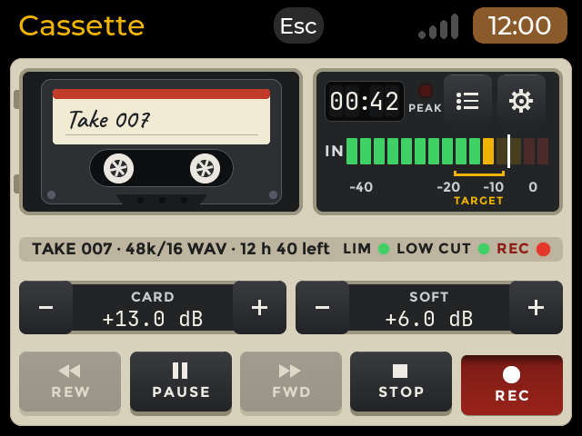
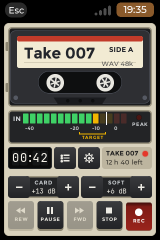
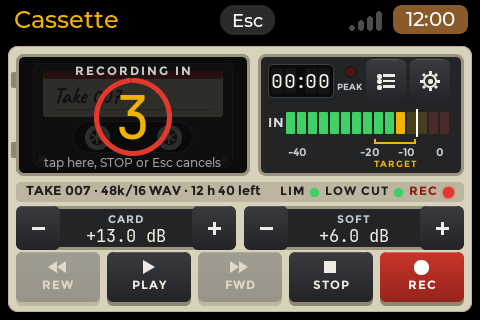
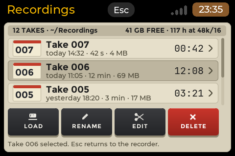
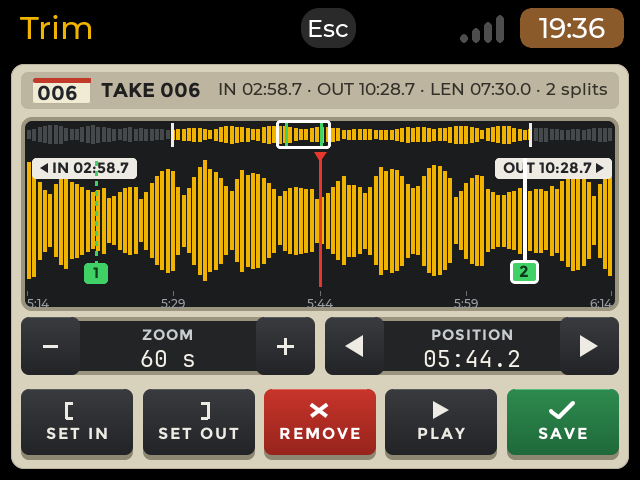
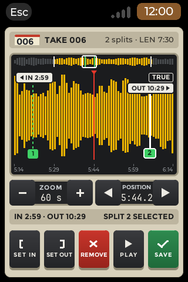
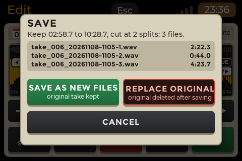
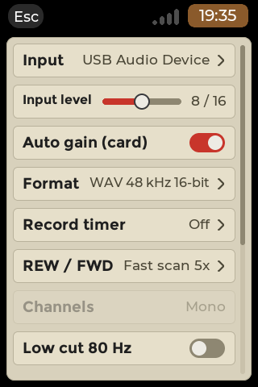
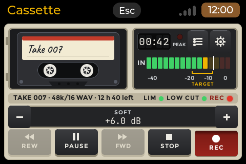

# Cassette (`cassette`)

A sound recorder for the cyberdeck with the look of a tape deck: it records from any USB sound card or headset to WAV
(Broadcast Wave) files, shows a level meter with a target zone, adds software gain, starts on a timer, trims and splits
takes, and plays them back with a 5x scan. Native fullscreen app on the launcher's `cp0_lvgl`, MIT, version 0.1.0,
category Tools. Plan: launcher `docs/dev/tasks/016-cassette-recorder.md`; study: launcher report 058.

- **Crash-safe.** A take is synced to the card every 10 s (5-30 s, setting) and its header is rewritten after every
  sync, so a power cut loses at most the audio since the last sync; the next start repairs the take (see
  [Crash safety](#crash-safety-and-repair)).
- **Private.** No cloud, no network: nothing leaves the board. The takes stay in `~/Recordings`.
- **Any USB sound card.** The card is found by its name and USB identity, never by its number (the number changes across
  reboots). The card's own level, auto gain and mute are shown when the card has them, and left as found otherwise.

## Screenshots

All ten were rendered on a PC by the headless harness (`build.sh host`, version 0.1.0) from the UI's scenes on
their synthetic model (generated levels and takes, no sound hardware); real-hardware captures will replace them.
Each comes from a scene in `tests/scenes` (named below): the build writes its PNGs to
`<CDK_BUILD>/host/out/<scene>/<size>/`. The Store shows the same ten pictures, in this order.

| | |
| --- | --- |
|  |  |
| Recorder while recording: the meter in the target zone, CARD and SOFT, 640x480, rendered on a PC (`a-recording`) | Recorder while recording, 480x320, rendered on a PC (`a-recording`) |
|  |  |
| Recorder in portrait (PDA mode), 320x480, rendered on a PC (`a-recording`) | The record timer's countdown over the cassette window, 480x320, rendered on a PC (`c-countdown`) |
|  |  |
| Recordings list with the free space and the four actions, 480x320, rendered on a PC (`i-list`) | Trim and split: IN, OUT, two split points (one selected: REMOVE), the overview strip, 640x480, rendered on a PC (`j-trim`) |
|  |  |
| Trim and split in portrait, 320x480, rendered on a PC (`j-trim`) | The save box: three files from two split points, save as new files or replace the original, 480x320, rendered on a PC (`k-save`) |
|  |  |
| Settings in portrait: the card's own rows first, 320x480, rendered on a PC (`h-settings`) | A card without a level control: SOFT takes the full width, 480x320, rendered on a PC (`b-nocard`) |

## What it does

Four pages and two boxes:

- **Recorder** (the first page). The cassette window with two hubs that turn while the deck runs (no tape is drawn),
  the take's name on the label, the counter, the **Recordings** (L) and **Settings** (S) buttons beside it, the LED
  meter (15 steps over -40 to 0 dBFS, one bar per channel, peak hold, the PEAK lamp, the target zone from -18 to
  -6 dBFS marked on the scale), the **CARD** stepper (the card's own level, only when the card has a level control) and
  the **SOFT** stepper (software gain 0 to +24 dB on top of the card's level, with a clip counter; SOFT takes the full
  width on a card without a level control), and the five deck keys REC, PLAY / PAUSE, STOP, REW and FWD. REW and FWD
  scan at 5x while held (or jump 5 s per tap, setting). The PLAY / PAUSE key shows the current state: PLAY latched while
  a take plays (also while REW / FWD is held), PAUSE latched while a take or a recording is paused, PAUSE unlatched while
  recording (what a press does), PLAY unlatched when stopped (the table is in [`docs/KEYS.md`](docs/KEYS.md)). Both hubs
  turn the same way, like a real cassette's: counterclockwise while recording and playing, counterclockwise at 3x for
  FWD, clockwise at 3x for REW (a 5 s jump turns them that way for about 300 ms), still when paused or stopped. The meter
  shows the live input level when idle and while recording; while a take plays or is paused it shows the played level on
  L and R instead (a mono take on both bars, the 5x cue while scanning; paused, the bars fall away; the PEAK lamp is the
  recording's clip warning and stays off). With the **Record timer** set (3, 10 or 20 s; default Off),
  REC starts a countdown over the cassette window instead: the meter stays live, a tap, STOP or Esc cancels it (nothing
  is written), at zero the take starts. Without a card the cassette window reads "No sound input found. Plug in a USB
  sound card or headset." and a card plugged in later is found by itself.
- **Recordings.** The takes in the folder, newest first, with their length and size; LOAD, RENAME, TRIM and DELETE
  (which asks first). A take repaired after a power cut is marked as such. LOAD puts the take into the deck with a
  cassette animation (the old cassette drops out, the new one falls in with a small bounce, the name is written onto the
  label in handwriting; 0.9 s, keys are ignored meanwhile but Esc) and PLAY then plays that take; it is dimmed while a
  take records. A double tap or Enter on a row previews the take, again on the same row stops the preview and rewinds it;
  closing the list stops it. Previewing never changes the loaded take.
- **Trim and split.** The take as a waveform that scrolls under a fixed play marker (drag, a 0.1 s stepper or the keys),
  ZOOM from the whole take down to a 2 s window, a thin overview strip of the whole take, the IN and OUT handles and any
  number of numbered split points (a tap selects one and the SPLIT key becomes REMOVE). SAVE opens the save box.
- **Settings.** Input (the capture card), Input level, Auto gain (card) and Mic mute (card) (only when the card has
  those controls), Format (WAV in 0.1), Record timer, REW / FWD (Fast scan 5x or Jump 5 s), Channels (what the card
  records, read-only), Low cut 80 Hz, Limiter, Sync every (5, 10, 20, 30 s), Folder, File prefix, Take number (the number the next take gets; a page with the number large,
  -1 / +1, -10 / +10 and -100 / +100 steppers, Reset to 1 and Set; Esc cancels; 1 to 9999), Auto-split (at 4 GiB,
  or Off: one RF64 file) and Output (the playback device, when there is more than one).
- **Save box.** SAVE AS NEW FILES (the default: the original stays) or REPLACE ORIGINAL (asks once more; the original is
  deleted only after every result is written and synced). **Confirm box** for delete and replace.

A short notice at the bottom of every page tells what happened (a take saved, the card unplugged, a save that failed
and why, an action refused while recording).

### Keys and touch

Every key also has its control on the screen; Esc is "back" everywhere (a box, a picker or a text field closes first;
on the recorder Esc ends the app, during the countdown it cancels the countdown). The header's Esc does the same.
The full map is [`docs/KEYS.md`](docs/KEYS.md).

| Page | Key | Does |
|---|---|---|
| Recorder | R | REC |
| | Space | PLAY / PAUSE |
| | X | STOP |
| | , (comma) / . (period) | REW / FWD: held, scan backwards / forwards at 5x |
| | L / S | the recordings list / the settings |
| | Esc | end the app (cancels a running countdown) |
| Recordings | Up / Down | move the selection |
| | Enter | PREVIEW the selected take (again on it: stop and rewind) |
| | L | LOAD the selected take into the deck |
| | N / T / Delete | RENAME / TRIM / DELETE (asks first) |
| | S | the settings |
| | Esc | back to the recorder |
| Trim and split | Left / Right | move the marker 0.1 s (with Shift 1 s) |
| | Up / Down | zoom in / out |
| | I / O | SET IN / SET OUT |
| | Enter | SPLIT at the marker; REMOVE while a split flag is selected |
| | Tab | select the next split flag (the marker moves to it) |
| | Space | PLAY |
| | S | SAVE (the save box) |
| | Esc | back to the list, nothing saved |
| Save and confirm boxes | Left / Right, Tab | move between the buttons |
| | Enter | choose (without a move: SAVE AS NEW FILES, or CANCEL in the confirm box) |
| | Esc | cancel |
| Settings | Up / Down | move |
| | Enter, Right | change or open the row; on a slider row Left / Right step it |
| | L | the recordings list |
| | Esc | back (a choice list first, then the recorder) |

Text entry (rename, the file prefix) uses a Bluetooth or USB keyboard; the launcher's fallback keyboard appears only
when none is connected.

## Files the app keeps

- `~/Recordings/` (setting Folder): the takes, `<prefix>_<take>_<YYYYMMDD-HHMM>.wav` (prefix `take` by default, for
  example `take_006_20261108-1105.wav`). The take number counts up and never repeats, even after a delete (Settings > Take number moves the
  next number to any value from 1 to 9999: only the next take changes, existing files are never renamed; a number
  that the same prefix already uses in the folder is skipped, so the next free one is taken and the row shows it). The
  number has at least 3 digits (`007`) and grows past 999 (`1000`); the counter is the file `.take-counter` in the folder. The date reads `nodate`
  until the clock has been set (the boards have no clock that runs while they are off: a wrong date in a name is worse
  than none). A trim or a split is named after its source plus the next free number (`take_006_20261108-1105-1.wav`,
  `-2.wav`, ...); a trim saved with REPLACE ORIGINAL keeps the original's name.
- `~/Recordings/.journal/<take>.json`: one small journal per take, open while it records (see below).
- `~/Recordings/<take>.wav.peaks`: the waveform overview of a take, built once when the trim page first opens it and
  checked against the take's size and time on every use.
- `~/.config/cassette/settings.json`: the settings, and per card its level, auto gain and mute, re-applied at every
  start (the card's mixer resets at every reboot). Written atomically. Delete it to reset.

## Crash safety and repair

The capture thread fills an 8 s ring buffer and never waits for the card; a writer thread drains it to the file in
large blocks, calls `fdatasync` every sync interval and then rewrites the header sizes, so the file on the card is a
valid WAV up to the last sync at any moment. The take's journal says "open" while it records and "closed" when it
ends. At the next start the app looks for takes whose journal is still open, and for WAV files in the folder whose
header still holds placeholder sizes, and rewrites their header sizes from the real file length (a partial last frame
is cut off). The audio itself is never rewritten. Repair is safe to interrupt: running it again finishes the job. The
take is then marked **repaired** in the list.

Trim, split and replace write each result to a temporary file, sync it and rename it into place: a crash at any point
leaves either the original or the finished result, never half a file. The writer stops a take cleanly, with a notice,
when the free space falls under 200 MB or the card is unplugged. A take that reaches 4 GiB continues in a new file
(Auto-split, default) or becomes one RF64 file (Auto-split Off).

## Requirements

A screen of at least 480x320 (portrait 320x480 in PDA mode), a USB sound card, a USB headset or a board's own input,
and the user in the `audio` group (the images add the first user to it; else `sudo usermod -aG audio $USER`, then log
out and in). CyberdeckZero Launcher with full-screen app support. Packages: `libfreetype6, libinput10, libxkbcommon0`
and `libasound2t64 | libasound2` (the ALSA library: it is opened at run time, never linked). When a sound server holds
the card, the app falls back to the server's ALSA device. arm64 and amd64.

The app records at the card's own sample rate: 48000 Hz, else 44100 Hz, else the highest rate the card offers at or below
48000 Hz (a USB headset in its call profile records 16000 Hz only), and only when every offered rate is above 48000 Hz the
lowest one. A card that offers no rate at all is refused. The take, its header, the counter and the lengths all use that
rate; playback on an output that does not play the take's rate goes through ALSA's own conversion (`plughw:`) at the right
speed. Through the sound server the take is S16 at 48000 Hz.

## Install

Settings > Apps (category Tools). By hand: `sudo dpkg -i cassette_0.1.0_arm64.deb`.

The package also installs `/usr/share/APPLaunch/bin/cassette-probe`, a listen-only command line tool for the board
tests: it lists the capture cards, what each offers and its mixer controls, then opens each card (or the one given
with `--card NAME_OR_BY-ID_PATH`) for 2 s (`--seconds N`) and counts the frames, including the sound-server fallback.
It writes no file and changes no setting; `--no-open` only lists.

## Known limits

- WAV only in 0.1. FLAC and Opus come later (the Format row shows the take's rate, depth and channels; there is no
  other choice yet).
- No background recording (plan 016, D10): the app owns the screen while it records, and leaving it stops the take
  safely. `X-Background` is not set; this is revisited when multitasking is switched on.
- Playback plays the app's own takes (WAV) through the card's playback side when it has one, else the default device.
- The record timer makes no sound.
- Not yet measured on a board: the animation cost on a Pi Zero 2 W and the behaviour of every card (board tests,
  [`tests/BOARD-TESTS.md`](tests/BOARD-TESTS.md)).

## Privacy

The recordings are private: the app has no network code, sends nothing anywhere and keeps the takes in the folder you
chose. Its test fixtures are synthetic (generated tones, noise and hand-built truncated files); no real recording is
part of this repository.

## The code

- `src/core/` (no LVGL, unit tested on a PC, a fake for every system call): `alsa/` (libasound through `dlopen`, card
  enumeration by name and by-id, the open policy with the sound-server fallback, the capture thread, the mixer
  controls; `tools/probe_main.cpp` is `cassette-probe`), `ring`, `wav` (WAV / BWF / RF64 header), `writer`, `journal`,
  `repair`, `dsp/` (meter, gain, DC blocker, low cut, limiter), `takes/` (naming, the take list, settings), `edit/`
  (the peak overview, trim and split), `playback/`, `app/` (the controller: the five-key state machine and the timer).
- `src/ui/`: the pages, the cassette window, the meter, the steppers, the boxes, the layout fitting.
- `src/bind/`: the controller bound to the UI (the view mapping, the actions, the worker thread).
- `src/demo/`: the scripted sound system of the bound scenes and of `CASSETTE_DEMO=1` (no sound hardware).

## Build and test

```sh
wsl -e sh <repo>/apps/cassette/tests/run.sh             # the core tests (no LVGL)
wsl -e sh <repo>/apps/cassette/tests/<suite>/run.sh     # alsa, dsp, takes, edit, playback, app, ui, bind
wsl -e sh <repo>/apps/cassette/build.sh host            # UI and binding tests + the headless scenes
wsl -e sh <repo>/apps/cassette/build.sh cross           # arm64 binary and cassette-probe into root/
wsl -e sh <repo>/apps/cassette/build.sh cross --arch amd64   # amd64 binary and cassette-probe into root.amd64/
python3 tools/make_registry.py --only cassette --out <dir outside the repo>   # a local package, no registry
python apps/cassette/tools/make_icon.py                 # the icon
```

Nine test suites: the core (ring, WAV header, writer, journal, repair, a writer killed at random points), alsa (a
scripted ALSA: busy fallback, unplug, overruns, two cards, index change), dsp, takes, edit (trim and split compared
byte for byte, a killed editor), playback, app (the controller), ui and bind. `build.sh host` also runs the scenes:
the UI's own on its synthetic model (`tests/scenes`) and the bound app on the scripted sound system
(`tests/bind/scenes`), at 480x320, 320x480, 640x480 and further sizes, with the layout checks; the PNGs land in
`$CDK_BUILD/host/out/<scene>/<size>/`. Builds run from a WSL native-filesystem LF copy with fresh build folders
(`CDK_BUILD`, `LVBUILD`). Board protocol: [`tests/BOARD-TESTS.md`](tests/BOARD-TESTS.md).

## Credits and licences

Our code, MIT, written from scratch from the published format documents (EBU Tech 3285 Broadcast Wave, EBU Tech 3306
RF64) and the ALSA library's API documentation. Linked: `cp0_lvgl` of the CyberdeckZero launcher (MIT) and LVGL (MIT);
the fonts (Montserrat and JetBrains Mono, SIL OFL 1.1) are the launcher's, read at run time. One font is compiled into
the binary: the handwriting of the cassette label is Caveat SemiBold (Copyright 2014 The Caveat Project Authors,
<https://github.com/googlefonts/caveat>, SIL OFL 1.1, no Reserved Font Name; licence text in
[`src/ui/fonts/OFL-Caveat.txt`](src/ui/fonts/OFL-Caveat.txt), regenerated by
[`tools/make_handwriting_font.sh`](tools/make_handwriting_font.sh)). The ALSA library
(alsa-lib, LGPL-2.1-or-later) is opened at run time from the system, neither linked nor shipped. See the package's
`copyright` file.

## Changes

- 0.1.0: first version: recorder, recordings list, trim and split, settings, save and confirm boxes; WAV / BWF takes
  with journal and repair; meter with target zone, software gain, record timer, playback with 5x scan; 480x320 and
  320x480 minimum layouts; `cassette-probe` in the package. Cards that record at other rates than 48000 or 44100 Hz
  (16000 Hz speech headsets) are opened at their own rate. The PLAY / PAUSE key shows the current state (PLAY latched
  while playing, PAUSE latched while paused); both hubs turn the same way (3x for REW / FWD, clockwise for REW); the
  meter shows the played level while a take plays. The recordings list has LOAD (the take goes into the deck with a
  cassette animation, PLAY plays it; the name on the cassette label is handwriting, Caveat SemiBold) and a preview that
  stops on a second double tap; a paused take reads PAUSED in the strip.
