# Cassette: user guide

Cassette is a sound recorder that looks like a tape deck. You plug a USB sound card or a USB headset into a
CyberDeck board, press REC, and the sound goes into a file in the `Recordings` folder: a WAV file, or, if you choose
it, a smaller FLAC or Ogg Opus file. You can listen again, cut a take with trim and split, and watch a level meter
while you record.

This guide describes the app as it is in the source (the 0.1 line, with FLAC and Ogg Opus). Pictures are rendered on a PC from the app's test scenes
(a made-up sound source: the tones and levels are not real audio); the two captures at the end of
[Screen sizes](#screen-sizes-and-layouts) come from real boards. How to refresh the pictures:
[MAKING-SCREENSHOTS.md](MAKING-SCREENSHOTS.md).

Contents:
[What you need](#what-you-need) |
[First run](#first-run) |
[The recorder screen](#the-recorder-screen) |
[Recording](#recording) |
[Listening while you record](#listening-while-you-record-monitor) |
[Playing](#playing) |
[The recordings list](#the-recordings-list) |
[Trim and split](#trim-and-split) |
[Settings](#settings) |
[Formats](#formats-wav-flac-and-ogg-opus) |
[Take number](#take-number) |
[Screen sizes](#screen-sizes-and-layouts) |
[Keys](#keyboard-shortcuts) |
[Files](#files-and-where-they-live) |
[Crash safety](#crash-safety) |
[Troubleshooting](#troubleshooting) |
[Limits](#limits)

## What you need

- **A USB sound card or a USB headset with a microphone.** Cassette records from any sound card that Linux sees as a
  capture device. It finds the card by its name and USB identity, never by its number, so a card that gets a different
  number after a reboot is still the same card for Cassette.
- A CyberDeck board with the launcher and a screen of at least 480x320 (portrait 320x480 in PDA mode). Square
  screens such as the HackBerry's 720x720 and 480x480 have their own layout.
- Your user must be in the `audio` group. The board images do this for the first user; otherwise run
  `sudo usermod -aG audio $USER` and log out and in again.
- Nothing else for WAV. For **FLAC** and **Ogg Opus** the board needs a few libraries (`libflac`, `libopusenc0`,
  `libopus0`; see [Formats](#formats-wav-flac-and-ogg-opus)); without them those formats are simply not offered and
  Cassette records WAV. There is no network code in the app: nothing you record leaves the board.

**Cards used so far** (named by the owner; the source does not hold the results of the board tests, so what each
card does is described only where the code says it): the PCM2902 USB sound card with a microphone, the UC02 USB-C
headset, the Jabra Evolve 65, the Link 370 headset, the Apple USB-C dongle. Cards differ in what they offer, and the
app adapts: some have a level control, some have auto gain or a mute switch, some can also play sound out (needed for
live monitoring), some record only at 16000 Hz (see [Troubleshooting](#troubleshooting)).

## First run

1. Plug the card in, then open **Cassette** from the home grid (category Tools).
2. Cassette picks the first capture card it finds and opens it at once. The level meter moves when you make a sound,
   even before you record anything. The folder `~/Recordings` is created if it is not there.
3. If you have more than one card, open Settings (the gear button or the **S** key) and choose the card in the
   **Input** row. Cassette remembers your choice, and the card's own level, auto gain and mute for each card.
4. Press **REC** (red key, or **R**) to start a take, **STOP** (or **X**) to end it.

If no card is found, the cassette window says *No sound input found. Plug in a USB sound card or headset.* REC is
dimmed. Plug a card in: Cassette finds it by itself within a few seconds.

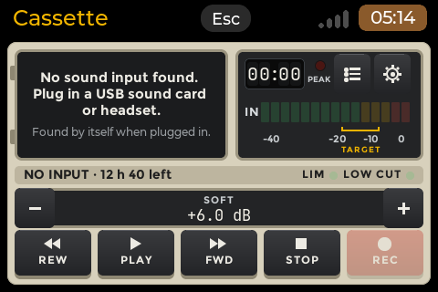

With no take on the board yet (first start, or after the last take was deleted), the deck holds a **blank
cassette** with an empty label. REC works as usual; the label fills in when the first take exists.

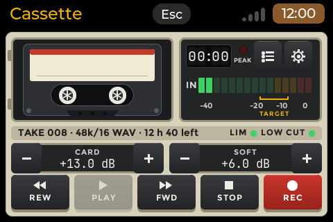

## The recorder screen

The recorder is the first page. This is the landscape layout at 640x480 (the deck's screen) while recording; the
numbers are explained below. The other layouts hold the same parts in another order (see
[Screen sizes](#screen-sizes-and-layouts)).

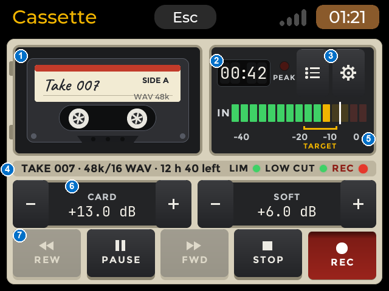

| No. | Region | What it shows |
|---|---|---|
| 1 | **Cassette window** | The cassette with its label (the take's name, `SIDE A`, the format such as `WAV 48k`). The two hubs turn while the deck runs: counterclockwise while recording and playing. They stand still when stopped or paused. With no card, the window shows the message about no sound input instead. |
| 2 | **Counter** | The time of the take: while recording, how long the take is; while playing or paused, the position in the take. It reads 00:00 when the deck is idle. The **PEAK** lamp beside it is explained below. |
| 3 | **Recordings** and **Settings** buttons | Open the recordings list (key **L**) and the settings (key **S**). |
| 4 | **Info strip** | The take's name in capitals, the format and the time left on the card (for example `TAKE 007 · 48k/16 WAV · 12 h 40 left`); while a take plays it reads `PLAYING TAKE 006 · 05:44 / 12:08`. At the right: the **LIM** and **LOW CUT** lamps (lit when those switches in Settings are on) and, while the deck works, a red **REC** or green **PLAY** word with a lamp. A notice replaces the strip for a few seconds (a take saved, the card unplugged, a refusal). On narrow screens this is a small box next to the counter. |
| 5 | **Level meter** | 15 bars from -40 to 0 dBFS, one row per channel (a mono card has one row, a stereo card two: L over R). Details below. |
| 6 | **CARD** and **SOFT** gain | CARD is the sound card's own level (shown only when the card has a level control). SOFT is gain added by Cassette, 0 to +24 dB. Each has a minus and a plus button, 1 dB a step. |
| 7 | **The five keys** | REW, PLAY / PAUSE, FWD, STOP, REC. |

### The level meter

- The scale marks -40, -20, -10 and 0. The bars go from green through amber to red at the top. Under the scale a
  bracket marks the **TARGET** zone, -18 to -6 dBFS. Aim for your loudest words to reach the TARGET zone and not
  go above it.
- A thin **peak hold** mark stays on the highest bar for 1.5 s and then falls back.
- The **PEAK** lamp lights red when a sample reaches -1 dBFS or higher and stays on for 1 s. That is the warning that
  the recording may be clipping. Turn the level down.
- The meter shows the live input when the deck is idle, counting down or recording. While a take plays or is paused it
  shows the **played** level on L and R (a mono take on both rows); the PEAK lamp stays off then.
- The **MON** lamp (bottom left of the meter, under IN) is explained in the next-but-one section.

| Level in the TARGET zone | Level too low |
|---|---|
|  | 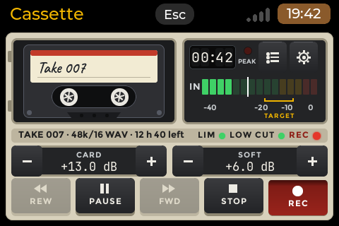 |
| Good. | The bars stop in the green: raise CARD (or SOFT). |

### CARD and SOFT

- **CARD** changes the sound card's own recording level (its mixer). Cassette stores it per card and puts it back
  when the app starts, because the card's mixer resets at every reboot. With no level control on the card, CARD is not
  drawn and SOFT takes the full width.
- **SOFT** multiplies the signal in software, 0 to +24 dB. Use CARD first, SOFT when CARD is at its top. SOFT also makes the card's hiss louder (see
  [Troubleshooting](#troubleshooting)).

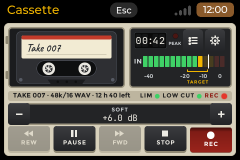

### The five keys

| Key | Does | Notes |
|---|---|---|
| **REW** | Hold: scan backwards at 5x (or jump back 5 s, see Settings) | Needs a take loaded. Dimmed while recording. A **5x** badge shows on the cassette window while it scans. |
| **PLAY / PAUSE** | Plays the loaded take; pauses and resumes | While recording, it pauses and resumes the **same** take. |
| **FWD** | Hold: scan forwards at 5x (or jump 5 s) | Same as REW. |
| **STOP** | Stops recording or playing | Also cancels the record countdown. |
| **REC** | Starts a take (after the countdown, if one is set) | Dimmed with no card, and while a take records. Pressing REC during playback stops the playback and starts recording. |

The PLAY / PAUSE key shows what is going on: it reads **PLAY** and is not pressed when you are stopped; **PLAY**
pressed in while a take plays (also while you hold REW or FWD); **PAUSE** pressed in while a take or a recording is
paused; **PAUSE** not pressed while recording (that is what a press would do). REC stays pressed in while a take
records or is paused.

## Recording

1. Check the meter and the gain. Say something at the loudest level you expect.
2. Press **REC**. The hubs start to turn and the counter runs. The take is a new file; its name is on the label.
3. **PLAY / PAUSE** pauses the take (the counter stops, the hubs stop); press it again to go on in the same file.
4. **STOP** ends the take. It becomes the loaded take (the one PLAY plays). A short notice says what happened.

**Record timer.** In Settings, *Record timer* can be Off (default), 3 s, 10 s or 20 s. With a timer, REC starts a
countdown over the cassette window (3, 2, 1 ...). The meter stays live. A tap on the window, STOP or Esc cancels it:
nothing is written. At zero the take starts. The timer makes no sound.

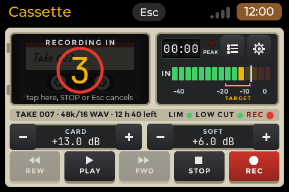

**Names and numbers.** Each take is a file named `take_006_20261108-1105.wav` (`.flac` or `.opus` for those formats):
the prefix (`take` by default), the take number (at least 3 digits), and the date and time. The take number only goes up and **never repeats**, even
after you delete takes (see [Take number](#take-number) to move it). Until the board's clock is set from the
network, the date reads `nodate`: a wrong date in a name would be worse than none. On screen the name shows as
`Take 006`. You can change the prefix in Settings (*File prefix*) or rename a take in the list; both follow the
[same rules](#the-recordings-list): a name may hold spaces (`my band_006_20261108-1105.wav`).

**Long takes: auto-split.** A WAV file cannot hold more than 4 GiB the usual way (FLAC and Opus takes are split at
the same size, each part a complete file of its own). With *Auto-split* at **At 4 GiB**
(default) a take that reaches 4 GiB goes on in a new file with `_p2` added to the name, then `_p3`. With **Off**, the
take is one RF64 file (a WAV variant for big files; most players read it). For scale: 4 GiB is about 12 hours of mono
audio at 48 kHz and 16 bit (a stereo card fills it in about 6).

**When a take ends by itself.** Cassette ends a take cleanly, keeps what was recorded, and shows a notice when:
the free space falls under 200 MB, the card is unplugged, or the disk reports an error. If audio could not be written
in time (a slow SD card or a card that stalled), a red `lost 0.3 s` is shown at the end of the info strip during the
take, and the take's journal keeps the figure.

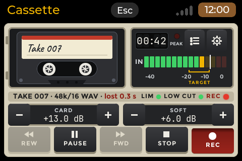

**Esc.** On the recorder, Esc ends the app. A take that records is stopped and kept first. Cassette does **not**
record in the background: the app owns the screen while it records.

**Mono and stereo.** Cassette records the channels the card gives (one or two); Settings > Channels shows which. A
stereo card gets two meter rows.

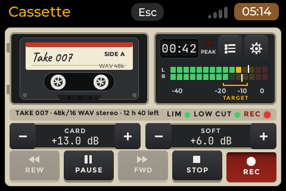

**Low cut and Limiter.** Two switches in Settings. *Low cut 80 Hz* removes rumble and wind noise (a high-pass filter).
*Limiter* is a simple peak limiter without look-ahead. Both are off by default; when on, small `LIM` and `LOW CUT`
lamps show in the info strip of the landscape layout. They change the recording.

**Sound server.** If another program (the sound server of a desktop board) holds the card, Cassette records through the
server instead and says so: *Recording through the sound server: the card is in use*, and `(server)` appears next to
the format. When the card is opened directly and a sound server runs, Cassette tells you the other apps cannot use the
card while it records.

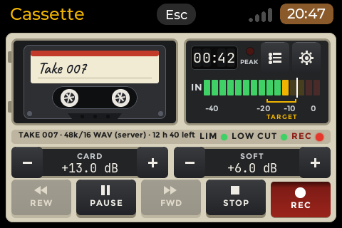

## Listening while you record: Monitor

**Monitor** plays the microphone into the headphones of the same card, so you hear yourself while you speak.
Settings > **Monitor** is a switch (off by default); **Monitor level** is its volume, 0 to 100 % in steps of 5
(default 50 %), dimmed while Monitor is off.

- Both rows appear **only when the selected card can also play sound** (a headset can, a bare microphone card cannot).
- It runs on the recorder screen: idle, during the countdown, while recording, and while a recording is paused.
- You hear yourself about 50 ms late. That is fine for checking the voice, not for singing in time.
- What you hear is what is recorded (after the gain and the filters), at the monitor level. The monitor level never
  changes the recording.
- **Use headphones.** With speakers the microphone hears the monitor and you get an echo or a howl. This is why
  Monitor is off by default.
- **It is off during playback.** The monitor stops when you play, scan or preview a take and while the trim page is
  open; it comes back when playback ends.
- If the monitor cannot start (for example another program holds the card's output) the notice *Monitor unavailable*
  shows and the monitor stays off. The recording is not affected.
- **Sidetone on a Jabra.** A headset such as the Jabra Evolve 65 has its own hardware sidetone: you hear yourself
  even with Monitor off. That is not an ALSA control and Cassette cannot change it. With Monitor on you get a second,
  later copy on top: leave Monitor off for that headset. Monitor is meant for cards without sidetone (a cheap USB
  dongle, the UC02 headset).

The **MON lamp** shows whether the monitor is playing right now: lit green while it runs, dark when the switch is off,
during playback, or after a failure. It is drawn only when the card has a playback side.

## Playing

The deck plays the **loaded take**: the newest take at start, the take you just recorded, or the one you loaded from
the list. Its name is on the cassette label.

- **PLAY / PAUSE** plays the take from where the tape is (after STOP, or a take that ended, that is the start).
  Pause keeps the position.
- **REW and FWD, held:** the take scans at 5x (like fast tape: the sound is audible, higher in pitch), with a
  **5x** badge. Let go and normal play continues, or the pause continues if you were paused. The hubs turn at
  3x speed: FWD the same way as in play, REW the other way round.
- **Jump mode:** in Settings, *REW / FWD* can be **Jump 5 s**: every tap moves 5 s, and a held key repeats about
  three times a second.
- **STOP** stops and rewinds to the start. The counter reads 00:00.
- **End of the take:** when playback reaches the end the deck stops by itself and the hubs stand still. Scanning
  forward to the end ends the take the same way; scanning back to the start also stops the deck. PLAY then plays from
  the start.
- **Blank cassette:** with no take, PLAY, REW and FWD are dimmed.
- REC during playback stops it and starts a new take (or its countdown).

The sound goes out of the card's own playback side when it has one, otherwise the default device. If the board has
more than one output, Settings > **Output** lets you choose.

| Playing | Paused | REW held |
|---|---|---|
| 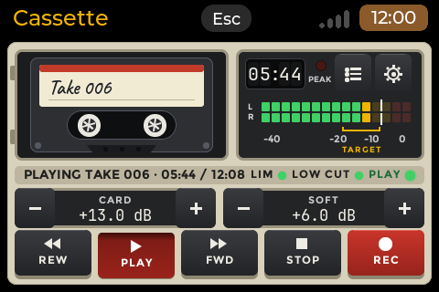 | 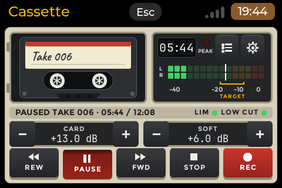 | 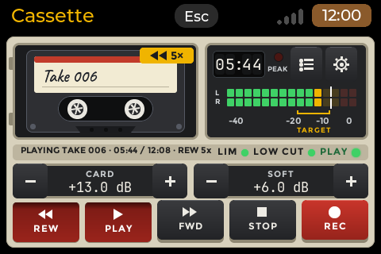 |
| PLAY pressed in, the meter shows the played level on L and R | PAUSE pressed in, the meter falls away | 5x badge, REW and PLAY pressed in |

If the playback device is lost, the deck pauses and the notice *The sound output was lost* shows.

## The recordings list

Press the list button (or **L**). The takes are listed newest first. Each row has the take number on a small sticker,
the name, when it was made (`today 11:05`, `yesterday 18:20`, a date, or `nodate`), its length and size, and its length
again in large figures at the right. A take that was repaired after a power cut says
`repaired`; a take that cannot be read says `damaged`. The detail line ends with the format of the file: `WAV`, `FLAC`
or `OPUS` (a folder can hold all three). The detail stays on one line: on a narrow screen (320 x 480, or a portrait
screen) a row that would not fit leaves out its size first, then writes the date shorter (`yest 18:20`, `18:20`,
`31 Dec 25`); the format is never left out. A strip shows how many takes there are, the folder and the free space.

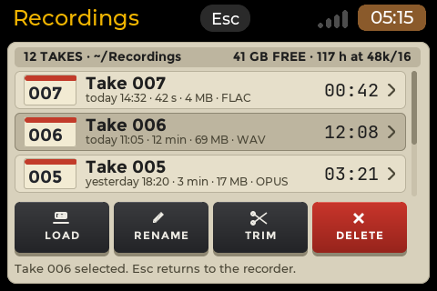

A name too long for one line wraps (at spaces; a single word wider than the row breaks by character) and its row grows
to show every line, with the details line under it; the rows below move down. Names are never cut with an ellipsis.

Four actions: **LOAD**, **RENAME**, **TRIM**, **DELETE**. A tap selects a row.

- **LOAD** puts the selected take into the deck and returns to the recorder. The cassette in the window drops out,
  the new one falls in with a small bounce, and its name is written onto the label in handwriting. It takes about
  0.9 s; keys are ignored meanwhile except Esc, which ends the animation at once. Then PLAY plays that take. LOAD is
  dimmed while a take records, a recording is paused or the countdown runs.

  | 0 ms | 190 ms | 420 ms | 750 ms |
  |---|---|---|---|
  |  | 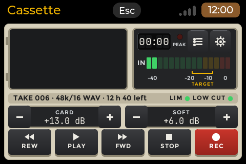 | 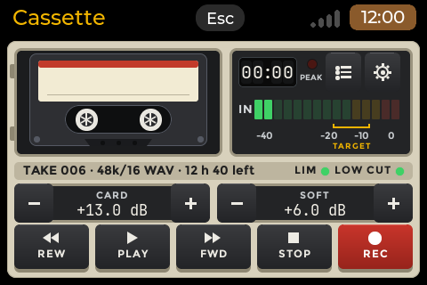 | 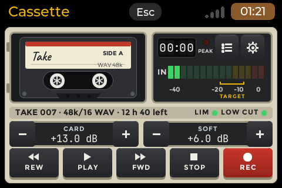 |
  | the old cassette is still there | the window is empty | the new cassette falls in | landed, the name is half written |

- **Preview:** double-tap a row (or press Enter) to listen to it without loading it. Double-tap the same row again to
  stop and rewind. Closing the list stops the preview. A preview never changes the loaded take.

  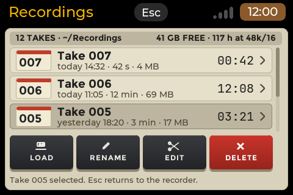

- **RENAME** opens a text box to change the **prefix** of the name (the first part of the file name); the take
  number, the date, the time and the extension (`.wav`, `.flac`, `.opus`) stay. With no keyboard connected the launcher
  shows its on-screen keyboard. The loaded take stays loaded under its new name.

  The rules, the same for RENAME and for the File prefix setting:

  - Letters, digits, **spaces**, `-` and `_`; 1 to 24 characters. Spaces typed before or after the name are dropped.
  - A **counter** under the entry shows how many of the 24 characters are used (`9/24`). It is muted grey, turns
    amber from 20 to 23 and red at 24; the entry takes no more than 24.
  - A refusal says why: *Not renamed: up to 24 characters*, *use letters, digits, space, - and _*, *the name is
    empty*, or *this file is not a Cassette take and cannot be renamed* (a file you put in the folder yourself that
    does not follow the take name pattern). Two more causes can appear: *that name is taken* and *the take is in
    use*. The File prefix setting says *Prefix not changed:* followed by the same reasons.

  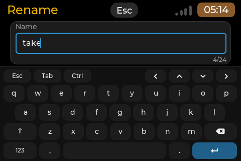

  | 9 of 24 | 21 of 24 | 24 of 24 |
  |---|---|---|
  | 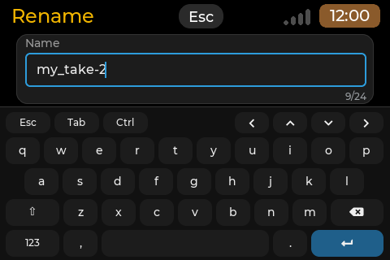 | 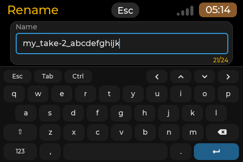 | 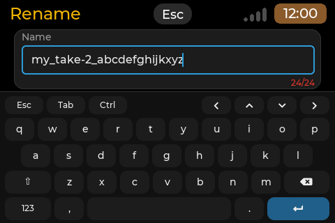 |

- **TRIM** opens the [trim and split page](#trim-and-split) for the take. It is refused while a take records.
- **DELETE** asks first (a box with DELETE and CANCEL; Enter without moving means CANCEL). Deleting
  the loaded take empties the deck and the blank cassette returns at once. A take that plays or is open for trimming
  cannot be deleted.

  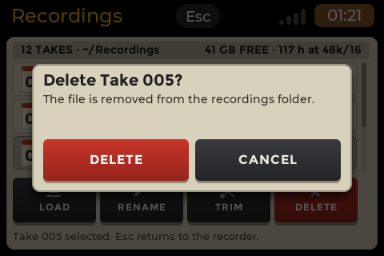

## Trim and split

Open it from the list with **TRIM** (key **T**). It cuts a take without losing quality. A WAV take is copied as it is. FLAC and Opus
takes are cut as [described below](#trim-and-split-of-flac-and-opus-takes).

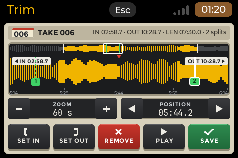

What you see: the top line with the take, IN, OUT, the kept length (LEN) and the number of splits; a thin **overview**
strip of the whole take (the part to keep is amber, the cut part grey, the white frame is the part shown below); the
**waveform** of the window under a fixed red **marker** (the play position); the **IN** and **OUT** handles (a chip
at the edge when they are outside the window); and any number of numbered green **split flags**.

- **Moving the marker:** drag the waveform sideways, use the POSITION buttons (0.1 s a step), or the Left / Right
  keys (Shift: 1 s). Flags and handles are not dragged.
- **ZOOM** from the whole take down to a window of about 2 s (the stepper shows the window's length; Up / Down keys).
  The waveform scrolls with the marker.
  The first time you open a take, Cassette builds its waveform overview (the `.peaks` file); for a long take that
  may take a moment (a FLAC or Opus take is decoded for it, with a progress bar).
- **SET IN / SET OUT** (keys I and O) set the start and end of the kept part at the marker. They are refused if IN
  would not be before OUT. Moving IN or OUT removes split flags that fall outside.
- **SPLIT** (Enter) puts a split flag at the marker, between IN and OUT. Add as many as you like. A tap on a flag
  selects it (white); then the key reads **REMOVE** and removes it. Tab selects the next flag.
- **PLAY** (Space) plays the kept part from the marker (or from IN) and stops at OUT.
- **SAVE** (S) opens the save box. Esc goes back to the list and saves nothing.

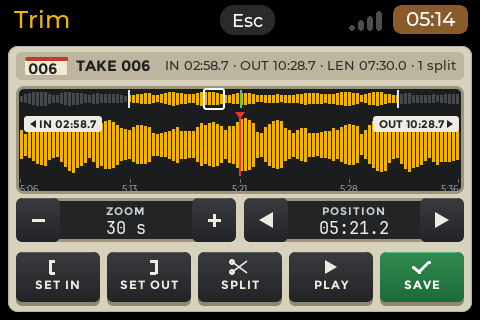

**The save box** says what is kept (`Keep 02:58.7 to 10:28.7, cut at 2 splits: 3 files.`) and lists the files that
will be written: one file for each part between IN, the split flags and OUT, with its length.

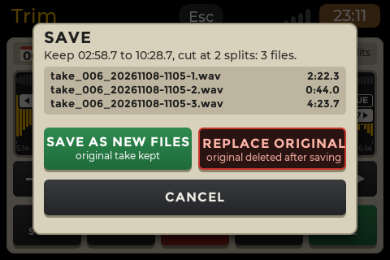

- **SAVE AS NEW FILES** (the default; Enter without moving): the original take stays. The new files are named after
  it with `-1`, `-2` ... added (`take_006_20261108-1105-1.wav`). Edit numbers are never reused for the same take, even
  if you deleted a result.
- **REPLACE ORIGINAL**: asks once more (*Delete the original take?* "It is deleted only after every new file is
  written and synced."). A single trimmed part takes the original's name. With several parts the original is removed
  after all parts are written.

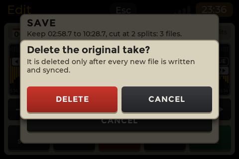

A result keeps the format of its take (`-1.wav`, `-1.flac`, `-1.opus`). Saving is safe against a power cut: each result is written to a temporary file, synced, then renamed into place. A
crash leaves the original or the finished results, never half a file. A notice tells the result (*Saved 3 new files*,
*Saved, original replaced*, or *Save failed* and the reason).

## Settings

Open with the gear button or **S**. Changes apply at once and are saved at once. Rows with a switch flip when you
tap them; rows with a choice open a list; sliders step with Left / Right. Esc closes a choice list first, then goes
back to the recorder.

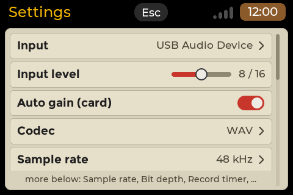

The card's own rows depend on what the selected card has:

| Row | What it does | Default | Appears |
|---|---|---|---|
| **Input** | The capture card. Cassette remembers it. | the first card | always; cannot change while a take records |
| **Input level** | The card's recording level (same as CARD on the recorder). | what the card has | only when the card has a level control |
| **Auto gain (card)** | The card's own automatic gain, if it has one. | as set on the card, then remembered | only when the card has it |
| **Mic mute (card)** | Mutes the card's microphone. | off | only when the card has it |
| **Codec** | The file type of new takes: WAV, FLAC or Opus. The row shows the codec in use (`WAV (Opus unavailable)` when the stored choice cannot be used) and opens a [picker page](#formats-wav-flac-and-ogg-opus): the three codecs, then six quick presets. Cannot change while a take records. | WAV | always |
| **Sample rate** | The rate the card records at, for example `48 kHz`. The picker lists the rates the card offers; the ones the codec cannot use are dimmed. Dimmed while a take records and with no sound input. | the card's own (48 kHz if it has it) | always |
| **Bit depth** (WAV, FLAC) or **Bit rate** (Opus) | WAV and FLAC: `16-bit` or `24-bit`, the depths the card can record. Opus: 16, 24, 32, 48, 64, 96 or 128 kbps. The row's name follows the codec. | 16-bit, Opus 32 kbps | Bit rate: always with Opus. Bit depth: only when the card records both 16-bit and 24-bit (most cards record 16-bit only: then there is no row and takes are 16-bit) |
| **Record timer** | Off, 3 s, 10 s, 20 s countdown before REC starts. | Off | always |
| **REW / FWD** | *Fast scan 5x* (hold) or *Jump 5 s* (tap). | Fast scan 5x | always |
| **Channels** | Mono or Stereo, what the card records. Read-only. | (the card) | always |
| **Low cut 80 Hz** | High-pass filter against rumble and wind. | off | always |
| **Limiter** | Peak limiter. | off | always |
| **Monitor** | Hear the microphone in the card's headphones. | off | only when the card can play sound |
| **Monitor level** | Its volume, 0 to 100 % in steps of 5. | 50 % | with Monitor; dimmed while Monitor is off |
| **Sync every** | How often the take is written safely to the card: 5, 10, 20 or 30 s. See [Crash safety](#crash-safety). | 10 s | always |
| **Folder** | Shows where takes are kept. The list offers the current folder and `~/Recordings`; for another folder edit `folder` in `settings.json` (see Files). Cannot change while a take records. | `~/Recordings` | always |
| **File prefix** | The first part of new take names. Same rules as RENAME: 1 to 24 characters of letters, digits, spaces, `-`, `_`. | `take` | always |
| **Take number** | The number the next take gets. See below. | one more than the last take | always; dimmed while a take records |
| **Auto-split** | *At 4 GiB* (new file) or *Off (one RF64 file)*. | At 4 GiB | always |
| **Output** | The playback device. | automatic | only when there is more than one |

The SOFT gain is set on the recorder screen (it is also stored). Where the rows do not fit the screen the list
scrolls: drag it, or use Up / Down.

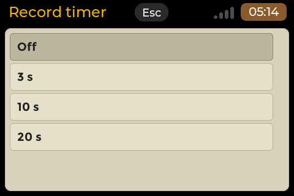

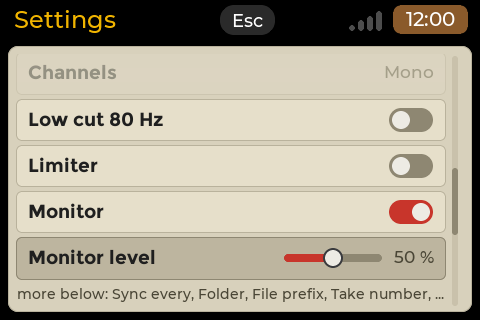

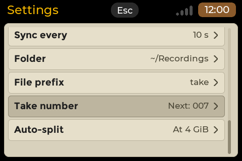

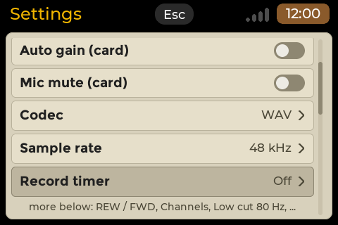

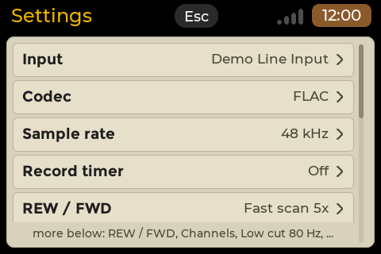

## Formats: WAV, FLAC and Ogg Opus

Cassette records in one of three formats. **WAV** is the default: nothing is compressed and every player opens it.
**FLAC** is lossless: it sounds exactly like the WAV, in a file about a third to a half of the size (a quiet room and
speech compress best, noisy music least). **Ogg Opus** is lossy, made for voice: a take of a few hours fits in a few
tens of megabytes, and the quality at the speech settings is good for talking.

**Choosing.** The format of a take is three settings, each on its own row in Settings: **Codec** (WAV, FLAC or Opus),
**Sample rate** and **Bit depth** (WAV, FLAC) or **Bit rate** (Opus); the Bit depth row is there only when the card
records more than one depth. Each row opens a page in the same style: one
entry per choice, the name on the left and the **estimated size per minute** on the right (`5.8 MB/min`, `about 1.7 MB/min`,
`190 kB/min` under a megabyte), and below a line with what the choice is for and **how many hours fit** in the free
space of the recordings folder (for example `8433 h free`; the figure is in hours, or minutes when under an hour). WAV is
exact; FLAC reads `about` because it depends on the sound; Opus is its bit rate (real files are usually a little
smaller). The footer says what the sizes assume: the other two choices as they are now (`Sizes for FLAC, 16-bit, this card`
on the rate page, `Sizes for FLAC, 48 kHz, this card` on the bit depth page; with no sound input there are no sizes).
The choice in use has a dot before its name; the darker row is the one the keys are on (Up / Down move it, Enter chooses).
Tap a row to choose it: the page closes and the Settings row shows the new value. Esc leaves the page without a change.
Nothing can be changed while a take records or counts down (the rows are dimmed).

**Codec.** The page starts with the three plain **Codecs**, then **Quick presets**, six ready-made combinations that set
the codec and its quality at once:

| Entry | What it sets |
|---|---|
| WAV, FLAC, Opus | only the codec; the sample rate and the quality stay as they are, unless the new codec cannot use them |
| WAV, 48 kHz, 16-bit | WAV, uncompressed, plays everywhere (the rate and depth are the card's own defaults) |
| FLAC, 48 kHz, 16-bit | FLAC, lossless, a third to half the size |
| Opus speech 24 kbps | speech, smallest |
| Opus speech 32 kbps | speech, clear (the preset used when the settings file says Opus and names none) |
| Opus music 64 kbps | music and voice |
| Opus music 128 kbps | music, best |

A preset also puts the sample rate and the quality back to the card's defaults. Changing only the codec re-checks the
other two: if the sample rate is not one the new codec can record, Cassette picks the nearest one it can (48 kHz, then
16 kHz, for Opus) and a line at the bottom of the page says so (*Sample rate set to 48 kHz: Opus cannot record at 44.1 kHz*).

**Sample rate.** The rates the card offers, for example `16 kHz`, `44.1 kHz`, `48 kHz`, `96 kHz`. A rate the chosen codec
cannot record is dimmed (Opus takes 8, 12, 16, 24 and 48 kHz). Choosing a rate reopens the card at once; the next take
is written at it, and the strip and the list show it (`44.1k/16 WAV`). The **default** is the card's own: 48 kHz if it has
it, else 44.1 kHz, else the highest below 48 kHz (Opus: 48 kHz, else 16 kHz).

**Bit depth and bit rate.** WAV and FLAC: `16-bit` or `24-bit`, only the depths the card can record. A card with one
depth (most USB cards and headsets record 16-bit only) has nothing to choose, so Settings shows **no Bit depth row** and
takes are written in the card's depth (16-bit); with Opus the row is there as **Bit rate**. Opus: the bit rate, one of 16, 24, 32, 48, 64, 96 and 128 kbps; the hints say which suit speech
(up to 32 kbps, coded as one channel) and which music (48 kbps and up, stereo kept). FLAC always uses compression level 5 (there
is no setting for it).

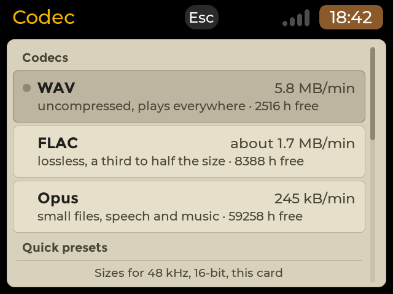

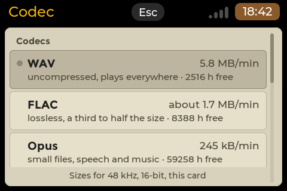

| The bottom of the list (the keys are on the last row) | FLAC chosen: the dot is on FLAC |
|---|---|
| 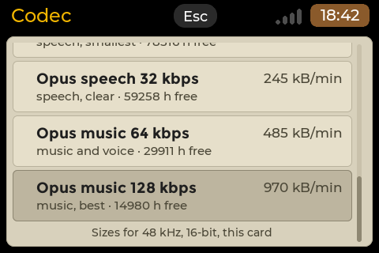 | 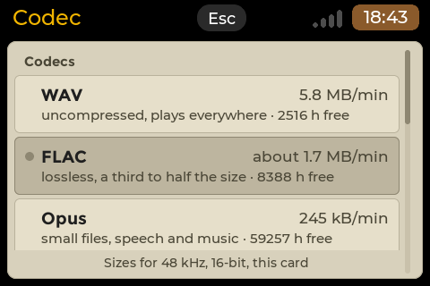 |

| The Sample rate picker | The Bit depth picker |
|---|---|
| 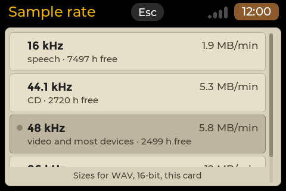 | 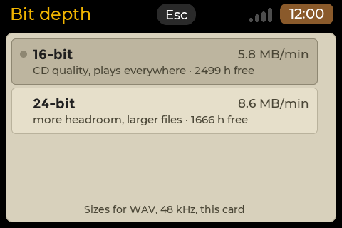 |

| The Bit rate picker (Opus) | Opus dims the rates it cannot record |
|---|---|
| 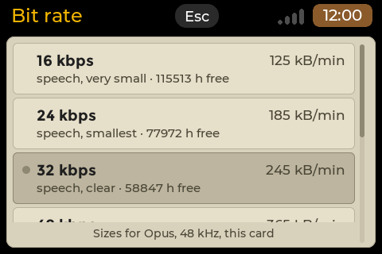 | 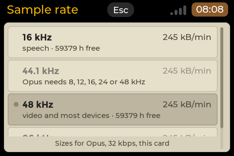 |

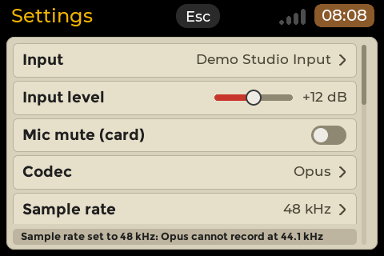

**Entries that are not available.** A choice the card or the board cannot record stays in the list, **dimmed**, and its
second line says why instead of the hours. The one exception is a bit depth the card cannot record: it is not listed at all
(see Bit depth above). A tap on it shows *Not available:* and the reason, and nothing changes. The
reasons you can meet:

| Reason | Meaning |
|---|---|
| `Opus needs 8, 12, 16, 24 or 48 kHz; this card has 44.1 kHz` | The card records at 44.1 kHz only (or at other rates Opus does not take). Opus is dimmed on it; Cassette does not resample. |
| `Opus needs 8, 12, 16, 24 or 48 kHz` | On the Sample rate page with Opus chosen: this rate is not one Opus takes. |
| `Opus records at most 2 channels`, `more than 2 channels` | The card gives more than mono or stereo. |
| `FLAC not installed (libflac14)` | The library is missing (the package name differs by system: `libflac12t64` on Ubuntu 24.04, `libflac12` on Debian bookworm). |
| `Opus not installed (libopusenc0)` | The library for recording Opus is missing. |
| the card's own reason | The card cannot be recorded at all; then every row is dimmed with its reason. |

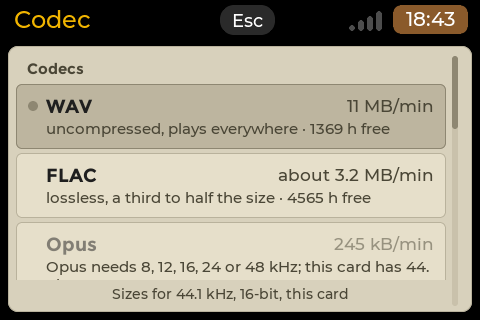

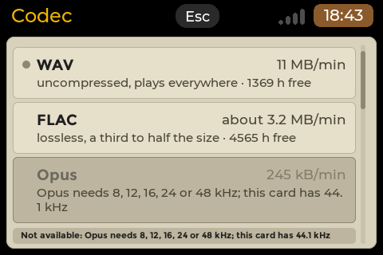

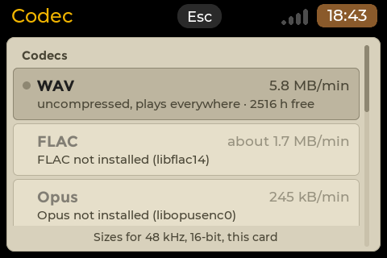

Old settings files keep working: a file that holds only `"format"` (and `"format_preset"`) records exactly as before,
and the new keys `"rate"` and `"quality"` are written only when you choose a rate or a quality (see
[Files](#files-and-where-they-live)).

If the stored choice stops being possible (you unplug the stereo card for a mono one, or a library is removed),
Cassette records **WAV** instead and the Codec row reads `WAV (FLAC unavailable)` or `WAV (Opus unavailable)`. The
stored choice is kept and comes back when it is possible again.

**What each format needs on the board.** The libraries are opened when needed; nothing is linked in.

| | Record | Play, preview, scan, waveform | Trim and split |
|---|---|---|---|
| WAV | nothing | nothing | nothing |
| FLAC | `libflac` (`libflac14`, `libflac12t64` or `libflac12`) | `libflac` | `libflac` |
| Ogg Opus | `libopusenc0` and `libopus0` | `libopus0` | nothing |

If a library is missing the format is unavailable in the picker and Cassette uses WAV. Install the package with
`sudo apt install libflac14 libopusenc0 libopus0` (use `libflac12t64` instead of `libflac14` on Ubuntu 24.04). The Cassette
package does not install them by itself.

**Names and the list.** Takes are named `.flac` or `.opus` instead of `.wav`; the strip shows the format (`48k/16 FLAC`,
`48k/16 OPUS`), and the take numbers run on across all formats. The recordings list ends each row with `WAV`, `FLAC` or
`OPUS`. RENAME keeps the extension.

**FLAC.** Level 5 FLAC, 16 or 24 bit as the card gives it, mono or stereo. The take is exactly what a WAV would have
held. A rough size at 48 kHz mono 16 bit (the picker shows `about 1.7 MB/min`, a WAV minute is 5.8 MB): speech 27 to 41 % of the WAV,
music about half. With a 24-bit card FLAC saves less (about 53 to 70 %), because the lowest bits of a real card are noise.

**Ogg Opus.** Four settings, all variable bit rate, 20 ms frames:

| Preset | Bit rate | Size per hour (at most) | Meant for |
|---|---|---|---|
| speech 24 | 24 kbps | about 11 MB | long voice notes and meetings, smallest |
| speech 32 | 32 kbps | about 15 MB | interviews and lectures (the default) |
| music 64 | 64 kbps | about 29 MB | voice with music, field sounds |
| music 128 | 128 kbps | about 58 MB | rehearsals and concerts, near transparent |

The speech settings code **one channel**: on a stereo card the take still says two channels, but the encoder
codes only one of them (Cassette has no mixing code), so expect no stereo picture from a speech take. The music settings keep stereo. Opus is
not offered when the card records at 44.1 kHz. An Opus take plays at the card's rate (8, 12, 16, 24 or 48 kHz).

**The Opus delay and a power cut.** The Opus encoder holds back about **2 s** of sound before it can write it. At STOP
it writes it all out (that takes a fraction of a second), so a normal take loses nothing. After a **power cut** a take
loses the time since the last sync (10 s by default, see *Sync every*) **plus up to about 2 s**. FLAC loses the sync
interval plus under 0.1 s.

**Crash repair.** FLAC and Opus takes are repaired at the next start like WAV takes, from the journal or, for a file
with no journal, when it looks unfinished: the file is cut after the last whole FLAC frame or Opus page and its length
fields are set. The take is marked `repaired` in the list and the notice says how much was kept. A damaged piece in the
middle of a FLAC take is skipped, never cut. The same holds for a card that is unplugged or a full disk: the take is
closed and kept, and it is a valid file.

**Playing.** FLAC and Opus takes load, play, pause, preview from the list, scan at 5x forwards and backwards, jump 5 s
and show their waveform on the trim page exactly as WAV takes. Playing a FLAC take is lossless; an Opus take is decoded
as it plays. A take of a format whose library is missing is refused with a notice (see
[Troubleshooting](#troubleshooting)).

### Trim and split of FLAC and Opus takes

The results keep the format of the take (`-1.flac`, `-1.opus`); the save box, the names, *Save as new files* and
*Replace original* work as for WAV, with the same safety against a power cut.

- **FLAC: lossless, re-encoded.** The kept part is decoded and encoded again as FLAC, so it is **exactly** the cut of
  the original, to the sample. It takes more time than copying: the save box shows the progress. For a long stereo
  take expect minutes (an estimate of 2 to 4 minutes for one hour on a Pi Zero 2 W; not measured on a board yet).
- **Opus: no re-encoding.** The sound packets of the part are **copied**, so there is no second round of lossy coding
  and no loss at all. A part starts exactly at IN and ends exactly at OUT when played. The file holds a little
  audio before IN, about 0.3 s, that players skip (it lets the decoder settle, so the start does not click); the
  file is a few kilobytes longer than the sound you hear. Trimming Opus needs no library.

## Take number

**Settings > Take number** sets where the next take counts from. The row reads `Next: 007`. Tap it to open the page:
the number large, steppers **-1 / +1**, **-10 / +10**, **-100 / +100**, **Reset to 1** and **Set**. Esc closes the
page without changing anything.

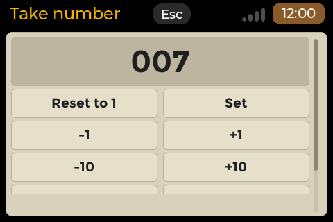

- The range is 1 to 9999.
- **Only the next take changes.** Existing files are never renamed.
- A number that the same prefix already uses in the folder is **skipped**: the next free number is taken, and the
  row shows it. So *Reset to 1* with takes 001 to 003 in the folder gives `Next: 004`.
- The number is stored in the file `.take-counter` in the recordings folder and survives a restart. The row is
  dimmed while a take records.

## Screen sizes and layouts

The recorder has four layouts, chosen by the shape of the screen:

| Screen | Layout |
|---|---|
| landscape (480x320, 640x480, 800x480) | cassette window on the left, meter and buttons on the right, info strip, steppers, keys |
| portrait (320x480, 480x800, the narrow PDA shell) | counter row with the info box, meter, steppers, keys, stacked |
| square (width / height from 0.9 to 1.1, such as 720x720 and 480x480) | one column: window, counter row, meter across the full width, CARD and SOFT side by side, keys |

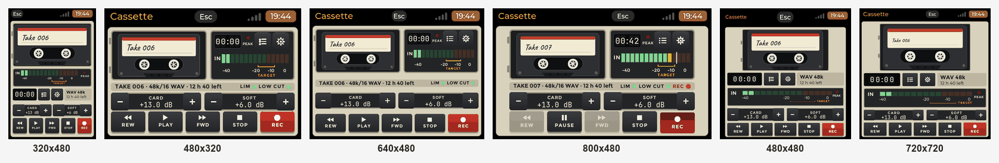

| 480x320 | 640x480 | 320x480 portrait | 800x480 |
|---|---|---|---|
|  | 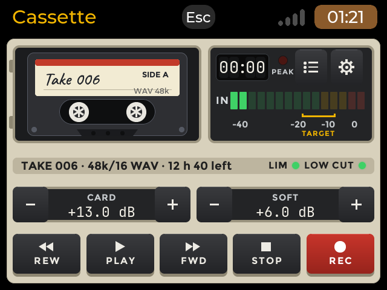 | 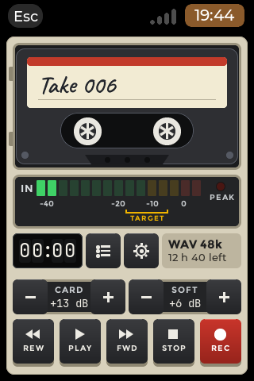 | 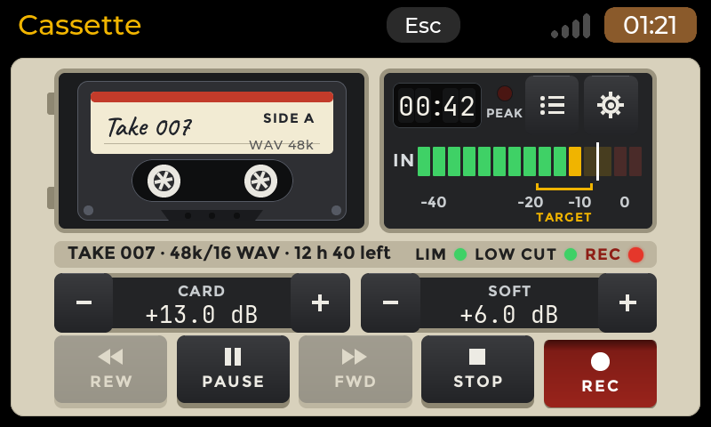 |

| 720x720 square | 480x480 square | 720x720 with a stereo card |
|---|---|---|
| 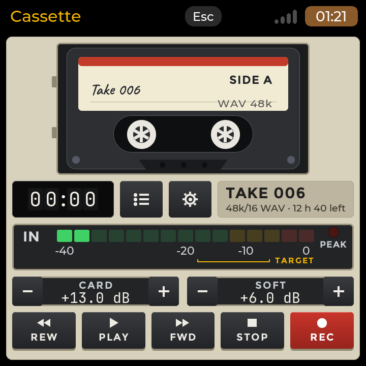 |  |  |

On a square screen the other pages (settings, list, trim, boxes) keep the landscape layout, scaled. The LIM and LOW
CUT lamps are shown only in the landscape strip. The **level meter panel keeps one height in every state**: a mono card
(one row, centred in the panel) and a stereo card (L over R) fill the same space, so nothing below the panel moves when
a card is changed or a take starts.

Real captures from boards: the HackBerry (720x720, square) and a Pi 3A+ (480x800 portrait).

| HackBerry, 720x720 | Pi 3A+, portrait |
|---|---|
|  |  |

## Keyboard shortcuts

Every key has a control on the screen too. A Bluetooth or USB keyboard is the main way to type text; the launcher's
on-screen keyboard appears only when no keyboard is connected. **Esc** goes back everywhere (a box, a list or a text
field closes first); on the recorder it ends the app, and during the countdown it cancels the countdown. The Esc
button in the header does the same.

**Recorder**

| Key | Does |
|---|---|
| R | REC |
| Space | PLAY / PAUSE |
| X | STOP |
| , (comma) | REW (held: scan backwards 5x) |
| . (period) | FWD (held: scan forwards 5x) |
| L | recordings list |
| S | settings |
| Esc | ends the app (cancels a countdown first) |

**Recordings list**

| Key | Does |
|---|---|
| Up / Down | move the selection |
| Enter | preview (again on it: stop and rewind) |
| L | LOAD |
| N | RENAME |
| T | TRIM |
| Delete | DELETE (asks first) |
| S | settings |
| Esc | back to the recorder |

**Trim and split**

| Key | Does |
|---|---|
| Left / Right | marker 0.1 s (Shift: 1 s) |
| Up / Down | zoom in / out |
| I / O | SET IN / SET OUT |
| Enter | SPLIT, or REMOVE while a flag is selected |
| Tab | select the next flag |
| Space | PLAY |
| S | SAVE |
| Esc | back to the list, nothing saved |

**Save and confirm boxes:** Left / Right or Tab move between buttons; Enter chooses (with no move: SAVE AS NEW FILES
in the save box, CANCEL in the confirm box); Esc cancels.

**Settings:** Up / Down move; Enter or Right change or open a row; on a slider Left / Right step it; L the list; Esc
back (a choice list first, then the recorder).

The full map is in [KEYS.md](KEYS.md).

## Files and where they live

| What | Where |
|---|---|
| The takes | `~/Recordings/` (setting *Folder*): `<prefix>_<number>_<YYYYMMDD-HHMM>.wav` (or `.flac`, `.opus`), for example `take_006_20261108-1105.wav`; a prefix may hold spaces (`my band_006_20261108-1105.wav`) |
| A second part of a long take | `take_006_20261108-1105_p2.wav` |
| A trim or split result | the source name plus `-1`, `-2` ...: `take_006_20261108-1105-1.wav` (the extension of the source) |
| The take counter | `~/Recordings/.take-counter` (the last number handed out) |
| One journal per take | `~/Recordings/.journal/<take>.json`, open while the take records |
| Edit numbers already used | `~/Recordings/.edits/` (so a deleted `-2` is never handed out again) |
| The waveform overview of a take | `<take>.wav.peaks` (`.flac.peaks`, `.opus.peaks`) next to the take, built the first time the trim page opens it; Cassette checks it against the take's size and time on every use and rebuilds it if they changed. Safe to delete. |
| Leftover temporary files | `.tmp-*` in the folder, from a save that was cut short; removed at the next start |
| The settings | `~/.config/cassette/settings.json`; also each card's level, auto gain and mute. Delete it to reset everything. |

The WAV files are standard (Broadcast Wave), and the FLAC and Ogg Opus files are standard too (the take's name and,
when the clock is set, the date are in the file's Vorbis comments). Any player or editor opens them. Copy them off the
board with `scp` or a USB stick. Files you put in the folder yourself show in the list if they are WAV, FLAC or Opus
files; one that does not follow the take name pattern shows but cannot be renamed.

## Crash safety

- While a take records, Cassette writes it in large blocks and every **Sync every** seconds (10 s by default) it forces
  the data onto the SD card and rewrites the file header. So at any moment the file on the card is a valid WAV up to
  the last sync.
- **Power cut or crash:** you lose at most the sound since the last sync, about 10 s with the default (5 to 30 s,
  the setting). At the next launch Cassette finds takes whose journal says "open" or whose header sizes are
  placeholders, repairs the header from the file's real length (a partial last frame is cut off) and shows a notice
  such as *Recovered take_006... after an interrupted recording (2 min kept, about 8 s at the end lost)*. The
  list marks the take `repaired`. The audio itself is not rewritten, and repair can be interrupted and run again.
- **FLAC and Opus** are synced at the same interval and repaired the same way (see
  [Formats](#formats-wav-flac-and-ogg-opus)). An Opus take can lose up to about 2 s more than the sync interval, because
  the encoder holds that much sound back.
- **Card unplugged during a take:** the take is closed and kept, a notice says *The sound card was unplugged: the
  take was closed and kept*. When you plug it back the notice *The sound card is back* shows and the card's settings
  are applied again. A new take is needed: the one that was running is not continued.
- **Disk full:** the take stops cleanly when under 200 MB are free, and the take is kept.
- **Trim, split, replace** use temporary files and renames (see above): a power cut gives the old file or the new
  ones, never half a file.

## Troubleshooting

**"No sound input found."** Cassette sees no capture card. Plug the card in again; check that the user is in the
`audio` group (see above); on a terminal, `/usr/share/APPLaunch/bin/cassette-probe` lists the cards, what each offers and its mixer controls,
and opens each for 2 seconds (listen-only, it writes nothing). Run it with `--no-open` to list only.

**The meter does not move.** Check the right card is chosen in Settings > Input, that *Mic mute (card)* is not on, and
that the headset's own mute is off. Raise CARD. Some headsets in call profile deliver a weak signal: use SOFT.

**"The card is in use" / "Recording through the sound server".** Another program (on desktop boards, the sound
server) holds the card. Cassette records through the server, at 48000 Hz 16 bit. The take is fine. If you want the
direct card, close the other program. The other way round: while Cassette records directly, other programs get
silence from that card, and Cassette says so.

**"Monitor unavailable".** The card's output could not be opened for monitoring (often another program has it). Turn
Monitor off, or close the other program. Recording is not affected.

**Lost audio.** A red `lost 0.3 s` in the strip means the card or the SD card could not keep up, and a short notice
*Some audio was lost: the card or the disk could not keep up* appears. Try a faster SD card, a different
USB port or cable, or less load on the board.

**Hiss and noise from a cheap headset.** The card's amplifier makes noise at high gain, and SOFT amplifies it as
well. First raise CARD, then use SOFT only as much as you need. The headsets used with Cassette so far give a weak
level (peaks around -17 to -7 dBFS at full card level in the first tests), so speak close to the microphone. *Low cut
80 Hz* removes the low rumble, not the hiss.

**A 16 kHz headset.** A USB headset in its call profile can offer only 16000 Hz (for example the Jabra Evolve 65).
Cassette records at the card's own rate: 48000 Hz if it offers it, else 44100 Hz, else the highest rate at or below
48000 Hz. The strip then reads `16k/16 WAV`, Settings > Sample rate reads `16 kHz`, and playback runs at the right
speed on other outputs too. A 16 kHz take sounds like a phone call: that is the card, not the app.

**"Unsupported card".** The card offers neither 16-bit nor 24-bit capture. It is not usable.

**A codec, rate or depth is dimmed in Settings ("not available").** Tap it: the notice says why. Not installed
means a library is missing: install `libflac14` (or `libflac12t64` / `libflac12`) for FLAC, `libopusenc0` and
`libopus0` for Opus. `Opus needs 8, 12, 16, 24 or 48 kHz; this card has 44.1 kHz` is a property of the card: Opus is dimmed there
(Cassette does not resample), FLAC and WAV are not. Until a codec is possible Cassette records WAV, and Settings > Codec says
`WAV (Opus unavailable)`.

**"This take cannot be played: FLAC not installed (libflac14)".** A FLAC take cannot be loaded, played, previewed or
trimmed without `libflac` (Opus: `Opus not installed (libopus0)`, and no `libopus0` means no playback). Install the
package named in the notice; the take is not damaged. WAV takes always play.

**"This take cannot be played" / "damaged".** The file is not a valid WAV, FLAC or Ogg Opus file, or it is cut off. Copy
it off the board and check it on a PC.

**Settings were not saved.** The notice *The settings could not be saved: ...* names the reason (a read-only or full
card). Delete `~/.config/cassette/settings.json` to start with the defaults.

## Limits

- **No Bluetooth audio.** Cassette records from sound cards that Linux presents as capture devices (USB, or a board's
  own input). It has no Bluetooth audio code. (A Bluetooth *keyboard* works as usual.)
- **No recording in the background.** Leaving the app stops the take (and keeps it).
- **No merge.** Trim and split cut a take into parts; there is no way to join takes in the app.
- **No hot-plug re-open of a running take.** After an unplug the take that was running is closed, not continued; a
  new take is needed after the card is back.
- **Opus is not offered at 44.1 kHz** (Cassette does not resample). Use FLAC or WAV for such a card.
- FLAC and Opus need their libraries (see [Formats](#formats-wav-flac-and-ogg-opus)); without them Cassette uses WAV
  and refuses to play such takes.
- The record timer makes no sound.
- Playback plays the app's own takes (WAV, FLAC, Ogg Opus).
- Not yet measured on the boards: the CPU cost of FLAC and Opus recording and of the 5x scan of an Opus take on a
  Pi Zero 2 W, how much the turning hubs cost it, and how every card behaves. The board test list is in
  [`../tests/BOARD-TESTS.md`](../tests/BOARD-TESTS.md).
