# Deck Atlas (`deck-atlas`)

An offline map viewer for the cyberdeck, by touch or keyboard: import your own maps (MBTiles or PMTiles files, or a
`z/x/y` tile folder from a tile downloader, converted on the board into one MBTiles file) from the SD card or a USB
stick, then pan and zoom without any network. Three online tile sources come with the map engine, all **off** until you
switch them on (OpenTopoMap, and Thunderforest and Geoapify with your own free key); the tiles you looked at stay on the
SD card. Version **0.2.0**, category Tools. Native fullscreen app (kind A of
the guidelines: it has its own pages, lists and forms) on the launcher's `cp0_lvgl` with its **map engine**
(`cp0_map.h`, switched on for this app only), MIT. Version 0.2.0 adds the **GPS**: a USB receiver's position as a dot on the map, follow mode and
`position.state` for other apps (off until you switch it on in Settings; listen-only, and the position never leaves the
deck). Places and tracks come after that.

## Screenshots

Rendered by the PC harness (`build.sh host`) over synthetic test tiles (a drawn grid, tile numbers, invented roads and
coastline; generated by `tests/tools/gen_fixture_tiles.py`, no real map data):

| | |
| --- | --- |
| 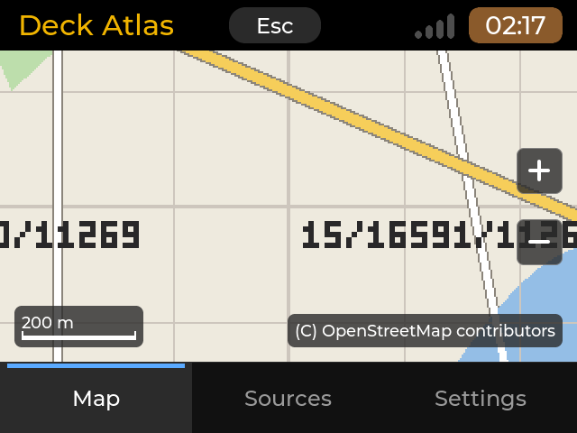 | 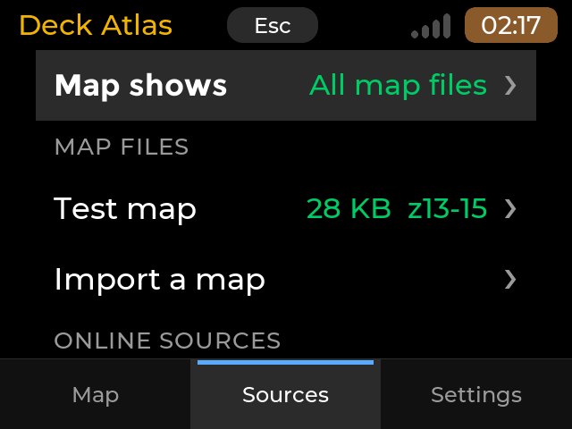 |
| Map tab at 640x480 (the deck: 2x) | Sources tab |
| 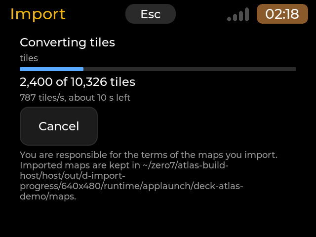 | 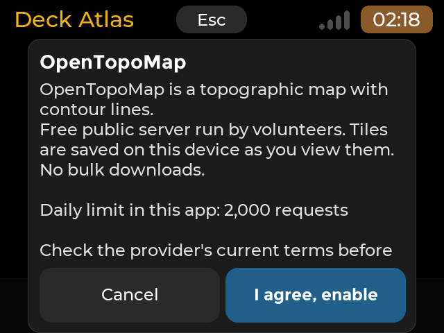 |
| Converting a tile folder | Switching an online source on: its terms, once |
| 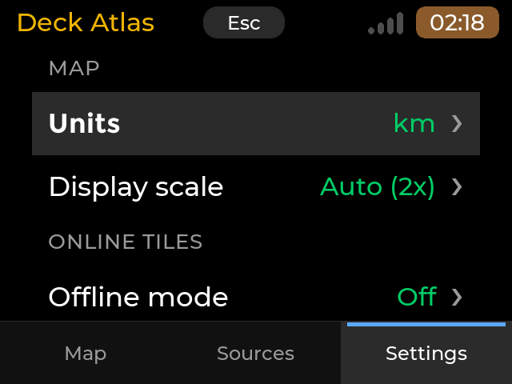 | 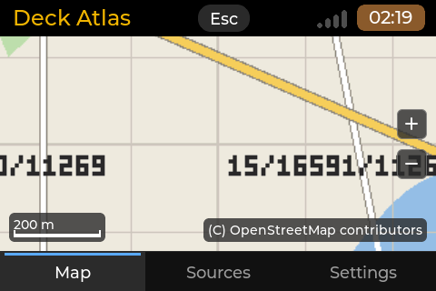 |
| Settings tab | zero8's 3.5" 480x320 panel (6.3 px/mm: 1.5x) |

The Store shows `screenshots/` (640x480, 480x320, 320x480 and 480x800).

The GPS (0.2.0), over a synthetic feed (an invented position inside the test tiles' area):

| | |
| --- | --- |
| 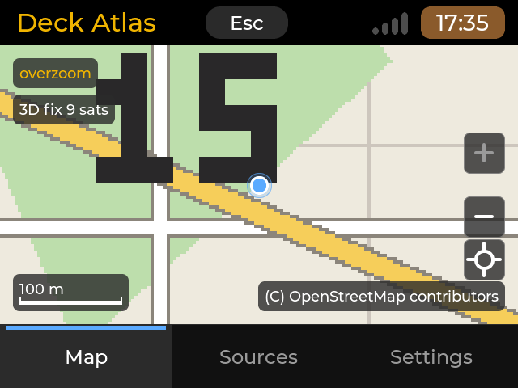 | 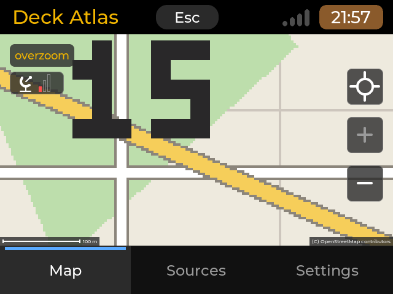 |
| 3D fix, nine satellites, accuracy ring; follow button under the zoom buttons | Receiver talking, no fix yet: "Searching", no dot |
| 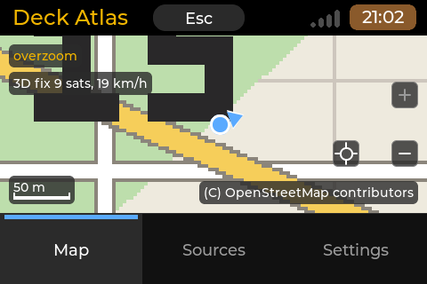 | 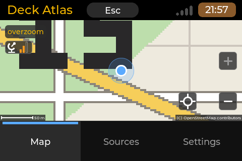 |
| Moving: heading wedge, speed; the follow button left of the zoom-out button on the 200 px high 480x320 map | 2D fix: a wider ring |
| 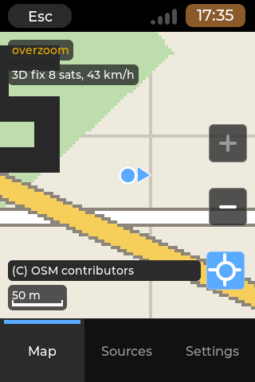 | 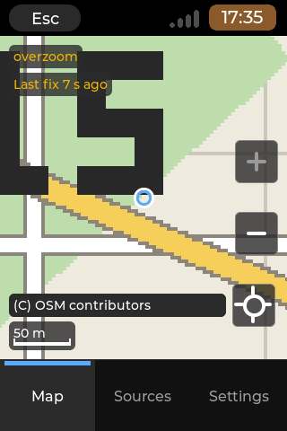 |
| Follow on (button highlighted), the dot kept in the middle | Stale (no fix for 5 s): hollow dot, "Last fix 7 s ago" |
| 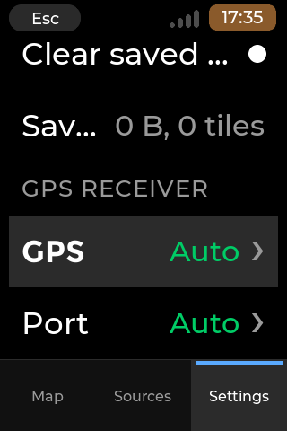 | 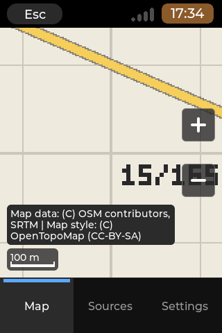 |
| Settings > GPS receiver | OpenTopoMap's credit shown whole on 320x480 |
| 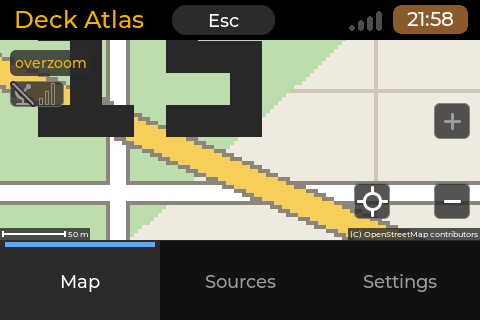 | 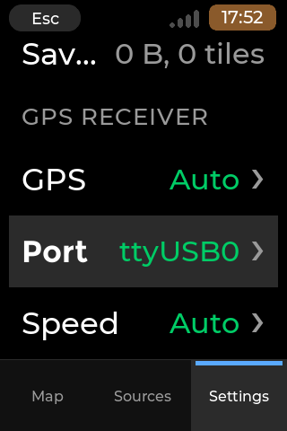 |
| Only another serial device (a CH340 radar): Auto never opens it | Port lists it; a port chosen by hand is opened |

## What it does

Three tabs, switched by the strip at the bottom (or Tab / Shift+Tab):

- **Map.** The engine's map widget over the whole area. Drag to pan (or the arrow keys: an eighth of the view, a half
  with Shift); zoom with the + / - buttons at the right edge, the + and - keys, Page Up / Page Down, or a double tap.
  The scale bar is at the bottom left (km or miles), the credit of the map in view at the bottom right, both on the
  very bottom edge of the view, on one line, in the smallest font the toolkit has. The zoom
  goes one level deeper than the map's last level ("overzoom": the deepest tiles magnified). When no imported file
  covers the view, a plate says **No map here**; on the first run with nothing imported it says **No map yet. Import a
  map file in Sources.** An online source that cannot fetch says why in the engine's strip at the top ("Offline: saved
  tiles only", "This source needs an API key", "Daily tile limit reached: saved tiles only"...). The view (centre and
  zoom) is remembered; the first run centres on the first imported file, or shows the world.
- **Sources.**
  - *Map shows*: every map file (each tile from the first file, in id order, that has it), one file, or an online
    source that is switched on.
  - *Map files*: each imported file with its size and zoom levels. Its page: Show on map (fits the file in the view),
    Remove (asks first; a copied or converted file is deleted, a file read in place on a stick is only forgotten), and
    the facts: name, file, size, zooms, tiles, area, how it is kept, what was imported, the date, its attribution.
  - *Import a map*: the file browser (the home folder and every USB stick or card mounted under `/media`,
    `/run/media` or `/mnt`; folders, `.mbtiles` and `.pmtiles` files, nothing else). A tile folder (zoom folders of
    column folders of tiles, MapTileDl's layout, or a TMS folder with `tilemapresource.xml`) shows one row, *Import this
    tile folder*, with its zoom levels. An archive offers **Copy** (recommended: it stays when the stick is out) or **In
    place** (read on the stick; listed as missing while the stick is out). Before it starts, the free space is checked
    (the folder's size plus 5 % and 16 MB, or the file's size). The import page shows the phase, a bar, "N of M tiles",
    the rate and the time left, and **Cancel** (a cancelled folder import goes on where it stopped next time). The
    result: tiles, size and rate, then Show on map. The import runs on a worker thread (the screen keeps
    responding; Esc on the page cancels it).
  - *Online sources*: OpenTopoMap, Thunderforest Outdoors and Geoapify OSM Bright, each with its state in a word (Off,
    On, Needs key, Offline, Paused by server, Daily cap reached with the counts, Server busy, No connection, No libcurl,
    Another app, Cache full) and, for the keyed ones, a key row (*Key saved* / *No key*). A tap on a source's row
    switches it: a source that needs a key and has none opens its **key page** first; the first time a source is
    switched on, the **terms dialog** shows its name, the app's own plain-language text for that source (what it is and its rules in a
    sentence or two), a privacy line (the tile provider can see your IP address when tiles are fetched; tiles already
    saved on the SD card are not fetched again), "Daily limit in this app: N requests", "Check the provider's current terms before relying on
    this." with the provider's address as plain text, and the map data credit; **Cancel** or
    **I agree, enable**. The acceptance is remembered per source; switching it off and on again does not ask again.
    Switching a source on shows it on the map. The area download is not offered (the engine's phase 0.2).
- **Settings.** Units (km / mi), Display scale (Auto / 1x / 1.5x / 2x; Auto shows what it chose), Offline mode (no
  tile request at all), Cache size (Auto / 128 MB / 256 MB / 512 MB / 1 GB: the cap of the saved online tiles; Auto is
  the smaller of 512 MB and 10 % of the free space), Clear saved tiles (asks first; imported files are never touched),
  the saved tiles now, the GPS receiver group (GPS, Port, Speed: see GPS below), and About: the version, the attribution of the map shown and of every source, the credits.

### Keys and touch

| Function | Keys | Touch |
| --- | --- | --- |
| Switch tabs | Tab, Shift+Tab | the tab strip |
| Follow the GPS position (GPS on) | G (on / off), Home (on, recentre) | the crosshair button under the zoom buttons |
| Pan | arrows (Shift: half a view); the deck's F / X / Z / C aliases | drag |
| Zoom in / out | + (=, keypad +) or Page Up / - (keypad -) or Page Down | the + / - buttons, a double tap (in) |
| Move in a list, open, act | Up / Down, Enter or Right | a tap selects a row, a tap on the selected row acts |
| A choice (Units, scale, cache, offline) | Enter on its row: the next value | a tap on the selected row |
| Switch an online source | Enter on its row | a tap on the selected row |
| Back (a page, a dialog) | Esc or Left | the header's Esc, Cancel |
| Leave | Esc at a tab (hold Esc 3 s: the launcher's watchdog) | the header's Esc at a tab |
| Type a key | the keyboard; Enter saves | the on-screen keyboard (only without a keyboard, the shared rule), Save key |

Every list row carries its marker (the launcher's row rule): a chevron on rows that open a page or change a value,
a dot on rows that act (Show on map, Remove, Import this tile folder, an archive, Clear saved tiles; blue while the
clearing runs), none on information rows.

## GPS (0.2.0)

Settings > **GPS receiver** has three rows: **GPS** (Off, the default; Auto), **Port** (Auto, or one of the serial ports
present, `/dev/ttyACM*` and `/dev/ttyUSB*`, known receiver or not, one tap for the next) and **Speed** (Auto, 9600, 4800, 38400, 115200). With
GPS Off the app opens no port at all and the Map tab is exactly what 0.1.0 drew.

- **Listen-only.** The reader only reads NMEA 0183 sentences (`$GP`, `$GN`, `$GL`, `$GA`... `RMC`, `GGA`, `GSA`, `GSV`). It
  opens the device read-only and never sends anything (no UBX or NMEA command, nothing to switch on or configure); the
  package test checks that no source of the reader contains a send call. Every sentence needs a valid `*HH` checksum.
  (The kernel raises DTR when any program opens a serial port, and some boards reset on that. That is why **Port = Auto
  opens only known GPS receivers**, below, and never anything else.)
- **Finding the receiver.** Port = Auto opens only a serial port whose USB identity (idVendor:idProduct in sysfs) is on
  a short built-in list of GPS receivers (`src/core/gps_ids.cpp`): **u-blox 1546:\*** (all), **Prolific 067b:2303** and
  **067b:23a3** (the PL2303 bridges of the common GPS pucks). Every other serial port is **never opened in Auto**: a CH340
  (1a86:\*, the mmWave radar), a CP210x (10c4:\*), an FTDI (0403:\*), an ESP32 or LoRa board (303a:\*, ...), a port with
  no USB id. With only such ports present the chip says "No GPS receiver found". Other serial ports are listed in
  Settings > GPS receiver > Port: pick one there if your receiver is not found by itself, and it is opened as chosen
  (that is your decision, and it is the only way such a port is ever opened). Several known receivers: the u-blox
  first, then the others in port order; the first one that talks is used. Auto looks at the ports every 2 s.
  A port is the receiver when two valid sentences arrive; Auto speed listens 2.5 s each at the
  speed that worked last, 9600, 4800, 38400 and 115200. A port that is busy (another app has it), denied or silent is left
  alone for 2, 4, 8, 15, then 30 s. Plugging in or pulling out is noticed while the app runs; a receiver that goes silent for
  10 s is found again when it talks. Nothing blocks the screen: the reader runs inside the app's 100 ms timer.
- **On the map.** With a fix: a filled blue dot with a white outline, a translucent accuracy ring (HDOP x 5 m, 3 to 100 m,
  drawn when wider than the dot) and, above 1 m/s with a known course, a heading wedge. No valid fix sentence for 5 s: a
  **hollow** dot, no ring. No fix yet: no dot. The **status chip** under the map's top edge says "No GPS device", "No access
  to GPS port" (the `dialout` group), "No GPS receiver found" (Auto sees only other serial ports), "Searching", "2D fix", "3D fix 9 sats" or "Last fix 12 s ago", with the speed
  ("19 km/h", "12 mph" with miles) when moving.
- **Follow.** The crosshair button below the zoom buttons (or **G**; **Home** turns it on and recentres): the map keeps the
  position at its centre on every fix, at the zoom it has. A pan (drag, arrow key, double tap away from the centre) turns
  it off; zooming does not. The button is highlighted while follow is on. Off by default.
- **position.state.** While the GPS is on, the app writes the deck's position for other apps to the launcher's state folder
  (`$APPLAUNCH_STATE_DIR`, else `$XDG_RUNTIME_DIR/applaunch/`, next to `status.state`; report 054 section 6.3), atomically
  (temporary file, rename), at most once a second, only when it changed. Keys (key=value, unknown keys are ignored, an absent
  key means unknown): `v=1`, `gen`, `pid` (believe the file only while it is alive), `writer=deck-atlas`, `fix` (0 none, 2 2D,
  3 3D), `lat`, `lon`, `alt_m`, `speed_mps`, `course_deg`, `acc_m`, `hdop`, `sats_used`, `sats_view`, `utc` (the receiver's
  time of the fix), `mono_ms` (CLOCK_MONOTONIC at the fix: the age without trusting the wall clock), `source` (`usb:1546:01a8`
  or `serial:ttyUSB0`). No fix, a lost receiver or a stale fix writes `fix=0` with no position; switching the GPS off or
  leaving the app removes the file.
- **Privacy.** The position is never sent anywhere by the app: it is drawn on the screen and written to `position.state` on
  this deck. The GPS adds no network use; the online sources keep the rules above.
- **Not in this version:** setting the system clock from the receiver (later, as an offer with a sudo prompt), tracks, a GPS
  page with the satellites, recording while the app is hidden.

## Map files: where they come from

- **MBTiles** (SQLite, raster PNG or JPEG tiles, 256 or 512 px): QGIS (*Generate XYZ tiles (MBTiles)*), `gdal_translate`
  / `gdaladdo`, MOBAC, TileMill, `mb-util`. Vector tiles (pbf) and WebP are refused for now (raster first, owner decision).
- **PMTiles** v3 with raster tiles (`pmtiles convert` from an MBTiles file).
- **A tile folder** `<zoom>/<x>/<y>.png` (or `.jpg`, `.jpeg`, `.png.tile`, extensionless), from MapTileDl or any tile
  downloader, or `gdal2tiles` (TMS: flipped by the engine). Converted into one MBTiles in the store (one SQLite file
  instead of thousands of small ones: SD wear). Other files in the folder (MapTileDl's `inventory.json`) are ignored.

**You are responsible for the terms of the maps you import**: a tile set downloaded from a public tile server may only
be used as its terms allow (many servers, the OpenStreetMap Foundation's among them, forbid bulk downloads). The
import page and the record of each file say so. Deck Atlas never downloads areas.

## Online sources: the rules

- The OpenStreetMap Foundation's tile servers are **never** used: there is no OSM source, and the engine refuses any
  `openstreetmap.org` / `osm.org` address, in a record or a redirect.
- All three sources are off by default. Only the tiles you look at are requested, never the tiles around the view.
- A request carries the tile's z/x/y and the app's User-Agent `deck-atlas/0.2.0 (+https://github.com/OSRdesign/cyberdeck-zero-apps)`,
  plus your key for a keyed source; nothing else. The provider sees your IP address.
- Keys are kept by the engine in `~/.local/share/cyberdeckzero/maps/sources/<id>.key`, mode 0600, never logged and
  never shown again (the page says *Key saved*); never in `settings.conf`.
- Each provider has a daily cap (OpenTopoMap 2,000, Thunderforest 5,000, Geoapify 12,000 requests), counted across
  restarts; at the cap it shows saved tiles only until midnight. A server's "blocked" picture pauses the source for an
  hour; missing tiles are not asked again for 24 h.
- Offline mode (Settings) stops every request at once; saved tiles keep showing.
- Without libcurl (`libcurl4t64`), the sources say *No libcurl* and the engine's strip "Network library missing";
  imports and offline viewing work. Without SQLite (`libsqlite3-0`), MBTiles files cannot be read (PMTiles still can).

## Requirements

- A screen of at least **480x320** (`X-MinSize=480x320`); in PDA mode an upright canvas of at least **320x480**
  (`X-Portrait=320x480`, the launcher's narrow portrait shell). Every board of the project fits.
- Packages (pulled by the `.deb`): `libsqlite3-0` (MBTiles), `libcurl4t64` and `ca-certificates` (online sources),
  plus the base `libfreetype6, libinput10, libxkbcommon0`.
- A launcher with fullscreen app support (contract 1); built against launcher `28817a5` (the map engine with its first fixes).
- Network only for the online sources, and only when you switch one on.
- For the GPS (optional): a USB receiver that sends NMEA 0183 (a u-blox puck, a SiRF or any "GPS mouse"), and your user in
  the `dialout` group (`sudo usermod -aG dialout $USER`, then log in again) to open `/dev/ttyACM*` / `/dev/ttyUSB*`.

## Install

Settings > Apps > Available > Deck Atlas (category Tools), or by hand:
`sudo dpkg -i deck-atlas_0.2.0_arm64.deb` (`_amd64` on an x86-64 PC), then `sudo apt-get -f install` if a dependency is
missing. Remove with `sudo dpkg -r deck-atlas` (your maps and settings stay).

## Files the app keeps

| Path | What |
| --- | --- |
| `~/.config/deck-atlas/settings.conf` | units, display scale, cache size, offline mode, what the map shows, the last view, the sources whose terms you accepted, the GPS rows (only when changed from Off / Auto / Auto) (key=value lines, written atomically, mode 0600) |
| `$APPLAUNCH_STATE_DIR/position.state` | the deck's position for other apps, while the GPS is on (above); removed at exit |
| `~/.local/share/cyberdeckzero/maps/` | the shared map store of the engine (any app may read it; Mesh Hop will): `archives/` (imported files and their records), `tiles/` (the saved online tiles, one MBTiles per source, within the cache cap), `sources/` (your switches and keys), `state/` (daily counts and pauses) |

Reset: delete `~/.config/deck-atlas` (settings) and `~/.local/share/cyberdeckzero/maps` (every map, key and saved tile).

## Multitasking

None (no `X-Background`): this version does not answer the launcher's lifecycle protocol, so it owns the panel until it
exits. So the GPS reader and `position.state` work only while Deck Atlas is in front; `X-Background=run` (report 054 7.4)
comes with the recording of tracks.

## Known limits

- **Legibility** (the legibility check of report 054, judged on the PC from the harness's pictures of a real
  raster tile set of standard-style 256 px tiles; to be confirmed on the glass): street and place labels are
  about 7 px high (capitals) in a tile. **zero8, 480x320 and 320x480 (6.3 px/mm), Auto = 1.5x:** capitals about
  10 px = 1.6 mm (letters about 2.3 mm, a little above the launcher's own smallest text there, 2.2 mm): street names
  (from zoom 15), house numbers and the names of places (zoom 17) read well; **1x** makes them 1.1 mm, too small;
  **2x** gives 2.2 mm capitals but shows half the area and looks blockier. **The deck, 640x480 (11.3 px/mm), Auto =
  2x:** capitals about 14 px = 1.2 mm, the size of the launcher's smallest caption: readable close up, small at arm's
  length, and 2x is the engine's largest scale (the one over-zoom level magnifies further, blurred). Keep Auto; zoom
  15 is the first level with street names, 16-17 for house numbers. Sharper text on the deck needs 512 px ("@2x")
  tiles in the imported file (the engine draws them 1:1 at 2x) or the vector rendering of a later phase.
- No places or tracks yet; no area download (the engine's phase 0.2, Geoapify only).
- One source on the map at a time (all files, one file, or one online source); no overlay of an online source over a
  file.
- Vector tiles (pbf), WebP and brotli / zstd PMTiles directories are refused (raster first).
- "No map here" is decided from each file's bounds and zooms, not from its actual tiles. A tile folder converted with
  this pin keeps the tile rectangle of every zoom (the file's Area is the union of all levels), so it is found at every
  level on "All map files" and by itself. A folder converted **before** (an earlier pin) kept the extent of its deepest
  level only: on "All map files" its wider shallow levels are skipped outside that extent; remove it in Sources and
  import the folder again to get all levels. A file made elsewhere (MBTiles / PMTiles) is only as wide as it declares;
  shown by itself it is read at every level whatever it declares, so there the plate shows only at its deepest level
  (and the over-zoom one), and at the shallower levels a view outside it shows the grey grid without the plate.
- The engine draws its own scale bar and map credit in the toolkit's caption font and cuts a long credit with "...";
  the app cannot change that. So the app gives the engine's widget a box taller than the view (by the height of the
  engine's two bottom rows, `src/core/attribution.cpp engine_reserve`) and the view clips it: the engine's rows lie
  below the edge. The app draws its own bottom row there (`src/ui/atlas_credit.cpp`), in the smallest font (8 px
  Montserrat): the scale bar at the left, the credit at the right, flush with the bottom edge, one baseline. The credit
  is shown whole on one line when it fits beside the scale bar, else with "OpenStreetMap" written "OSM", else wrapped
  to two lines (more only when two do not hold it); it is never cut and never dropped. It stops left of the zoom
  buttons when they come down to its rows (a short view with a long credit). The copyright sign is written "(C)": the
  builtin fonts have no (c) glyph. Side effect: the widget's centre is half the extra height below the view's middle,
  so the zoom buttons sit a little lower and, as their size is a share of the widget's shorter side, a little larger
  than in 0.1.0; the app converts between the widget's centre and the view's middle wherever it matters (first view,
  saved view, follow, the dot, "No map here"). The full text is also in Settings > About and in each file's facts in
  Sources.
- The engine draws a grey grid while a tile loads (the parent tile magnified when it is cached); there is no separate
  "loading" indicator.
- Board-only checks are listed in [`tests/BOARD-TESTS.md`](tests/BOARD-TESTS.md): the import rate on the Zero 2 W,
  VmRSS (expected 22-24 MB with the engine's 8 MiB tile cache), the legibility on the glass, the network path.

## Credits and licences

- Deck Atlas: MIT, 2026 OSRdesign.
- The map engine of the CyberdeckZero Launcher's toolkit `cp0_lvgl` (projection, MBTiles / PMTiles readers, the shared
  store, the online sources, the map widget; MIT), compiled into the binary.
- stb_image 2.30 by Sean Barrett (public domain or MIT), inside the engine.
- SQLite (public domain) and libcurl (the curl licence, MIT-style): system libraries the engine loads at run time when
  installed; not shipped.
- LVGL (MIT), linked; the Montserrat font (SIL OFL 1.1), read from the launcher.
- Map data and styles shown in the app and credited on the map: map data © OpenStreetMap contributors (ODbL);
  OpenTopoMap style (CC-BY-SA, SRTM elevation); Maps © Thunderforest; Powered by Geoapify, © OpenMapTiles. Imported
  maps are the user's own, under their own terms.
- The test tiles in `tests/fixtures/tiles` are synthetic, generated at build time (six tiles, never packaged, not in the
  repository): see [`tests/fixtures/README.md`](tests/fixtures/README.md). No real map tile is kept in this repository.

<!-- branding-allow-begin: credits the upstream runtime the binary links -->
The binary links the cp0_lvgl runtime of the CardputerZero launcher by M5Stack (MIT); the full notices are in
`/usr/share/doc/deck-atlas/copyright`.
<!-- branding-allow-end -->

## Build and test

```sh
wsl -e sh apps/deck-atlas/build.sh host                 # unit tests (2,014 checks) and 23 scenes (sheets in ~/cdk-build/deck-atlas/host/out/sheets)
wsl -e sh apps/deck-atlas/build.sh cross                # the arm64 binary into root/
wsl -e sh apps/deck-atlas/build.sh cross --arch amd64   # the amd64 binary into root.amd64/
python3 tools/make_registry.py --only deck-atlas --out <dir>            # a local arm64 .deb, no registry
python3 tools/make_registry.py --only deck-atlas --arch amd64 --out <dir>
```

- **The map engine for this app only.** `cp0_config.mk` holds `CONFIG_CP0_LVGL_MAP=y`; `apps/_common/build_app.sh`
  appends it to this app's scratch configuration and `apps/_common/headless/Makefile` includes it (the
  [`_common` README](../_common/README.md#toolkit-switches-of-one-app-cp0_configmk)); no other app changes.
- **GPS in the scenes.** `DECKATLAS_GPS=auto|off` switches the GPS on or off; `DECKATLAS_GPS_FEED=<name>` plays
  `tests/gps-feeds/<name>.nmea` through a fake port (demonstration mode only; without it there is no device). The feeds
  (searching, fix2d, fix3d, moving, follow, stale, noise) are made at build time by `tests/tools/gen_nmea.py` around an
  invented point in the fixture tiles' area, with valid checksums; no recording, never packaged or committed.
- **Demonstration mode** (the scenes; never on a board): `DECKATLAS_DEMO=1` keeps the settings and the store under the
  harness's runtime folder, converts the generated `tests/fixtures/tiles` with the engine's own import at the start, and forces the
  network off. `DECKATLAS_DEMO=empty` starts with nothing; `DECKATLAS_DEMO=import-hold` replaces the import with a
  simulated 10,326-tile conversion held at 40 % (the progress shots). `DECKATLAS_VIEW=lat,lon,zoom`,
  `DECKATLAS_SCALE=auto|1x|1.5x|2x` and `DECKATLAS_UNITS=km|mi` set the first view; `DECKATLAS_MBTILES=<file>` registers
  that archive in place instead of the fixture.
- **The real-tile check** (optional, needs a tile folder; skipped with a message otherwise):
  `DECKATLAS_TILES=<folder> wsl -e sh apps/deck-atlas/tests/real/run.sh` builds `tests/real/import_bench.c` against the
  engine, imports the folder into a scratch store (rate, size, tile count) and renders `tests/real/scenes` (zoom 13, 15,
  17 at the four canvases; the legibility shots at 1x, 1.5x, 2x on zero8's density and 2x on the deck's). An owner's set,
  2026-11-07 (MapTileDl, 10,326 tiles, zoom 1-17): 10,326 tiles imported out of 10,326 image files (`inventory.json`
  ignored), a 260 MB MBTiles (273,063,936 bytes); 4,000 to 22,000 tiles/s on the PC (i5-12450H, WSL2) from a
  native copy of the folder (four runs: the page cache decides), 165-200 tiles/s read straight from the Windows folder
  over WSL's `/mnt/c`.
- The board protocol: [`tests/BOARD-TESTS.md`](tests/BOARD-TESTS.md). The icon: `python tools/make_icon.py`
  (`--sheet <png>` for the check picture).

## Changes

- **0.2.0** (2026-11-07): the GPS reader (NMEA 0183, listen-only, Auto port and speed, hot-plug), the position dot with
  its accuracy ring, heading wedge and hollow stale state, the status chip, follow mode (button below the zoom buttons,
  G / Home keys, a pan turns it off), Settings > GPS receiver (GPS, Port, Speed; Port Auto opens only known GPS
  receivers: u-blox, Prolific PL2303 pucks; every other serial device is listed in Port but never opened unless chosen), `position.state` for other apps; the map
  credit and the scale bar sit on the view's bottom edge in the smallest font, the credit whole (abbreviated or
  wrapped when it does not fit on one line) instead of being cut with "...".

- **0.1.0** (2026-11-07): first version. Map, Sources and Settings tabs; MBTiles, PMTiles and tile-folder
  imports with progress and cancel; the engine's three online sources off by default, with the key page and the terms
  dialog; the persistent viewing cache with its cap and clearing; offline mode; 480x320 and up, 320x480 in PDA mode.

## Roadmap

1. **GPS, next steps**: set the system clock from the receiver (an offer with a sudo prompt, never automatic), the GPS page
   (satellites in view, DOP, the receiver's name), `X-Background=run` for recording.
2. Places and tracks (record, list, show, GPX export); the area download (Geoapify).
3. Mesh Hop shows its nodes on the same engine and store (read-only, report 054 6.2).
