# Home Assistant (`home-assistant`)

A client of your own Home Assistant server on the local network, for the cyberdeck: sign in by scanning a QR code with your
phone, then **your own stored Home Assistant dashboard, drawn natively** (its views as the first tabs: entities, sensor
and weather-forecast cards, as the official app shows them), and after it a dashboard of tiles in the style of Home
Assistant's own app (its icons and state colours): your favourites, one tab per area, and All. Tap a row's switch or a
tile's icon to switch a light or a switch, run a scene or a script, open a garage door or unlock a lock after a
confirmation; drag a dimmable light's slider; tap a name for its page. Native fullscreen app on the launcher's `cp0_lvgl`
(kind A of the [guidelines](../../docs/APP-GUIDELINES.md): its own pages and live data), MIT (the bundled icon font
Apache-2.0), version 0.3.0, published on 2026-11-02 for arm64 and amd64, category Home (study 053 P2 and P1 on top of
design 052a's phase 1).

It is a pure client: the deck is not registered in Home Assistant as a device, nothing of the deck appears in Home Assistant
except the sign-in (a refresh token) in the user's profile. Everything stays on the local network: no cloud, no account other
than your Home Assistant user. Not affiliated with or endorsed by the Home Assistant project; the icon is the app's own (a
house with a signal, ink on a very light cool grey badge `#E6EBF0`; `tools/make_icon.py`).

## Screenshots

Rendered on a PC by the headless harness with the simulated Home Assistant (`build.sh host`, `HA_DEMO=<world>`); 12 to
18 show the stored dashboard of 0.3.0 (`HA_DEMO=dash`, the owner-shaped fixture). The Store shows the same eighteen, in
this order.

| | |
| --- | --- |
| 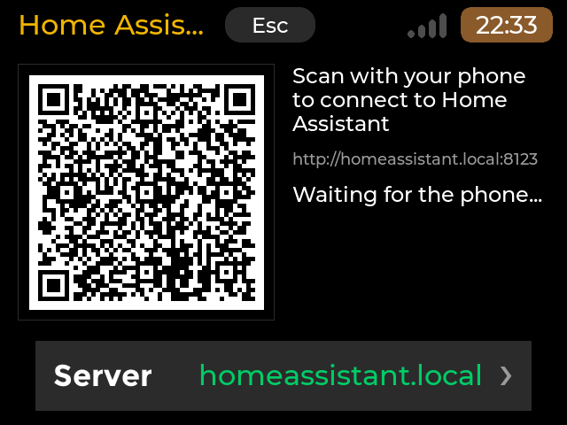 | 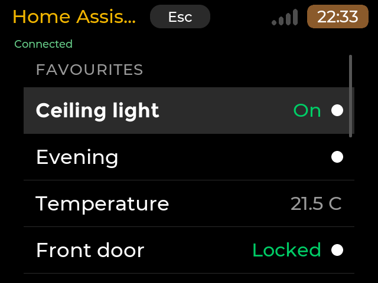 |
| Connect page (sign in by QR code), 640x480 | Favourites tab, 640x480 |
| 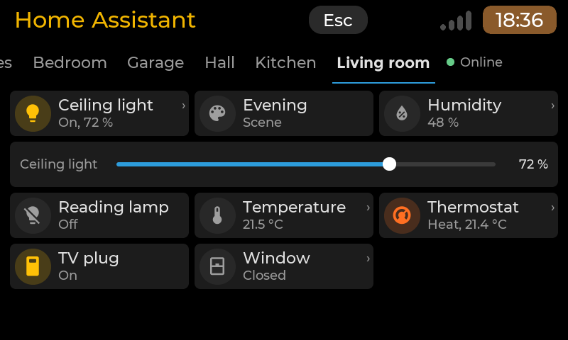 | 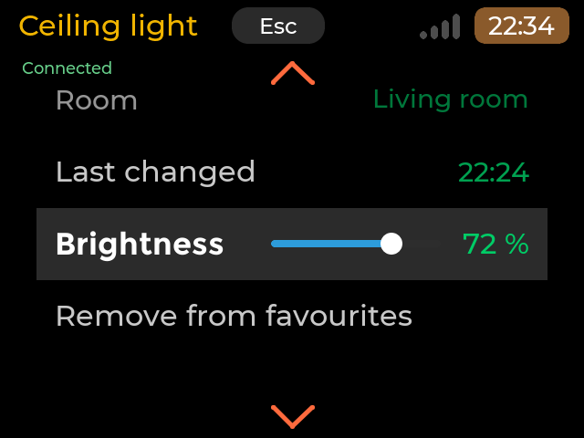 |
| An area's tab, 800x480 | A light's page, 640x480 |
| 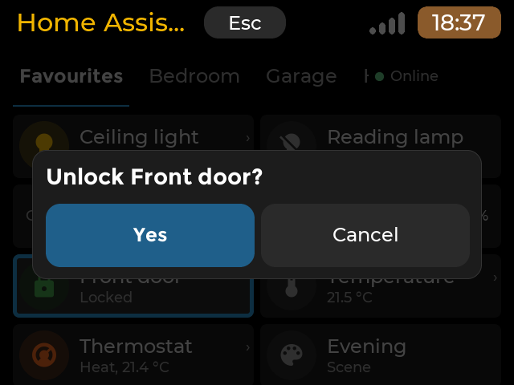 | 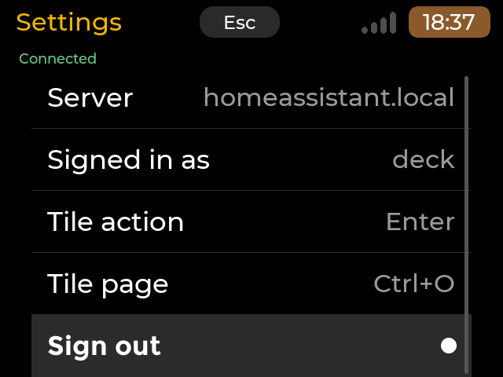 |
| A lock's tile asks for a confirmation, 640x480 | Settings, 640x480 |
| 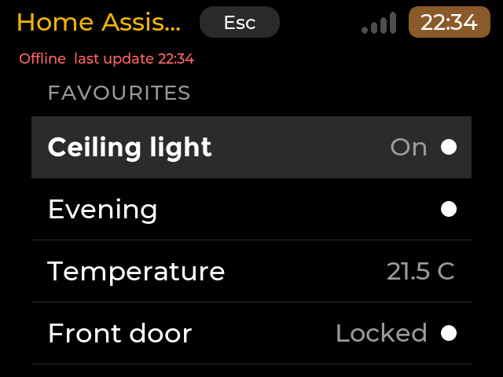 | 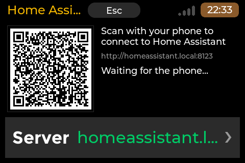 |
| Offline, 640x480 | Connect page, 480x320 |
| 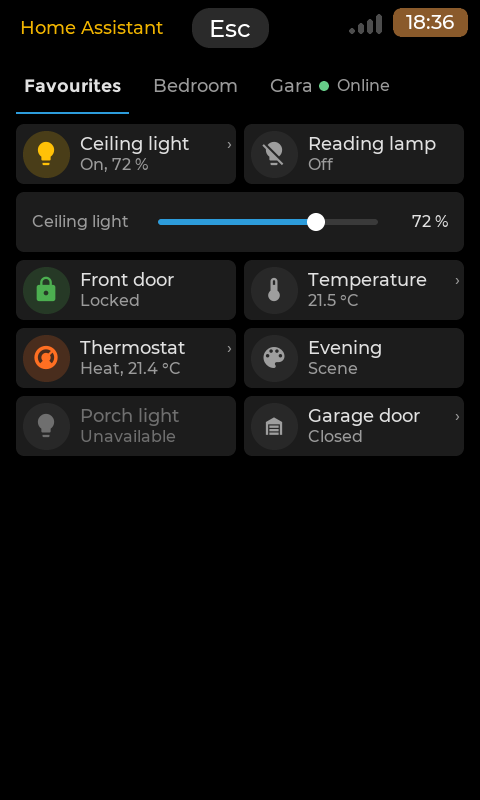 | 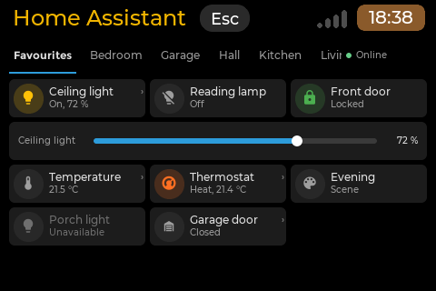 |
| Portrait (PDA mode), 480x800 | The Pi 3A+'s 3.5" panel, 480x320: three columns |
| 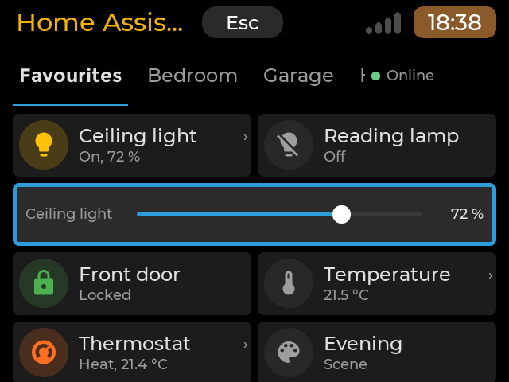 | 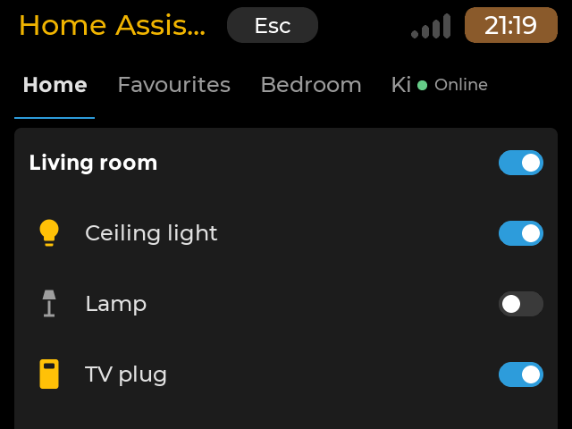 |
| The keyboard's focus on a slider row, 640x480 | 0.3.0, the stored dashboard: its view, one column, 640x480 |
| 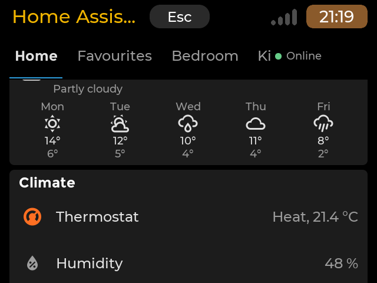 | 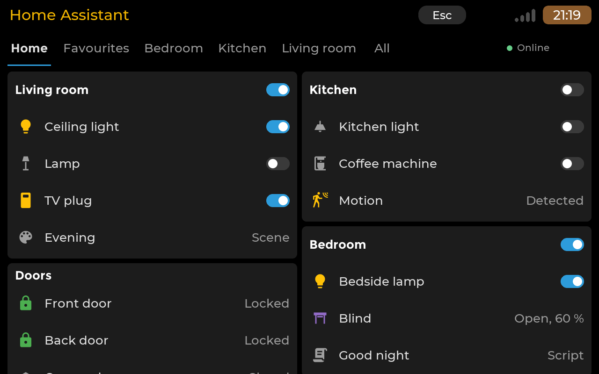 |
| A sensor card's line and the weather card, 640x480 | Two masonry columns, 1280x800 |
| 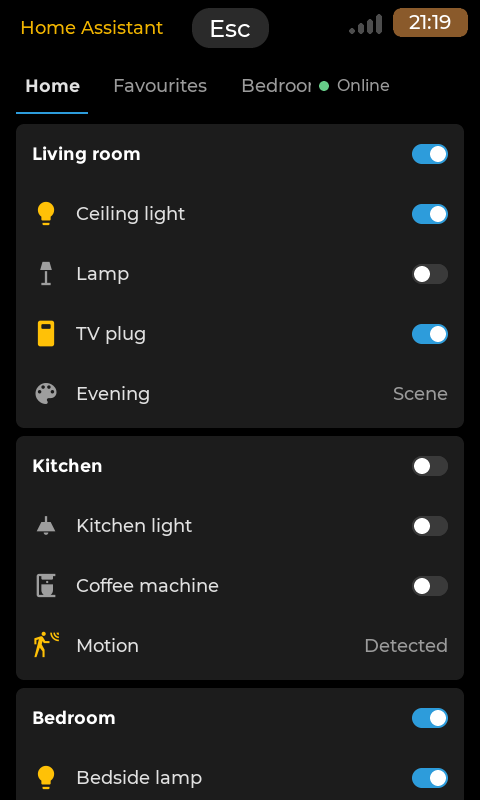 | 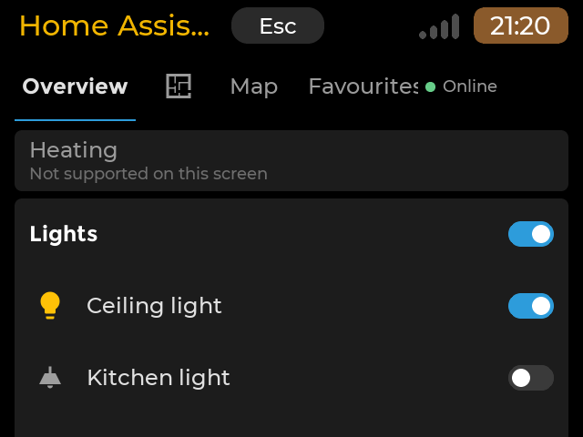 |
| The stored dashboard in portrait, 480x800 | Cards the deck does not draw, 640x480 |
| 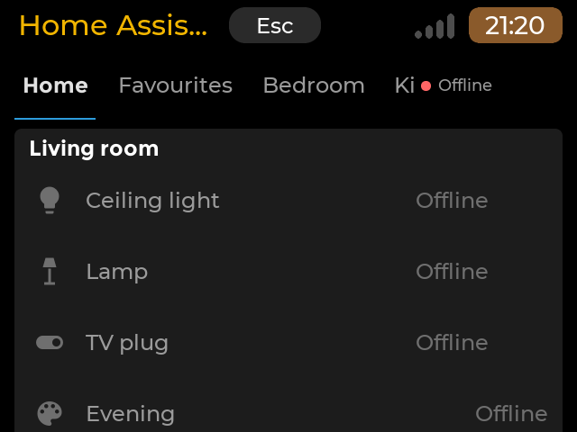 | 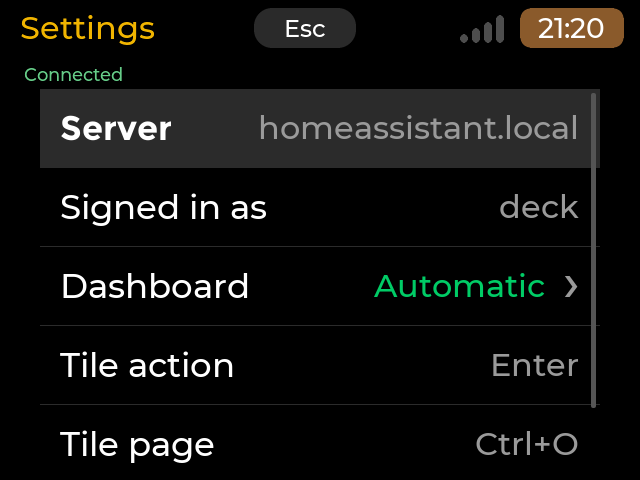 |
| A start without a connection, 640x480 | Settings > Dashboard, 640x480 |

## Pages

- **Connect** (first run, after Sign out, or when Home Assistant refuses the sign-in): "Scan with your phone to connect to
  Home Assistant", the QR code (left, or on top on a portrait screen), the address line (`http://homeassistant.local:8123`),
  the status line, and the row `Server  homeassistant.local  >` across the bottom (the host whole beside the label;
  "..." only for a host too long for the row). The status line says
  "Waiting for the phone...", then "Signing in...", "Connected as <user>" (green) and Home follows after 1.5 s; or which step
  failed: "Cannot reach Home Assistant at ... Check the server address." (the server), "Home Assistant refused the sign-in
  (access_denied). Scan the code again." (the login on the phone), "Nothing came back from the phone yet. If it could not
  open the page, use Home Assistant's IP address as the server address." (after 3 minutes without an answer: the phone could
  not open the page or could not reach the deck). Esc ends the app.
- **Server address**: one field (the toolkit's `TextField`; the fallback keyboard shows only when no keyboard is connected, the
  shared rule). `homeassistant.local:8123`, `192.168.1.5:8123`, `http://...`, `https://...` are understood; without a port, the
  scheme's own (80 / 443), as in a browser. A wrong address is named under the field. Enter keeps it, Esc goes back.
- **Dashboard** (0.2.0, study 053 P1; 0.3.0, P2). Under the shared header, one 7 mm **tab bar**: first **the views of your
  stored dashboard** (0.3.0: their titles, or their icon when a title is missing or too long for the bar; subviews and
  views hidden from your user get no tab), then **Favourites** (starred on the deck, in the order starred), then **one tab
  per Home Assistant area** that holds entities (by name, as All's rooms), then **All**. The app opens on the dashboard's
  first view when there is one.
  The bar scrolls sideways; a long area name ends with dots. Its right end is the connection as a dot and a word: **Online**
  (green), **Connecting...** / **Reconnecting...** (amber), **Offline HH:MM** (red, after three failed tries, with the time
  of the last update).
  - A **view of your stored dashboard** (0.3.0) shows its cards as Home Assistant's masonry view places them:
    `columns = clamp(floor(width_mm / 50), 1, 4)` (one on the deck's 56.6 mm and in portrait, two on the Pi 4B's 5" 108 mm
    screen and at 1280x720 / 1280x800; a panel view one card, full width), each card in order into the column that is the
    shortest so far, as wide as its column; the view scrolls vertically. Cards are Home Assistant's dark card colour
    #1c1c1c with a small radius (no shadows, gradients or animations), titles in the toolkit's label colour:
    - **entities**: the title, and in its line a switch, the **header toggle**, when the card holds lights, switches, fans or
      input booleans (`show_header_toggle: false` hides it; locks and covers never take part): all on when none is on,
      else all off. Then one 7 mm row per entity (given as an id or as `{entity, name, icon, secondary_info, tap_action}`):
      the icon in its state colour (the row's own `icon` first), the name (the row's `name` first; cut with dots), and at
      the right the state word ("Locked", "21.5 °C", "Home" / "Away", "Partly cloudy", "Not available" for an entity Home
      Assistant does not have) or, for a light, switch, fan or input boolean, a **switch** that only moves when Home
      Assistant reports the new state ("..." while waiting). A tap on the icon or the switch does the row's action
      (toggle; run a scene or script; a lock and a garage / gate / door cover ask first, as the tiles); a tap on the name
      follows the row's `tap_action` (the entity page by default, `toggle`, or `none`). `section` rows are grey capitals
      after a hairline, `divider` rows a hairline; other row types (button, weblink, call-service, conditional ...) show
      their name (or type) in grey and do nothing. `secondary_info` is read and not drawn.
    - **sensor**: the name and the icon, the value large with its unit (`name`, `icon`, `unit` honoured), and with
      `graph: line` a line of its history (`hours_to_show`, 24 by default; `detail` 1: a point an hour, 2: six an hour, at
      most 100 points), from `history/history_during_period`; while there is no history only the value shows. A tap opens
      the entity page.
    - **weather-forecast**: the name, the condition's icon (Material Design Icons' `weather-*`), the temperature with its
      unit and the condition in words; with `show_forecast` (default) up to five days: the day, its icon, high and low
      (`weather/subscribe_forecast`, daily, only while the view shows). Read only.
    - **any other card** (a map, a thermostat, a tile, a custom card ...): a small greyed card with its title (or type) and
      "Not supported on this screen", in its place; never dropped. A panel view with such a card shows the same.
    Keys: Up / Down from stop to stop (header toggles, entity rows, sensor cards), Left / Right to the previous / next card,
    Home / End, Enter acts, Ctrl+O opens the entity page, Up from the first stop to the tab bar. Only what changed is
    redrawn (a row's word, colour or switch, a chart's points).
  - Favourites and the areas are **grids of tiles**. Columns from the width in millimetres:
    `clamp(floor((width_mm - 2 margin + gap) / (24 mm + gap)), 2, 6)` (margin and gap from the `space` tokens): 2 on the deck
    and in portrait, 3 at 800x480 and on the Pi 3A+'s 3.5" panel (79 mm), 4 on the Pi 4B's 5" screen. Each tile is one 7 mm
    `row` high: at its left the 7 x 7 mm icon square (a Material Design Icons glyph in a 5.5 mm circle, tinted with the
    state's colour when the entity is active), then the name (cut with dots; the name size keeps about 12 characters whole)
    and the state word in grey ("On, 72 %", "Off", "Locked", "21.5 °C", "Heat, 21.4 °C", "Scene", "Unavailable"). A tap
    on the name opens the entity page on every tile; a small chevron in the top right corner says when that page holds
    more than the icon's action: a dimmable light (the brightness), a cover (Open and Close, its position), a sensor,
    binary sensor or thermostat (read on its page). A plain toggle, a scene, a script or a lock shows none (its page only
    repeats the action). An unavailable entity's tile is dimmed; a
    command waits with "..." until Home Assistant reports the new state (no optimistic flip); a scene says "Done" for 1.5 s.
  - A **dimmable light** gets a full-width **slider row** under its row of tiles (the light's name at its left, its level at
    its right, the toolkit's slider look): drag it, or tap left / right of the knob for 10 %; the level goes to Home
    Assistant 0.3 s after the last move.
  - **Colours** (dark only): Home Assistant's dark surface tokens (tile #1c1c1c, idle circle #282828, disabled #6f6f6f) and
    its state colours, which are Material palette values: amber for on (lights, switches, a running script, a binary sensor),
    purple for an open cover, green for locked, red for unlocked / jammed / an alarm sensor / a low battery, orange for
    locking or a medium battery, deep orange / blue / green / orange / cyan for heating / cooling / auto / dry / fan. Amber
    means "on" inside the tiles only, always with the word; the launcher's green / amber / red keep their status meaning
    elsewhere (the connection, errors, the lists of All).
  - **All** is 0.1.0's list: FAVOURITES, ROOMS (with the count of their entities; "No room" collects the entities without
    an area), then Settings.
  - Before the first favourite: "No favourites yet. Open a device (in All, or by its name here) and add it."
- **Room** (from All): the room's entities, by name. Typing on a keyboard filters the room ("FILTER: ..."); Backspace and Esc
  undo it. No on-screen keyboard for the filter (the fallback keyboard is only for the server address).
- **Entity page** (a tile's name, Ctrl+O, or a row of All; study 053 section 7.6): at the top the tile's icon in its
  circle, the state word and "Living room - changed 19:58"; right under it, from the top, 7 mm rows in the toolkit's list
  look (the highlight bar, a hairline between rows, grey read-only values, the white action dot, blue while a command
  waits): the read-only attributes (climate temperatures and action, a cover's position), for a dimmable light the
  Brightness slider row (the label whole, the level at the right, the track between), the action row (Turn on / Turn off,
  Activate, Run, Lock / Unlock, or a cover's Open and Close), and Add to / Remove from favourites. A label too long for
  its row gets a smaller face, never dots. Keys: Up / Down move over the rows that do something, Left / Right step the
  slider by 10 %, Enter (or Right) acts, Esc (or Left) goes back. Touch: a tap selects a row, a tap on the selected row
  acts (the lists' rule); the slider follows a drag at once, a tap on it left or right of the knob steps 10 %.
- **Settings** (the last row of All): Server (the address with its port when it fits, else the host) and Signed in as (read
  only), **Dashboard** (0.3.0: "Automatic (Home)", the dashboard's title, or "Off (tiles only)"; Enter, or a tap on the
  highlighted row, moves to the next: Automatic, each dashboard with at least one card the deck draws, Off; Automatic is
  the dashboard the system's default panel names when it is one of the listed dashboards, else the default dashboard),
  the tiles' keys ("Tile action: Enter", "Tile page: Ctrl+O", also the rows'), Sign out (asks first; Home Assistant
  revokes the sign-in, the file goes, the Connect page shows).

Room and Settings keep 0.1.0's line under the title (Connected / Connecting... / Reconnecting... / Offline, "last update
HH:MM"). Not connected, the tiles and rows keep their last values in grey; no spinner animation (CPU on the Zero 2 W). A
command sent while not connected says so (a box at the bottom of the dashboard and the entity page, the line elsewhere)
instead of queueing; so does a command Home Assistant refuses ("Could not unlock Back door: Lock jammed").

### Tiles and what they do

| Domain | Icon tap, or Enter on the focused tile | Name tap, or Ctrl+O |
|---|---|---|
| light, switch, input_boolean | on / off ("..." until Home Assistant reports it); a dimmable light also has its slider row | entity page |
| scene, script | run ("Done" for 1.5 s; "Running" while a script runs) | entity page |
| lock | asks "Unlock Front door?" / "Lock Front door?" Yes / Cancel | entity page |
| cover | open / close; garage, gate and door covers ask first ("Open Garage door?") | entity page (Open, Close) |
| sensor, binary_sensor, climate | entity page | entity page |

The chevron shows on the tiles whose page holds more than the icon's action (dimmable lights, covers, sensors, binary
sensors, thermostats).

An unavailable tile's icon opens its page. Not connected, no question is asked: the command is refused with a message.

### Rows (All, a room) and what they do

| Domain | Row | Enter, or a tap on the highlighted row's name | Right, or a tap on its value (right 40 %) |
|---|---|---|---|
| light | Action (dot) | on / off ("..." until Home Assistant reports it) | entity page (brightness) |
| switch, input_boolean | Action | toggle | entity page |
| scene, script | Action (blue while a script runs) | run ("Done" for 1.5 s) | entity page |
| lock | Action | asks "Unlock Front door?" / "Lock Front door?" Yes / Cancel | entity page |
| cover | Open (chevron) | its page: Open, Close; garage, gate and door covers ask first | the same |
| sensor, binary_sensor, climate | Info (grey value) | entity page | entity page |

Phase 1 domains only: light, switch, input_boolean, scene, script, sensor, binary_sensor, cover, lock and climate (read only).
Hidden entities and Home Assistant's configuration / diagnostic entities are left out of the tabs and rooms. No alarm panels.
Values: the tiles write "21.5 °C" (their face, the launcher's Montserrat through FreeType, has the degree sign; other
non-ASCII unit characters are left out), the lists of All and the rooms keep 0.1.0's "21.5 C"; "Open" / "Closed",
"Detected" / "Clear" (a binary sensor's word from its class), grey "Unavailable" / "Unknown".

### Icons

Material Design Icons 7.4.47 (Pictogrammers, Apache-2.0: the version Home Assistant's frontend uses), the whole webfont
(`materialdesignicons-webfont.ttf`, 7,447 icons) drawn by the toolkit's FreeType at the tile's size, and `mdi-names.bin`
(13,659 names and aliases to codepoints, a sorted table mapped and searched by binary search), both in
`/usr/share/APPLaunch/share/home-assistant/`. Which icon an entity shows, the first name the font knows:

1. the icon the user chose in Home Assistant (the entity registry's `ic`);
2. the state's `icon` attribute;
3. the integration's icon for the entity's translation key (`frontend/get_icons`, category `entity`);
4. a battery sensor's level step (battery-10 ... battery);
5. the domain's rule (`frontend/get_icons`, category `entity_component`: the device class's rule, else the domain's, by
   state: `lightbulb` / `lightbulb-off`, `lock` / `lock-open-variant` ...);
6. the app's own small table (every phase-1 domain, for an older server or a first start offline).

Points 3 and 5 are data Home Assistant serves to any user at run time (one call each at connect, kept compact and cached
in `layout.json`); no icon table or code of Home Assistant's frontend is copied. Icons of other sets (a HACS `phu:` icon)
fall through to the next point. Without the font file the circle shows the name's first letter.

### Keys and touch

On the dashboard (study 053 section 8.2):

| Action | Touch | Keys |
|---|---|---|
| Move between tiles | drag to scroll | arrows: a 2-D focus (Up / Down by row, Left / Right by column; Down from a dimmable light goes into its slider row, Up from a slider back to its light; Home / End) |
| The tile's action (toggle, run, ask for a lock) | tap the icon | Enter |
| The tile's page | tap the name or the state word | Ctrl+O |
| Brightness | drag the slider row, or tap left / right of its knob (10 %) | Left / Right on the slider row (10 %) |
| Switch view | tap a tab; a sideways swipe on the tiles (a convenience) | Page Up / Page Down anywhere; Up from the first row to the tab bar, then Left / Right |
| Quit | the header's Esc | Esc |

The focus (the launcher's highlight colour as the tile's ground, and an outline in the launcher's selection blue) shows
from the first key press, which only shows it; a tap hides it again, so a touch-only board (the Pi 3A+) never shows a
focus. In the All tab the list takes Up / Down / Home / End / Enter / Right as in 0.1.0 (Page Up / Down switch views
there too; Up from the first item reaches the tab bar). Settings shows "Tile action: Enter" and "Tile page: Ctrl+O".

On the other pages (0.1.0):

| Action | Touch | Keys |
|---|---|---|
| Move | tap a row (it highlights), drag to scroll | Up, Down, Home, End, Page Up, Page Down |
| Act on a row | tap the highlighted row (on its name) | Enter |
| Entity page of a row | tap the highlighted row on its value side | Right |
| Brightness (entity page) | tap the highlighted slider row left or right of the knob (10 %) | Left / Right (10 %) |
| Filter a room | | type letters; Backspace |
| Confirm / cancel | Yes / Cancel | Enter / Esc |
| Back, quit at the dashboard or Connect | the header's Esc | Esc (Left in a list) |

The app takes every key itself (the toolkit's keypad path is intercepted, as Mesh Hop does), so that letters typed into a
room's filter never move the list; outside a room the navigation letters work as in the other apps.

## How it works

- **Pairing** (spike probe 3, run by the owner against Home Assistant 2026.10.4): the deck checks the server with
  `GET /auth/providers` (no login, answers 200), opens a listener on its LAN address and a free port, and shows the QR code of
  `<server>/auth/authorize?client_id=http://<deck>:<port>/&redirect_uri=http://<deck>:<port>/callback&state=<random>`
  (Home Assistant accepts a client id on a local IP address and a redirect to the same host and port). The phone logs in and
  comes back to the listener with a one-time code; the deck exchanges it at `POST /auth/token`. The listener answers only
  while the Connect page shows, only `/callback` with the right state counts, and it closes after the sign-in.
- **Tokens**: the access token (30 minutes) stays in memory; the refresh token and the exact client id are kept in
  `~/.config/home-assistant/credentials.json` (mode 0600, folder 0700, written atomically), never logged or shown. Each
  connect uses a fresh access token (refreshed first when less than a minute is left) and the token is refreshed 2 minutes
  before it ends while connected.
- **Failed logins count toward Home Assistant's IP ban** (when enabled): an `auth_invalid` with a token older than a minute
  is retried once with a new token; any other refusal (a second `auth_invalid`, a 4xx from `/auth/token`) stops, revokes what
  is left and goes back to the Connect page. It never loops.
- **WebSocket** (`ws://<server>/api/websocket`, libcurl 8.11 or newer, `CURLOPT_CONNECT_ONLY` 2): auth, `supported_features`
  (coalesced messages), `get_config` (temperature unit), `auth/current_user`, `config/area_registry/list`,
  `config/device_registry/list` (only areas and names kept), `config/entity_registry/list_for_display` (name, area, the
  user's icon `ic`, platform `pl`, translation key `tk`), then one `subscribe_entities` for the favourites plus the area tab,
  room or entity shown (spike verdict: never the whole state), and the icon rules: `frontend/get_icons` category
  `entity_component` for the ten phase-1 domains, and category `entity` for the integrations whose entities have a
  translation key (both open to a user without administrator rights). Changes arrive as `a` / `c` / `r` and are applied to
  the model; only the attributes the pages show are kept (0.2.0 adds `icon`).
- **Stored dashboards** (0.3.0, study 053 P2; every command open to a user without administrator rights): after the
  registry, `lovelace/dashboards/list`, `frontend/get_system_data` (key `core`: the default panel) and `lovelace/config`
  for the default dashboard (no `url_path`), then `lovelace/config` for each listed dashboard (at most 20). Each answer is
  imported into a small Lovelace-shaped model (views, cards, rows; unknown keys ignored; a `sections` view's cards flattened
  in order; badges not kept); a dashboard generated by a strategy (`config_not_found`, or `{"strategy": ...}`) is not read
  (no generators on the deck: then the tiles). An answer over 1 MB is not shown: a message, and the tiles. The
  subscription (`subscribe_entities`) holds the entities of the view shown plus the favourites, and changes when the tab
  does; `weather/subscribe_forecast` runs only while a view with a weather card shows; a sensor card's
  `history/history_during_period` (`minimal_response`, `no_attributes`) is asked when its view shows, again after 5
  minutes. The app never calls Home Assistant's REST API.
- **Dashboard cache**: the dashboard shown, as Lovelace-shaped JSON (only the keys the deck uses), with the dashboards
  offered, the system's default panel and the names of its entities as last seen, is written to `dashboard.json` when it
  changes (atomically, mode 0600, at most 1 MB). The next start shows it at once, greyed, until Home Assistant answers.
- **Layout cache**: the areas, the visible entities (name, area, icon, platform, key, precision) and the icon rules are
  written to `layout.json` when they change (atomically, mode 0600, at most 1 MB: a larger install is not cached; 2,000
  entities make about 130 KB). The next start shows the tabs and tiles from it, greyed with "...", until Home Assistant
  answers. A dimmable light's slider row appears once its state says it is dimmable.
- **Link**: `SO_RCVBUF` 64 KB (spike: libcurl otherwise copies whatever the kernel holds), messages put back together from
  frames by the app (at most 4 MB; a larger one is dropped and logged, the link stays), libcurl answers the server's pings
  while the thread reads, a `ping` after 30 s without a message and the link dropped after 15 s without an answer, TCP keepalive,
  IPv4 only (Home Assistant also publishes an IPv6 link-local address without a zone). Reconnect after 2, 4, 8, 16, 32, then
  60 s. After the launcher stopped the app (multitasking freeze) it reconnects at once.
- **Threads**: one connection thread owns the engine (a state machine with no I/O, `src/core/engine.*`), libcurl, the
  listener and the files, sleeping in `poll()`; the LVGL thread sends commands and copies the view when it changed (polled
  every 200 ms, the pages refreshed at most twice a second). A refresh touches only what changed: a tile whose state
  changed is redrawn alone (LVGL invalidates just its objects); the grid is rebuilt only when its entities or slider rows
  change. No shadows, gradients, blur or animations; small radii. libcurl is opened at run time (`dlopen("libcurl.so.4")`, as
  Mesh Hop opens libsystemd), so the shared build is unchanged; its constants are checked against the real headers by
  `tests/integration/check_curl_abi.cpp`.

## Requirements

- Home Assistant on the same network (tested against a fake server only; the owner's is 2026.10.4), a user to sign in with
  (a dedicated user without administrator rights is best: see below), and a phone on the same Wi-Fi that can open the
  server's address (`homeassistant.local` or its IP address).
- `libcurl4t64` (Debian 13 and Ubuntu 24.04 or later; the boards already have it through `curl`) with WebSocket support
  (curl 8.11 or newer; Ubuntu 24.04's 8.5.0 has none: the app then says so on the Connect page).
- A screen of 480x320 or larger (`X-MinSize=480x320`; portrait `X-Portrait=480x640` in PDA mode). Touch and keyboard both
  complete.
- Launcher with full-screen app support. `X-Background=freeze`: hidden, the app is stopped; shown again, it reconnects.

### On the Home Assistant side

1. Settings > People > Users > Add user (for example `deck`): **Administrator off**; "Can only log in from the local
   network" on unless you use the deck away from home. Home Assistant has no per-entity permissions in its UI: this user
   still controls every entity, so the locks and garage covers ask on the deck.
2. Log in as that user on the phone when you scan the code.
3. Lost deck: log in to Home Assistant as that user > profile > Security > Refresh tokens, and delete the entry named
   `http://<deck address>:<port>/`. The deck's open link closes at once; it shows the Connect page and never retries.

## Install

Settings > Apps > Available (the project's default source), or by hand: `sudo dpkg -i home-assistant_0.3.0_arm64.deb`
(or `_amd64.deb` on a PC); remove from Settings > Apps > Installed or with `sudo dpkg -r home-assistant`.

## Files the app keeps

| Path | What |
|---|---|
| `~/.config/home-assistant/settings.json` | the server address, `"dashboard"` (0.3.0: `auto`, `off` or a dashboard's `url_path`; Settings > Dashboard), and `"qr_use_ip": true` to put Home Assistant's IP address in the QR code instead of its name (for a phone that cannot resolve `homeassistant.local`; no row for it in phase 1) |
| `~/.config/home-assistant/favourites.json` | the starred entity ids |
| `~/.config/home-assistant/names.json` | the favourites' names as last seen, written when one changes: a start without a connection shows them; mode 0600 (0.2.0) |
| `~/.config/home-assistant/layout.json` | 0.2.0: the areas, the entities' names, areas and icons, and Home Assistant's icon rules as last seen (the tabs and tiles of a start without a connection); mode 0600, at most 1 MB |
| `~/.config/home-assistant/dashboard.json` | 0.3.0: the stored dashboard shown (Lovelace-shaped, only the keys the deck uses), the dashboards offered, the names of its entities as last seen (a start without a connection); mode 0600, at most 1 MB |
| `~/.config/home-assistant/credentials.json` | server, client id, refresh token; mode 0600; deleted by Sign out or when refused |

Reset: Sign out in the app (revokes the token), then delete the folder. `HA_CONFIG_DIR` moves it (tests).
`HA_DEMO=<world>` runs the app against the simulated Home Assistant, with no network (the harness's worlds: `connect`,
`home`, `empty`, `big`, `connecting`, `reconnecting`, `offline`; 0.3.0: `dash` (the owner-shaped stored dashboard: one
masonry view of 12 cards, 9 entities, 2 sensor, 1 weather-forecast, 25 entity references, invented names; a second
dashboard of one map card), `dash-offline`, `dash-mixed` (unsupported cards and rows, an icon-only view, a panel map view,
a subview, a hidden view), `dash-long` (long names)).

## Known limits (phase 1)

- Not tested against a real Home Assistant, nor on a board: only against the simulated server (unit tests, scenes) and the
  fake server (integration test). The owner's board protocol is `tests/BOARD-TESTS.md`.
- https servers: libcurl checks the certificate against the system CAs; a self-signed certificate is refused (no pinning
  yet). Plain http is accepted on any address.
- No discovery (mDNS) yet: the address is typed or the default is used. No token-file or typed-token fallback.
- No climate control, media players, cameras, fans, buttons, alerts, Assist or wallboard (later phases).
- Without a connection at start, the tabs and tiles show the layout cached by the last session (`layout.json`, and the
  favourites' names in `names.json`); an entity starred but never seen online shows its entity id's words.
- Tiles and rows are 7 mm: on the deck about three and a half rows of tiles show under the header and the tab bar (two
  columns). A long name is cut with dots. A dimmable light's slider row is full width under its row of tiles; two dimmable
  lights side by side give two slider rows, each with the light's name.
- The tiles' layout is the app's own (favourites, then each area's entities by name). 0.3.0 reads your **stored**
  dashboards, and draws only the card types the owner's dashboard holds: `entities`, `sensor`, `weather-forecast`; every
  other card (map, thermostat, gauge, history graph, tile, heading, custom cards ...) is a greyed "Not supported on this
  screen" card. Generated dashboards (the new Overview, the `original-states` / `areas` strategies) are not rebuilt (study
  053 P3): with only those, the tiles show. Cards' `visibility` conditions and views' badges are not read (every card
  shows); `state_color` is not read (icons are coloured by state); `secondary_info` is not drawn; the weather card shows the
  daily forecast only. No colour temperature, climate control or cover position feature rows yet; climate is read only.
- Automatic follows the **system's** default panel (`frontend/get_system_data`), not a default panel chosen by your user
  in its profile; a default panel that is not a listed dashboard (the generated Overview `home`, `map` ...) reads as the
  default stored dashboard.
- Ctrl+O cannot be scripted in the PC harness (no modifier keys there): its mapping is unit-tested (`nav_key`), the scenes
  open pages by a tap on the name. The Server row is
  fitted the other way ("Server" stays whole, the value gives way): `homeassistant.local` is whole at 640x480 and up and on
  the real 480x320 panel (the Pi 3A+'s 3.5", 6.1 px/mm); only a 480x320 screen at the deck's 11.3 px/mm (the harness's
  default, no board has one) shortens it with "...".
- The Brightness slider row is the toolkit's; its bar is a picture (not clickable): the row is the touch target.
- The QR code holds a plain-http address of the deck: a phone browser in HTTPS-only mode refuses the redirect.

## Credits and licences

- The app: MIT, 2026 OSRdesign.
- [QR Code generator library](https://www.nayuki.io/page/qr-code-generator-library) by Project Nayuki, C++ version 1.8.0, MIT,
  vendored unchanged in `src/core/qrcodegen.{cpp,hpp}` (its notice is in the files and in the package's copyright file).
- [Material Design Icons](https://pictogrammers.com/library/mdi/) 7.4.47 by Pictogrammers, Apache-2.0: the webfont
  `materialdesignicons-webfont.ttf` shipped unchanged (npm `@mdi/font`) and `mdi-names.bin` generated from `@mdi/svg`'s
  `meta.json` by `tools/make_mdi.py` (which checks both npm tarballs against their pinned sha512); the licence text is
  `/usr/share/doc/home-assistant/LICENSE.mdi`. The tiles' look follows Home Assistant's tile card as its documentation and
  the study describe it (facts: the Material colour values of its state colours, its dark surface colours); no code, CSS,
  SVG or icon table of Home Assistant's frontend (Apache-2.0) is used. No Home Assistant logo. 0.3.0's dashboard reads the
  cards' configuration keys as Home Assistant's dashboard documentation describes them and draws them its own way; the
  weather conditions' icon names are Material Design Icons names.
<!-- branding-allow-begin: credits -->
- The LVGL based `cp0_lvgl` runtime of the CyberdeckZero Launcher (derived from the MIT-licensed launcher of M5Stack Technology
  CO LTD) and LVGL (MIT), linked into the binary.
<!-- branding-allow-end -->
- libcurl (curl licence) is not shipped: the system's `libcurl.so.4` is opened at run time.
- Home Assistant's APIs as documented on contributors.home-assistant.io and read in its core sources (study 052 and its spike);
  the JSON reader is adapted from Mine Field's (same repository).

## Build and test

```
sh apps/home-assistant/build.sh host            # unit tests (core: 1,200+ checks) and the scenes at ten sizes
python3 apps/home-assistant/tools/make_mdi.py --download --check   # the font, name table and licence = the pinned npm packages
sh apps/home-assistant/build.sh cross           # the aarch64 binary into root/
sh apps/home-assistant/build.sh cross --arch amd64   # the x86-64 binary into root.amd64/ (Mesh Hop's README: private dev root)
sh apps/home-assistant/build.sh integration     # the real client against tests/fake_ha/fake_ha.py (needs a WebSocket libcurl)
python tools/make_registry.py --only home-assistant --out <folder outside packages/> [--arch amd64]
```

- `src/core/` (no LVGL): `json` (the reader), `text` (URL / form encoding, the server address), `model` (registry, rooms,
  a / c / r), `format` (the words of the rows), `tiles` (0.2.0: tabs, columns by mm, the tiles' colours and words, the rows
  of tiles and sliders, the 2-D focus and the keys), `lovelace` (0.3.0: the stored dashboard's model, its importer and
  export, which dashboard is shown), `dash` (0.3.0: masonry, the toggle domains, the forecast, the history's buckets, the
  rows' words), `icons` (the icon order, Home Assistant's icon rules, the app's own
  table), `mdi` (the name table), `engine` (the client state machine), `store` (the files), `qr` + `qrcodegen`
  (the code), `sim` (the simulated Home Assistant of the tests and the harness), `curl_api` + `net` (libcurl at run time, the
  WebSocket, HTTP, the listener), `runner` (the connection thread). `src/ui/`: the pages (`ha_app`), a view of the stored
  dashboard (`ha_dash`, 0.3.0).
- `tests/*.cpp`: the unit tests (`test-home-assistant`; `test_tiles.cpp` for 0.2.0's dashboard, `test_lovelace.cpp` for
  0.3.0's stored dashboard: the importer, masonry, toggles, forecast, history, the choice, the cache, the engine against the
  owner-shaped fixture). `tests/scenes/*.scene`:
  every page and state at 480x320, 640x480, 800x480, 1024x600, 1280x720, 1280x800, 720x720 and the portrait 480x800,
  480x640, 800x1280 (the dashboard: Favourites, an area, All, the entity page, the lock's confirmation, toggles and the
  slider, the keyboard's focus, offline, the cached layout, a 300-entity area; `t-panel480` the real 480x320 panel at
  6.1 px/mm; 0.3.0 `w1`-`w7`: the owner-shaped stored dashboard, the keys and a lock row's question, touch, unsupported
  cards, the cached dashboard offline, Settings > Dashboard, long names); the notice under 480x320; Esc; no contract; the multitasking lifecycle. `tests/fake_ha/fake_ha.py` (Python stdlib) and `tests/integration/`: pairing,
  2,000 registry entries, 100 subscribed entities, the stored dashboard (0.3.0: an owner-shaped one on the fake house, a
  map-only one, the forecast, the history, the header toggle's list call, Settings > Dashboard, no administrator command,
  no REST call), 1 KB frames, service calls, server pings, a 5 MB message, a TCP reset, an
  expired token, the token refresh, Sign out with revoke, a sign-in deleted on the server; every issued token is searched for
  in the logs. `tests/BOARD-TESTS.md`: the owner's protocol.

## Changes

- 0.3.0 (published 2026-11-02, the first published version): study 053 P2: your stored dashboard drawn natively, its views as the first tabs (titles or icons): masonry
  columns by millimetres, `entities` cards (rows with icons, names, state words or switches, sections, dividers, the
  header toggle, `tap_action`), `sensor` cards (the value and a line of its history), `weather-forecast` cards (now and
  five days), any other card greyed "Not supported on this screen"; the subscription follows the view shown; Settings >
  Dashboard (Automatic, a dashboard, Off); the dashboard cached for a start offline (`dashboard.json`).
- 0.2.0 (draft): study 053 P1: the dashboard of tiles (Favourites, a tab per area, All), Material Design Icons with Home
  Assistant's icon rules (`frontend/get_icons`), its state colours, the icon acts and the name opens the page, a slider
  row for dimmable lights, the keyboard's 2-D focus (Enter acts, Ctrl+O opens, Page Up / Down switch views), the entity
  page's new top and action row, the layout cached for a start offline (`layout.json`), errors in a box at the bottom.
- 0.1.0 (draft): phase 1 of design 052a: QR pairing, Home (favourites, rooms), rooms with a keyboard filter, toggles, scenes,
  scripts, sensors, the light's brightness, locks and garage covers with a confirmation, covers' Open / Close, favourites,
  Sign out with revoke, connection states with back-off and greyed values.
