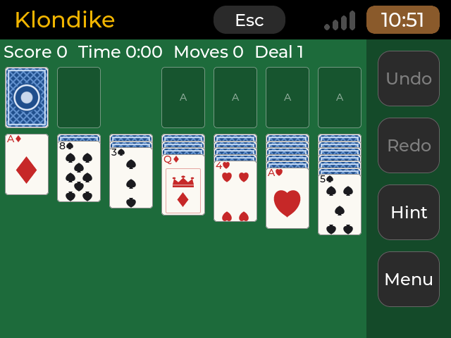
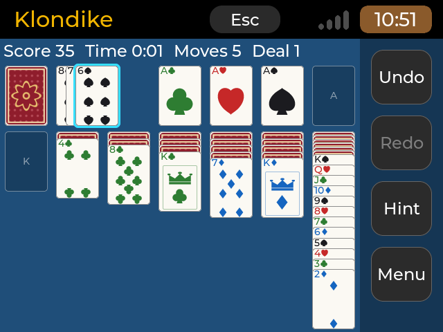
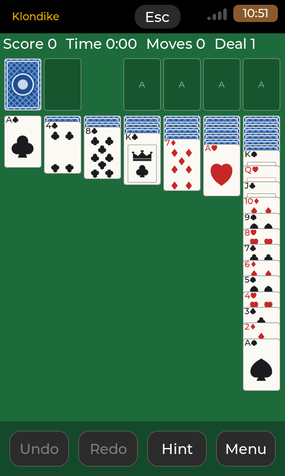
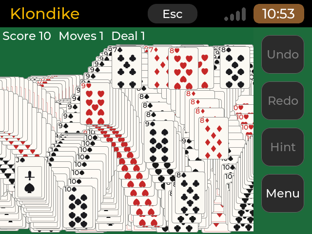
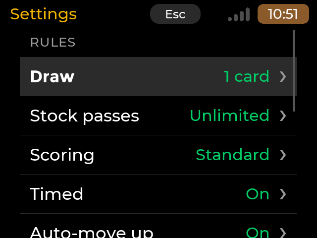
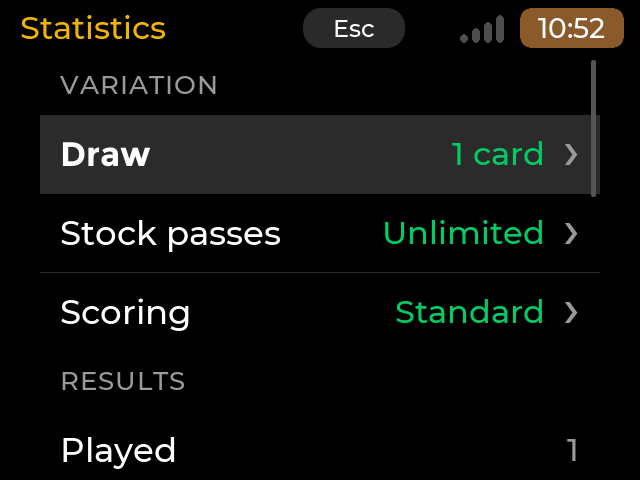
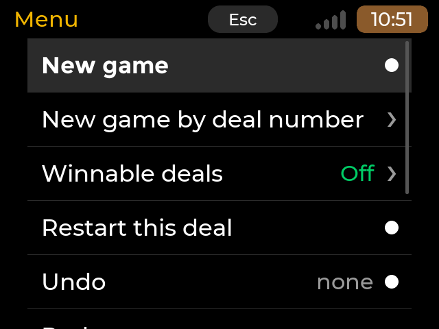
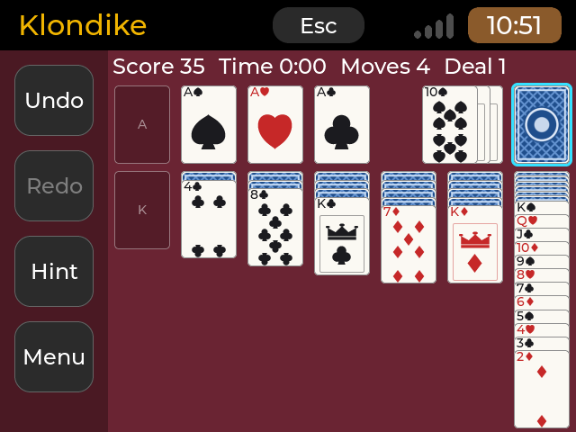

# Klondike Solitaire (`klondike-solitaire`)

The classic patience game for the deck, to be played by touch or keyboard: draw one or three, unlimited passes or
three or one, Standard, Vegas or no scoring, unlimited undo and redo, hints, safe moves to the foundations played for
you if you wish, a check that tells you when no useful move is left, numbered deals that are the same on every board,
and winnable deals proven by a built-in solver. Statistics per variation and the game in progress are kept on the
board. No network. Category Games, licence MIT, version 0.1.1.

> **Status.** Version 0.1.1 (0.1.0 was the first release), for arm64 and amd64 (`app.json`: `arm64`, `amd64`). The engine and the screen are
> tested on the PC (unit tests and scene runs at seven sizes) and the game was played on a Raspberry Pi 4B (touch and keyboard)
> before publishing; other boards are listed in `tests/BOARD-TESTS.md`.

## Screenshots

Rendered by the app's headless harness (`build.sh host`, scene files under `tests/scenes/`), at the deck's size and at a
portrait size, **not photographs of the panel**.

| | |
|---|---|
|  640x480 render, deck size. A fresh deal: the seven columns, the stock, four empty foundations, the bar at the right |  640x480 render. Mid-game, draw 3: the waste fanned three cards, the four-colour deck on a blue felt |
|  480x800 render, PDA mode (portrait, 4.3" DSI). The longest column (6 face down, King to Ace) with every index whole; the bar in a row at the bottom |  640x480 render. The win cascade under way: kings first, each card thrown, bouncing and leaving its trail |
|  640x480 render. Settings: rules and look |  640x480 render. Statistics of a variation |
|  640x480 render. The menu |  640x480 render. Left-handed: the top row and the bar mirrored |

## What it does

- **Table.** Seven columns, stock, waste and four foundations on a felt (green, blue or burgundy), cards drawn by the app
  from vector shapes (no image files): big index corners, pips, a Jack's sword, a Queen's tiara, a King's crown, two
  backs (blue lattice, red rosette), empty-pile marks (A for a foundation, K for a column, a turn-again arrow for the
  stock). A four-colour deck option (clubs green, diamonds blue) helps tell the suits apart.
- **Touch.** Tap the stock to draw (and to turn the waste over again). **Drag** a card or a run: it follows the finger
  lifted with a shadow; dropped near a pile that takes it, it snaps there (the nearest legal pile within one card width
  wins), anywhere else it flies back. Or **tap a card** (a blue frame marks it) and **tap where it goes**. **Double-tap**
  a card to send it to its foundation. The safe moves to the foundations play themselves when the setting is on and undo
  together with the move that led to them.
- **Keys.** Arrows move a cyan cursor over the piles and the cards of a column; Enter or Space picks up the card (the run
  from it) or draws from the stock, then puts it down on the pile under the cursor; Enter on the picked card sends it to
  its foundation. **U** undo, **R** redo, **H** hint, **N** new game, **A** auto-finish, **M** or **Ctrl+O** the menu.
  Esc drops a pick, then (like the header's Esc button) goes up one level; a short Esc at the table ends the app (the
  game is saved). A mouse or trackpad acts as a finger.
- **Bar.** Undo and Redo are always there; the third button is Hint, and turns into **Auto** when every card is face up
  and the stock can be played out without a recycle; the fourth opens the **Menu**. The line over the cards shows Score
  (not with scoring None), Bank (Vegas), Time (timed Standard), Moves and the deal number ("Winnable 123" for a winnable
  deal). A hint frames the source and the destination in amber; a banner (never blocking, taps pass through it) tells
  "No more useful moves" when the engine proves the game is lost (checked by a helper process, below), or other short
  notices.
- **Menu.** New game (random deal), New game by deal number (a number field of the toolkit: the on-screen keyboard, or
  the PDA handwriting band, shows by the shared rule), Winnable deals on / off, Restart this deal, Undo, Redo, Hint,
  Settings, Statistics, Help and rules.
- **Settings.** Rules (kept for the *next* game, shown in amber while they differ from the game in progress): draw 1 / 3;
  passes unlimited / 3 / 1; scoring Standard / Vegas / None; timed; auto-move to foundation; foundation back to column;
  empty column takes a King / any card. Look (at once): left-handed, four-colour deck, felt, card back, animation On /
  Reduced / Off. Leaving Settings with changed rules: an untouched deal is dealt again with them, a game in progress
  asks first (Later / New game, which counts the old game as a lost one); a rule never changes a game in progress.
- **Statistics.** Pick the variation (draw, passes, scoring); played, won, win rate, best score, best time, fewest moves,
  current and best streak, total time, the Vegas bank; reset this variation or all (asked first).
- **What counts.** Leaving a game after a move that was not taken back (new game, restart, new rules, deal by number)
  counts as a lost game of its variation; an untouched deal costs nothing; a win records score, time and moves and ends
  the saved game. The clock starts with the first move, runs only while the table is in front (not in a menu, a dialog,
  hidden by the launcher; a frozen app's long gap is dropped) and stops at the win.
- **Resume.** The game is saved after every move (and every 20 s of play, when hidden and on exit); the next start
  resumes it ("Game resumed"). With no saved game a fresh random deal starts. There is no "continue / new game" screen.
- **Winnable deals.** With the menu switch on, a new random game (or a typed number) asks the solver for the first
  provably winnable deal of that number; the search runs in a helper process and the old table stays usable meanwhile.
  If nothing is found in 45 s (or at all) the plain numbered deal is played and a notice says so.
- **Animation.** On: cards glide (190 ms), Reduced: 80 ms, Off: they jump. Drag release, undo and the auto-finish follow it.

### Layout, landscape and portrait

`X-Portrait=480x640` is declared (and `portrait_w/h` in `AppSpec`), so a portrait launcher (PDA mode) shows the app
upright. Nothing is chosen by screen name: `src/core/view_layout.hpp` tries the buttons in a column at the side and in a
row at the bottom and keeps the arrangement that allows the larger cards. The card size is the largest that fits seven
columns in the width **and** the worst column (6 face down, King to Ace) in the height with every index still whole:
a covered face-up card shows at least `fan_up_min` = the larger of 15 % of the card and `index_strip_px` (the rank
glyph's height, two px of margin above it, one of air below; the UI draws the index in exactly that frame, measures the
real font and shrinks it if a font were ever taller); the columns spread over the spare width; a long column shrinks
both its steps towards their minima (never below) so its last card ends inside the board. `tests/test_layout.cpp`
checks, at the seven sizes, both hands, draw 1 and 3 and for every column from 0 to 6 down and 1 to 13 up, that every
step in pixels is at least that minimum and the last card is inside (before this fix the longest column at 640x480
cut a few pixels off the suit of its covered cards). Left-handed mirrors the top row (stock and waste at the right, the waste fanning left) and the side dock.

| Canvas | Cards (px) | Buttons | Longest column (step of a face-up card) |
|---|---|---|---|
| 640x480 (deck) | 65x91 | column at the right | shrinks from 27 to 14 px |
| 800x480 | 65x91 | column at the right | 27 to 14 px |
| 720x720 | 90x126 | row at the bottom | 38 to 19 px |
| 1280x800 | 118x165 | column at the right | 50 to 25 px |
| 480x800 | 63x88 | row at the bottom | 26 px (no shrink) |
| 800x1280 | 104x146 | row at the bottom | 44 px (no shrink) |
| 480x640 | 63x88 | row at the bottom | 26 to 20 px |

(From the unit test's tokens; the real sizes follow the toolkit's header and button tokens.) The buttons are at least the
TARGET token (7 mm, 44 px at least). A card's width is limited by the seven columns: on a 480 px portrait canvas it is
about 7 mm, not 9 mm; the tap target of a fanned card is its visible strip (a column wide), of the top card the whole card.

### Files of the UI

| Path | What |
|---|---|
| `src/core/view_layout.{hpp,cpp}` | the geometry above (pure, unit-tested at the seven sizes) |
| `src/core/cardart.{hpp,cpp}` | the card art: suits, emblems and backs rasterised with anti-aliasing, the pip layouts, the palette |
| `src/core/session.{hpp,cpp}` | `Session`: next-game rules, look preferences (`ui.json`), the statistics rules (abandon, win), autosave and resume, the clock, auto moves; the helper process's replies |
| `src/ui/board_view.{hpp,cpp}` | 52 card objects and 13 pile slots made once, drawn by a callback from masks made once per card size; pointer gestures; drag; one animation; marks (cursor, selection, hint) |
| `src/ui/klondike_app.{hpp,cpp}`, `klondike_pages.cpp` | the page, the table, input, the notices, jobs; the menu, Settings, Statistics, Help and the dialogs (the toolkit's `CompactList`, `TextBlock`, `Dialog`, `TextField`) |
| `src/core/win_sim.{hpp,cpp}` | the physics of the win cascade (pure, fixed point, deterministic; `tests/test_winsim.cpp`) |
| `src/ui/win_animation.{hpp,cpp}` | the win cascade: trail layer, card images, timer, skip, pause (below) |
| `tools/make_icon.py` | draws `icon.png` and the tile copy under `root/` (Pillow; the shared helpers of `tools/icons/make_icons.py`) |
| `src/ui/worker.cpp` | the solver helper: the app starts itself as `<exe> --klondike-worker winnable|deadend ...` through `cdk::async_run`; a static initialiser answers before `main()`, so it also works in the headless harness |

### The win animation (the classic cascade)

`WinAnimation::start(BoardView &, done)` is called when the last card reaches the foundations; `done` is called exactly
once, when the cascade has run out or was skipped (the app then shows the result dialog), or at once with the animation
setting Off. `stop()` cancels (no `done`); `running()` and `skip()` let the app turn a key, a tap, Esc, a button or a
layout change into "end it". `set_input_enabled(false)` is set during it.

What you see: the cards leave the four foundations one by one, **kings first, the four piles in turn**; each card is
thrown sideways with its own speed, falls with gravity, **bounces on the bottom of the table** (loses 16 to 24 % of its
speed each time) and flies on until it has left the table sideways, **leaving an image of itself at every step**, so the
screen fills with the arcs of the cascade. The HUD and the buttons stay clean and on top: the cards pass under them.
It is the real card faces, drawn once by the card art and stamped, never an image file.

| | Normal | Reduced | Off |
|---|---|---|---|
| step (the simulation) | 33 ms (30 per second) | 66 ms (15 per second, half the drawing) | no animation: the result box at once |
| cards in flight at most | 8 | 6 | |
| a new card every | 8 steps (0.26 s) | 2 steps (0.13 s) | |
| a stamp every | step | 2nd step (a quarter of the stamps) | |
| horizontal speed | 0.8 to 2.1 % of the table's width per step | twice that per step (the same pace on the clock) | |
| whole run (52 cards) | about 15 s | about 8.6 s | |

The physics is in `src/core/win_sim.cpp` in integers (1/256 px), the same on every CPU and independent of the frame
rate: **the deal number seeds it**, so a deal always gives the same cascade. Everything scales with the table, not the
screen's name: throw speeds are fractions of the play area's width, gravity and the upward kick fractions of its height
(a drop from the foundations to the floor takes about 0.65 s anywhere), the floor is the bottom of the board (above the
bar in portrait), a card is gone when fully outside the board (beside the side bar), the launch points are the
foundations' places (so mirrored when left-handed), and a card goes mostly towards the side with more room. A card also
bounces off the top of the board (under the HUD).

How it is drawn (`win_animation.cpp`): an opaque **RGB565 canvas** over the felt, filled with the felt's colour, is the
trail: a stamp is a blit of the card's 8888 picture into it (alpha-blended at the rounded corners), clipped to the
board; nothing is redrawn. The cards in flight are 8 image objects (one blit per dirty area, not the table card's ten
draw calls). Memory, on top of the table: the trail is width x (height - header) x 2 bytes and the 52 card pictures
52 x card_w x card_h x 4 bytes (drawn one per tick, ahead of the launches):

| Canvas | Trail | Pictures | Total |
|---|---|---|---|
| 640x480 | 0.52 MB | 1.2 MB | 1.7 MB |
| 480x800 | 0.68 MB | 1.1 MB | 1.8 MB |
| 1280x800 | 1.80 MB | 4.1 MB | 5.9 MB |
| 800x1280 | 1.87 MB | 3.2 MB | 5.1 MB |

Speed: a timer (16 ms) turns the time passed into whole steps (at most 4 per call: a slow board plays the cascade
slower, never in a burst or with gaps in the trail), the frame's changes are reported to LVGL as one rectangle per card
(LVGL repaints the whole screen after 32 invalid areas per frame), no allocation per frame, the felt and the empty slots
are not drawn while the opaque trail covers them. Measured on the PC (i5-12450H under WSL2, software rendering into a
32-bit buffer, `KLONDIKE_TEST_WINSTATS` / `_WINFORCE`): the simulation and the stamps cost 0.15 to 0.5 ms a step, painting
a frame 1.6 to 2.2 ms on a quiet machine (4 to 6 ms while other builds ran), at every size from 480x800 to 1280x800
(the cost follows the cards in flight, not the screen); a first draw of each card's picture 1 to 4 ms, one per tick.
A Cortex-A53 runs this kind of pixel work about 8 to 15 times slower, so a frame is estimated at 15 to 30 ms (up to
90 ms on a busy PC's figures): 11 to 30 pictures a second on a Pi 3A+ or Zero 2 W, to be measured on a board
(`tests/BOARD-TESTS.md` T8); the Pi's RGB565 display makes the trail's blit a plain copy, which the PC's 32-bit
buffer does not. Skip: a tap on the table, any key, Esc, the header's Esc, a bar
button or a change of layout ends it, clears the trail, puts the table back and shows the result box; the app hidden by
the launcher pauses it (the time away is not played) and brings it back where it was. After a natural end the last
picture stays behind the result box until it is closed (Close, Statistics, New game), then the table is back.

Kind A (a native `cp0_lvgl` app from the [template](../cyberdeck-app-template/README.md)): a card game has its own
screen and needs nothing upstream. Rules for every app: [`docs/APP-GUIDELINES.md`](../../docs/APP-GUIDELINES.md).

## The engine (`src/core/`)

Pure C++17, no LVGL, no clock, no threads, host-tested. Each header starts with the comment that documents it.

| File | What |
|---|---|
| `card.hpp` | a card is one byte (suit * 13 + rank - 1; Clubs, Diamonds, Hearts, Spades), `builds_on()`, names such as `AS`, `TH` |
| `rules.hpp` | `Rules` (draw 1 / 3; passes unlimited / 3 / 1; scoring Standard / Vegas / None; timed; auto moves; foundation back; empty column for a King or any card), its one-line text form, the statistics key, **the scoring table** |
| `board.hpp` | `Board` (stock, waste, 4 foundations, 7 columns), `Move` (from, to, count), the rules of every move (`can_move`, `do_move`, `undo_move`, `legal_moves`, `stock_move`), safe moves to the foundations, the cards the stock can bring up, the board text form, **the deal** from a 32-bit number |
| `game.hpp` | `Game`: one game as the UI plays it: moves with unlimited undo and redo (a move and its automatic followers undo as one), score, time added by the UI, moves counter, win, dead end, save and load |
| `hint.hpp` | `hint(game)`: the best next move by a ranked heuristic; never the reverse of the last move, never endless stock cycling |
| `solver.hpp` | `Solver` (winnable / not winnable / unknown within a node budget, with the winning moves) and `find_winnable_deal()` |
| `stats.hpp` | `Stats`: per variation games played and won, streaks, best score, best time, fewest moves, total time, Vegas bank |
| `store.hpp` | `Store`: `stats.json`, `game.json` (autosave), `settings.json`, written atomically; a file that does not read back is kept as `.bad` |
| `json.hpp`, `fsutil.hpp` | the small JSON reader and the file helpers they use |

### The deal

A deal number (32 bits, 0 to 4294967295) gives the same deal on every board and in every version: a deck in card-id
order shuffled by Fisher-Yates driven by SplitMix64 (seed `number * 0x9E3779B97F4A7C15 ^ 0x4B4C4F4E44494B45`, no
modulo bias), dealt by hand: row by row, one card to each column from the row's own column rightwards, the last card of
each column face up; the 24 cards left are the stock. The exact steps are in `board.hpp`; the unit tests pin four deals
by checksum (deal 1 = `0x58BEDB81`).

A **winnable deal** number `u` is mapped to the first of `u`, `mix(u, 1)`, `mix(u, 2)`, ... that the solver proves
winnable with 30 000 nodes per try (up to 256 tries), under the rules that change winnability (draw, passes, foundation
back, empty-column fill). The mapping is stable as long as those limits stay as they are.

### Scoring

The table lives in one place, `rules.hpp` (`namespace score`):

| Standard | Points |
|---|---|
| waste to tableau | +5 |
| waste to foundation | +10 |
| tableau to foundation | +10 |
| turn over a tableau card | +5 |
| foundation to tableau | -15 |
| recycle the waste, draw 1 | -100 (the score never goes under 0) |
| recycle the waste, draw 3 | 0 |
| tableau to tableau, draw | 0 |
| timed game: every 10 s of play | -2 |
| timed game: won after more than 30 s | + 700 000 / seconds |
| undo | the score from before the undone move comes back |

**Vegas:** the game costs 52 at the deal and pays 5 per card on the foundations, so its score is always
-52 + 5 x (cards on the foundations): undoing, or taking a card back from a foundation (-5), cannot earn anything. Each
finished game adds its score to the variation's bank, which carries over from game to game. **None:** always 0.

### Solver

Depth-first search with a transposition table, safe moves played at once, the stock searched as "draw until this card
shows, then play it", positions compared up to the order of the columns; two passes in one budget (a fast pass without
the moves that change nothing now, then the complete search), so **not winnable** is always a proof. It looks at the
face-down cards: it answers whether the deal can be won at all. Deterministic: the same position, rules and limits give
the same answer on every board. Details in `solver.hpp`.

Measured on the PC (Intel Core i5-12450H, one thread, `g++ -O2`; `tests/bench/solver_bench.cpp`), deals 1 to 200, the
default budget of 100 000 nodes:

| Rules | Winnable | Not winnable | Unknown | Nodes per second | Average | Slowest |
|---|---|---|---|---|---|---|
| draw 1, unlimited passes | 168 | 4 | 28 | 2.2 million | 7 ms | 64 ms |
| draw 3, unlimited passes | 147 | 14 | 39 | 2.1 million | 11 ms | 64 ms |
| draw 3, 3 passes | 86 | 34 | 80 | 2.3 million | 24 ms | 59 ms |
| draw 1, 1 pass | 23 | 41 | 136 | 2.4 million | 32 ms | 61 ms |

Winnable deals for user numbers 1 to 50 (all found): draw 1 average 3 ms (slowest 42 ms), draw 3 5 ms (45 ms), draw 3
with 3 passes 29 ms (127 ms), draw 1 with 1 pass 166 ms (716 ms, up to 65 tries).

**Estimate for the boards (not measured yet):** a Cortex-A53 at 1.4 GHz (Pi 3A+) runs this kind of code about 12 to
16 times slower than that PC: 130 000 to 200 000 nodes per second, so a solve that uses the whole 100 000-node budget
takes about 0.5 to 0.8 s (the Pi Zero 2 W, 1.0 GHz, about 1.4 times longer). A winnable deal then takes on average
under 0.1 s with unlimited passes, about 0.4 s with draw 3 and 3 passes, and about 2 s with draw 1 and 1 pass (rare
worst cases about 10 s): the UI runs it off the LVGL thread. Memory: about 2.4 MB for a 100 000-node solver, 0.6 MB
for the winnable-deal and dead-end solvers; the search recurses at most 400 levels (about 250 KB of stack). Measure on
a board with the bench: `g++ -std=gnu++17 -O2 -I src/core src/core/*.cpp tests/bench/solver_bench.cpp -o solver-bench`
then `./solver-bench 100`.

## Files the app keeps

| Path | What |
|---|---|
| `~/.local/share/klondike-solitaire/stats.json` (or `$KLONDIKE_DATA`, `$XDG_DATA_HOME/klondike-solitaire`) | the statistics per variation |
| `~/.local/share/klondike-solitaire/game.json` | the game in progress (rules, deal, start position, every move, the redo list, time, moves counter), to resume it |
| `~/.config/klondike-solitaire/settings.json` (or `$XDG_CONFIG_HOME/klondike-solitaire`) | the rules for the next deal |
| `~/.config/klondike-solitaire/ui.json` | the look: left-handed, four-colour deck, felt, card back, animation, winnable deals |

Every file is written through a temporary file, fsynced and renamed, so a power cut keeps the last complete one. A file
that does not read back (cut, edited, from a newer version, a saved game that does not replay move by move) is renamed
`<name>.bad` and that part starts afresh. To reset everything, remove the two folders.

## Multitasking

`X-Background=freeze`: a card game has nothing to do while hidden. The game clock is the UI's: it adds only the time
the game was in front (`Game::add_time`), so a pause does not count.

## Requirements

A screen of at least 640x480 (`X-MinSize=640x480`), a launcher with full-screen app support. Packages: `libfreetype6,
libinput10, libxkbcommon0` (as every native app). No network, no special hardware or group.

## Known limits

- Real touch feel, drag smoothness, the cascade's frame rate and the helper's times were checked by hand on a Pi 4B only; on a
  Pi 3A+ / Zero 2 W they are not measured yet (`tests/BOARD-TESTS.md`); the cascade's cost is measured on the PC only and
  extrapolated.
- The solver's times on the boards are an estimate from the PC (above) until measured with the bench.
- The hint knows the order of the stock (as a player who remembers earlier passes); it never looks at face-down
  tableau cards. The solver looks at every card.

## Credits and licences

<!-- branding-allow-begin: credits -->
The engine is this app's own code, written from scratch from the public rules of Klondike (MIT, 2026 OSRdesign); it
contains no code of other solitaire programs and no artwork of any other game. The card art (faces, backs, suit pips, the
cascade's cards, the icon) is original, drawn by the app's own code and `tools/make_icon.py`: no third-party assets, no
fonts or images are bundled. The deal generator uses the SplitMix64
mixing function (Sebastiano Vigna, public domain algorithm), implemented from its published description. The binary
links the cp0_lvgl runtime of the CardputerZero launcher by M5Stack (MIT) and LVGL (MIT): see
`root/usr/share/doc/klondike-solitaire/copyright`. An independent hobby project, not affiliated with M5Stack.
<!-- branding-allow-end -->

## Build and test

```
wsl -e sh /mnt/c/CLAUDE/zero7/cyberdeck-zero-apps/apps/klondike-solitaire/build.sh host
```

`host` builds the headless harness and runs `test-common`, `test-klondike-solitaire` and every scene of `tests/scenes`: the unit
tests of `src/core/` (`tests/test_core.cpp`: cards, the pinned deal, the board text, every move type legal and illegal,
sequence moves, undo / redo round trips over random playouts, the scoring table; `tests/test_solver.cpp`: the solver on
constructed winnable and not winnable positions and on deals, winnable deals, the hint, the dead-end check, a fuzz of
10 000 random legal moves with the board's invariants; `tests/test_store.cpp`: JSON, the rules line, statistics and
the Vegas bank, saved games and cut or tampered files; `tests/test_layout.cpp`: the table's geometry at the seven sizes, left- and right-handed, draw 1 and 3 (every column from 0 to 6 down and 1 to 13 up ends inside the board with every index whole, the buttons are finger size) and the card art; `tests/test_winsim.cpp`: the cascade's physics (bounce and its energy loss, the exit, determinism per deal, all 52 cards gone within a bounded time at every size, the order, the stamps, reduced mode); `tests/test_session.cpp`: the abandon / restart / win rules, resume with the clock, a damaged saved game, preferences, the helper's replies). The scenes (`tests/scenes/*.scene`, 7 sizes: 640x480 800x480 720x720 1280x800 480x800 800x1280 480x640) cover a fresh deal, the longest column, draw 3 with another felt, back and the four colours, left-handed, the menu and every page, drag, tap, double tap, undo, the dead-end banner, the win result, a new game with its confirmation and the statistics, settings kept across a restart (two scenes sharing a data folder), keyboard play, the deal number with the keyboard and with the handwriting band. Fixtures (environment of the harness only): `KLONDIKE_TEST_DATA` (a data folder under the harness output), `_RESET`, `_DEAL`, `_BOARD`, `_RULES`, `_PREFS`, `_WINFRAME` (the win cascade runs that many steps at once and holds the picture), `_WINSTATS` (a file that gets the cascade's cost), `_WINFORCE` (paints and times each frame), `_PROBES` (invisible labels named `@T3.top`, `@F1`, `@S`, `@W` that `tap` can find), `_DUMP` (their geometry into a file), `_GHOST` (a lifted run). The build needs the pinned launcher (`apps/_common/LAUNCHER_REF`)
as `LAUNCHER_SRC` and a build tree with its SDK as `LAUNCHER_TREE`. `cross` (the arm64 binary) and `cross --arch amd64` work as for every app.

## Changes

- 0.1.1: Rebuilt for the new launcher strip (SSH indicator slot); no other change.
- 0.1.0 (first release): the game engine and the screen: touch (drag, tap, double tap) and keys, menu, Settings,
  Statistics, Help, landscape and portrait layouts, left-handed, four-colour deck, felts and backs, hints, auto-finish,
  dead-end banner, winnable deals by a helper process, autosave and resume; the classic win cascade (skippable, reduced
  and off modes); an own icon (`tools/make_icon.py`); the covered cards of the longest column show their whole index.
