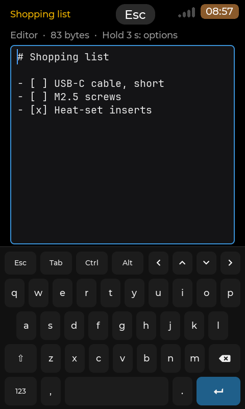
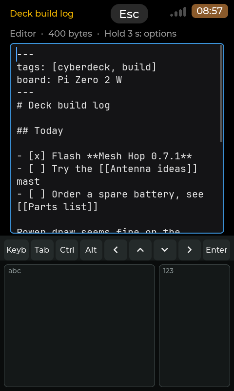

# Markdown Notes

Package `markdown-notes`, title "Markdown Notes", version 0.2.1. Part of
[cyberdeck-zero-apps](../../README.md).

Notes as plain Markdown files in one folder on the deck, the **vault** (`~/Notes` by default): write them, read them
with headings, lists, task boxes and links, open any note by typing part of its name. The files stay plain `.md`, with
sub-folders as you like, so any Markdown editor reads them and the folder can be kept in sync with Syncthing, rsync or
git ([Sync](#sync)); the app does not sync by itself. A native app (kind A of the [guidelines](../../docs/APP-GUIDELINES.md)):
its own screens on the launcher's `cp0_lvgl`, every function by touch and by keyboard. Design and decisions: launcher
report 037 (`docs/dev/reports/037-notes-app.md`), slice N1 "write and read notes".

**Status: first release, slice N1** (unit tests, scenes at four sizes and ten scripted flows in the headless harness;
board test plan: [`tests/BOARD-TESTS.md`](tests/BOARD-TESTS.md).

## Screenshots

From the headless harness (`build.sh ui`: the flows at 640x480, 800x480, 720x720 and 1280x800, a fixed clock and the
fixture vault of `tests/data`); copies for `docs/screenshots/` and `screenshots/` come with the publication.

Portrait renders of the same harness (PDA mode, `portrait-keyboard.scene` and `portrait-band.scene`), **not photographs of the panel**:

| | |
|---|---|
|  480x800 render, PDA mode (portrait, 4.3" DSI). Touch only: the editor above the on-screen keyboard (Esc, Tab, Ctrl, Alt, arrows) |  480x800 render, PDA mode with Handwriting + keyboard (launcher v0.8.11): the band where the keyboard would be (Keyb, Tab, Ctrl, Alt, arrows, Enter over the writing boxes) |

| Page | What the shot shows (flow `screens` unless named) |
|---|---|
| Home | `01-home`: Open or create... (Ctrl+P), All notes (the count), Recent, Today's note (the date), New note, Settings |
| A folder | `02-all-notes`, `03-folder`: New note here, FOLDERS (notes in each), NOTES newest first ("edited 2 h ago") |
| Preview | `04-preview` (the mock-up's note: properties muted, headings, ticked and open boxes, links), `05-preview-ring` (Tab), `10`-`13-showcase` (bold, synthetic italic, strike, code, nested and numbered lists, quotes, a rule, accents and CJK) |
| Markdown help | flow `help`: `01-help-top`, `02-help-lists`, `03-help-links`, `04-help-keys`, `06-help-large` (Text size Large) |
| Options of a note | `06b-preview-hold-cue` (holding: the bar fills), `06c-preview-options`, `08-editor-options` (each action with its Ctrl key) |
| Editor | `07-editor` (the whole body is the text); `09-note-info`; flow `create` `03-typing` (the dot of an unsaved note) |
| Open or create | `15-open`: 'Create "mesh ant"' first, then the matches with their folder |
| New note | `16-new-note`, `17-new-note-refused` (a refused name says why) |
| Settings | `18-settings`, `19-text-size` |
| On-screen keyboard | flow `osk`: New note, the editor above the keyboard, its options by a hold (`05c`), Open or create (only the field); flow `osklate`: the keyboard going away while each field is open, Settings > On-screen keyboard (`04`-`06`) |
| Dialogs | flow `conflict` `01-conflict` (Changed on disk), flow `delete` `01-hold-cue` and `03-confirm`, flow `links` `04-web-address` |

## Pages

- **Home**: *Open or create...*, *All notes*, *Recent* (the 20 notes edited last), *Today's note* (`YYYY-MM-DD.md` at
  the vault root, made when missing, opens in the editor; a clock that looks unset asks first), *New note* (asks a name,
  opens the note in the editor), *Settings*. A short Esc (or the header's Esc) quits.
- **A folder** (*All notes* is the vault's root): *New note here*, then FOLDERS and NOTES (newest first). A note's options
  (Delete, Note info): hold its row 3 s, or Ctrl+O.
- **Open or create**: type part of a name; matches are ranked (whole name, start, word starts, letters in order). When no
  note has exactly that name, the first row creates it (at the vault root, or in the folders written: `Trips/Alps`); Enter
  takes the selected row. Nothing typed: the recent notes.
- **Preview** (how an existing note opens; Settings can say Editor): the note drawn from its Markdown. A tap on a task box
  ticks it (the file changes by one character, saved at once); a tap on a `[[link]]` opens that note, or creates it and
  opens it in the editor when it does not exist; a web address shows in a box (there is no browser). The note takes the
  whole page; **hold a finger on it 3 s** (or Ctrl+O) for its options: Edit, Note info, Markdown help, Delete note. At most 400 blocks
  are drawn (a grey line says when a note is cut; the editor has all
  of it).
- **Editor**: the note's text in a monospace box, word-wrapped, no colours. The title gets a dot while there are unsaved
  changes; the note is saved 1.5 s after the last key, on Esc, on leaving and when the app closes. The text takes the
  whole page (about 14 lines on the deck); a tap places the cursor, a drag scrolls, **a 3 s hold** (or Ctrl+O) opens the
  options: Preview, Tick task on this line, Insert date and time, Note info, Markdown help, Delete note (a hold never
  moves the cursor;
  it works with the on-screen keyboard up too). The line under the title says "Hold 3 s: options" while no keyboard is
  connected, "Ctrl+O: options" with one. (0.1.0 had bars of 9 mm keys here; the owner chose the hold, 2026-10-24.)
  When the file changed on disk meanwhile (a sync), the save asks **Keep mine** / **Keep theirs**: the version not
  kept is written beside the note as `Name (deck 2026-10-24 1403).md`, never lost.
- **Markdown help** (Ctrl+H, or the options of a note): a cheat sheet drawn by the preview, read only: for each syntax
  what you type and how it looks (headings, emphasis, code, lists, tasks, links and wikilinks, quotes, rules,
  properties), what is not supported yet (tables, images, embeds), the keys. Esc comes back to the note exactly where it
  was (the editor's cursor, scroll and unsaved text as they were).
- **Settings**: the vault folder, Text size (Small, Medium, Large: the preview and the editor), Open notes in (Preview,
  Editor), the version, and **On-screen keyboard**: whether the launcher's rule allows it now and why not ("a keyboard is
  connected", "Bluetooth keyboard asleep 8 min more": a Bluetooth keyboard that went away still counts for 10 minutes,
  in every app; then the keyboard shows by itself in the field you were typing into).
- **New note**: a name (spaces and any script are fine; `/ \ : * ? " < > | # ^ [ ]`, a leading dot, a trailing space or
  dot and Windows device names are refused, with the reason), Enter or Create.

## Keys and touch

Every function is reachable by touch through the rows and the options boxes (a 3 s hold on a note's row, on the
preview or on the editor's text); every action of a box shows its Ctrl key in grey for keyboard users.

| Function | Keys | Touch |
|---|---|---|
| Move, open, back | Up / Down, Enter (or Right), Esc (or Left) | tap a row to select it, tap it again to open; header Esc |
| Quit (at Home) | Esc | header Esc |
| Open or create | Ctrl+P | Home > Open or create... |
| New note / Today's note | Ctrl+N / Ctrl+D | Home rows; New note here in a folder |
| A note's options (Delete, Note info) | Ctrl+O | hold the note's row 3 s |
| Preview: scroll | Up / Down, Page Up / Down, Space, Home / End | drag |
| Preview: tick a box, follow a link | Tab / Shift+Tab ring one, Enter | tap it |
| Preview <-> Editor | Ctrl+E | hold the note 3 s > Edit / Preview |
| The note's options (preview, editor) | Ctrl+O | hold the note (the preview, the editor's text) 3 s |
| Note info | Ctrl+I (also on a note's row in a list) | options > Note info |
| Markdown help (what to type, how it looks, the keys; Esc comes back where you were) | Ctrl+H | options > Markdown help |
| Delete the note (to `.trash`, asked first) | Ctrl+Del (also on a note's row in a list) | options > Delete note |
| Save now | Ctrl+S (it saves by itself anyway) | |
| Tick the task of the cursor's line, or follow the link under the cursor | Ctrl+Enter | options > Tick task on this line; links in the preview |
| Insert the date and time ("2026-10-24 14:03") | Ctrl+T | options > Insert date and time |
| Indent / outdent the line | Tab (a real tab, shown as ⇥) / Shift+Tab | the on-screen keyboard's Tab |
| Cursor | arrows, Home / End (line), Ctrl+Home / Ctrl+End, Page Up / Down | tap in the text |
| On-screen keyboard | shows only while no keyboard is connected (the launcher's rule; a Bluetooth keyboard that went away counts for 10 min); its Esc puts it away | tap the text or the field to bring it back; Settings > On-screen keyboard says why it is not shown |

## Requirements

A screen of at least 640x480 (`X-MinSize=640x480`), a launcher with full-screen app support. No network, no group, no
hardware. arm64 (the boards) and amd64 (PCs). The fonts are the launcher's (Montserrat, JetBrains Mono, DejaVu, Noto Sans
CJK), read at run time.

## Portrait (PDA mode)

`X-Portrait=480x640`: on a launcher in PDA mode (v0.8.8 and later; Settings > Screen > PDA mode from v0.8.9) the app runs
**upright** on the portrait screen (480x800, 480x640, 800x1280) instead of turned by a quarter; every other screen
(landscape, an older launcher, a portrait panel under 480x640) is exactly as before. The app has one pane at every
size, so the portrait layout is the same pages in one column at the screen's width under the toolkit's narrow header
(18 px title, the last part of the path, a 72 % status strip); nothing scrolls sideways.

- **Lists** (Home, folders, Recent, Open or create): rows keep their chevron or grey dot; on the 480 px wide screens a
  long note name ends with dots (the whole name is in Note info), and Home's key hint is the shorter "Enter: open
  Ctrl+D: today Esc: quit" where the whole one does not fit.
- **Preview and Markdown help**: the text wraps at the width of the screen (no sideways scroll); the page scrolls.
- **Editor with the keyboard**: the page ends above the on-screen keyboard (about 40 % of the height at 480x800, 45 %
  at 480x640, a quarter at 800x1280): about 13 lines of text at 480x800, 8 at 480x640, 27 at 800x1280 stay above it, the cursor
  line in view. Open or create keeps its matches under the field (landscape hides them behind the keyboard), so there
  Enter opens the selected match at once.
- **The handwriting band** (PDA mode with Settings > On-screen keyboard = Handwriting + keyboard, launcher v0.8.11 and
  later): the band takes the keyboard's place on the same rule (a field asks, no physical keyboard) and its rows are left
  free through the same inset; written letters and digits, the strip's Tab, Ctrl, arrows and Enter reach the editor and the
  fields as the keyboard's keys do. The strip has no Esc: the header Esc leaves the page (the editor saves first) and
  Keyb brings the keyboard, with its Esc.

## Install

Settings > Apps once the app is published; until then by hand: `sudo dpkg -i markdown-notes_0.2.1_arm64.deb` (amd64 on a
PC). Removing it (`sudo dpkg -r markdown-notes`) leaves the vault and the settings.

## Files the app keeps

| Path | What |
|---|---|
| `~/Notes/` | the vault (created on first start): your notes, `<name>.md`, in any sub-folders. `$NOTES_VAULT` or `vault=` in the settings chooses another folder |
| `~/Notes/.trash/` | deleted notes (moved there after a Yes; a name already there gets " 2", " 3"...). Delete them by hand to free the space; move one back to restore it |
| `~/Notes/**/.<name>.md.~deck` | the temp file of a save, for a fraction of a second (a crash can leave one; the next save replaces it) |
| `<name> (deck 2026-10-24 1403).md` | the version not kept after "Changed on disk" (Keep mine: the other device's; Keep theirs: yours), beside the note |
| `~/.config/markdown-notes/settings.conf` | `vault=`, `text_size=` (small, medium, large), `open_in=` (preview, editor) |

Nothing else is written; a note is written only after an edit or a tick. Folders and files whose names start with a dot
(`.obsidian`, `.git`, `.stversions`) and symbolic links are never read or listed.

## Sync

The app keeps every write safe for a sync tool: a save is atomic (a temp file, fsync, rename), a note is read from disk
each time it opens, and a note changed on disk while you edit it is never overwritten silently (Keep mine / Keep theirs,
both versions kept).

- **Syncthing** (both ways, automatic): `sudo apt install syncthing`, `systemctl --user enable --now syncthing`, then
  share `~/Notes` with your other device from its web page (`ssh -L 8384:localhost:8384 deck`, open
  `http://localhost:8384`). Its own conflict files (`*.sync-conflict-*.md`) show up as notes.
- **rsync** (one way, by hand): from a PC, `rsync -av deck:Notes/ ~/Notes/` (and the other way round when you wrote on
  the deck). `--delete` mirrors deletions; keep `.trash` out with `--exclude .trash`.
- **git**: `cd ~/Notes && git init`, then `git add -A && git commit -m notes && git push` when you like (a remote of
  yours). The `.~deck` temp files never stay; add `.trash/` to `.gitignore` if you do not want deleted notes kept.

## Known limits

- Notes up to 128 KB open in the editor, up to 1 MB in the preview only; larger files are not opened. A file that is not
  UTF-8 opens read-only. The typing speed in a large note on the Zero 2 W is the board test B4.
- The preview draws at most 400 blocks; tables show as plain text (N2); `![[embeds]]` and images show as links.
- At most 5000 notes and folders 12 levels deep are listed.
- No colours in the editor, no search inside notes, backlinks, undo, rename or new folder yet (later slices of report 037;
  a folder is made by naming a note `Folder/Name`).
- No system clipboard exists on the deck.
- Italic is FreeType's slanted Montserrat (the launcher has no italic face).
- A file whose line ends are mixed (CRLF and LF) is written back with the line end most of its lines had, after an
  edit only; LF, CRLF, a BOM and tabs are kept byte for byte.

## Credits and licences

<!-- branding-allow-begin: credit of the cp0_lvgl runtime linked into the binary (MIT) -->
MIT, 2026 OSRdesign. The binary contains the launcher's `cp0_lvgl` runtime (M5Stack Technology CO LTD, MIT) and LVGL
(LVGL Kft, MIT), and **md4c v0.6.0** by Martin Mitáš (https://github.com/mity/md4c, MIT), the Markdown parser,
vendored unchanged in `third_party/md4c` with its licence (shipped as `/usr/share/doc/markdown-notes/LICENSE.md4c`).
See `root/usr/share/doc/markdown-notes/copyright`. The fonts are the launcher's, read at run time; none is shipped.
<!-- branding-allow-end -->

The notes are plain Markdown files compatible with other Markdown note apps (Obsidian among them: `[[wikilinks]]`,
frontmatter properties, `.trash`, the daily note's name); this app is an independent project and has no link with them.

## Build and test

In WSL (the launcher build tree with its SDK; see `apps/_common/build_app.sh -h`):

```sh
wsl -e sh /mnt/c/CLAUDE/zero7/cyberdeck-zero-apps/apps/markdown-notes/build.sh test                # unit tests
wsl -e sh /mnt/c/CLAUDE/zero7/cyberdeck-zero-apps/apps/markdown-notes/build.sh host                # + harness, scenes, runner
wsl -e sh /mnt/c/CLAUDE/zero7/cyberdeck-zero-apps/apps/markdown-notes/build.sh sim both            # the flows, 640x480 + 800x480
wsl -e sh /mnt/c/CLAUDE/zero7/cyberdeck-zero-apps/apps/markdown-notes/build.sh ui                  # the flows at four sizes
wsl -e sh /mnt/c/CLAUDE/zero7/cyberdeck-zero-apps/apps/markdown-notes/build.sh cross               # aarch64 into root/
wsl -e sh /mnt/c/CLAUDE/zero7/cyberdeck-zero-apps/apps/markdown-notes/build.sh cross --arch amd64  # x86-64 into root.amd64/
python3 tools/make_registry.py --only markdown-notes --out <a folder outside packages/>               # the .deb
```

- `tests/unit`: the core (vault walk, names, text codec, atomic save, changed-on-disk check, trash, settings, ranking,
  links, tasks, dates, md4c's block model) and the UI logic (rows, menus, words, text sizes, the preview's layout and
  ring, link plans, the editor's offsets).
- `tests/scenes`: the shared harness's scenes (Home at six sizes with the header title check, the pages and the
  on-screen keyboard at 640x480, 800x480, 720x720 and 1280x800, multitasking, no contract, the "needs 640x480" notice;
  PDA mode at 480x800, 480x640 and 800x1280: `portrait` (the pages), `portrait-keyboard` (Open, New note, the editor, its
  options box and the help with the on-screen keyboard) and `portrait-band` (the same with the handwriting band: written
  letters, the strip's keys, Keyb and its cross, hide and show). `portrait-band` writes into notes, in its own copy of
  the vault (`/tmp/markdown-notes-scene-vault-band`), each size into its own note).
- `tests/flows`: `markdown-notes-script` runs twelve scripts on seeded vaults: create and type, Esc back and reopen, preview
  and tick, links (create, follow, a web address), Today, delete to `.trash`, a conflict on disk, typing with the
  on-screen keyboard (touch only), the keyboard going away while a field is open (the real policy on input.state), the
  Markdown help (from the editor with an unsaved edit, from the preview), the caps, and every screen.
- `tests/board/big-note.sh` writes a 100 KB note into the vault (the lag test); the board protocol is
  [`tests/BOARD-TESTS.md`](tests/BOARD-TESTS.md).

The icon: `python apps/markdown-notes/tools/make_icon.py` (Pillow; the shared helpers of `tools/icons`).

## Multitasking

`X-Background=freeze`: hidden, the app is stopped; nothing has to go on. The editor saves 1.5 s after the last key (and
tries once more as it is hidden), so an app closed while hidden (memory pressure) loses at most that much typing; the
launcher's close is the app's normal exit, which saves. Shown again, a note not being edited is read anew if a sync
changed it meanwhile.

## Changes

- 0.2.1: Rebuilt for the new launcher strip (SSH indicator slot); no other change.
- 0.2.0: portrait layout for PDA mode (`X-Portrait=480x640`, see [Portrait](#portrait-pda-mode)): the pages upright at
  480x800, 480x640 and 800x1280, the editor above the keyboard or the handwriting band; no change at any landscape size.
- 0.1.2: Markdown help (Ctrl+H, or the options box of the preview and the editor): what to type and how it
  looks, what is not supported yet, the keys; read only, drawn by the preview at the chosen text size; Esc returns to
  the note as it was. (Not done: inserting an example at the editor's cursor from the help.)
- 0.1.1 (draft): no bars (owner decision): the preview and the editor take the whole page; a 3 s hold on the note
  (or Ctrl+O) opens its options box, every action with its Ctrl key (new: Ctrl+I note info, Ctrl+Del delete); the line
  under the title says how ("Hold 3 s: options" / "Ctrl+O: options"); a tap places the editor's cursor, a hold never
  does. The tile says "Notes" (one line) and the icon keeps its lower third free (a label wrapped onto two lines
  covered it). The key hint line of Home and the folders sits under a hairline, below the list.
  The on-screen keyboard. A tap on a field (the editor's text, Open or create, New note) always asks for
  the keyboard again, and a request the keyboard service no longer holds is made again; the shared rule still decides
  (never shown by hand). Settings > On-screen keyboard says what the rule says now and why ("allowed: no", "Bluetooth
  keyboard asleep 8 min more": a Bluetooth keyboard that went away counts as asleep for 10 minutes, for every app).
  Typed text is put into the editor once per frame (a slow board falls behind less in a large note). Tests: the flow
  `osklate` (a keyboard going away and coming back while each field is open, through the real policy).
- 0.1.0 (draft, slice N1): the vault, Home, folders, Recent, Open or create, New note, Today's note, the preview
  (headings, emphasis, lists, quotes, code, task boxes, links, properties), the editor (autosave, the changed-on-disk
  question, Ctrl shortcuts, More), delete to `.trash`, Settings; unit tests, scenes, flows.
