# Mesh Hop

Version 0.4.1, package `mesh-hop`. Part of [cyberdeck-zero-apps](../../README.md).

**Status: early release.** 0.2.2 and 0.3.0 were tested on the deck by the owner with real boards (Seeed XIAO nRF52840 and a
spare XIAO S3 WIO, MeshCore firmware v1.15.0, a board swap included). 0.4.0 is the responsive, touch-complete version; its board
tests are in [`tests/BOARD-TESTS.md`](tests/BOARD-TESTS.md). The GPS switch of the Position box is not tested on a real board yet.
Several MeshCore features are not there yet (see [Known limits](#known-limits)).

A full-screen client for [MeshCore](https://github.com/meshcore-dev/MeshCore) LoRa mesh networks. The radio is a separate
**companion radio board** plugged into the deck's USB port (MeshCore *companion radio, USB* firmware); the deck is its screen and
keyboard. Everything works **by touch or by keyboard**, on any screen from **640x480** up. Mesh Hop replaces the 320x170 UI of
[MeshZero](../meshzero/README.md) and keeps its core: the serial transport, the protocol, the client, the model and the history
store (`src/core/`, with unit tests).

## What changed in 0.4.1

* Built on the launcher's newer `cp0_lvgl` (commit `f35c2d6`): its buttons use the shared 7 mm minimum tap target, as Mesh
  Hop's own controls already did. The header Esc keeps its 9 mm size (it is not on the 7 mm target).
* **Pointer navigation**: with Settings > System > Pointer navigation on (off by default), a trackpoint, trackball or mouse moves
  through Mesh Hop like the arrow keys, a click is Enter and a held click is Ctrl+O (a chat's options).

## What changed in 0.4.0

* **Any screen from 640x480 up** (tested in the simulator at 640x480, 800x480, 720x720, 1024x600 and 1280x720): every page is laid
  out from the launcher's layout tokens; 0.3.0 was a fixed 640x480 picture.
* **Home list** (Chats, Contacts, Settings) instead of the tab row, and the launcher's **page header** with its **Esc** button on
  every page; the Esc of Home asks *Quit Mesh Hop?*, so a touch-only board can leave the app.
* **On-screen keyboard** when no keyboard is connected (the launcher's shared rule). 0.3.0 typed with a physical keyboard only.
* **Chats**: one pane at 640x480 (the list, then the conversation as its own page), two panes where both fit; a *Search* / *Add
  channel* bar; **hold a chat** (or Ctrl+O) for its options; a compose view while the on-screen keyboard is up.
* **Contacts**: a list with a **Filter / Sort / More** bar instead of the table and its filter chips; *More* holds *Send advert*
  (flood or zero-hop), *Nearby* and *Manage contacts*.
* The launcher's dialogs for every box, menu, question and editor; rows show what can be tapped (chevron, grey information,
  action dot).
* Built on the shared app platform (`apps/_common`) and the launcher's `cp0_lvgl`, with the shared headless harness and scenes.

## Screenshots

Made with the simulator (`mesh-hop-script`, a simulated board with invented names and test data), **not on the deck's panel**.

| | |
| --- | --- |
| 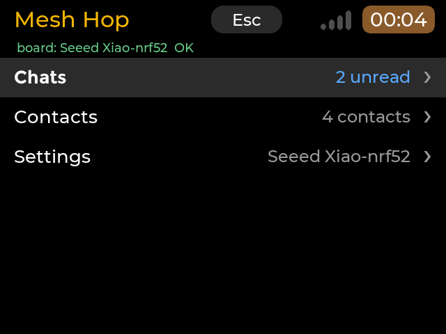 Home: Chats (unread total), Contacts, Settings | 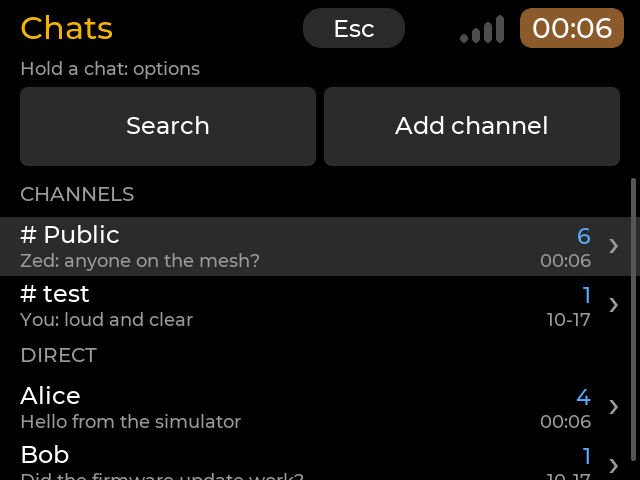 Chats at 640x480: the Search / Add channel bar, channels and direct chats with their unread counts |
| 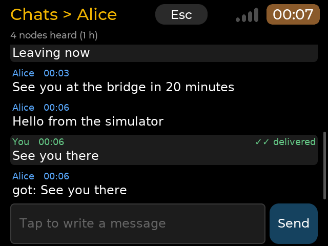 640x480 by touch: a conversation's own page, the messages, the entry and Send | 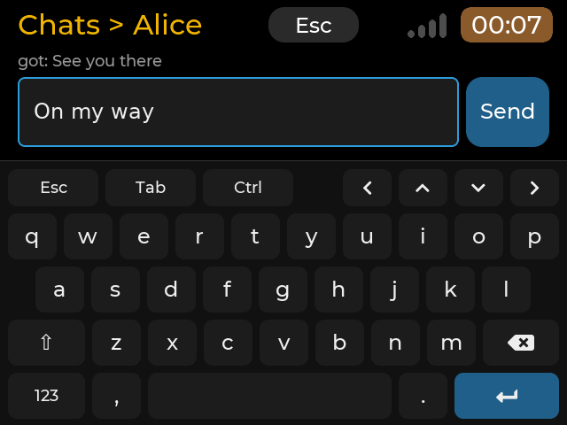 Writing without a keyboard: the compose view above the on-screen keyboard |
| 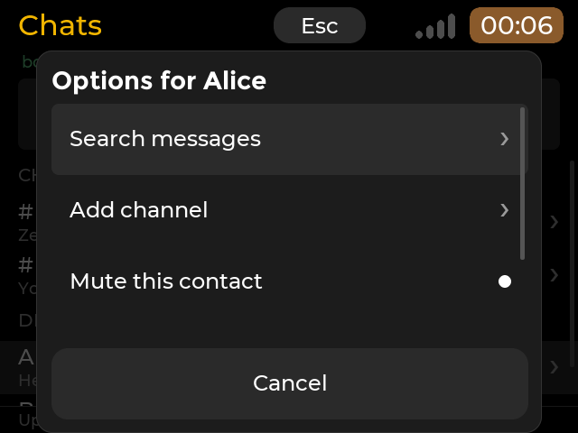 Hold a chat (or Ctrl+O): its options (Search messages, Add channel, Mute, Delete, Details) | 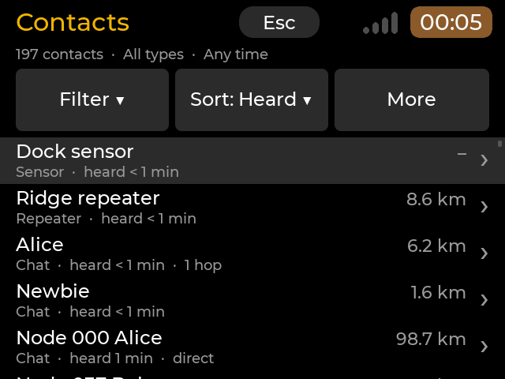 Contacts: the Filter / Sort / More bar and the list |
| 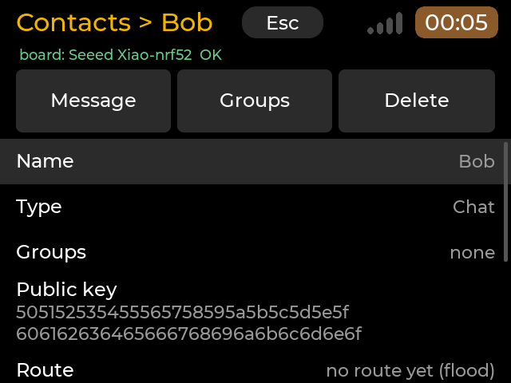 A contact's details: Message, Groups, Delete, then name, type, groups, key, route | 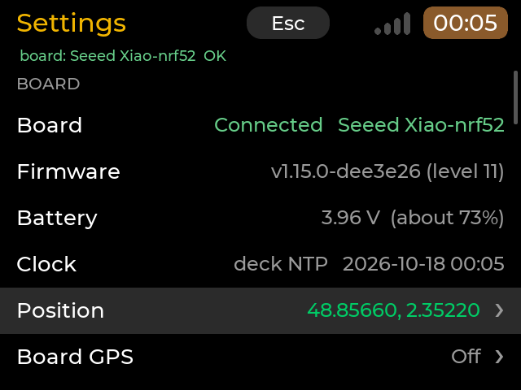 Settings: the BOARD section with Position and Board GPS |
| 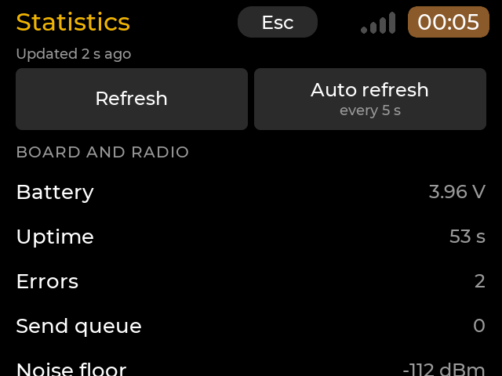 Statistics of the board | 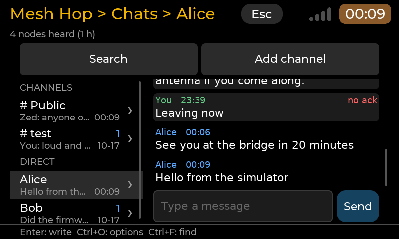 800x480: Chats in two panes, the conversation follows the selected chat |
| 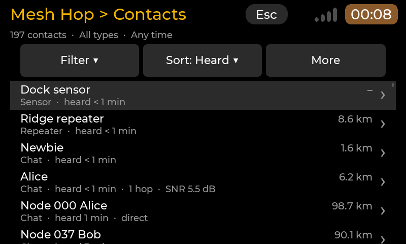 800x480: Contacts, with the SNR on the rows | |

**On real boards** (0.4.0 build, 2026-10-18, Home list with a connected radio board; nothing personal on these pages):

| | | |
| --- | --- | --- |
| 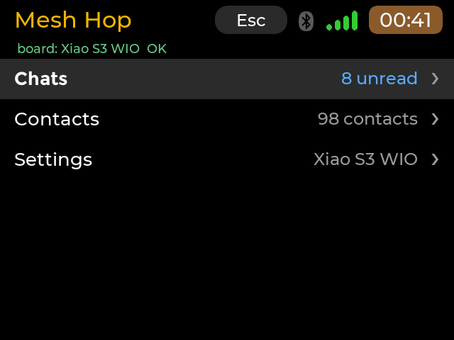 Deck (Pi Zero 2 W), 640x480 | 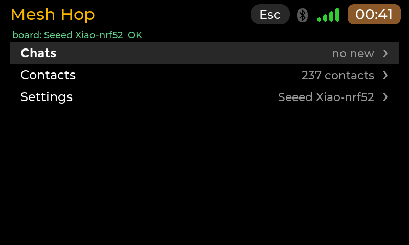 Pi 3A+ with the Waveshare 4.3" DSI, 800x480, touch only | 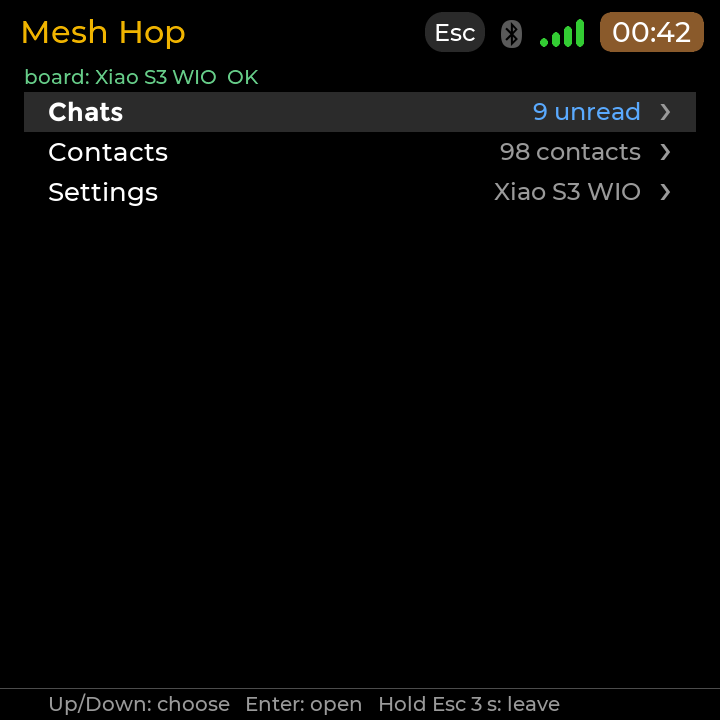 HackBerry CM5, 720x720, with its hint line |

## Screens and sizes

* The screen must be at least **640x480** (`X-MinSize=640x480`; a smaller one shows a notice and a way out).
* **One pane or two**: Chats shows the list and the conversation side by side only when both fit at the text sizes (800x480,
  1024x600 and 1280x720 in the simulator); at 640x480 and on a square 720x720 it is one pane: the list, then the conversation as its
  own page. Contacts shows the SNR on the wider screens.
* Rows and buttons are 7 mm high (the launcher's row token); rows where a tap only selects are 5 mm.

## Using it

**Home and the header.** The app opens on **Home**: **Chats** (the unread total in blue, or "no new"), **Contacts** (the number of
contacts) and **Settings** (the board). Every page has the standard header: the title (with the sub-page where it fits, e.g.
"Mesh Hop > Contacts > Nearby"), the **Esc** button and the launcher's status strip. The line under the header says the board (model
and state) or, for a few seconds, a notice. The key hints are a line at the bottom, shown only while a keyboard is connected.
The header's Esc goes back one step; from the root of a page it goes to Home; at Home it asks **Quit Mesh Hop?** (Cancel / Quit).

**Chats.** The channels and direct conversations (under CHANNELS and DIRECT), each on two lines: the name, then the last message and
its time; at the right the **unread count** in blue ("muted" for a muted chat). A tap selects a row, a tap on the selected row opens
it. The bar above the list has **Search** and **Add channel**. **Hold a chat** (a finger 3 s on its row, a bar shows the hold
filling; Ctrl+O with a keyboard) for its menu, titled "Options for <name>": **Search messages**, **Add channel**, **Mute / Unmute**,
**Delete conversation** (direct) or **Delete messages** (channel), and **Details** for a direct chat with a known contact. By touch
the line under the title says "Hold a chat: options".

* **A conversation**: the sender and time of each message (yours in green, with its status), the text in the large size, the entry
  and **Send** at the bottom. The line under the title says the nodes heard in the last hour, "muted", or the bytes left while you
  write. At 640x480 the conversation is its own page (its header's Esc goes back to the list); with two panes it follows the
  selected row.
* **Compose**: a tap on the entry brings the on-screen keyboard when no keyboard is connected, and the page becomes the compose view:
  the header, the last message, the entry (and Send where it fits; the keyboard's Enter sends too), the keyboard. After a Send, or
  Esc, the keyboard goes.
* **Message status**: a channel message ends at **sent** when the board accepts it (a channel has no acknowledgement; "sent
  (unconfirmed)" if the board does not answer within 5 s); a direct message goes sending, sent, delivered or no ack.
* **Heard back by N repeaters**: when your own channel message comes back from the mesh (the board's radio log), "sent" becomes "heard
  back by N repeaters"; N grows for 60 s, then it is saved with the message. Read it as a hint: the app cannot decrypt, it matches the
  channel hash and the packet size, and **N counts distinct routes**. It needs the channel key read from the board at connect.
* **Search messages** (the bar, the menu, or Ctrl+F): words (in the text and the sender's name), narrowed by **chat** (Ctrl+K),
  **dates** (Ctrl+D: last 24 h, 7, 30 or 90 days, or a typed day or range like `2026-09-01 2026-09-30`) and **direction** (Ctrl+R).
  Results newest first; a tap (or Enter) opens the conversation at that message, framed in blue. Without a keyboard only the words fit
  above the on-screen keyboard at 640x480; its Enter puts it away and the filters and results come back.
* **Add channel**: a hashtag channel (`#name`), a private channel with a key typed as 32 hex characters, or one with a random key
  (shown as text to share).
* **Delete** asks Yes / No with the number of messages and removes them from memory and from the history file; a deleted direct
  conversation leaves the list (the contact stays), a channel stays with its history cleared.

**Contacts.** A row per contact on two lines: the name, then the type, when it was heard and the hops (and the SNR on the wider
screens); the distance at the right when both positions are known. The line under the title says what is shown. The bar:

* **Filter**: the type, the time since heard, the group (a pick list each).
* **Sort**: name, heard, type, SNR, hops, distance; choosing the field in use again reverses it. The order is kept.
* **More**: **Send advert** (an arrow choice: **Flood** or **Zero-hop**, starting on the one used last), **Nearby** (with the
  number of nodes waiting) and **Manage contacts**.

A tap selects a row, a tap on the selected row opens its **details**: name, type, groups, the whole public key, the route (flood,
direct, or the hops with their hash size), last advert, when it was heard, position, distance, SNR; **Message** (a chat node), **Groups** and **Delete** on its bar.
**Manage contacts** puts a check box on every row: **Select...** (all shown, none, not heard for 7 or 30 days, never heard,
invert), **Delete n** (asks Yes / No, then deletes **one by one on the board** with a progress box and Stop), **Group...** (add to a
group, take out, new group), **Done**. **Groups** are kept on the deck, per board; the board knows nothing of them.
**Nearby**: the nodes heard, newest first, pending ones first, with type, SNR, hops, age and **Add** / **Ignore**; **Scan** asks the
nodes in direct radio range to answer (zero-hop discover, 8 s); **Ignored** shows the ignored nodes and restores them.
The list is virtual (only the rows in view are widgets), so 160 or more contacts scroll as quickly as a few.

**Settings.** A list in sections; a tap selects, a tap on the selected row changes or opens it.

* **BOARD**: connection, firmware, battery, clock (information); **Position** (opens the Position box: the **Board GPS** switch
  when the firmware has a `gps` variable, and the **latitude** and **longitude** in decimal degrees; OK sends SET_ADVERT_LATLON and
  reads it back, **Clear** sets "no position"; setting a position sends no advert); **Board GPS**; **Statistics** (battery, uptime,
  errors, noise floor, RSSI, SNR, airtime, packet counters; Refresh, automatic refresh every 5 s); **Packet log** (the radio packets
  the board hears: time, route, type, hops, SNR, RSSI, size, the channel for a group text; the selected row shows its path and hex
  bytes; capture is **off at every start**, Start / Stop / Clear, the last 500 packets, in memory only).
* **RADIO**: node name, **Preset** (26 built in from `api.meshcore.nz`, dated 2026-10-07; refreshed in the background at launch when
  the deck is online, once more 60 s later if that failed, the last good copy kept), frequency, bandwidth, spreading factor, coding
  rate, TX power (an arrow choice: the arrows or Left / Right, OK, Cancel), **Path hash size** (1, 2 or 3 bytes; firmware level 10
  and up), **Repeat** (only on the frequencies the board allows; switching it on asks first).
* **DIRECT MESSAGES**: **Message tries** and **Forget the route** (before which try). **SCHEDULED ADVERT**: off (default), every 1, 3, 6 or 12 h, flood or
  zero-hop (the app sends it while it runs). **CONTACTS**: **Add nodes by itself** (manual add mode off: new nodes wait in Nearby)
  and **Still added by itself** (the auto-add types). **CLOCK**: **Sync clock now** (deck NTP, board GPS or a typed start time).
* **CHANNELS**: each channel (not the fixed Public one) with Mute, Key (shown as text) and Remove; Add channel.
* **HISTORY**: Delete all messages, Delete messages older than 7, 30 or 90 days, **Forget this board's data**, **Other boards' data**.
* **BOARD ACTIONS**: **Reboot the board** and **Factory reset the board** (see below). **RADIO CHANGES**: **Undo changes** and
  **Save to radio**, each asks Yes / No.

A feature the board's firmware lacks (custom variables, channel commands, path hash, statistics, auto-add filter, discover, factory
reset) shows "Firmware too old for this feature" instead of its row.

## Typing: keyboard or on-screen keyboard

* With a **keyboard** (Bluetooth or USB), typing goes to the field at once: a letter on the Chats list or a conversation starts the
  message.
* With **no keyboard connected**, a tap on a field (the message entry, the search words, an editor, a field of the Position box)
  brings the launcher's **on-screen keyboard**; the field stays above it. It goes after a Send, Enter or Esc, or within about a second
  when a keyboard connects. The launcher's shared rule decides (`input.state`: no keyboard, or a Bluetooth keyboard asleep for 10
  minutes; Settings > System > On-screen keyboard; `APPLAUNCH_OSK`); the app never shows it by its own test and has no button to
  summon it.
* Everything is reachable by touch: rows, Home, bar cells, arrows and buttons; drag scrolls lists and conversations. There is no
  swipe gesture. The only touch action that needs a hold is a chat's options (a 3 s hold on its row); Search and Add channel are
  also on the bar.

## Keys

A short **Esc** on the keyboard is Back and never quits: it closes the newest layer first (box, editor, the on-screen keyboard,
search, statistics, packet log, details, Nearby, Manage contacts, a conversation's page), from the root of a page it goes to Home,
and at Home it says "Hold Esc 3 s to exit". **Holding Esc 3 s** ends the app (the launcher does that).

| Key | Action |
| --- | --- |
| Up / Down, Enter or Right | Home: choose a page, open it |
| Tab / Shift+Tab | on a page: the next / previous page (Chats, Contacts, Settings), in a loop |
| Up / Down, PgUp / PgDn, Home / End | move in a list (Chats, Contacts, Settings, Nearby, details, results, packet log); scroll a conversation |
| Enter or Right, or a letter | Chats: write in the selected conversation (one pane: its page opens with the entry) |
| Enter | entry: send; Contacts: open the details (Manage contacts: mark); Settings: change / do; Nearby: add; details: open the chat |
| Left / Right | Settings: step the value of the row; entry: move the cursor; arrow choice: previous / next value |
| Ctrl+O | Chats: the menu of the selected or open conversation (the touch way is a 3 s hold on its row) |
| Ctrl+M | Chats: mute / unmute the conversation |
| Ctrl+F | Chats: search the messages; then Ctrl+K chat, Ctrl+D dates, Ctrl+R direction |
| `S` `R` `T` `H` | Contacts: next sort, reverse, type filter, heard filter |
| `G` `N` `X` `I` `U` | Contacts: group filter, Nearby, Manage contacts, details of the selected contact, ask the board for its contacts again |
| `A` `D` | Contacts: send a flood / zero-hop advert at once (Settings: `A` sends a flood advert) |
| Space or Enter, `A` `N` `I` `M` `D` or Del, `G` | Manage contacts: mark, all, none, invert, the Select menu, delete, group |
| `I` `S` `V` | Nearby: ignore (or restore), scan, show / hide the ignored |
| `G`, `D` or Del | contact details: groups, delete |
| `R` or Enter, `A` | Statistics: refresh, switch the automatic refresh |
| `S` or Space, `C` | Packet log: start / stop the capture, clear it |
| `S` `V` | Settings: save to radio, undo changes (each asks Yes / No) |
| `M` `K` Del | Settings, a channel row: mute, show the key, remove |
| `Y` `N` | Yes / No boxes |

Letters typed into a field are text, not shortcuts. The keyboard layout is US by default, AZERTY when `MESHHOP_KEYMAP=fr` or
`XKBLAYOUT="fr"` is in `/etc/default/keyboard`.

## Install and requirements

* A **MeshCore companion radio board** with the *companion radio, USB* firmware, plugged into the deck's USB port. Path hash size
  needs firmware level 10 and up, repeat level 9 and up; statistics, discover and factory reset need their commands.
* A screen of at least 640x480 and a launcher with **full-screen app support** (`X-Fullscreen=true` in the `.desktop` file).
* A keyboard is optional: without one the launcher's on-screen keyboard is used.
* The user must be in the `dialout` group (the Raspberry Pi OS default user is).
* `curl` (for the preset list; without it the app keeps the saved or built-in list), `libfreetype6`, `libinput10`,
  `libxkbcommon0` (the package depends on them).

**Install from the deck:** Settings > Apps > Sources > + Add a GitHub source `OSRdesign/cyberdeck-zero-apps` (if not added yet),
then Apps > Mesh Hop > Enter (it asks for the sudo password). If an older version is installed, the deck offers the new one as an
update in the same menu.

**Or install a local `.deb`** (a build of your own). On a PC with this repository:

```
python tools/make_registry.py --only mesh-hop --out <a folder outside packages/>
```

Copy the `mesh-hop_0.4.1_arm64.deb` it writes to the deck and run `sudo apt install ./mesh-hop_0.4.1_arm64.deb` there. Remove it
with `sudo apt remove mesh-hop`.

The board is found by itself (`/dev/ttyACM*`, `/dev/ttyUSB*`, by USB id); to force a port put its path in
`~/.local/share/mesh-hop/port` or start the app with `MESHHOP_PORT=/dev/...`. The app reads the launcher's fonts in
`/usr/share/APPLaunch/share/font`.

## Reboot and factory reset: read this

Settings > **Reboot the board** restarts it and erases nothing. Settings > **Factory reset the board** **erases the board's keys
(its identity), contacts and channels**: it asks two Yes / No questions and the Yes of the second waits 3 s. The firmware formats its
file system (up to a minute on an ESP32 board) and restarts with a new identity; the app waits up to 60 s and judges by the key the
board reports ("Board reset", or "not reset" for the same key). To the mesh it is then a new node. There is no power-off command in
the companion protocol. Settings > History > **Forget this board's data**, **Other boards' data** and the *Delete* rows remove the
deck's saved copy of messages, groups and flags; each asks first.

## Files the app keeps

All in `~/.local/share/mesh-hop`. Plugging another board shows that board's own conversations and contacts (the app knows a board by
its public key); plugging the first back restores them. The log holds no message text.

| Path | What |
| --- | --- |
| `boards/<first 12 hex digits of the board key>/` | per board: `messages.jsonl` (history: 200 messages per conversation, 1500 in all), `read.txt`, `contacts.jsonl` and `channels.jsonl` (caches), `groups.jsonl` (and `groups.bak`), `prefs.txt` (mute flags, ignored nodes, advert schedule) |
| `prefs.txt` | global: the direct message retry settings |
| `presets.jsonl` | the last good copy of the radio preset list |
| `port` | optional: the serial port to use |
| `mesh-hop.log` | debug log, size bounded (`MESHHOP_DEBUG=1` logs every frame) |
| `*.pre-boards.bak` | the files of 0.2.1 and before, kept after they moved into the first board's folder |

## Known limits

* No **Map**, no **Terminal** and no **Bluetooth LE** link to the board yet (USB only).
* A **channel message has no delivery acknowledgement** in MeshCore: it ends at "sent", never "delivered". "Heard back by N
  repeaters" is an approximation (distinct routes, matched by channel hash and size).
* **Emoji and other characters the launcher's fonts lack** show as empty boxes (in messages and names from other clients).
* **Keyboard layout**: the app translates the keys itself, US by default or its own FR (AZERTY) table; any other layout types as US.
* **Key repeat**: holding a key repeats arrows and typed characters; Enter, Esc and the letter shortcuts act once per press.
* The packet log is not saved or exported and holds 500 packets. The scheduled advert runs only while the app runs and the board is
  connected. The deck keeps 200 messages per conversation and 1500 per board.
* The screenshots on this page come from the simulator, not from the panel.

## Credits and licences

Mesh Hop is MIT (see the `copyright` file of the package).

* **MeshCore** firmware and protocol: Scott Powell / rippleradios.com, MIT, <https://github.com/meshcore-dev/MeshCore>.
* **meshcore_py** (Florent de Lamotte, MIT, <https://github.com/meshcore-dev/meshcore_py>) was the reference of the wire
  format; the protocol code was written from the protocol documentation and from it. The radio presets come from the public list
  of `api.meshcore.nz`.
* **MeshCore Open** (MIT), **meshcore-gui** (MIT), **wadamesh** (GPL-3.0) and **Meshy** (GPL-3.0-or-later) were looked at as
  feature references only. **No code was copied from the GPL projects.**
* **LVGL** (MIT), **FreeType** (FreeType License or GPL-2, the system `libfreetype6`) and the launcher's `cp0_lvgl` runtime of the
  CardputerZero launcher by M5Stack (MIT). The launcher's fonts are read at run time (Montserrat, Font Awesome Free, DejaVu Sans:
  SIL OFL 1.1, CC BY 4.0 for the icons, Bitstream Vera / DejaVu licence); they are not in the package.

## For developers

```
wsl -e sh /mnt/c/CLAUDE/zero7/cyberdeck-zero-apps/apps/mesh-hop/build.sh cross        # aarch64, into root/usr/share/APPLaunch/bin/mesh-hop
wsl -e sh /mnt/c/CLAUDE/zero7/cyberdeck-zero-apps/apps/mesh-hop/build.sh host         # PC: shared harness + scenes, mesh-hop-script, unit tests
wsl -e sh /mnt/c/CLAUDE/zero7/cyberdeck-zero-apps/apps/mesh-hop/build.sh all --strict # both, warnings as errors
wsl -e sh /mnt/c/CLAUDE/zero7/cyberdeck-zero-apps/apps/mesh-hop/build.sh flows [WxH]  # the 20 simulator flows (tests/flows), about 15 minutes
wsl -e sh /mnt/c/CLAUDE/zero7/cyberdeck-zero-apps/apps/mesh-hop/build.sh flows sizes  # shell, pages and chats at the five sizes and at the HackBerry's density
```

Mesh Hop is a native full-screen app on the shared app platform (`apps/_common`, see `apps/_common/build_app.sh -h`): it links the
launcher's `cp0_lvgl` (pinned by `apps/_common/LAUNCHER_REF`) for the display, touch, keyboards, status strip, the page header, the
dialogs and the on-screen keyboard (with the shared rule of `apps/_common/osk_policy`), and lays every page out from the layout
service's tokens (`mesh_app.cpp` `layout_body()`, `layout_chats()`).

* **Simulator**: `tools/meshcore_sim.py` simulates a board on a pseudo-terminal (`--contacts N`, `--manual-add`, `--new-nodes N`,
  `--fw-level N`, `--old-firmware`, `--no-gps-var`, `--heard-back N`, `--identity A|B`, `--reset-format-delay SEC` and more: see its
  header; stdin commands `newnode`, `reboot`, `swap`). Its names (Alice, Bob, Zed...) are invented.
* **Flows**: the scripts in `tests/flows/` drive `mesh-hop-script` (`--script f --shot-dir d [--size WxH] [--ppmm N]`: the shared
  headless harness at any size and density). Commands: `key`, `type`, `tap "label"`, `tapfield n`, `tapkey "label"` (a key of the
  on-screen keyboard), `hold`, `keyboard on|off`, `shot`, `dump`, `bench`, `sim <line>`, `@panes1` / `@panes2`, `fill`, `check` (the
  shared layout checks and the size rules of every control; any finding fails) and `expect`. The first line of each script names
  its simulator options; `run_flows.sh` runs all of them. The seed scripts write test histories: `seed_chats.py` (`chats_run.sh`),
  `seed_history.py` (`history_run.sh`, `p2_run.sh`); `presets_run.sh` puts a local web server in place of `api.meshcore.nz`.
* **Scenes** of the shared harness (`tests/scenes/`) and the **unit tests** (`tests/unit/`) run with `build.sh host`.
* **Package**: `python3 tools/make_registry.py --only mesh-hop --out <a folder outside packages/>`.

| Path | What |
| --- | --- |
| `src/core/` | transport, protocol, client, model, store, clock policy, presets (`radio_presets.inc` is the dated data file), preset feed, channel keys, firmware features, contact groups, message search, log, the radio log parser and echo tracker, the packet log (no LVGL; unit tested) |
| `src/ui/ui_logic.*`, `ui_phase2.cpp`, `ui_pages.*` | keys, editor filters, formatting, chat and contact rows, filters and sort, selection, groups, details, Nearby, search, statistics, popups, the Settings layout, the Back rule (no LVGL; unit tested) |
| `src/ui/key_bridge.*` | the platform's keys to the app's key events, with the US / FR tables (no LVGL; unit tested) |
| `src/ui/stage.*`, `session.hpp`, `app_spec.cpp` | the keyboard bridge, the tick timer, the app's spec for the shared runners |
| `src/ui/mesh_app.*` | the shell (Home, header, status line, hint line, dialogs), the pages, Chats in one or two panes, the text fields and the on-screen keyboard, the virtual row list |
| `src/main.cpp` | `cdk::run` (apps/_common: display, touch, keyboards, signals, the "needs 640x480" notice) |
| `tests/flows/`, `tests/scenes/`, `tests/unit/` | the simulator flows and `mesh-hop-script`, the shared harness's scenes, the unit tests |
