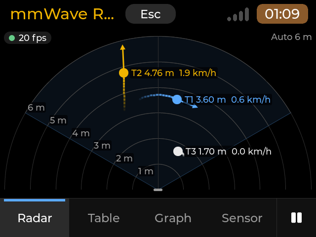
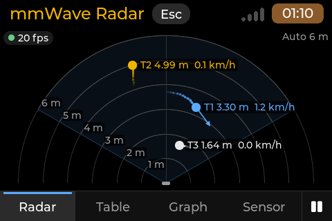
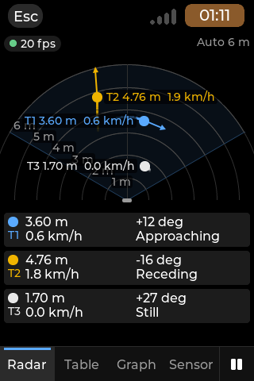
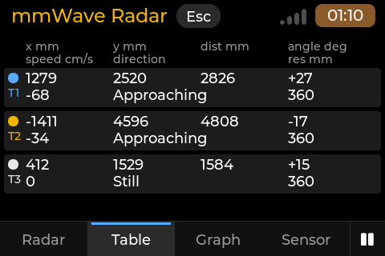
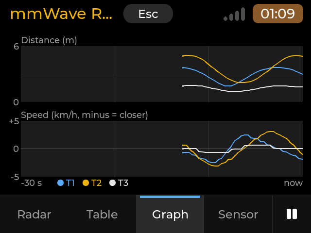
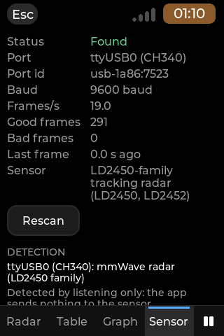
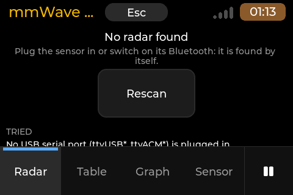
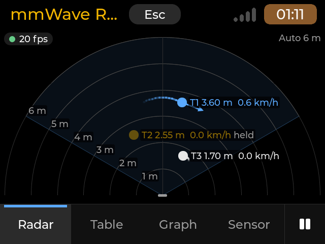
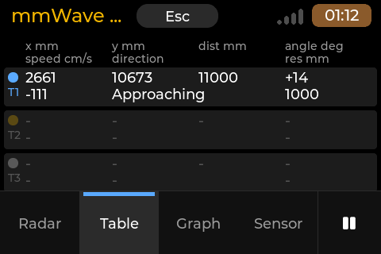
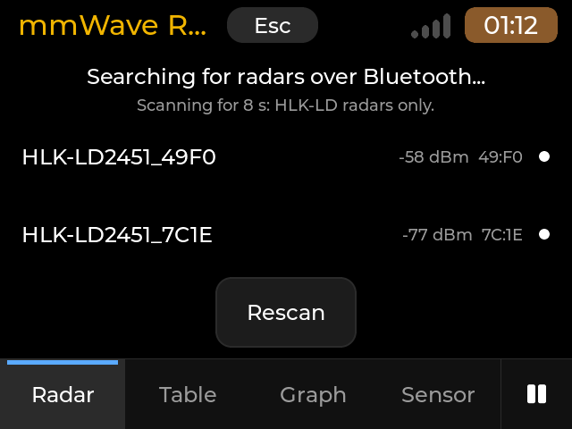

# mmWave Radar (`mmwave-radar`)

A viewer for the Hi-Link HLK-LD2450 / HLK-LD2452 24 GHz tracking radar and the HLK-LD2451 24 GHz target radar on a
USB-serial adapter, or for the HLK-LD2451 over Bluetooth LE (its built-in module): up to three targets seen from above, with trails and speed arrows, the raw numbers, a 30-second
graph of distance and speed, and the sensor's state. Native fullscreen app on the launcher's `cp0_lvgl`, MIT, version 0.1.1, category Tools. **Listen only:** the app sends
nothing to the sensor, not even to find it (study: launcher report 056); over Bluetooth the only thing sent is the
standard notification subscription (see [Bluetooth](#bluetooth-hlk-ld2451)).

- **Listen only.** Nothing is ever written to a serial port (the port layer has no write call); over Bluetooth the
  only thing sent is the subscription to the radar's notifications. No sensor setting is read or changed.
- **Supported sensors:** the HLK-LD2452 (and the HLK-LD2450, which sends the same frame) and the HLK-LD2451, on a
  USB-serial adapter; the HLK-LD2451 also over Bluetooth LE. See [Supported sensor](#supported-sensor).
- **Not supported:** the HLK-LD2410 presence radar is only recognised by listening (sniffed and named in the scan),
  never read or shown.
- **Bluetooth** needs BlueZ: the package recommends `bluez` (see [Requirements](#requirements)); without it the app
  works over USB.

## Screenshots

All ten were rendered on a PC by the headless harness (`build.sh host`, version 0.1.1) over the scripted ports and
radios (`MMWAVE_DEMO`, synthetic targets, no sensor); real-hardware captures will replace them. Each comes from a scene
in `tests/scenes` (named below): the build writes its PNGs to `<CDK_BUILD>/host/out/<scene>/<size>/`. The Store shows
the same ten pictures, in this order.

| | |
| --- | --- |
|  |  |
| Radar page, three targets with trails and speed arrows, 640x480, rendered on a PC (`b-radar-three`) | Radar page, 480x320 at the small panel's 6.1 px/mm, rendered on a PC (`o-board-density`) |
|  |  |
| Tall Radar page with the T1-T3 list, 320x480 at 6.1 px/mm, rendered on a PC (`s-tall-three`) | Table page, the sensor's own units, 480x320 at 6.1 px/mm, rendered on a PC (`o-board-density`) |
|  |  |
| Graph page, distance and speed over 30 s, 640x480, rendered on a PC (`e-graph`) | Sensor page, link status and frame counts, 320x480 at 6.1 px/mm, rendered on a PC (`o-board-density`) |
|  |  |
| No radar found with Connection Auto: the hint names Bluetooth, 480x320, rendered on a PC (`z5-auto-nomodule`) | A held target: T2 dimmed with the `held` label, 640x480, rendered on a PC (`t-held`) |
|  |  |
| LD2451 Table: an approaching target, its speed signed (`-111` cm/s), 480x320, rendered on a PC (`w-ld2451-approach`) | Connection Bluetooth: the HLK-LD radars nearby (scripted radios), 640x480, rendered on a PC (`z1-ble-list`) |

## What it does

Four pages, switched by the tab strip at the bottom, the Left / Right keys or the keys 1-4:

- **Radar** (the first page). A top-down plot: the sensor at the bottom centre (it is mounted on the deck facing away
  from the screen, so "outward" is up), its field of view (+-60 degrees) drawn faintly, a range ring every metre with
  its distance. Each target (up to three: T1 blue, T2 amber, T3 light grey) is a filled circle with a fading trail of the
  last 2 s, an arrow along its movement that grows with its speed, and a label such as `T1 1.23 m  3.6 km/h`. The range
  is Auto (the farthest target plus 0.5 m, rounded up to 2, 4 or 6 m, shrinking only well inside the smaller step; with
  an LD2451 also 10, 20, 50 and 100 m, and the range rings then sit every 2, 5, 10 or 20 m instead of every metre) or
  fixed with + / - or the Range setting (2, 4 or 6 m); it shows in the corner. A chip in the top left: the link dot (green found,
  amber searching, red lost or error, grey busy) and the frames per second; `PAUSED` while paused. The ring labels sit
  along the left edge of the field of view, so a target near the centre line never covers them. On a tall screen
  (480x800, 320x480 on the board) the plot sits at the top at full width and a compact list of T1-T3 follows (distance,
  angle, speed and direction in the units chosen; an empty slot is a dimmed `-`), and where there is room (480x800) a
  strip chart of the distance over the last 30 s.
- **Table.** One row per slot T1-T3: x, y, distance, angle, speed, direction (Approaching / Receding / Still) and
  resolution in the sensor's own units (mm, cm/s, degrees), whatever the Units setting says; an empty slot is a dimmed
  `-`. On a narrow screen each target takes two lines, the label above each value.
- **Graph.** Distance and speed of each target over the last 30 s, one line per target in its colour (3 samples a second
  from the tracker), in the units chosen.
- **Sensor.** The **Status** of the link (Found, Searching, Lost, Busy, Error), the port (its name and its id: the by-id name or
  `usb-vvvv:pppp`), the baud rate, frames per second, good and bad frame counts, the age of the last frame, the Rescan
  button, what the last scan found on every port (`ttyUSB0 (CP2102): not a supported radar: GPS receiver (NMEA)`), the
  line *Detected by listening only: the app sends nothing to the sensor*, and the settings: **Units** (Metres: m and
  km/h / Millimetres: mm and cm/s), **Orientation** (Normal / Mirror (left and right swapped) / Rotate 180), **Range**
  (Auto / 2 / 4 / 6 m), **Trails** (On / Off), **Hide held targets** (On / Off, default Off; see Known behaviour), **Sensor type** (Auto, the default, or
  LD2452 / LD2450, or LD2451: a fixed type listens for that driver only), **Connection** (USB, the default: the USB
  serial ports only, no radio is used; Bluetooth: an HLK-LD radar over Bluetooth LE only; Auto: the USB ports first,
  and only when a scan finds no radar there, the remembered Bluetooth radar; see [Bluetooth](#bluetooth-hlk-ld2451)).
  With Bluetooth or Auto a line **Bluetooth** under the Sensor line names the remembered radar ("None chosen" before
  one was picked).
  A tap or Enter on a setting row moves it to its next value.
- **No radar.** While the radar is not streaming, the Radar page says why ("No radar found", "The port is used by
  another app", "Signal lost, searching", "The port cannot be opened"), what the scan is doing, what was tried on each
  port, the wiring and a Rescan button. A plugged-in sensor is found by itself (the port list is checked every 2 s).
  With **Connection Bluetooth** the page shows the Bluetooth state instead of the USB scan ("Searching for radars over
  Bluetooth...", "Choose a radar", "No radar found over Bluetooth", "Looking for HLK-LD2451_49F0", "Connecting to
  HLK-LD2451_49F0", "Connected to HLK-LD2451_49F0" while the detector listens, "Signal lost, reconnecting", "Could not
  connect to HLK-LD2451_49F0", or only "Bluetooth is off" / "No Bluetooth adapter" / "BlueZ not available"), a line
  under it (the scan's seconds left, the next try and why the last one failed), the Rescan button and the HLK-LD radars
  seen (rows: name, RSSI, the last two bytes of the address, and a white dot that turns blue while connecting to that
  radar). A tap on a row, or Up / Down and Enter, connects it and remembers it. With **Auto** the USB page stays, and
  once the USB scan found nothing the hint reads "Plug the sensor in or switch on its Bluetooth: it is found by
  itself." and the TRIED list ends with a Bluetooth line from the fallback's state: "Bluetooth: no HLK-LD module in range
  (scanning).", "Bluetooth: HLK-LD module seen, connecting (retrying).", "Bluetooth is not available (needs the bluez
  package and a switched-on adapter)." or, with no Bluetooth radar chosen, "Bluetooth: no radar chosen yet (Connection >
  Bluetooth lists them).". With **USB** (the default) the page keeps its USB-only texts.

### Keys and touch

| Function | Key | Touch |
|---|---|---|
| Next / previous page | Right / Left | the tabs at the bottom |
| A page | 1 Radar, 2 Table, 3 Graph, 4 Sensor | the tabs |
| Pause / resume (the display and the graph freeze, the link keeps reading) | Space | the pause cell at the right end of the tab strip |
| Rescan the ports now | R | Rescan (Sensor page, the "no radar" page) |
| Bigger / smaller range | + (or =) / - | Range row (Sensor page) |
| Pick a setting, change it | Up / Down, Enter (Sensor page) | tap the row |
| Connect a Bluetooth radar of the list | Up / Down, Enter (Radar page, Connection Bluetooth) | tap the row |
| End the app | Esc | Esc in the header |

### Finding the radar (listen only)

The app looks at `ttyUSB*` and `ttyACM*` only (USB serial ports; no GPIO UART in 0.1). A port another app holds (Mesh
Hop, Serial Console, a terminal) is skipped as busy, never opened. Every other port is opened, set to a speed (the
remembered one first, then 256000, 9600, 115200, 57600, 38400, 19200, 230400, 460800) and **listened to**: three valid
frames in a row make it the radar (an LD2451 at 115200 is given 6 s for them, because it sends one empty frame every 1.4 s
when nothing is in view, and in Auto a port counts as silent only after 2 s without a byte; a fixed LD2452 / LD2450 type
keeps the 0.6 s); a GPS receiver (NMEA, UBX), an LD2410 presence radar, text and silence are
named and left alone (a fixed Sensor type does not look for the LD2410 any more: only the driver you chose listens), and the port's settings are put back. Nothing is ever written to a port: the port layer has no
write call. The port and speed that worked are remembered for a fast start (the port by its USB identity, not its
number). The owner's LD2452 talks at 9600 baud and 19 frames a second.

### Wiring

| Sensor (J1) | USB-serial adapter (CH340, CP2102, FTDI) |
|---|---|
| 5V (VCC) | 5V |
| GND | GND |
| TX | RX |
| RX | TX |

The sensor needs 5 V (about 130 mA); its UART uses 3.3 V logic (LD2450 manual; assumed for the LD2452): use a
USB-serial adapter set to 3.3 V, never a 5 V signal. The radar sees motion: mount it still (on the deck: everything
moves when the deck moves).

## Supported sensor

**LD2452 / LD2450** (driver `ld2450`): the tracking frames of the Hi-Link LD2450 family (`AA FF 03 00`, three targets,
`55 CC`): HLK-LD2450 and HLK-LD2452. Tested on recordings of the owner's LD2452 (report 056, `tests/data/`); an LD2450
sends the same frame.

**LD2451** (driver `ld2451`, 115200 baud): `F4 F3 F2 F1`, length, target count, alarm, then per target five bytes (angle,
distance, direction, speed, SNR), `F8 F7 F6 F5`. Distance is in whole metres (the sensor reports up to 100 m), angle in
degrees, speed in km/h as a magnitude (the app shows an approaching target with a negative speed, as for the LD2450
family). With nothing in view it sends an empty frame (length 0) about every 1.4 s: that is "found, no targets", not
"lost" (it counts as lost after 5 s without any frame), and a target that disappears for up to 3 s keeps its identity.
Facts from our own recordings (`tests/data/ld2451-*.bin`, README there), which differ from the protocol document: the
direction byte is 1 for approaching and 0 for receding (the document says the opposite), and the empty frame has no
count and alarm byte. The alarm byte is read for the plausibility check and not used. The sensor showed at most one
target at a time; the decoder accepts up to 16 per frame and shows the first three. The polar values become x and y
(`x = d sin a`, `y = d cos a`; the Table also shows the distance and the angle as sent). **The sign of the angle was confirmed by one
walk test on 2026-11-06**, with the sensor horizontal and its cable on the left as seen when facing it: a positive angle
is to the right as seen from behind the sensor (looking where it points), and the plot in the Normal orientation shows
that view; **Orientation > Mirror** gives the view as seen when facing the sensor. Readings of 6-10 m in a 4 m room were seen: they look like reflections and
are shown as sent. The resolution is 1 m and 1 degree, so the plot moves in steps. The sensor's detection settings (a
direction filter, a minimum speed) cannot be read or changed with a listen-only app. Not supported:
the LD2410 presence radar (named in the scan; its data frames are told from the LD2451's by their `02 AA ... 55 00` layout), any configuration (0.1 sends no command), two-person slot identity (not
verified, report 056 section 8).

## Bluetooth (HLK-LD2451)

The HLK-LD2451 has a Bluetooth LE module on board; the app can read the radar through it instead of a USB-serial
adapter (**Connection > Bluetooth**, or **Auto** as a fallback). It is a second transport under the same listen-only
port interface (`core/ble_sys.hpp`): the frames, the decoder, the tracker and the pages are the same; only there is no
speed (the diagnostic line reads `transport=ble addr=ED:2F:90:B4:49:F0 name=HLK-LD2451_49F0` instead of `port=... baud=...`,
the Sensor page's Baud is `-`, the port is `HLK-LD2451_49F0 (Bluetooth)` with the id `ble:<address>`). The driver is
chosen as on a serial port: by listening (one window: the longest of the drivers in play, 6 s for the LD2451, plus 1 s),
honouring the Sensor type. A Bluetooth radar is found at its first valid frame (a serial port needs three in a row: the
module is picked by its HLK-LD name and a notification is one whole frame, so there is no speed to guess), which is
within 1.4 s for an idle LD2451, and the link listens the moment the connection is up. The app's log says
`Found HLK-LD2451_49F0 (Bluetooth)`, without a baud (`Found ttyUSB0 (CH340) 115200 baud` stays for a serial port).

**What the module does** (measured on the owner's HLK-LD2451 from a Pi 3A+ with BlueZ, 2026-11-06/07; captures in the
study folder, `tests/data/ble-ld2451-notify-75s.csv`):

- It advertises as `HLK-LD2451_xxxx` (the last four hex digits of its address; a public address, connectable, no
  bonding needed) with the 16-bit service 0xAF30 in the advertisement (not in the GATT table).
- GATT: service 0xfff0 with 0xfff2 (write without response) and 0xfff1 (notify, its CCCD at handle 0x0009); a Jieli
  service 0xae00 with 0xae01 (write without response) and 0xae02 (notify, silent in our tests: ignored); the Device
  Name; ATT MTU 512.
- 0xfff1 is a complete real-time mirror of the UART stream: **one whole LD2451 frame per notification** (the empty
  frame every 1.4 s, a target frame about every 0.15 s while someone is in view, 17 bytes for one target), 0 to 0.5 s
  after the UART (batching). Over 75 s of a walk the notifications and the UART carried the same 3008 bytes, the same
  182 frames (the test asserts it).
- The module can send a malformed frame (the length says 7, the body has 2 bytes: `F4 F3 F2 F1 07 00 01 00 F8 F7 F6 F5`);
  it came through the UART as well. The decoder counts it as one bad frame and resyncs on the next header (tested
  alone, glued to the next frame and cut in any chunking). A frame split over two notifications (another module, a
  smaller MTU) is read the same way.

**Safety rules (built in).** The module's writable characteristics (0xfff2, 0xae01, the Device Name) need no
authentication: anyone in range could reconfigure the radar or rename it. The app never writes any characteristic
value, never reads one, never bonds with the module, never marks it as known to BlueZ, registers no agent and changes
no adapter setting (it never powers the adapter on). The only thing sent to the module is the standard notification
subscription of 0xfff1 (its CCCD, through BlueZ's AcquireNotify, else StartNotify). The backend interface has no call
for anything else, and `tests/test_package.cpp` greps the Bluetooth sources for the D-Bus names that would.

**Finding and choosing a radar.** Discovery runs in windows of 10 s with 20 s between them, never continuously (the
Pi 3A+ shares its radio with Wi-Fi), only while the Radar page is visible and no radar is connected, and it stops as
soon as a connection starts. Only devices whose name starts with `HLK-LD` (any case) are listed, strongest first, with
the last RSSI seen. A tap (or Enter) connects one and remembers it (`remembered.conf`). With a remembered radar the app
connects at once when BlueZ knows it, else a window looks for it and connects as soon as it is seen.

**The connection.** Connect, with the services resolved, within 10 s; then the 0xfff1 subscription (5 s); the radar
counts as found once the detector has heard three good frames, and as lost after the driver's quiet time (LD2451: 5 s
without a frame). A failed step, a lost link or the radar going quiet disconnects it cleanly and tries again after 2, 4,
8, 15 and then every 30 s, while the Radar page is visible (a link that streamed for 20 s or more starts again at 2 s).
Leaving Bluetooth (Connection USB) and ending the app disconnect it and end the subscription and the discovery before
BlueZ is closed. **A connected radar is busy**: Hi-Link's phone app cannot reach the module while the deck holds it
(end the app or switch Connection to USB first).

**Requirements.** BlueZ (`bluetoothd`, the package recommends `bluez`) and the system D-Bus; `libsystemd.so.0` is
opened at run time (no link, the same approach as Mesh Hop), so the app starts and works over USB when either is
missing and says "BlueZ not available" on the Bluetooth page. Any user may use BlueZ through D-Bus (no group needed).

## Layout and sizes

The minimum screens are 480x320 (landscape) and 320x480 (portrait in PDA mode); larger screens scale (640x480,
800x480, 720x720, 1280x800, 480x640, 480x800). The page header is the launcher's (Esc, title, status strip); at
320x480 the Esc sits at the left edge and there is no title (the launcher's narrow portrait rule; with the current
toolkit pin the bar keeps its 56 px, see Known limits). The tab strip is one 7 mm row high (44 px on the 6.1 px/mm
480x320 panels). The Radar page is tall when the wedge, laid out at full width under the chip row, leaves room for the
three two-line list rows below it (`core/view.hpp` `radar_layout`): 480x800 (plot 291 px, list 208 px, strip chart
120 px) and 320x480 at the board's 6.1 px/mm (plot 193 px, list 139 px); 480x640, 320x480 with the 80 px tab strip of
an 11.3 px/mm panel and every landscape or square size keep the plot over the whole page. The plot, the table and the
graph are drawn by draw events; the radar's static background (wedge,
rings, labels) is drawn once into a canvas, and each frame redraws only where the targets moved, at most 20 times a
second and never more than half of the time (the render time paces it). `MMWAVE_TIMING=1` logs the render time every
5 s. `MMWAVE_LOG=<file>` or the marker file `diag` in the settings folder (off by default, see Known behaviour)
appends one diagnostic line a second (link state, port, speed, frame counters, the three slots as the tracker holds
them, the empty / non-empty / identical frame counts) plus once the port settings and the raw bytes of the first three
frames that held a target, and every 10 s the raw bytes of the latest one; it never sends anything to the sensor.

## Known behaviour

- A still target: the sensor can report a person at rest (speed 0.0 km/h) and keeps reporting it; the app shows what the
  sensor sends and drops a slot 0.5 s after the sensor stops sending it. Our own recordings of an empty room
  (`tests/data/empty-*.bin`) decode to empty frames in every slot, and the tests check that no target stays on screen.
- Held (stale) targets: the HLK-LD2452 sometimes keeps reporting a target that is no longer there, byte-identical in
  every frame (the same x, y, speed 0 and resolution) for seconds to over a minute; a real person standing still shows
  a few millimetres of jitter. This is a sensor quirk we observed on the LD2452, not something the app can fix. A target
  whose x, y, speed and resolution stay exactly the same for 3 s of continuous frames is marked **held**: its circle is
  dimmed, it has no speed arrow and no trail, its label ends with a muted `held`, and in the Table and the tall
  Radar page's list the speed reads `held` in muted text. Any change of any of the four values, or the target leaving
  the frame, clears the mark and the 3 s start again; the target is otherwise tracked, counted and released after 0.5 s
  as before. **Hide held targets** (Sensor page, default Off) does not draw or list held targets; the status line
  then shows `N held` (muted) so nothing is hidden silently. Nothing extra is shown while no target is held. The
  diagnostic line ends its slots with `held=N`.
- The diagnostic log (off by default). The launcher starts the app, where no variable can be set, so a marker file turns
  it on: `touch ~/.config/mmwave-radar/diag` (the app's settings folder, see Files the app keeps), then start the app.
  It writes `~/.config/mmwave-radar/mmwave.log`: a first line `log on (marker ...)`, the start line, then one line a
  second (link state, port, speed, frame counters, the three slots, `held=N`) and once the port settings and the raw bytes of the
  first three frames that held a target. Each line ends with the frames of that second and the totals since the start:
  `empty=0 nonempty=20 same_as_prev=20 total_empty=0 total_nonempty=407 total_same_as_prev=406`. `empty` frames hold
  no target; `same_as_prev` counts the frames whose 24 target bytes equal the previous non-empty frame's byte for byte,
  as received (before any tracking): a sensor that keeps reporting a still target shows `same_as_prev` equal to
  `nonempty` second after second. Every 10 s, when a target came in those 10 s, a line `last-target-frame <hex>` gives
  the latest such frame's 30 bytes. Nothing is counted while the log is off. The log is cut to its last 200 KB at each start (and while running once it
  reaches 400 KB). `rm ~/.config/mmwave-radar/diag` turns it off; without the marker the app writes no log file at all.
  `MMWAVE_LOG=<file>` (started by hand) does the same into that file, without the cut.
  The start line ends with `connection=<usb|bluetooth|auto>` and, for Bluetooth and Auto, `ble=<remembered address or
  -> name=<remembered name or ->`. With Bluetooth in use the log also gets one line per event (time stamp `t=` in ms as
  in the per-second line; none per notification, no secrets, nothing is built while the log is off):
  `ble-scan start window_ms=10000 looking_for=-`, then at its end `ble-seen name=HLK-LD2451_49F0 addr=ED:2F:90:B4:49:F0
  rssi=-60` once per radar of that window (HLK-LD names only) and `ble-scan end found=3 kept=1 reason=window-ended` (found
  = every device BlueZ reported, kept = the HLK-LD ones); `ble-choose addr=... name=...` (the user's pick);
  `ble-connect-start addr=... name=... attempt=1 already_connected=0`, `ble-connect addr=... name=... ms=1840 result=ok`
  (`result=ok|timeout|error:<text>`); `ble-subscribe addr=... ms=210 result=ok notify=AcquireNotify mtu=512` (or
  `notify=StartNotify`; a failed AcquireNotify adds a `ble-subscribe-note` line); `ble-found addr=... name=...
  driver=ld2451` and `ble-lost reason=quiet|port-gone|no-frame-since-found` (with `quiet_ms` and `limit_ms` for the
  silence); `ble-lose reason=<why the link ended> had_data=1 connected_ms=...` and `ble-backoff attempt=2 wait_ms=4000
  reason=...` (the retry waits 2, 4, 8, 15, 30 s); `ble-disconnect-request addr=... reason=failed|lost|choose|exit...`
  and BlueZ's answer `ble-disconnect addr=... result=ok|ok-already-disconnected|error:<text>` (the app asks BlueZ for
  one disconnection per link, and at the exit waits at most 0.5 s for the answer). A serial radar logs none of this.
- Target jumps (the tracker). A slot's next measurement farther from its last one than a person or a vehicle could
  have moved in the time between the two frames is a **new target** (new id, trail, smoothed speed and held count
  restarted; the old one is gone): at most 40 m/s (144 km/h) for the elapsed time plus 1 m of slack for the noise of
  whole-metre distances and coarse angles. It catches the far reflection the LD2451 reports for a frame now and then
  (seen on the Pi 3A+: 41 m at -47 deg, 0.3 s after a target at 2 m, which used to keep its id across the 39 m jump).
  Two frames read in one poll share their time stamp and are not judged. In our recordings the largest step is a third
  of the limit.

## The code

- `src/core/` (no LVGL, unit tested): `frame` (the common frame model and the decoder interface), `driver` (the sensor
  driver seam and registry), `ld2450` (the LD2450-family driver and decoder), `ld2451` (the LD2451 driver and decoder),
  `ld2410` (the stub driver: recognised, not read), `sniff` (what else talks on a port), `detect` (the
  listen-only scan), `port_sys` / `posix_sys` / `posix_tty` (the port layer: sysfs, /proc, flock, termios2, no write),
  `link` (the poll loop: Searching / Found / Lost / Busy / Error, hot-plug), `tracker` (trails, smoothed speed, the
  30 s history, the jump rule), `units`, `csv`, `settings` (the settings file), `view` (range, orientation, arrow, label placement),
  `demo_sys` (the scripted ports of the scenes and of `MMWAVE_DEMO`), `ble_sys` (the Bluetooth radar as a listen-only
  port: discovery windows, the remembered radar, connect, subscribe, retries; a state machine over a `BleBackend`),
  `bluez_backend` (BlueZ over sd-bus, `libsystemd.so.0` loaded at run time, asynchronous calls polled from the UI
  timer: Mesh Hop's approach cut down to discovery, connect / disconnect and the notification subscription),
  `mux_sys` (the port layer by the Connection setting, and the Auto rule), `demo_ble` (the scripted radios of the
  scenes and of `MMWAVE_DEMO=ble...`).
- `src/ui/`: `radar_app` (pages, timer, input), `radar_draw` (the plot, the table, the graph), `palette`.

### Adding a driver

A sensor model is one `SensorDriver` (`core/driver.hpp`): a const struct of names, speeds, a stateless `sniff`, a
decoder factory and capability flags. The detector, the link, the settings and the Sensor type row read only that
struct and the registry. To add a model:

1. Write `core/<model>.hpp/.cpp`: a `FrameDecoder` (bytes in any chunking in, `Frame`s out, with `DecoderStats`, no
   allocation per frame), a `sniff(bytes)` that answers Match / Maybe / No, and a `const SensorDriver kDriver<Model>` with
   its `id`, `name` (short: it must fit at 320x480), `model`, `found_text`, speeds, `caps` and `view`, and the sensor's
   timing: `quiet_ms` (no frame for this long = lost), `drop_ms` (the tracker releases a slot unseen for this long),
   `listen_ms` / `silent_ms` (longer detector windows for a slow sensor) and `max_range_m` (how far the Auto range may
   grow); see `ld2450.cpp` (the numbers of a fast sensor) and `ld2451.cpp` (a slow one, the numbers justified from its
   recordings). A polar sensor (distance and angle on the wire) fills `distance_mm` and `angle_deg` from the wire,
   derives x and y, and sets `caps.polar`. Its sniff must not match another
   model's frames: the LD2410 shares the `F4 F3 F2 F1` framing with the LD2451, so each checks the layout inside it.
2. Add it to the array in `driver.cpp` (real drivers before stubs). The Sensor type row, the settings file value
   (`sensor=<id>`), the scan and the diagnostic line's `driver=<id>` pick it up from there.
3. Add the model's fixtures and a contract test like `tests/test_driver.cpp` (the decoded frames equal a golden file).

A stub (no `make_decoder`) is only recognised and named in the scan, as the LD2410 is.

`MMWAVE_DEMO=walk|one|three|lost|none|busy|denied|ld2451|ld2451-away|ld2451-two` runs the app on scripted ports instead of the real ones (`walk`
replays the recorded walk from `tests/data`, or `$MMWAVE_DEMO_FILE`; the `ld2451*` ones are generated LD2451 streams at
115200 baud: an approaching target, a receding one, or both). `MMWAVE_DEMO=ble|ble-off|ble-noadapter|ble-nobluez|ble-empty|ble-refuse` (nothing in range; a module that refuses to connect; with `MMWAVE_DEMO_CONNECTION=auto|bluetooth` and `MMWAVE_DEMO_REMEMBERED="AA:BB:CC:DD:EE:FF Name"` as scene fixtures, never saved)
starts in Connection Bluetooth (not saved) on scripted radios: two HLK-LD2451 nearby among three other devices, the
connected one sending the `ld2451-two` stream one frame per notification; or the adapter off, no adapter, no BlueZ. Any
demonstration uses the scripted radios (never BlueZ) when Bluetooth is chosen.

## Files the app keeps

`~/.config/mmwave-radar/` (or `$XDG_CONFIG_HOME/mmwave-radar/`): `settings.conf` (units, orientation, range, trails, hide_held, `sensor=<driver id>` only when the Sensor type is not Auto, `connection=bluetooth|auto` only when the Connection is not USB, so an older file reads as USB; a `flip_angle` line of an older version is ignored and not written back) and
`remembered.conf` (the port id and speed of the last radar; `ble=<address>` and `ble_name=<name>` of the Bluetooth
radar chosen last), both written atomically. Delete the folder to reset. Only
when you create the marker file `diag` there: `mmwave.log` (the diagnostic log, at most about 400 KB).

## Multitasking

The app declares no `X-Background`: it owns the panel until it exits, so it never answers the launcher's lifecycle
protocol. If the launcher freezes it behind the "Close app?" sheet (three-finger hold, status-strip long press), the
port stays open while it is stopped; when it continues, a gap of more than 2 s counts as Lost and the radar is found
again at once. Declaring `freeze` is possible later, with the protocol helper. A frozen app cannot run any code
(`SIGSTOP`), so **a Bluetooth radar stays connected while the app is frozen**; Close on that sheet (and Esc, the
header's Esc, the 3 s Esc hold) ends the app normally and disconnects it. Only a killed app (`SIGKILL`, the
out-of-memory killer) leaves it connected until BlueZ or the radar drops the link.

## Requirements

A screen of at least 480x320 (portrait 320x480), a USB-serial adapter with the sensor, the user in the `dialout` group
(`sudo usermod -aG dialout $USER`, then log out and in), CyberdeckZero Launcher with full-screen app support. Packages:
`libfreetype6, libinput10, libxkbcommon0`; recommended: `bluez` (Connection Bluetooth / Auto; `libsystemd0` is there
on every systemd system and is only opened at run time). arm64 and amd64.

## Install

Settings > Apps (category Tools). By hand: `sudo dpkg -i mmwave-radar_0.1.1_arm64.deb`.

## Known limits

- The title is cut to "mmWave ..." at 480x320 and "mmWave R..." at 640x480 by the toolkit's title width rule (as other
  apps' long titles).
- Listen only: no sensor setting can be read or changed (the LD2452 does not answer the LD2450 queries anyway; the
  LD2451's direction filter and minimum speed stay as they are, and a sensor set to approaching only never shows a
  receding target).
- LD2451: the angle sign was confirmed by one walk test (see above); the field of view drawn is the LD2450's +-60 degrees, the
  LD2451's is not in the protocol paper (angles up to 71 degrees were recorded); a fixed Range is 2, 4 or 6 m (Auto goes
  to 100 m); the speed is a whole km/h from the sensor, so the Table's cm/s column moves in steps of 28.
- Left and right: the sign of x is taken as the sensor sends it; if a step to your right moves the dot left, choose
  Orientation > Mirror (it applies to every sensor).
- A frozen (hidden) app keeps the port; another app cannot open it meanwhile. A Bluetooth radar stays connected too.
- The plot's refresh rate on a Pi Zero 2 W is not measured yet (board test).
- Bluetooth: tested on scripted radios with the owner's recorded notifications, not yet on a board with the real
  BlueZ and the radar (board test): the scan's timing on the Pi 3A+ (shared radio), BlueZ's answers to Connect and
  AcquireNotify on this module and the 10 s timeout are the things to watch. Auto falls back to Bluetooth only at
  search time: a USB radar plugged in while the Bluetooth radar streams is used once that one is lost. Only the
  LD2451's module is known; another HLK-LD module with the same 0xfff0 / 0xfff1 service would be read by its driver.

## Credits and licences

Our code, MIT. Written from Hi-Link's published documents (HLK-LD2450 serial protocol V1.03, HLK-LD2452 user manual
V1.3: the facts of the data frame) and our own recordings; no code of other radar libraries (ESPHome's GPL components
were not used). Hi-Link is named only to say which sensor the app reads; the project is not made, endorsed or sponsored
by Hi-Link. Linked: `cp0_lvgl` of the CyberdeckZero launcher (MIT) and LVGL (MIT); see the package's `copyright` file.
Bluetooth: BlueZ's D-Bus API (the `org.bluez` documents of BlueZ 5) through systemd's sd-bus, `libsystemd.so.0`
(LGPL-2.1-or-later) opened at run time from the system, neither linked nor shipped; the backend follows the approach
of Mesh Hop's (`apps/mesh-hop/src/core/ble`, our own code, MIT). The module's facts are from our own captures.

## Build and test

```sh
wsl -e sh <repo>/apps/mmwave-radar/tests/run.sh        # the core tests alone (no LVGL)
wsl -e sh <repo>/apps/mmwave-radar/build.sh host       # unit tests + headless scenes (scripted ports, no serial)
wsl -e sh <repo>/apps/mmwave-radar/build.sh cross      # arm64 binary into root/
wsl -e sh <repo>/apps/mmwave-radar/build.sh cross --arch amd64   # amd64 binary into root.amd64/
python3 tools/make_registry.py --only mmwave-radar --out <dir outside the repo>   # a local package, no registry
python apps/mmwave-radar/tools/make_icon.py            # the icon (--sheet PNG for the check picture)
```

Build from a WSL native-filesystem LF copy with fresh build dirs (`CDK_BUILD`, `LVBUILD`). Board protocol:
[`tests/BOARD-TESTS.md`](tests/BOARD-TESTS.md).

## Changes

- 0.1.1: on the "No radar found" page, Connection Auto names Bluetooth: the hint "Plug the sensor in or switch on its
  Bluetooth: it is found by itself." and a Bluetooth line under TRIED (no module in range, module seen and retrying,
  not available, no radar chosen yet); USB keeps its texts. The 320x480 header follows the launcher's narrow portrait shell: a 40 px bar and the Esc 44x30 at the left
  edge with its tap area over the whole bar. 0.1.0 was built at a toolkit before that shell and drew a round Esc
  and a 56 px bar there (480x320 and the larger sizes are unchanged); the app's own copy of the rule is gone and the
  build stops on such a toolkit. A vertical drag that starts anywhere on the "No radar found" page or on the Sensor
  page scrolls it (the status block, a label, the page background, the Rescan button); before, only a drag that began
  on a button or a row did, because the page itself was not clickable and a press on its labels went to the screen.
  A tap on Rescan or a row still acts.
- 0.1.0: first version: Radar, Table, Graph and Sensor pages, listen-only detection, units, orientation,
  range and trails settings, 480x320 and 320x480 minimum layouts; the tall Radar page (plot, target list, distance
  strip), ring labels on the wedge's edge, the diagnostic log's marker file and its frame counters (empty, non-empty,
  identical; the latest target frame every 10 s); held (stale) targets of the LD2452 marked after 3 s, with the
  setting Hide held targets; the sensor driver seam (the LD2450 family is one driver, the LD2410 a stub) and the
  Sensor type setting (Auto, default, or a fixed driver); the diagnostic line gains `driver=<id>`; the HLK-LD2451
  driver (115200 baud, polar targets, per-driver quiet time and release time, Auto range up to 100 m); the Sensor type value of the LD2450 family reads `LD2452 / LD2450`;
  the Bluetooth LE transport for the HLK-LD2451 (listen-only: the 0xfff1 notifications only; discovery windows, the
  remembered radar, retries, clean disconnection) and the Connection setting (USB, default / Bluetooth / Auto); the
  package recommends `bluez`.
