# Net Toolbox

Version 0.2.0, package `net-toolbox`. Part of
[cyberdeck-zero-apps](../../README.md).

Net Toolbox gathers the tools you reach for when a network misbehaves: a step-by-step **diagnosis** ("why is my
internet broken?") in plain words, **ping** with loss and jitter, a **DNS lookup** with a resolver you choose, a TCP
**port check**, the **interfaces** of the board and, from 0.2, a **traceroute** drawn as a chain of hops, an **HTTP check**
with a timing waterfall and the certificate's days left, your **public IP** and **whois**. It is a full-screen touch app made for the deck's small screen
(Pi Zero 2 W, 640x480) and meant to work the same on the Pi 3A+, the Pi 5 and the CM5. It does not repeat
[LAN Scan](../lanscan/README.md) (devices and their ports) or [Wi-Fi Survey](../wifi-survey/README.md) (channels).
Nothing leaves the board until you start a test.

Kind: a native `cp0_lvgl` app (kind A of the [guidelines](../../docs/APP-GUIDELINES.md)), because it has its own
pages, live results and must be complete by touch and by keys; the usual command-line tools (`dig`, `traceroute`)
are not installed on the boards, and their output does not fit the small screen.

The plan and the measured facts behind it are in the launcher's report 027 (`docs/dev/reports/027-net-toolbox.md`).

**State of this version (0.2.0):** the core and the pages of all nine tools (Home, Diagnosis, Ping, Traceroute,
DNS lookup, Port check, HTTP check, Public IP, Whois, Interfaces) are written; the unit tests and the headless scenes
pass; the pages ran on the deck (Zero 2 W); the board tests (`tests/BOARD-TESTS.md`) are still to be run on the Pi 3A+. The core of the four new
tools is described in [0.2.0: the new tools' core](#020-the-new-tools-core).

## Screenshots

Shots 01 to 12 are real captures of the app running on the boards: the deck (Pi Zero 2 W, 640x480) and a Pi 3A+ with
the Waveshare 4.3" DSI panel (800x480), on a home network. Shots 13 and 14 are rendered by the app's headless harness
(`build.sh host`) with fixture data at other screen sizes, **not photographs of a panel**; the contact sheets of the headless scenes
(folder in *Build and test*) show every page at 640x480, 800x480, 720x720, 1024x600 and 1280x720.

| | |
|---|---|
| 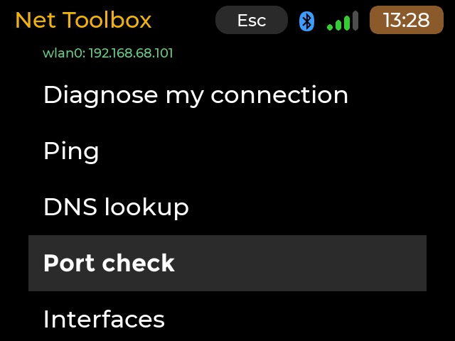 640x480, deck. Home: the active interface and its address on top, then the tools | 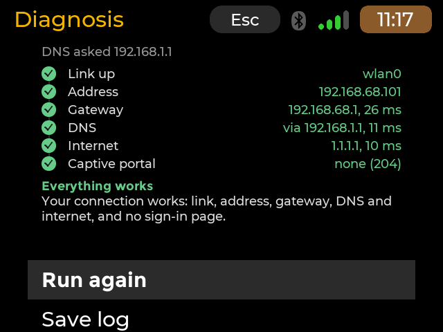 640x480, deck. Diagnosis: the six rungs all green, *Everything works* |
| 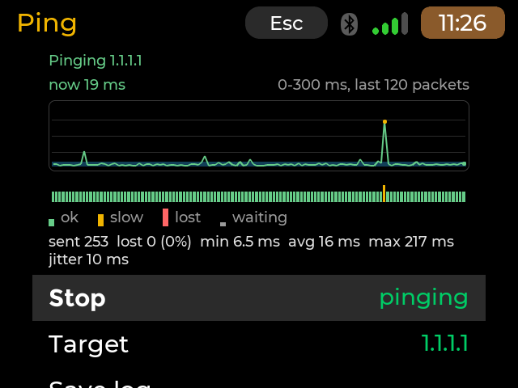 640x480, deck. Ping 1.1.1.1: the latency graph with one slow spike (amber dot), the packet strip and the statistics | 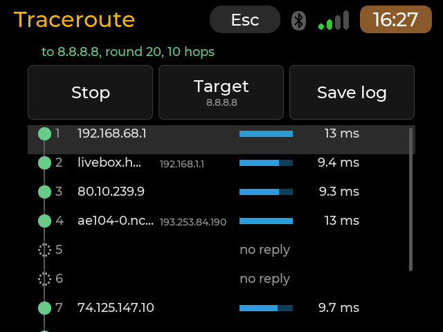 640x480, deck. Traceroute to 8.8.8.8: the chain of hops, two silent ones (*no reply*), a bar per hop |
| 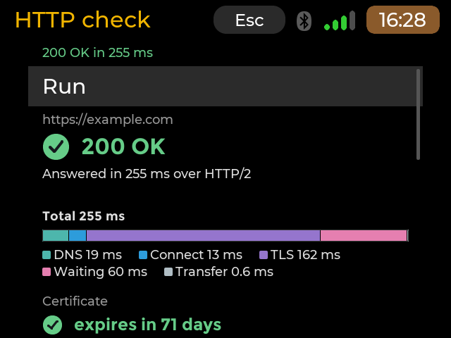 640x480, deck. HTTP check of example.com: *200 OK*, the timing waterfall (DNS, Connect, TLS, Waiting, Transfer) and the certificate's days left | 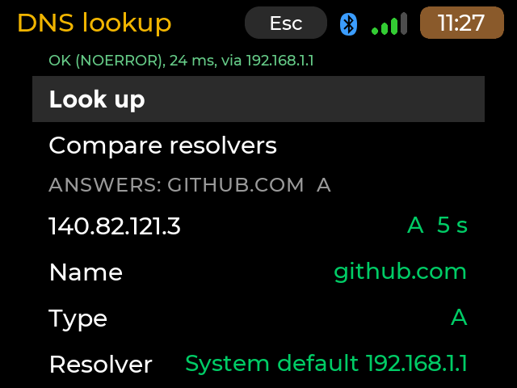 640x480, deck. DNS lookup: the answer for github.com A, its TTL and the resolver used |
| 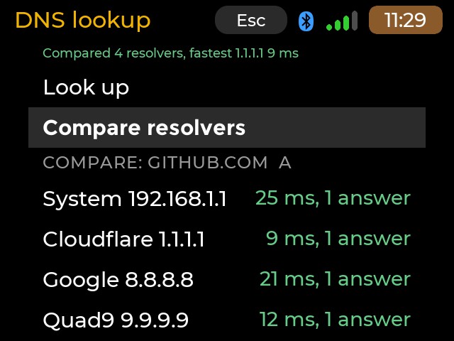 640x480, deck. Compare resolvers: the system's, Cloudflare, Google and Quad9 with their times | 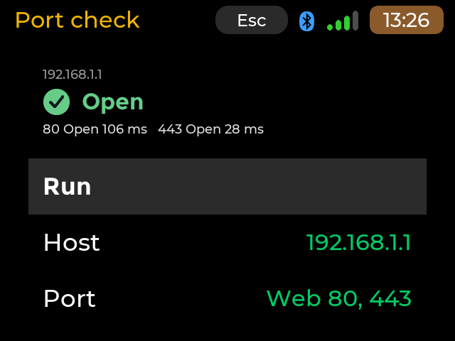 640x480, deck. Port check of the router's web ports: *Open*, with each port's connect time |
| 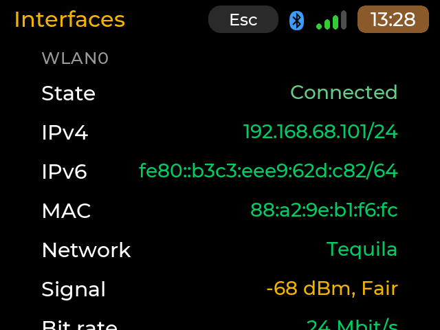 640x480, deck. Interfaces: wlan0 with its state, addresses, MAC, network and signal | 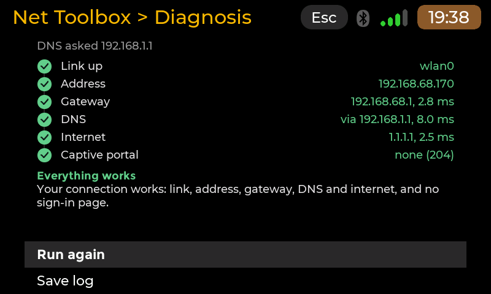 800x480, Pi 3A+. The same diagnosis on the wider screen |
| 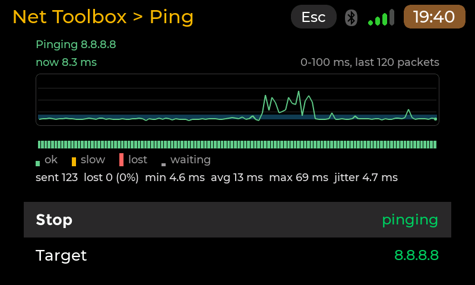 800x480, Pi 3A+. Ping 8.8.8.8 with the jitter band shaded behind the line | 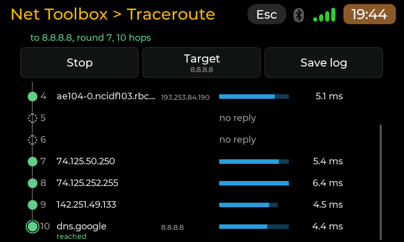 800x480, Pi 3A+. Traceroute scrolled to the end: hop 10, *dns.google*, reached |
| 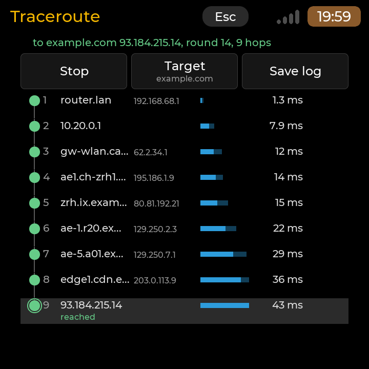 720x720 render, HackBerry size (square). The whole chain of nine hops fits on the square screen | 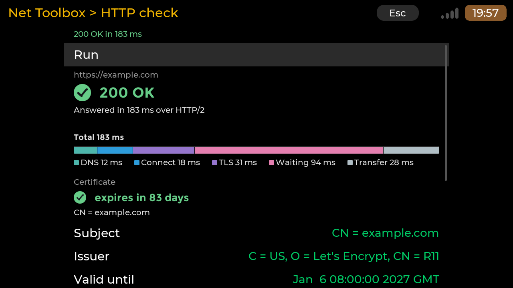 1280x720 render, larger screen. The HTTP check with the certificate's subject, issuer and expiry |

The screens above come from several screen sizes: the app adapts to the screen it runs on.

## Pages and keys

Every page is a column under the shared header (title, the on-screen Esc, the status strip), laid out by the launcher's
layout service. **Up / Down** move the highlight, **Enter** (or a tap on the highlighted row) acts, **Esc / Left** (or the
header's Esc) go one level up and stop the tool in use; at Home they end the app. A tap on a row selects it, a second tap
on the selected row acts (the launcher's CompactList rule); every action is a row, so every action is reachable by tap
and by keys.

| Page | What it shows | Actions (rows) |
|---|---|---|
| **Home** | a line with the active interface and its address (or **No network**, amber), refreshed every 2 s | Diagnose my connection, Ping, Traceroute, DNS lookup, Port check, HTTP check, Public IP, Whois, Interfaces (nine rows: the list scrolls) |
| **Interfaces** | read-only, refreshed every 2 s: a heading per interface with State, IPv4, IPv6, MAC, Speed (Wi-Fi: Network, Signal `-58 dBm, Good`, Bit rate), then Network: Gateway and the DNS servers in `resolv.conf` order, the first marked | one row scrolls per key press |
| **Diagnosis** | starts by itself: the **health ladder**, six rungs (Link up, Address, Gateway, DNS, Internet, Captive portal), each a mark and a word: hollow circle *waiting*, spinning amber arc *checking...*, green disc with a check (the detail: `3 ms`, the address, the resolver), red disc with a cross, a dash *skipped*; under it the first failure in plain words or **Everything works** with the core's notes | Run again, Save log |
| **Ping** | the latency **line graph** of the last 120 packets (time on x, ms on y with an automatic scale, the **jitter band** (average plus and minus the jitter) shaded behind the line, a lost packet a red tick on the baseline and a gap, a slow one an amber dot), the **packet strip** (one cell per packet: short green *ok*, medium amber *slow*, tall red *lost*, small grey *waiting*) with its legend, and the statistics (sent, lost and loss %, min / avg / max, jitter). When ICMP sockets are not allowed a notice says why and how to fix it | Start / Stop, Target (Roller: Gateway, 1.1.1.1, 8.8.8.8, the saved targets, Type a host...), Save log, Save target |
| **DNS lookup** | the status line (response code in words, time, resolver used) and the answer rows (data, record type and TTL; the CNAME chain); Compare resolvers lists the system's, 1.1.1.1, 8.8.8.8 and 9.9.9.9 with their time and answer count, one after the other | Look up, Compare resolvers, Name (typed), Type (A, AAAA, MX, TXT, NS, PTR), Resolver (System default, Cloudflare, Google, Quad9, Type an address...), Save log |
| **Port check** | a large mark and word (**Open** green check, **Closed** red cross, **No answer** amber dash, **Unreachable** red mark, **Mixed**), the host with its address and what it means with the connect time | Run, Host (typed), Port (Roller of the presets Web 80 443, Mail, SSH, DNS, Remote desktop ... or Custom port...), Save log |
| **Traceroute** | the status line (`to example.com 93.184.215.14, round 14, 9 hops`; stopped: the verdict, `Reached in 9 hops, 43 ms` or `Did not reach the destination: no answer after hop 6`) and **the chain**: a line down the left with one node per hop, then the hop number, the name (reverse name when known, else the address; the address smaller beside it), a latency **bar** (one linear scale: the largest average on screen; a stub for a tiny one; the best-to-worst range as a lighter extension), the average in ms and a loss tag (`30 %`). The node is a shape and a colour: filled **green** circle ok; **amber** circle with a notch (1 to 20 % loss, or an average over 150 ms); **red** circle with an X (more than 20 % loss that later hops share: real loss); hollow **dotted** circle and the words `no reply` (a silent hop is normal, never red); **grey ring** and `probably rate limiting` (loss at that hop only, the later ones are clean); the destination gets a double ring and the word `reached`. Hops appear as the first round fills them and the numbers move once a second without the layout jumping. Enter or a tap on the selected hop opens its details in place (all addresses seen, last / avg / best / worst, jitter, sent / received, loss, a plain reading of the node) | a row of three large cells above the chain: Start / Stop, Target (Gateway, 1.1.1.1, 8.8.8.8, the last host typed, Type a host...), Save log; Tab, Left / Right move between the cells, Down goes into the chain, Up from the first hop comes back |
| **HTTP check** | Run, then right under it: the status **badge** (`200 OK` green check, `301 moved` amber arrow, `404 Not Found` / `500 ...` red cross, an error in plain words with the same red cross), the final URL when it differs, the **waterfall** (one bar split into DNS, Connect, TLS, Waiting, Transfer on one scale, each segment in its own tone and named below with its milliseconds, a segment above 0 ms at least 2 px wide, the total), the **certificate badge** (`expires in 83 days` green from 30 days, amber under 30, red under 7 or `expired 12 days ago`) with Subject, Issuer, Valid until, then Remote IP, HTTP version, Size, Redirects | Run / Stop (curl is ended), URL (typed), Method (GET, HEAD), Ignore certificate errors (On / Off; On shows a warning), Save log |
| **Public IP** | asks by itself on entry: Public IPv4, Public IPv6 (`none` is normal and neutral), Country, Cloudflare data centre, Local address; behind carrier-grade NAT (a local address in 100.64.0.0/10) a note says `Your provider shares one public address between customers (carrier-grade NAT): you cannot receive inbound connections` | Run again, Whois of this address (opens Whois with it and runs it), Save log |
| **Whois** | a summary of the answer (domain: Registrar, Created, Updated, Expires with the days left in words, Status, Name servers; address: Net name, Organisation, Country, Range, AS number, Abuse contact; an empty field is not shown, a value is never cut: it wraps) and under the heading Raw answer the raw lines as compact rows (cut with dots, the first 200 lines; Save log has them all) | Query (typed), Run / Stop, Save log (placed under Run so that it stays in reach) |

Typed values (a host, a name, a resolver address, a port number) open a text field page: a physical keyboard types at
once; with none connected the launcher's on-screen keyboard shows (the rule of `input.state`, never summoned by hand);
Enter keeps the value, a bad one says why under the field, Esc goes back. The choices (target, type, resolver, port)
are Roller pages with a check on the current value. **Save log** writes the page's result (see *Files the app keeps*)
and the line at the top says where. Ping has **Stop**, not Pause: a stopped ping keeps its graph and numbers on screen.
The Traceroute, HTTP check, Public IP and Whois pages keep their rows in a list of their own (rows of any height: wrapped
values, paragraphs, the chain's hops, the badges) with the same keys and the same tap rule; Tab goes from the cells of
Traceroute to the chain and back.

Leaving a page, and leaving the app, stops its worker thread and ends its curl (Stop does the same): nothing runs in the
background (a cancel ends a probe within 50 ms). The page changes were checked for leaks (`tests/scenes/leak.scene`).

## What each tool sends, and to whom

| Tool | Sends | To |
|---|---|---|
| Traceroute | ICMP echo (or UDP to ports 33434 and up) with growing TTLs, one probe per hop per second; PTR questions for the names of the hops | the host you chose (Gateway, 1.1.1.1, 8.8.8.8, or the host you typed), the routers on the way, your DNS server |
| HTTP check | one `GET` or `HEAD` request through `curl` (never a shell); a TLS handshake read by `openssl s_client` only when curl refused the certificate | the address you typed, nothing else |
| Public IP | two `curl` requests (IPv4, IPv6) to `https://www.cloudflare.com/cdn-cgi/trace` | Cloudflare |
| Whois | the query over TCP 43 | `whois.iana.org`, then the registry or regional registry it names (ARIN, RIPE NCC, APNIC, LACNIC, AFRINIC, a TLD registry) and a registrar server when the registry names one, at most three referrals |

Everything starts when you press Run or Start, except the diagnosis (0.1) and the public address, which asks when you
open its page.

## Tools in 0.1

* **Diagnosis**: six steps in order, stopping at the first failure (the steps after it are *skipped*):
  * *Link up*: an interface other than `lo` is up with a link (the default route's first);
  * *Address*: it has an IPv4 address that is not self-assigned (169.254.x.x);
  * *Gateway*: the default gateway answers ping (three tries). A router that ignores ping but answers on TCP 53, 80
    or 443 (even with a refusal) passes too, with a note;
  * *DNS*: `example.com` resolves through the resolver in use: the system's servers in the order of
    `/etc/resolv.conf` (the next one is asked when one is silent, as the C library does), or the one you chose. The
    result names the resolver that answered (on the deck `resolv.conf` lists 192.168.1.1 first while the gateway is
    192.168.68.1). When no server answers, one ping to 1.1.1.1 tells "DNS down" from "internet down";
  * *Internet*: 1.1.1.1, then 8.8.8.8 answer ping; when ping is not allowed or is blocked, a TCP connection to their
    port 443 counts (with a note);
  * *Captive portal*: a plain HTTP request for `http://connectivitycheck.gstatic.com/generate_204`; the answer 204
    means no portal, anything else means the network shows its own page (a sign-in page is suspected).

  Each step has a state (pending, running, pass, fail, skipped) and a short detail (*192.168.68.1, 3 ms*); the failed
  one comes with an explanation and what to do (*The gateway answers but DNS does not (192.168.1.1 timed out). Try
  another resolver, for example 1.1.1.1, in DNS lookup.*).
* **Ping**: to a name or an address (a name is resolved by the app's own DNS client, IPv4 first; an address is used
  as typed). Interval, timeout and count (0 = until stopped). Each packet is *ok*, *slow* (longer than 100 ms and
  than 3 times the average of the replies before it) or *lost* (no reply within the timeout; a send error counts as
  lost); the last 120 packets are kept for the strip and the graph. Sent, received, loss (lost / (received + lost):
  a packet still waiting is not lost yet), min / avg / max and the jitter (the mean difference between successive
  round trips). No root: an unprivileged ICMP socket (IPv4 and IPv6).
* **DNS lookup**: A, AAAA, MX, TXT, NS, PTR (from an address: type `1.1.1.1`) and CNAME, through the system's
  resolver (the first of `resolv.conf`), a typed address, or 1.1.1.1 (Cloudflare), 8.8.8.8 (Google), 9.9.9.9
  (Quad9). The answer rows (name, type, TTL, data), the CNAME chain, the time, the resolver and its response code
  in words (*NXDOMAIN, no such name*). A compare mode asks several resolvers one after the other and times each.
* **Port check**: one port or a preset (Web 80 443, Mail 25 465 587 993, SSH 22, DNS 53, Remote desktop 3389, VNC
  5900, File sharing 445, MQTT 1883, Printer 631 9100, HTTP alt 8080 8443) of a host: *open*, *closed* (the host
  refused: it is there, nothing listens), *filtered* (no answer within the timeout), *unreachable* (the network says
  so), with the connect time. Nothing is sent on an open port: the connection is closed at once.
* **Interfaces**: each adapter with its state, IPv4 and IPv6 addresses, MAC, MTU, speed (wired), the Wi-Fi signal
  (`/proc/net/wireless`) and, from `iw`, the network name and bit rate; the default gateway, the DNS servers and the
  search domains.
* **Save**: every result can be written as text to `~/net-logs/<tool>-<YYYYmmdd-HHMMSS>.txt`.

## How it works

* Each running tool has **one worker thread** (256 kB stack) that waits with `poll()` in slices of at most 50 ms, so
  a cancel (Esc, a new start) ends it within that time; no thread pool, no detached threads. The thread publishes
  immutable snapshots under a mutex; the screen looks at a sequence number on a timer and never waits for the
  network (as System Monitor's sampler).
* **Ping** uses `socket(AF_INET, SOCK_DGRAM, IPPROTO_ICMP)` (and ICMPv6), which Linux allows to the groups in
  `net.ipv4.ping_group_range` (Raspberry Pi OS: everyone). The app checks at start whether the socket opens and,
  when not, says why and how to fix it.
* **DNS** is the app's own client (UDP with EDNS0, the query sent again after each try's timeout, TCP when the
  answer is truncated, once more without EDNS for an old server), not `getaddrinfo`, which cannot be cancelled,
  hides which server answered and cannot be pointed at another resolver. The parser bounds every read: compression
  pointers must point backwards (at most 32), names are at most 255 bytes, record counts must fit the packet, and a
  record whose data does not match its type is kept as *(malformed, N bytes)*. Names for ping and port check look in
  `/etc/hosts` first (`localhost`, the board's own name), then ask A, then AAAA.
* **Port check** and the captive-portal request are non-blocking TCP connections with a timeout; the HTTP request is
  hand-written (one `GET` with `Connection: close`; only the status line and the headers are read).
* **Interfaces**: `/sys/class/net/<if>/` (flags, operstate, carrier, address, MTU, speed), `getifaddrs` for the
  addresses, `/proc/net/route`, `/etc/resolv.conf`, `/proc/net/wireless`; `/usr/sbin/iw dev <if> link` (full path:
  `/usr/sbin` is not in every PATH) through the shared `async_run` with a 1.5 s timeout, optional.

## 0.2.0: the new tools' core

The core (`src/core/`, no LVGL) of four more tools; their pages are described above (the screen code is in `src/ui/`:
`rich_list.*` the list of rows of any height and the action cells, `chain.*` the hop rows, the badge, the waterfall and
the certificate block, `flow_runner.*` the curl tools on the shared `async_run`, `view_model_02.cpp` the words). Same rules as 0.1: one worker thread per
running tool (256 kB stack), every wait a `poll()` slice of at most 50 ms (a stop ends a tool within that time),
immutable snapshots under a mutex that the screen polls, nothing on the network until you start a tool.

* **Traceroute / MTR** (`traceroute`): the app's own, no root, no `traceroute` or `mtr` program (neither is installed).
  One socket for the whole run: an unprivileged ICMP echo socket (`SOCK_DGRAM`, `IPPROTO_ICMP`, allowed by
  `net.ipv4.ping_group_range` as for ping) and, when that socket is not allowed, UDP datagrams to ports 33434 and up
  (the snapshot says which, and why). Each probe leaves with its own TTL (`IP_TTL`, `IPV6_UNICAST_HOPS`); the answers
  come back on the socket's error queue (`IP_RECVERR` / `IPV6_RECVERR`, `MSG_ERRQUEUE`): *time exceeded* names the
  router of that hop, an echo reply (ICMP) or *port unreachable* from the destination (UDP) ends the path, an
  *unreachable* from a router ends it there with its words (*host unreachable*, *communication prohibited*, ...).
  It runs in **rounds** like mtr: a round probes every hop up to the destination (every hop up to the maximum while
  the destination is not known), a few ms apart, all in flight together and waited for in one `poll()` loop, so a
  round lasts about one probe timeout. Per hop and across the rounds: sent, received, lost (no answer within the
  timeout), loss %, last, average, best, worst, jitter (as ping: the mean difference of successive round trips), the
  addresses that answered (most frequent first, four kept; *several addresses* when the path is balanced) and their
  reverse names. A hop that never answers is a **silent hop**, not an error. **Rate limiting**: a hop with loss when
  every later hop that answers has none is flagged `loss_only_here` (*likely ICMP rate limiting, not a real problem*).
  The list stops at the destination; when it never answers, every hop up to the maximum is probed and a summary
  stops at the last hop that answered. Settings: maximum hops (30), round interval (1 s), rounds (0 = until
  stopped), probe timeout (1.5 s). The destination: an address, `/etc/hosts`, or the app's DNS client (IPv4 first,
  IPv6 when the name has only AAAA records or for an IPv6 address). **Reverse names** use the DNS client's packet code
  in a non-blocking form on the same thread: one UDP socket to the resolver, a PTR query when an address first
  answers, at most 4 waiting, 1.5 s each (one try), at most 64 addresses (the cache): the probing never waits for a
  name.
* **HTTP check** (`httpcheck`): the system's `curl` (8.14.1 on the boards), as an argv, never through a shell:
  `curl -sS -v -o /dev/null -g --proto =http,https --proto-redir =http,https -m 15 --connect-timeout 8
  --max-redirs 5 [-L] [-I] [-k] -w '%{json}\n' --url <address>`. `-k` (ignore certificate errors) only when you turn
  it on; `-I` asks with HEAD instead of GET; `--proto` keeps curl, and every redirect, to http and https; `-g` turns
  off curl's `{}` / `[]` URL patterns; `-v` only serves to tell a refused connection from no route (curl 8.14 says
  *Could not connect to server* for both). The address: a host, `host:port`, `http://...` or `https://...` (https when
  no scheme is typed); refused: blanks, control characters, quotes, `;`, `` ` ``, `$`, `\`, `<`, `>`, a leading `-`,
  another scheme, a user name or password, a bad host or port, more than 2048 characters. curl's `%{json}` report
  gives the status (with its reason: *404 Not Found*), the final address and the redirect count, the HTTP version, the
  server's address, the size, and the timings, shown as stages: DNS (namelookup), connect (connect - namelookup), TLS
  (appconnect - connect), wait / first byte (starttransfer - pretransfer), transfer (total - starttransfer); with
  redirects curl adds the requests together. **The certificate**: for a connection curl verified, its report carries
  the chain (`certs`: subject, issuer, start and expire dates of the server's certificate). When curl refuses the
  certificate (exit 60: expired, self-signed, unknown issuer, not yet valid) its report has none; the app then runs
  `openssl s_client -connect <host>:<port> -servername <host>` (stdin empty, so it ends after the handshake; no
  `-servername` for an address) and reads the server's certificate from its *Certificate chain* lines (`s:`, `i:`,
  `v:NotBefore: ...; NotAfter: ...`), without judging it. Checked on the deck on 2026-10-15 (curl 8.14.1 with
  OpenSSL 3.5.7; also OpenSSL 3.0.13 on the build PC): curl alone gives the dates of a good certificate but not of a
  refused one, and `openssl s_client` alone gives them without a pipe to `openssl x509`. The days left use the board's
  clock (a wrong clock shows as *not yet valid* or *expired*). Errors in plain words from curl's exit code and
  message: the name cannot be found, refused, no route, timed out (no answer to the connection, or too slow),
  certificate expired / not yet valid / name mismatch / self-signed / untrusted issuer, TLS failed, too many
  redirects, empty reply, connection cut, not HTTP, curl not installed. With `-k` the page is shown and a note says
  what was ignored. The core builds the commands and reads their output; who runs them is injectable (`cmdrun`): the
  pages will use the shared `async_run` (as `iw`), the sessions and the tests the core's own runner (posix_spawn,
  stdout and stderr in one pipe, stdin `/dev/null`, `LC_ALL=C`, its own process group: a timeout or a stop ends the
  whole group, SIGTERM then SIGKILL after 0.5 s).
* **Public address** (`publicip`): `curl -4 -sS -m 8 --proto =https https://www.cloudflare.com/cdn-cgi/trace`, then
  the same with `-6`. Cloudflare answers `key=value` lines: the address (`ip`), the country (`loc`, two letters) and
  the Cloudflare site that answered (`colo`, an airport code). An IPv6 request that fails is reported as *no IPv6*,
  the usual case at home, not as an error. `ip_class()` tells public, private, carrier-grade NAT (100.64.0.0/10),
  loopback, link-local or reserved; `nat_kind()` compares the board's address with the public one: the same (the
  board has the public address), behind a router (NAT), or behind carrier-grade NAT (the board's address is in
  100.64.0.0/10: the provider shares one public address).
* **Whois** (`whois`): the app's own TCP port 43 client. The query (a domain, an IPv4 or an IPv6 address) goes to
  `whois.iana.org`, whose `refer:` (or `whois:`) line names the registry: the TLD's server for a domain, the regional
  registry for an address (ARIN, RIPE NCC, APNIC, LACNIC, AFRINIC); that answer may name another server
  (`Registrar WHOIS Server:`, ARIN's `ReferralServer:`), asked in turn: at most 3 referrals, never the same server
  twice for the same query, 64 kB per answer, 10 s in all. `whois.arin.net` gets `n + <address>`, the others the
  query as typed; a registry that finds no `www.example.com` is asked for `example.com` (at most twice). The result
  keeps the raw answers (control characters dropped, bytes that are not UTF-8 shown as `?`, 300 bytes per line, 400
  lines in all) and a summary of the most specific answer (IANA's own only when no other came): for a domain the
  registrar, created, updated, expires, status codes and name servers; for an address the network name, holder,
  country, range, AS number and abuse contact. A field the answers do not give stays empty.
* **Saved results** (`netlog`): `format_trace`, `format_httpcheck`, `format_publicip`, `format_whois`, same text style
  as 0.1. **Settings**: `trace_target`, `http_url`, `http_insecure` (0 by default), `whois_query` in the same file;
  a 0.1 file reads with their defaults.

Limits of the 0.2 core: the real ICMP trace, routers that limit their ICMP answers, and the whois servers were
exercised from the build PC (WSL, UDP probes through its NAT; whois over the internet) but not yet on a board; curl's
`certs` of a redirect chain describe the last server only; a hop that answers from more than four addresses keeps
the others as a count; reverse names come from the resolver in `resolv.conf` (or the one chosen), over UDP only.

## Requirements

* A screen of at least **640x480** (`X-MinSize=640x480`; under it the app says so and closes on any key) and a
  CyberdeckZero Launcher with full-screen app support (contract 1).
* Ping needs unprivileged ICMP sockets (`net.ipv4.ping_group_range` covering the user's group; the default on
  Raspberry Pi OS). Without them ping says so with the fix, and the diagnosis uses TCP connections instead.
* `iw` (package `iw`) for the Wi-Fi network name and bit rate; optional.
* `depends` = the template's `libfreetype6, libinput10, libxkbcommon0` and, from 0.2, `curl, ca-certificates` (the
  HTTP check and the public address); no root. The `openssl` program (installed on both boards) reads the dates of a
  certificate curl refused; without it that certificate shows no dates.
* Network: the tests talk to the hosts you name; the diagnosis contacts your gateway, your DNS servers, 1.1.1.1
  (Cloudflare), 8.8.8.8 (Google) and `connectivitycheck.gstatic.com` (Google), only when you start it. From 0.2: the
  public address asks `www.cloudflare.com` (Cloudflare), whois asks `whois.iana.org` and the servers it names, only
  when you start them.

## Install

From **Settings > Apps**. By hand:

```sh
python3 tools/make_registry.py --only net-toolbox --out <a folder outside packages/>
sudo dpkg -i net-toolbox_0.1.0_arm64.deb      # remove: sudo dpkg -r net-toolbox
```

## Files the app keeps

| Path | What |
|---|---|
| `${XDG_CONFIG_HOME:-~/.config}/cyberdeckzero/net-toolbox.conf` | saved ping targets and the last values of each tool (`key=value`); written through a temporary file and a rename. Delete it to reset. `NET_TOOLBOX_CONFIG` names another file |
| `~/net-logs/<tool>-<YYYYmmdd-HHMMSS>.txt` | a result you saved (only when you ask). `NET_TOOLBOX_LOG_DIR` names another folder |

Logs go to stderr with the tag `[net-toolbox]` (the launcher's journal).

## Known limits

* **Not yet run on a board**: the tools are unit-tested on fixtures and on loopback and the pages on headless scenes;
  the board protocol (`tests/BOARD-TESTS.md`) is still to be run.
* Ping has Start and Stop, no Pause: Start begins a new series.
* IPv4 first: the gateway is the IPv4 default route; an IPv6-only network is not diagnosed yet.
* Names ending in `.local` (mDNS) are not resolved; use the address.
* The real ICMP path was tested on the build PC only inside a network namespace that allows ping (the PC itself
  does not); on the boards it is still to be run.

## Credits and licences

<!-- branding-allow-begin: credit of the cp0_lvgl runtime linked into the binary (MIT) -->
MIT, 2026 OSRdesign. The binary contains the launcher's `cp0_lvgl` runtime (M5Stack Technology CO LTD, MIT) and
LVGL (LVGL Kft, MIT); see `root/usr/share/doc/net-toolbox/copyright`. The fonts are the launcher's, read at run
time; none is shipped.
<!-- branding-allow-end -->
At run time the app reads the Linux kernel's `/proc` and `/sys` interfaces and, when installed, runs `iw` (ISC); it
is not shipped or modified. The ping, DNS (RFC 1035, EDNS0 of RFC 6891), TCP and HTTP clients are the app's own code.
The captive-portal check uses Google's `generate_204` address; the internet check uses Cloudflare's 1.1.1.1 and
Google's 8.8.8.8. From 0.2 the app also runs `curl` (curl licence, MIT-style) and, when installed, `openssl`
(Apache 2.0) as separate programs, not shipped or modified; the traceroute, the whois client (RFC 3912) and the JSON
reader are the app's own code; the public address comes from Cloudflare's `/cdn-cgi/trace` page.

## Build and test

In WSL (the launcher build tree `~/zero7/launcher` with its SDK; see `../_common/build_app.sh -h`):

```sh
wsl -e sh /mnt/c/CLAUDE/zero7/cyberdeck-zero-apps/apps/net-toolbox/build.sh host           # tests + scenes
wsl -e sh /mnt/c/CLAUDE/zero7/cyberdeck-zero-apps/apps/net-toolbox/build.sh all --strict   # + aarch64 binary
python3 tools/make_registry.py --only net-toolbox --out <a folder outside packages/>      # a local .deb
```

* `src/core/`: no LVGL. `interfaces` (the readers and parsers), `source` (the system, or a fixture folder),
  `netaddr` (addresses, reverse names, host names), `worker` (the tool thread, the cancel token, the snapshot
  channel), `sock` (non-blocking socket steps), `dns` (the wire format), `dns_client` (queries, compare,
  `resolve_host`, the lookup session), `ping` (statistics, the packet ring, the ICMP socket, the engine, the
  session), `portcheck`, `http`, `diagnosis` (the steps, the probe interface, the session), `netlog` (saved results
  and their text), `settings`, `text`. From 0.2: `traceroute` (the probe socket, the rounds, the hop statistics, the
  session), `rdns` (reverse names without blocking), `cmdrun` (the command runner interface, the direct runner, the
  step flows), `httpcheck` (the address rules, the curl and openssl command lines and parsers, the flow, the session),
  `minijson` (curl's report), `publicip`, `whois`.
* `src/ui/`: `toolbox_app` + `tool_pages` (the frame: navigation, the band, the Choice and Typed pages, saving; the five
  tool pages), `view_model` (every text, tone and number a page shows, from the core's snapshots: no LVGL, unit-tested),
  `charts` (the health ladder, the ping graph and strip, the result badge: drawn with LVGL's draw API), `backend`
  (the runners the pages use: the core's sessions, or the scripted ones of the scenes), `style` (palette and helpers),
  `wifi_link` (`iw` through `async_run`).
* `tests/`: unit tests (`test-net-toolbox`, about 500 checks): the readers on `tests/fixtures/<board>/` (the deck,
  the deck with Wi-Fi not associated, a Pi 3A+ on 5 GHz with IPv6, a Pi 5 on Ethernet with Wi-Fi off); DNS packets
  built and parsed, crafted bad packets and a 40 000-case mutation fuzz; the DNS client against a fake server on
  loopback (UDP, TCP fallback, retries, silence, a closed port, FORMERR, compare, cancel); the ping statistics and
  engine on a scripted socket; port check and HTTP against loopback listeners (open, closed, filtered through a
  full accept queue); the diagnosis on a fake network, one test per failure point; the log files, the settings, the
  worker. The real ping of 127.0.0.1 and ::1 runs when the host allows ICMP sockets and is skipped with the reason
  otherwise. Headless scenes in `tests/scenes` (about 40, each at 640x480, 800x480, 720x720, 1024x600 and 1280x720, with the layout
  checks of `_common/headless`): Home, Interfaces on the four recorded boards, the Diagnosis in six states (healthy, a gateway
  that ignores ping, no link, DNS down, a captive portal, in progress), Ping (ok / slow / lost packets, everything lost,
  an unknown name, no ICMP socket, the target Roller, a typed host with the on-screen keyboard), DNS lookup (answer,
  NXDOMAIN, timeout, compare, MX, PTR, the choices, the typed name), Port check (open, closed, no answer, unreachable,
  a preset with several ports, an unknown host, the choices), `nav` (Up / Down, Esc and Left at every level, Esc at Home
  quits), `touch` (every action by tap), `save-empty`, `leak` and the notice under 640x480. The scenes run on a
  scripted backend (`NET_TOOLBOX_DEMO`, see `src/ui/backend.hpp`) and the recorded boards of `tests/fixtures`
  (`NET_TOOLBOX_FIXTURE`): no network, the same picture every time. `tests/test_ui_model.cpp` checks `view_model`.
* `tests/` from 0.2 (about 1100 checks in all): the traceroute engine on a fake hop network injected at the socket
  layer (latency per hop, loss, a silent hop, a hop answering from two addresses, rate limiting at one hop, real loss
  further on, the destination at hop N, a destination that never answers, a router saying *unreachable*, the ICMP to
  UDP fallback, a long path in one round, cancel, the statistics), the reverse names through the fake DNS server, and a
  real UDP trace of 127.0.0.1 and ::1 (ICMP too when the host allows it); curl's reports recorded on the deck
  (`tests/fixtures/curl`: a healthy HTTPS page, HEAD, a redirect followed and not followed, too many redirects, an
  expired, a self-signed, an untrusted-root and a wrong-name certificate, `-k` on an expired one, a DNS failure, a
  refused connection, a connect timeout, a TLS reset) and `openssl s_client`'s (`tests/fixtures/openssl`), the days
  left on an injected clock (expiring soon, expired, not yet valid), the address rules against about 35 hostile
  inputs, the flow on a fake runner and on fake `curl` / `openssl` programs run by the real runner, the runner itself
  (timeout, cancel, the process group ended, the output cap); the public address on Cloudflare's recorded trace (its
  address replaced by 203.0.113.7) and the address classes; whois answers recorded from IANA, Verisign, MarkMonitor,
  ARIN, RIPE NCC and APNIC (`tests/fixtures/whois`), and the client against fake whois servers on 127.0.0.2 and up
  (referral chains, ARIN's `n +`, the parent-domain retry, a referral loop, the referral limit, an oversized answer,
  garbage bytes, a silent server, a refused connection, cancel); the 0.2 log texts and settings.

## Changes

* 0.2.0, the pages: Home has nine rows; **Traceroute** with the chain of hops (node shapes and colours, latency
  bars on one scale, loss tags, details in place), **HTTP check** (status badge, waterfall, certificate badge, rows;
  curl runs on the shared `async_run` and Stop ends it), **Public IP** (asks on entry, the carrier-grade NAT note, Whois
  of this address) and **Whois** (a summary that is never cut, the raw answer as compact rows); the scripted demonstration
  backend and the headless scenes for each state, the unit tests of the new wording (verdicts, days left, loss tags, node
  classes, waterfall scaling), the board steps.

* 0.2.0: the core of traceroute / MTR (in-app, unprivileged, in rounds), the HTTP check (curl, certificate
  dates through curl or openssl), the public address (Cloudflare's trace) and whois (TCP 43 with referrals), their
  saved texts and settings, the unit tests; `depends` gains `curl, ca-certificates`.
* 0.1.0: first version: interfaces, diagnosis with the health ladder, ping with the latency graph, jitter band
  and packet strip, DNS lookup and compare, port check, saved results and settings; the pages for touch and keys, the unit
  tests and the headless scenes. Board tests still to run.
