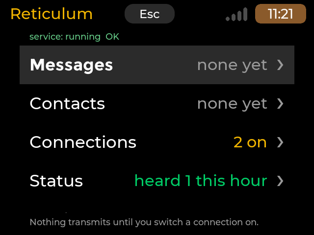
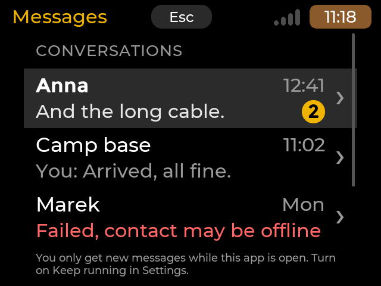
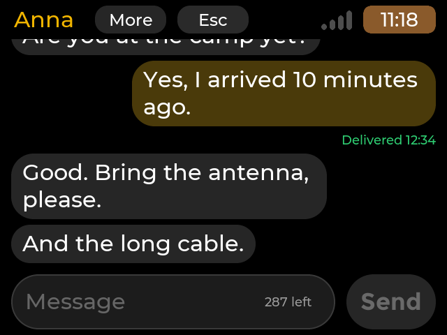
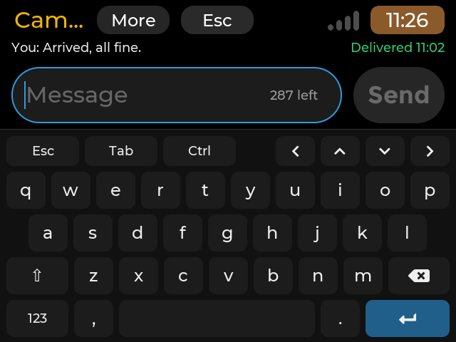
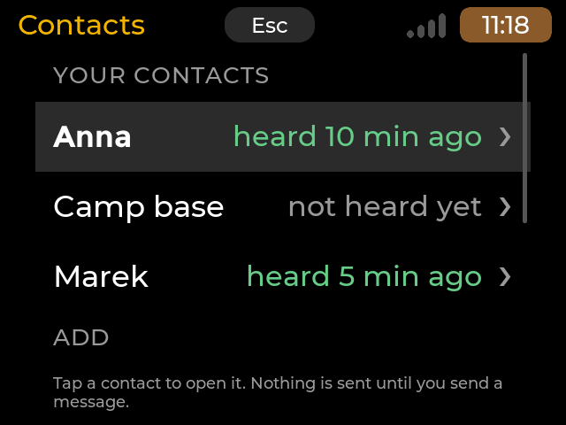
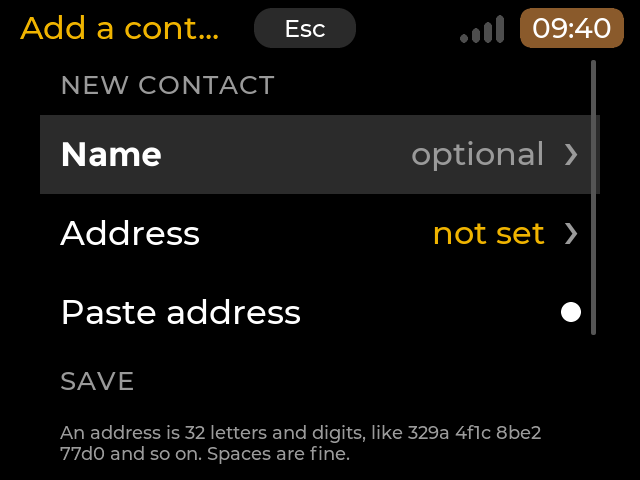
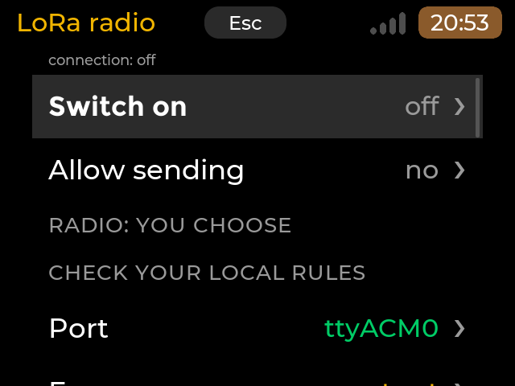
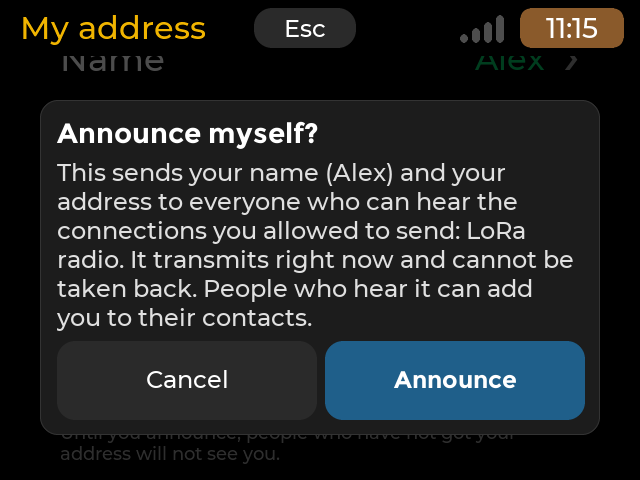
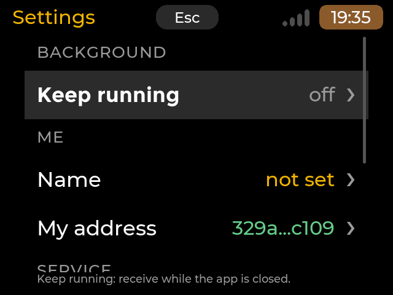

# Reticulum (draft, not published)

Contacts, messages, connections, status and settings for the [Reticulum](https://reticulum.network) network, as a full-screen
app with its own tile, **plus the background service it needs** (one package, `reticulum` 0.3.3, `"draft": true` in
`app.json`, so `make_registry.py` skips it until the board tests are done). You keep a list of contacts (a name and an
address), write direct messages to them and see whether each one was delivered; the app also switches the ways your deck can
reach others on and off (Wi-Fi / LAN, the internet, a LoRa radio (RNode), and more kinds), shows who was heard, and keeps a few
settings. **Every connection starts off and nothing is sent until you switch one on and allow it to send, and then only what you
send yourself** (Wi-Fi / LAN has no listen-only state: it announces itself to the network from the moment it is on, so it is on, and may send, or off): a message with Send, a message again with Retry, your name and address with the confirmed Announce myself.
Nothing is sent by itself, no announcement is automatic. The screens use plain words (address, connection, contact, heard
recently): none of the network's own vocabulary is on them.

Phase P2 (this version) adds the screens for what the service has had since 0.3.0-bridge: Messages, Contacts, Heard recently, My
address, Announce myself and the new-message alerts ([docs/dev/reticulum-bridge.md](../../docs/dev/reticulum-bridge.md) section
10). Direct messages only: no groups, no relay servers in the screens.

Kind of app: **A, a native `cp0_lvgl` app** (the default of the [guidelines](../../docs/APP-GUIDELINES.md)): its own pages,
forms and lists, touch and keyboard, the launcher's widgets and status strip. It talks to the service over a Unix socket;
the service is a small Python program (our own code on the public API of RNS and LXMF, bundled unmodified) that the app
starts when it opens.

## Screenshots

Rendered by the headless harness from the real UI code (a plain LVGL display, the **fake bridge's canned data**, a fixed
clock): **not photographs of a board**. The numbers in the LoRa radio pictures are synthetic placeholders, not a band plan
and not a recommendation. 640x480 is the deck's reference size, then 480x320 and the portrait canvas 480x800 (PDA mode).
All of them are in [`screenshots/`](screenshots/) in the Store's order (1-44: connections, status, settings; 45 on:
contacts and messages, at 640x480, 800x480, 480x320 and portrait 480x800); a selection:

| Home | Messages | A conversation |
|---|---|---|
|  |  |  |

| Typing (on-screen keyboard) | Contacts | Add a contact |
|---|---|---|
|  |  |  |

| Connections | A LoRa radio, listening | Radio fields start empty |
|---|---|---|
|  |  |  |

| Allow sending asks first | Add a connection | Announce myself asks first |
|---|---|---|
|  |  |  |

| Status | Settings | 480x320 |
|---|---|---|
|  |  |  |

## What it does and how to use it

Opening the app starts the service (`systemctl --user start reticulum`) and waits for it with a progress line; if it cannot
start, the page says why and offers **Try again**. Leaving the app stops the service again unless **Keep running** is on. **Messages
are received only while the app is open, unless Keep running is on** (the Messages page says so while it is off).

| Page | What it holds |
|---|---|
| **Home** | the service line (running OK / starting / stopped); **Messages** (*2 new*), **Contacts** (how many), **Connections** (*all off*, *listen only*, *sending* or how many are on), **Status** (*heard 4 this hour*), **Settings** (*keeps running* / *stops on exit*) |
| **Messages** | one row per conversation, two lines: the name and the time, then the last text (*You: ...* for one you sent; a failed one says so in red) with a count of new ones in an amber pill; **New message** asks who to write to |
| **A conversation** | the messages as bubbles (yours on the right), under each of yours where it stands: *Sending...*, *Delivered 12:34*, *Sent, not confirmed by contact*, or *Failed, contact may be offline* with a **Retry** button (nothing is sent again by itself); the compose row at the bottom with the characters left in it and **Send**; **More** in the header opens the conversation's options |
| **More** | **Contact** (or **Add to contacts** for someone who is not one yet), **Send the failed messages again** (only when there are some), **Delete conversation** (asks first; only on this deck, nothing is sent to the other side) |
| **Contacts** | your contacts (name, *2 new* / *heard 5 min ago* / *not heard yet*), **Add a contact**, **Heard recently**, **My address** |
| **A contact** | when it was heard and on which connection; **Send a message**, **Rename**, **Remove contact** (asks first: only on this deck, and its messages go with it) |
| **Add a contact** | a name (optional) and an address (32 letters and digits, spaces are fine; **Paste address** takes it from the clipboard where the deck has one); **Save contact** is available once the address is complete |
| **Heard recently** | the people your connections heard, newest first, with how long ago; a white dot adds that person with one tap (the heard name, or *Anonymous* with the short address); **Announce myself** |
| **My address** | your name, your address in groups of four (two even lines of four groups where one line does not fit; the page scrolls to the rows under it), **Copy address**, **Announce myself** |
| **Announce myself** | asks first, naming your name and the connections that may send; when no connection may send it shows *No connection is allowed to send* with a row that opens Connections, and sends nothing |
| **Connections** | one row per connection with its state in plain words (*off*, *on, listen only*, *on, sending*, *on, not connected*, *problem*); **Add a connection** |
| **A connection** | **Switch on** (for **Wi-Fi / LAN** it asks first: it makes this deck known to others on the network and may send; Enter alone says no); **Allow sending** (*no* = listen only; turning it on asks first and explains; on a radio it says the rules are yours; **Wi-Fi / LAN has no such row**; an Internet connection that listens only still says hello to its server when it connects, and the page says so); **Problem / details** when something is wrong; the options of its kind (a list the service gives, so the same page serves every kind; radio settings start **not set** in amber, and the app has no presets and no example values: you choose them, and the rules for sending are yours to check); **Remove connection** (asks first). A refusal comes back in plain words (the port is used by another program, a value is out of range, something still has to be set) |
| **Add a connection** | the kind: **Wi-Fi / LAN**, **Internet**, **LoRa radio**, **More...** (the other kinds the service lists); then a short form (name and the kind's fields); **Save connection** creates it **switched off and listen only**. A serial port is chosen from `/dev/serial/by-id` and the `ttyACM` / `ttyUSB` devices, or typed |
| **Status** | this deck (service, address in short form), the connections with their state (a radio also shows the channel busy and noise values when the service reports them), who was heard recently (*Nobody yet* when none) |
| **Settings** | **Keep running** (enables or disables the user service; off by default); **New message alerts** (a message on the screen and a beep for each new message, only while the service runs, so while Keep running is on or the app is open; off by default; the text of the message is never in the alert); **Name** (the name others will see; saving it sends nothing); **My address** (the page above); **Stop the service** (asks first); the on-screen keyboard rule and the version. The list is longer than the screen: it scrolls, and **Stop the service** is below the fold on small screens |

### The length of a message

The compose row counts the **bytes** of what you typed (an accented letter is two, a euro sign three, an emoji four) against what
fits one packet (287; the service says the number, the app asks it once). It reads *287 left*, turns white in bold at 30 or fewer, and
past the limit reads *23 over* in amber with the line *Long messages are slow over radio*: **Send stays enabled**, a long message
is still sent (slowly over a radio link). The service refuses a text over 8192 bytes; the field stops there. Where the keyboard
leaves no room for the warning line (480x320) the amber counter says it and the line is there when the keyboard closes.

### Keys and touch

| Function | Keys | Touch |
|---|---|---|
| Move | Up / Down, Home / End, Page Up / Down | drag; a tap on a row selects it |
| Open or do the selected row | Enter or Right | a tap on the selected row |
| Back | Esc or Left | the header's Esc button |
| Leave the app | a short Esc on Home | the header's Esc button on Home |
| Edit a value | Enter on its row, type, Enter | tap the row twice, type (on-screen keyboard), Enter |
| Answer a question | the focus starts on **Cancel**: Enter or Esc says no; Right (or Tab) moves to the main button, Enter says yes; Left goes back | tap a button |
| Write a message | open the conversation: with a physical keyboard the field is ready, just type; Enter sends; Esc stops typing, a second Esc goes back | tap the field (the on-screen keyboard comes), type, tap **Send** |
| Move in a conversation | Up / Down / Page Up / Page Down / Home / End scroll the bubbles; Down at the end moves on to the field, Send, a Retry button, More; Right opens More; Up / Down in the field move along the same chain | drag the bubbles; tap Retry or More |
| Send again | Enter on a **Retry** button (reach it with Down from the field), or **More > Send the failed messages again** | tap **Retry** |

The on-screen keyboard appears only by the shared rule (no physical keyboard connected, or the launcher's setting forces
it); there is no button that summons it, and **Settings** shows the rule's state. Without a physical keyboard a conversation opens
with the history in view and the keyboard comes when you tap the field (or press Enter). With the keyboard up there is little
room: the bubbles give way to **one line with the latest message** and where it stands, above the compose row.

### Multitasking

`X-Background=freeze`: while the app is hidden it is stopped and does nothing. The service itself keeps running (it is
its own process), so receiving does not depend on the app being in front. The app polls the service every 3 seconds only
while it is shown.

## Requirements

- Raspberry Pi OS (Debian 13) with a systemd user session: the service is a **user unit** and needs `XDG_RUNTIME_DIR`
  (a normal desktop or console login; a bare `ssh` login without a user manager does not have one, and the app says so).
- `python3` (3.10 or later), `python3-cryptography`, `python3-serial` (installed with the package); `python3-bleak` is
  recommended (Bluetooth radios, not used by this version's pages).
- A USB radio or modem needs the `dialout` group: `sudo usermod -aG dialout $USER`, then log out and in.
- Any screen: no minimum size (the lists scroll); portrait from 480x640 (`X-Portrait=480x640`). Memory: the app is a
  native app (about 13-15 MB); the service is a Python process of about 40 MB with every connection off (PC measurement,
  not a Zero 2 W figure). **Not yet measured on a board.**

## Install

Settings > Apps once it is published (the package is a draft). By hand: `sudo dpkg -i reticulum_0.3.0_arm64.deb` (or
`_amd64.deb`; the package has one tree of Python for both, and a binary per architecture). The package does not start or
enable the service: the app starts it, and **Keep running** enables it.

## Files the app keeps

The app writes **no file of its own**. What exists is the service's: the Reticulum configuration (`~/.reticulum/config`,
changed only by the connection pages, with a `config.bak` of the last change), the deck's identity and name
(`~/.local/share/reticulum/`), and the socket and state in `$XDG_RUNTIME_DIR/reticulum/`. **Keep running** is the enabled
state of `~/.config/systemd/user/default.target.wants/reticulum.service`. To reset: remove a connection on its page,
or `rm -r ~/.reticulum ~/.local/share/reticulum` with the service stopped (this also deletes the deck's identity).
Package files: [section 9 of the bridge document](../../docs/dev/reticulum-bridge.md#9-package-p1a-part-2).

## Known limits

- Draft: not published; not tested on a board (see the board protocol, [`tests/BOARD-TESTS.md`](tests/BOARD-TESTS.md)).
- On a 480 px wide screen a long value (a state word such as *on, listen only*) shortens the label to its first letters;
  the value is never cut.
- The kind list shows only what the service can set up; a hand-written connection of another kind is listed and can be
  switched on and off and removed, not edited.
- A name for a connection cannot contain a slash (the service's rule), so the first one is called *Wi-Fi LAN*.
- One instance: if another program already runs the Reticulum shared instance, the service joins it as a client and
  does not hold the serial ports.
- Direct messages only: no groups, no relay servers, no read receipts (*Delivered* means the contact's deck got it, not that it was read), no per-message delete (delete the conversation), no pictures or files.
- **Paste address** and **Copy address** use the system clipboard only where the deck has one (`wl-copy` / `wl-paste`, `xclip` or `xsel` on a desktop session); on the console they do nothing useful and the app says so: read the address out and type it (the **My address** page shows it in groups of four). A clipboard for apps in the launcher contract would fix that (a request for the launcher, not built here).
- The *Delivered* time is the time the message was sent, not the time the confirmation arrived (the service does not report the latter).
- A conversation shows its last 60 messages; there is no *earlier messages* button yet. The service keeps up to 2000 per conversation.
- The Add a contact keyboard is the ordinary one (the canvas drew a hexadecimal one with a *Paste* key): the field counts the digits instead.
- Home's Settings row says *keeps running* / *stops on exit*, not the board's *keep running: off*, and its Status row *heard 4 this hour*, not *heard 4 in the last hour*: the longer words cut the row's label to a few letters on a 480 px screen. The Connections row says *listen only* or *sending* without the connection's name (it is on the Connections page).
- The grey dot of an *info* row on the design boards is not drawn: the toolkit's information rows carry no marker (a plain value is grey).
- With the on-screen keyboard up at 480x320 there is room for the compose row and the latest message only; while a message is over the limit the warning about a long message takes that line and the history is hidden until the keyboard closes (0.3.3; it was a cut sliver). The warning wins the room over the history: where the keyboard leaves no room for the latest message under it, that line is dropped (it was a cut sliver).
- On a screen as short as 480x320 Home's hint is one line (*A connection may send. Only what you send goes out.*, *Connections only listen. Nothing is sent.*) so that the five rows stay whole; taller screens keep the two-line hint. A hint on any page now has a full gap of black above its first line.
- **Header titles at 480x320.** The title room (left of the Esc pill) is about 190 px, and the shared header drops the leading crumbs until the rest fits, then cuts the last one with dots. So the contact's page reads the contact's name (a long name ends in dots), Rename reads *<Name> > Rename* when that fits and *Rename* when it does not (the field shows the old name), and Announce myself reads *Announce* (the whole word) where *Announce myself* does not fit. Where a title fits, the crumbs show as before; the name still appears only once.
- **The Esc pill** is the shared header's (`cp0::ui::Page`, the same in every app and in the launcher): 9 mm wide (`cp0_ui_toolbar_key_px`) and as high as the bar's margins allow, which is 30 px of the 40 px bar at 480x320 (about 4.6 mm on the 3.5 in Orange Pi panel). Reticulum does not change it; the More pill copies its height.
- The propagation nodes and the map of the network are later phases.

## Credits and licences

- Our code (the app, the service called the bridge, and their tests): MIT, 2026 OSRdesign. The bridge was written with AI
  assistance from the public Python API of RNS and LXMF; it is not a Reticulum implementation and is not part of the
  upstream projects.
- [Reticulum (RNS)](https://github.com/markqvist/Reticulum) 1.6.1 and [LXMF](https://github.com/markqvist/LXMF) 1.3.1 by
  Mark Qvist, under the Reticulum License (the MIT text plus two use conditions: no use in a system that can purposefully
  harm people, no use for AI or language-model training datasets). They are pinned with their sha256 in
  [`bridge/requirements.txt`](bridge/requirements.txt) and bundled unmodified, with their licence texts
  (`/usr/share/doc/reticulum/LICENSE.rns`, `LICENSE.lxmf`). The package licence field is
  `MIT AND BSD-3-Clause AND LicenseRef-Reticulum`. Read the two added conditions before you redistribute it.
- The configuration file is read and checked with the ConfigObj parser that RNS ships (BSD-3-Clause).
- The app is linked against the LVGL based `cp0_lvgl` runtime of the CyberdeckZero Launcher and LVGL (both MIT); the fonts
  are the launcher's, read at run time.
- The tile icon is our own drawing ([`tools/make_icon.py`](tools/make_icon.py)).

## Build and test

```sh
sh apps/reticulum/build.sh host            # WSL: harness, unit tests, scenes (tests/scenes), then the fake-bridge scenes
sh apps/reticulum/build.sh cross           # the arm64 binary into root/;  cross --arch amd64 -> root.amd64/
sh apps/reticulum/bridge/tests/run_tests.sh   # the service's own tests (PC): about 100 since P2
sh apps/reticulum/tests/run_real_chat.sh   # phase P2: the app on one of two REAL bridges (about 7 minutes): add a contact, receive, send, an offline contact fails, Retry by hand, delete
sh apps/reticulum/build.sh check           # the vendored tree equals what `vendor` writes
python tools/make_registry.py --only reticulum --arch arm64 --out C:/somewhere/outside/packages   # and --arch amd64
```

Build the packages with **Windows Python** (file modes). Tests, the fake bridge, the fake `systemctl`, the request checks
(nothing may allow sending unless a scene says so) and what each scene covers: [`tests/README.md`](tests/README.md).
The board protocol: [`tests/BOARD-TESTS.md`](tests/BOARD-TESTS.md). The service: [docs/dev/reticulum-bridge.md](../../docs/dev/reticulum-bridge.md).
Test hooks (never set on a deck): `RETICULUM_BRIDGE_RUN` (the socket folder; `{canvas}` becomes the harness size) and
`RETICULUM_SYSTEMCTL` (the program run instead of `systemctl`).

## Changes

- 0.3.3 (draft): the 480x320 layout defects of the Orange Pi board QA of 0.3.2 (the app runs there landscape, compact shell, touch only). **My address** shows the whole address: the list measured the address block without the 1 px between letters, so the second line was never counted and the Copy address row covered it; it is now two even lines of four groups where one line does not fit, each its own label. The Add a contact hint no longer splits its *...* across a line break (it says *and so on*). The count line of the address field follows every character again after a refusal (it stayed at *3 so far*). Home's hint is one line on a short screen (the Settings row was cut by the two-line hint), and every hint has a full gap above it (*MORE OPTIONS* touched it). In a conversation with the keyboard up and a message over the limit, the long-message warning stays and the history line is dropped where both do not fit (the history was a cut sliver under the header). The title of Announce myself is the whole word *Announce* where the full name does not fit (it was cut as *Announce my...*). The first character of a 32-character address scrolls out of the field while typing: that is the shared text field's behaviour, left as it is. The Esc pill is the shared header's (see the notes), not changed. New harness commands `expect whole` and `expect gap`, and three scenes at the board's density (`compact320*`, `ppmm 633`). Bridge 0.2.1, unchanged.
- 0.3.2 (draft): three small findings of the 0.3.1 board QA. The contact page title no longer repeats the name after a Rename when the page was opened from a conversation's More (it reads "Contacts > <Name>" either way); the line "This kind of connection is on or off. While it is on, it may send." now shows under *Listen only: not possible* on the Wi-Fi / LAN page (it was designed for 0.3.1 but never built; a scene and a unit test now check it); the board test says to wait up to 5 minutes for the announcement stamp on a Pi 3A+ (272 s measured the first time, 9.9 s the second; about 25 s to 45 s on a 4B). Bridge 0.2.1, unchanged.
- 0.3.1 (draft): answers the board QA of 0.3.0 (seveninch, palmpi). **Wi-Fi / LAN has no listen only** (it multicast discovery packets while listening: the bridge refuses `outgoing = false` for it, switches a stored on-and-listening one off at start and the app says so once; *Switch on* asks first). Audit of every kind of connection against the RNS source in `docs/dev/reticulum-bridge.md` section 4: only the radio, serial, UDP and pipe kinds are silent when listening; Internet kinds still say hello when they connect, and their page says so. **Every question opens with Cancel focused** (Enter alone never deletes or sends; Left, Right, Tab, Esc; a focus ring on both buttons). A message cancelled because sending was off says why in the Messages list too (*Failed, sending was off* there, *Failed, no connection is allowed to send* in the conversation: one function, two lengths). The announcement stamp (RNS proof of work, measured 272 s the first time on a Pi 3A+ (9.9 s the second time) and about 25 s to 45 s on a Pi 4B; wait up to 5 minutes on a Pi 3A+: a first-ever message sent too early may fail, and Retry then works) is made in the background once sending is allowed, so the first answer to a stranger does not wait for it (stamps stay on: switching them off would make this deck unreachable for nodes that enforce them). Home's hint is true in both states; *More* fits its pill at 800x480; the contact page title follows a rename; the focus no longer jumps when the conversation is rebuilt (a Retry button or More that had it keeps it). Bridge 0.2.1.
- 0.3.0 (draft): phase P2 screens: **Messages**, conversations with delivery states, Retry and the length counter, **Contacts**, a
  contact's page (rename, remove), **Add a contact**, **Heard recently** (one tap adds), **My address**, **Announce myself** (asks
  first; blocked when nothing may send), **New message alerts** in Settings, Home with Messages and Contacts. New in the code:
  `src/core/chat.*` (states, limits, bytes, addresses, time words), `src/ui/rich_list.*` (two-line rows), `src/ui/ret_chat.cpp`,
  `src/ui/ret_convo.cpp`; the fake bridge speaks the new verbs (scenarios `chat`, `chatblocked`, `chatempty`); 9 new scenes and `tests/run_real_chat.sh` (the app on one of two real bridges).
  The service is unchanged (bridge 0.2.0).

- 0.3.0-bridge (draft): service side of phase P2 (the app binary is the one of 0.2.1; it prints 0.2.1): contacts, the heard list,
  direct messages with delivery states, unread counts and an optional toast and beep for a new message, stored in a SQLite file in
  the data folder; 14 new bridge verbs and six events (`docs/dev/reticulum-bridge.md` section 10). `send`, `retry` and
  `announce` are refused by the bridge when no connection may transmit.
- 0.2.1 (draft): option values are shown in plain words (a table with a humanised fallback, so no raw term such as `access_point` reaches a screen); Info rows draw their values grey; useful hints for the text fields; systemctl failures in plain words; the hint line no longer overlaps the last row.
- 0.2.0 (draft): the app (tile, Connections and Status, Settings, Add a connection) folded into the service package; the
  bridge gets `identity.name` (read and set the display name).
- 0.1.0 (draft, PR #172): the service alone, without a tile.
