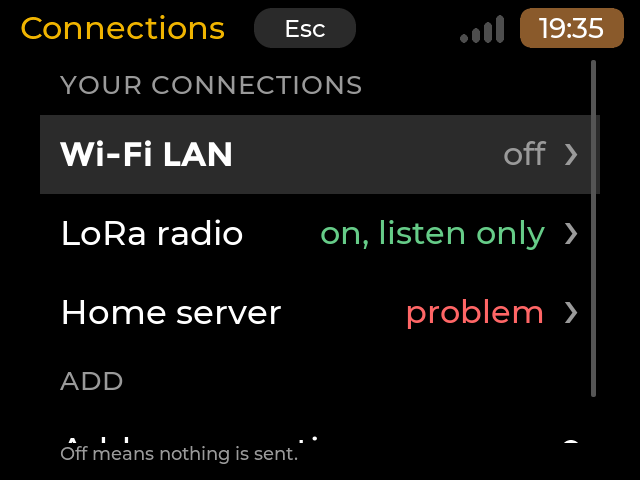
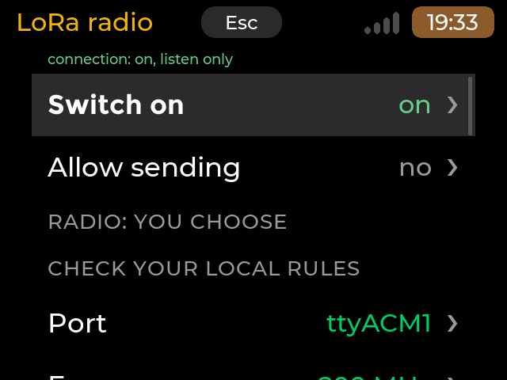
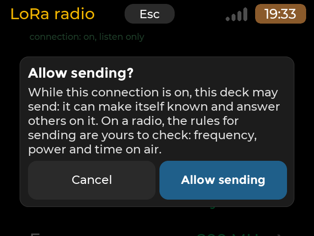
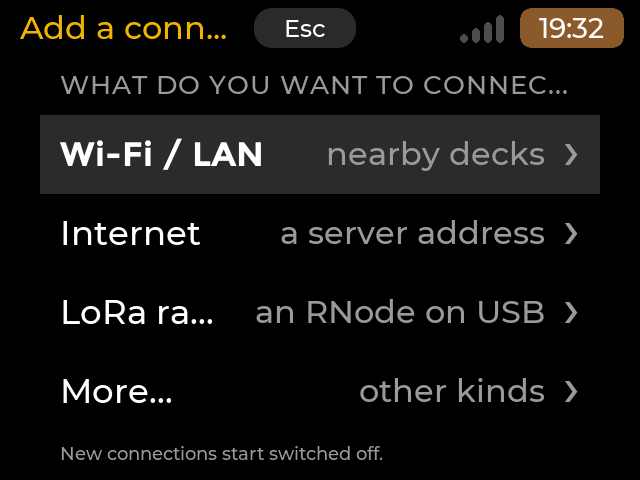
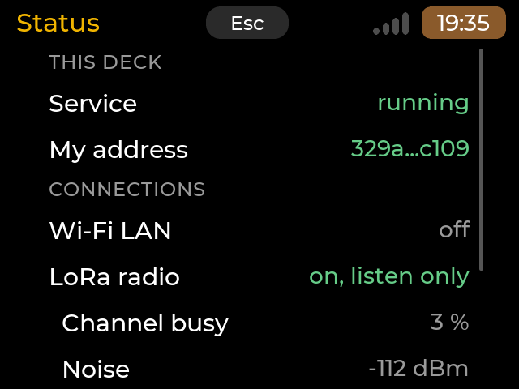
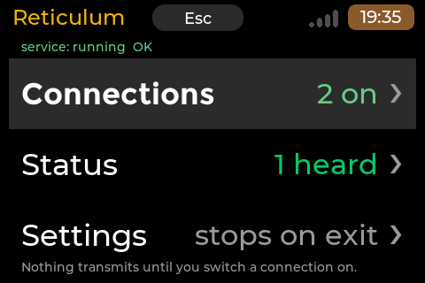

# Reticulum (draft, not published)

Connections, status and settings for the [Reticulum](https://reticulum.network) network, as a full-screen app with its own
tile, **plus the background service it needs** (one package, `reticulum` 0.2.0, `"draft": true` in `app.json`, so
`make_registry.py` skips it until the board tests are done). The app switches the ways your deck can reach others on and
off (Wi-Fi / LAN, the internet, a LoRa radio (RNode), and more kinds), shows who is reachable and what was heard, and keeps
a few settings. **Every connection starts off and nothing is sent until you switch one on and allow it to send.** The screens
use plain words: a connection is a way to reach others, and none of the network's own vocabulary is on them.

Contacts and messages are not in this version; they will appear later as more rows on the home page.

Kind of app: **A, a native `cp0_lvgl` app** (the default of the [guidelines](../../docs/APP-GUIDELINES.md)): its own pages,
forms and lists, touch and keyboard, the launcher's widgets and status strip. It talks to the service over a Unix socket;
the service is a small Python program (our own code on the public API of RNS and LXMF, bundled unmodified) that the app
starts when it opens.

## Screenshots

Rendered by the headless harness from the real UI code (a plain LVGL display, the **fake bridge's canned data**, a fixed
clock): **not photographs of a board**. The numbers in the LoRa radio pictures are synthetic placeholders, not a band plan
and not a recommendation. 640x480 is the deck's reference size, then 480x320 and the portrait canvas 480x800 (PDA mode).
All of them are in [`screenshots/`](screenshots/) in the Store's order; a selection:

| Home | Connections | A LoRa radio, listening |
|---|---|---|
|  |  |  |

| Radio fields start empty | Allow sending asks first | Add a connection |
|---|---|---|
|  |  |  |

| Status | Settings | 480x320 |
|---|---|---|
|  |  |  |

## What it does and how to use it

Opening the app starts the service (`systemctl --user start reticulum`) and waits for it with a progress line; if it cannot
start, the page says why and offers **Try again**. Leaving the app stops the service again unless **Keep running** is on.

| Page | What it holds |
|---|---|
| **Home** | the service line (running OK / starting / stopped); **Connections** (all off, or how many are on), **Status** (how many were heard), **Settings** (whether the service keeps running) |
| **Connections** | one row per connection with its state in plain words (*off*, *on, listen only*, *on, sending*, *on, not connected*, *problem*); **Add a connection** |
| **A connection** | **Switch on**; **Allow sending** (*no* = listen only; turning it on asks first and explains; on a radio it says the rules are yours); **Problem / details** when something is wrong; the options of its kind (a list the service gives, so the same page serves every kind; radio settings start **not set** in amber, and the app has no presets and no example values: you choose them, and the rules for sending are yours to check); **Remove connection** (asks first). A refusal comes back in plain words (the port is used by another program, a value is out of range, something still has to be set) |
| **Add a connection** | the kind: **Wi-Fi / LAN**, **Internet**, **LoRa radio**, **More...** (the other kinds the service lists); then a short form (name and the kind's fields); **Save connection** creates it **switched off and listen only**. A serial port is chosen from `/dev/serial/by-id` and the `ttyACM` / `ttyUSB` devices, or typed |
| **Status** | this deck (service, address in short form), the connections with their state (a radio also shows the channel busy and noise values when the service reports them), who was heard recently (*Nobody yet* when none) |
| **Settings** | **Keep running** (enables or disables the user service; off by default); **Name** (the name others will see; saving it sends nothing); **My address** (the whole address); **Stop the service** (asks first); the on-screen keyboard rule and the version |

### Keys and touch

| Function | Keys | Touch |
|---|---|---|
| Move | Up / Down, Home / End, Page Up / Down | drag; a tap on a row selects it |
| Open or do the selected row | Enter or Right | a tap on the selected row |
| Back | Esc or Left | the header's Esc button |
| Leave the app | a short Esc on Home | the header's Esc button on Home |
| Edit a value | Enter on its row, type, Enter | tap the row twice, type (on-screen keyboard), Enter |
| Answer a question | Enter = the main button, Esc = Cancel | tap a button |

The on-screen keyboard appears only by the shared rule (no physical keyboard connected, or the launcher's setting forces
it); there is no button that summons it, and **Settings** shows the rule's state.

### Multitasking

`X-Background=freeze`: while the app is hidden it is stopped and does nothing. The service itself keeps running (it is
its own process), so receiving does not depend on the app being in front. The app polls the service every 3 seconds only
while it is shown.

## Requirements

- Raspberry Pi OS (Debian 13) with a systemd user session: the service is a **user unit** and needs `XDG_RUNTIME_DIR`
  (a normal desktop or console login; a bare `ssh` login without a user manager does not have one, and the app says so).
- `python3` (3.10 or later), `python3-cryptography`, `python3-serial` (installed with the package); `python3-bleak` is
  recommended (Bluetooth radios, not used by this version's pages).
- A USB radio or modem needs the `dialout` group: `sudo usermod -aG dialout $USER`, then log out and in.
- Any screen: no minimum size (the lists scroll); portrait from 480x640 (`X-Portrait=480x640`). Memory: the app is a
  native app (about 13-15 MB); the service is a Python process of about 40 MB with every connection off (PC measurement,
  not a Zero 2 W figure). **Not yet measured on a board.**

## Install

Settings > Apps once it is published (the package is a draft). By hand: `sudo dpkg -i reticulum_0.2.0_arm64.deb` (or
`_amd64.deb`; the package has one tree of Python for both, and a binary per architecture). The package does not start or
enable the service: the app starts it, and **Keep running** enables it.

## Files the app keeps

The app writes **no file of its own**. What exists is the service's: the Reticulum configuration (`~/.reticulum/config`,
changed only by the connection pages, with a `config.bak` of the last change), the deck's identity and name
(`~/.local/share/reticulum/`), and the socket and state in `$XDG_RUNTIME_DIR/reticulum/`. **Keep running** is the enabled
state of `~/.config/systemd/user/default.target.wants/reticulum.service`. To reset: remove a connection on its page,
or `rm -r ~/.reticulum ~/.local/share/reticulum` with the service stopped (this also deletes the deck's identity).
Package files: [section 9 of the bridge document](../../docs/dev/reticulum-bridge.md#9-package-p1a-part-2).

## Known limits

- Draft: not published; not tested on a board (see the board protocol, [`tests/BOARD-TESTS.md`](tests/BOARD-TESTS.md)).
- On a 480 px wide screen a long value (a state word such as *on, listen only*) shortens the label to its first letters;
  the value is never cut.
- The kind list shows only what the service can set up; a hand-written connection of another kind is listed and can be
  switched on and off and removed, not edited.
- A name for a connection cannot contain a slash (the service's rule), so the first one is called *Wi-Fi LAN*.
- One instance: if another program already runs the Reticulum shared instance, the service joins it as a client and
  does not hold the serial ports.
- Contacts, messages, the propagation nodes and the map of the network are later phases.

## Credits and licences

- Our code (the app, the service called the bridge, and their tests): MIT, 2026 OSRdesign. The bridge was written with AI
  assistance from the public Python API of RNS and LXMF; it is not a Reticulum implementation and is not part of the
  upstream projects.
- [Reticulum (RNS)](https://github.com/markqvist/Reticulum) 1.6.1 and [LXMF](https://github.com/markqvist/LXMF) 1.3.1 by
  Mark Qvist, under the Reticulum License (the MIT text plus two use conditions: no use in a system that can purposefully
  harm people, no use for AI or language-model training datasets). They are pinned with their sha256 in
  [`bridge/requirements.txt`](bridge/requirements.txt) and bundled unmodified, with their licence texts
  (`/usr/share/doc/reticulum/LICENSE.rns`, `LICENSE.lxmf`). The package licence field is
  `MIT AND BSD-3-Clause AND LicenseRef-Reticulum`. Read the two added conditions before you redistribute it.
- The configuration file is read and checked with the ConfigObj parser that RNS ships (BSD-3-Clause).
- The app is linked against the LVGL based `cp0_lvgl` runtime of the CyberdeckZero Launcher and LVGL (both MIT); the fonts
  are the launcher's, read at run time.
- The tile icon is our own drawing ([`tools/make_icon.py`](tools/make_icon.py)).

## Build and test

```sh
sh apps/reticulum/build.sh host            # WSL: harness, unit tests, scenes (tests/scenes), then the fake-bridge scenes
sh apps/reticulum/build.sh cross           # the arm64 binary into root/;  cross --arch amd64 -> root.amd64/
sh apps/reticulum/bridge/tests/run_tests.sh   # the service's own tests (PC): 46 + the identity.name tests
sh apps/reticulum/build.sh check           # the vendored tree equals what `vendor` writes
python tools/make_registry.py --only reticulum --arch arm64 --out C:/somewhere/outside/packages   # and --arch amd64
```

Build the packages with **Windows Python** (file modes). Tests, the fake bridge, the fake `systemctl`, the request checks
(nothing may allow sending unless a scene says so) and what each scene covers: [`tests/README.md`](tests/README.md).
The board protocol: [`tests/BOARD-TESTS.md`](tests/BOARD-TESTS.md). The service: [docs/dev/reticulum-bridge.md](../../docs/dev/reticulum-bridge.md).
Test hooks (never set on a deck): `RETICULUM_BRIDGE_RUN` (the socket folder; `{canvas}` becomes the harness size) and
`RETICULUM_SYSTEMCTL` (the program run instead of `systemctl`).

## Changes

- 0.2.0 (draft): the app (tile, Connections and Status, Settings, Add a connection) folded into the service package; the
  bridge gets `identity.name` (read and set the display name).
- 0.1.0 (draft, PR #172): the service alone, without a tile.
