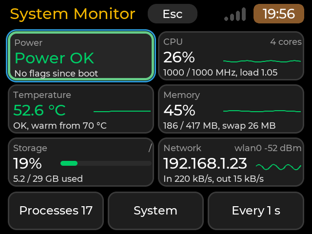
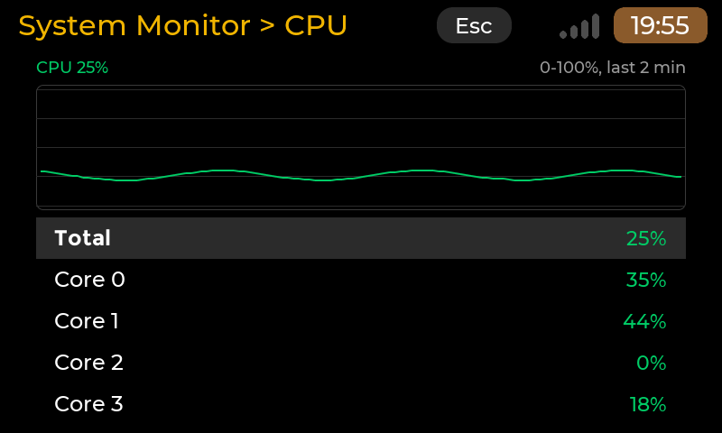
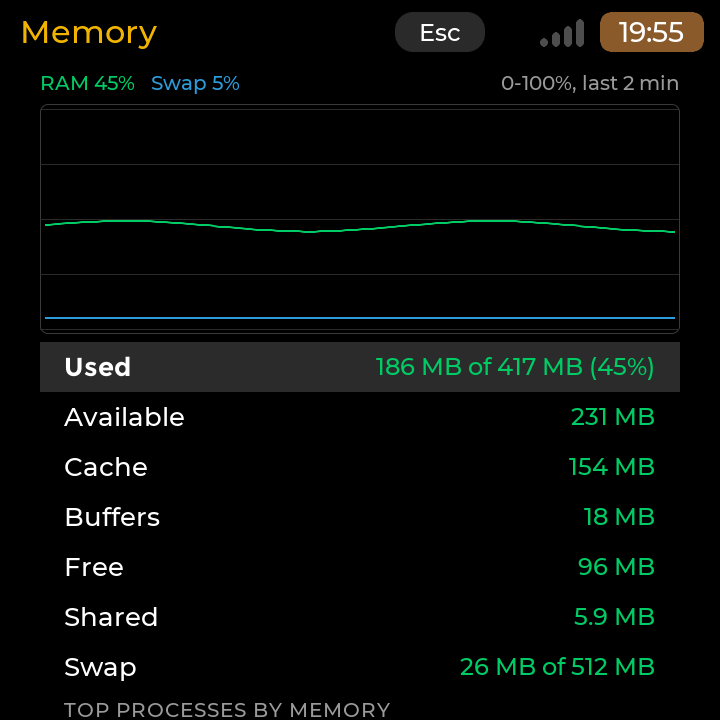
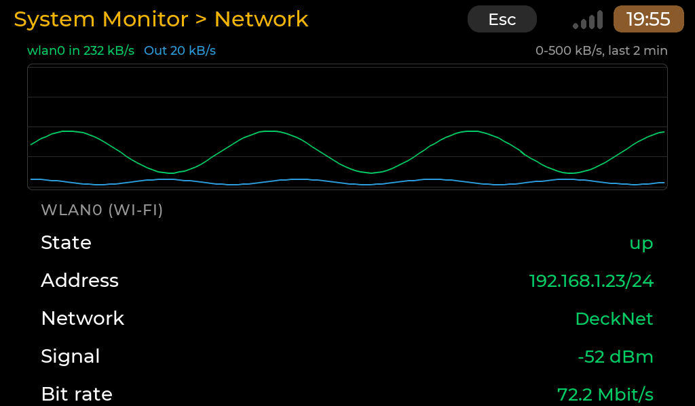
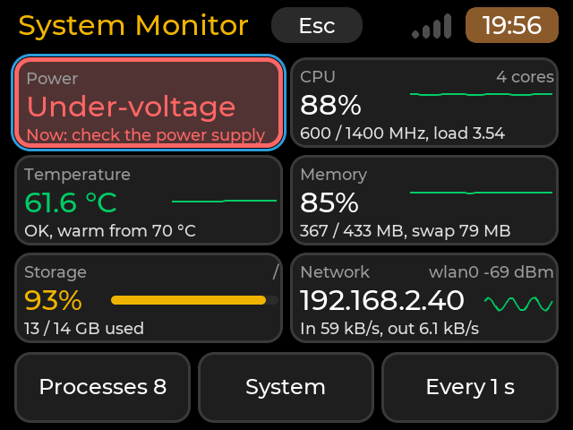
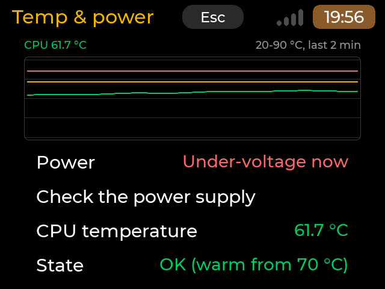
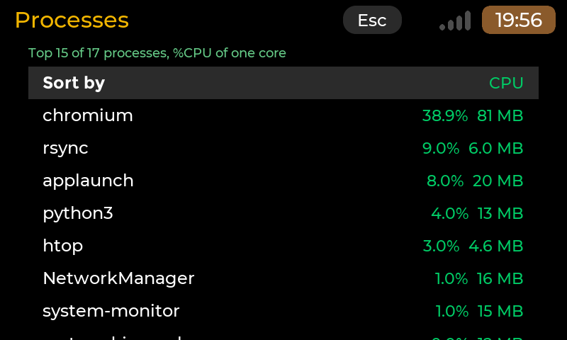
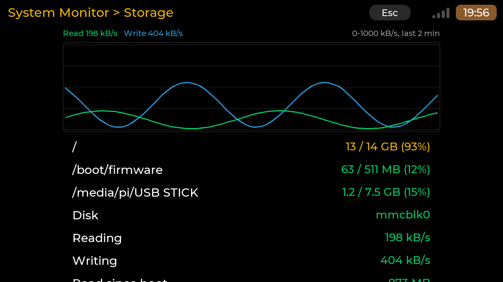

# System Monitor

Version 0.2.2, package `system-monitor`. Part of [cyberdeck-zero-apps](../../README.md).

System Monitor is a live, read-only look at the Raspberry Pi it runs on: CPU load per core, temperature, frequency,
memory, storage, network, processes and the **power supply** (under-voltage and throttling from the firmware's flags,
in plain words). It is a full-screen touch app made for the deck's small screen (Pi Zero 2 W, 640x480) and works the
same on the Pi 3A+ (800x480, touch only), the Pi 5 and the HackBerry CM5. It changes nothing on the system: no kill,
no writes except its own one-line settings file.

Kind: a native `cp0_lvgl` app (kind A of the [guidelines](../../docs/APP-GUIDELINES.md)), because it has its own
pages, live charts and must be complete by touch and by keys; no existing program fits the small screen.

## Screenshots

Rendered by the app's headless harness (`build.sh host`) with fixture data from a Pi Zero 2 W, at the deck's size and
at other screen sizes, **not photographs of the panel**. The contact sheets of `build.sh host` show every page at the
five sizes (see [Build and test](#build-and-test)).

| | |
|---|---|
|  640x480 render, deck size. The overview: six tiles (Power, CPU, Temperature, Memory, Storage, Network) with their history lines, and the footer row |  800x480 render, Pi 3A+ size. The CPU page: the total load over the last 2 minutes and each core's % |
|  720x720 render, HackBerry size (square). The Memory page: RAM (green) and swap (blue) chart, used, available, cache, buffers, free, swap |  1024x600 render, larger screen. The Network page: in / out rates of wlan0, its address, Wi-Fi network, signal and bit rate |
|  640x480 render, deck size. Under-voltage now: the Power tile turns red with *Now: check the power supply*; storage at 93 % in amber |  640x480 render, deck size. The Temp & power page during the same under-voltage: the temperature chart with its 70 and 80 °C lines, the power state in plain words |
|  800x480 render, Pi 3A+ size. Processes sorted by CPU, with their memory |  1280x720 render, larger screen. The Storage page: read / write chart, each mounted file system with its fill, the disk's rates |

The screens above come from several screen sizes: the app adapts to the screen it runs on.

## What it does

* **Overview** (the first page): six tiles that fill the screen under the header, never scrolling (2 x 3 at 640x480;
  3 x 2 on the wide screens 800x480, 1024x600, 1280x720; on the square 720x720 Power and Network across the width).
  Each tile has a title, one big value, a small line and, when the tile has room, a history line of the last 2
  minutes (or a fill bar):
  * **Power** (first, top left): *Power OK* in green with a green frame; *Under-voltage* in red, a red frame and a red
    tint with *Now: check the power supply*; *Under-voltage* in amber with *Happened since boot, last 0:41:12*;
    *Throttled*, *Temp limit*, *Capped* (now: red or amber; since boot: amber); *No access* (the video group is
    missing); *Unknown* in grey when the system gives no power information (see [Requirements](#requirements)).
    On a Pi 5 the small line gives the 5 V input.
  * **CPU**: total %, the history line, frequency (current / maximum) and the 1-minute load; the core count.
  * **Temperature**: the CPU temperature in green, amber from 70 °C, red from 80 °C (the Pi slows down from 80 to 85 °C),
    the history line in the same colour, the fan speed when there is a fan.
  * **Memory**: used % (as `free`: total minus available), the history line, used / total and swap.
  * **Storage**: % used of `/` (amber from 85 %, red from 95 %) with a fill bar, used / size.
  * **Network**: the address of the main interface (the default route's), the history line of what it receives, in /
    out rates, the interface and its Wi-Fi signal; *Not connected* in amber when it has no address.
  Under the tiles, a footer row: **Processes** (with their number), **System**, **Sampling** (*Every 1 s*).
* **CPU**: a chart of the total load over the last 120 samples (2 minutes at 1 s), each core's %, the frequency,
  the governor, the load average, running / total tasks, the uptime, the top 5 processes by CPU and *All processes*.
* **Memory**: a chart of RAM (green) and swap (blue) use; used (with %), available, cache, buffers, free, shared,
  swap; the top 5 processes by memory and *All processes*. "Used" is counted as `free` counts it: total minus available.
* **Temp & power**: a chart of the CPU temperature with the 70 °C (amber) and 80 °C (red) marks; the power state
  first (*Under-voltage now* in red with the row *Check the power supply* right under it, only in that state); temperature, state (OK / warm / hot), the highest value of the chart; the fan (level of the cooling device and
  speed in rpm) when there is one; then each firmware flag (*Under-voltage*, *Frequency capped*, *Throttled*, *Soft temp
  limit*) with *now*, the time since boot of the last event the app saw (*last 0:41:12 after boot*), *before the app
  started* (the firmware's "has occurred" bit with no event seen) or *never since boot*; the 5 V input on a Pi 5 /
  CM5, the core voltage, the raw flags (`0x50005`).
* **Storage**: a chart of the system disk's read (green) and write (blue) rates; each real filesystem (on a block
  device; network, RAM and loop filesystems are left out) with used / size and %; the disk's rates and the bytes read
  and written since boot.
* **Network**: a chart of the main interface's in (green) and out (blue) rates; per interface its state, IPv4
  address, for Wi-Fi the network name, signal and bit rate (from `iw`, while the page is open) or the signal from
  `/proc/net/wireless`, the rates and the totals since boot; Bluetooth (on, off, connected, no adapter).
* **Processes**: the top 15 by CPU or by memory (*Sort by*, Enter or a tap switches), name, %CPU and memory (RSS);
  the status line under the title gives the highlighted one's pid, state, memory and CPU. %CPU is the share of one
  core, as `top` shows it (a process busy on two cores shows 200 %). Read-only.
* **System**: model, kernel, OS, hostname, the last 8 digits of the serial number, firmware date (from
  `vcgencmd version`), CPU, RAM, uptime, **This app** (its own CPU over the last 10 s, its `vcgencmd` and `iw` runs
  included, and its memory, from `/proc/self`: *1.2% CPU, 14 MB*), the screen as the launcher's layout service sees
  it, the launcher contract, the app version.
* **Sampling**: every second, 2 or 5 seconds; remembered. Changing it starts the charts again (their samples would no
  longer be evenly spaced); at 5 s a chart covers 10 minutes.

The pages' lists are the launcher's `cp0::ui::CompactList`: top-aligned dense rows under the chart, a label on the left
and its value on the right; the list scrolls only when the highlight reaches the bottom of the screen, with a thin
scrollbar at the right edge that hides itself when the list stops. Section headings (*TOP PROCESSES BY CPU*, an
interface's name) are drawn in grey capitals and are not selectable.

Values refresh once per period on a thread of their own; the screen never waits for them, and a refresh changes only
the texts that changed (the scroll and the highlight stay). Rates and percentages need two samples: they appear a
third of a second after the start.

## Keys and touch

| Function | Keys | Touch |
|---|---|---|
| Overview: move the blue ring between the tiles and the footer items | the arrows, by position (Left / Right in a row, Up / Down across rows and down to the footer) | |
| Overview: open a tile's page or a footer item | Enter | **one tap** on the tile or the item (a tile is a large target: no first tap to highlight) |
| A page: move the highlight (CPU, Memory, Processes) | Up / Down | a tap on a row highlights it; swipe to scroll |
| A read-only page (Temp & power, Storage, Network, System): scroll | Up / Down, one row per press | swipe |
| A page: open *All processes*, switch *Sort by*, choose a period | Enter or Right | a tap on the highlighted row |
| Back one page (the ring comes back to the tile you opened) | Esc (or Left on a page) | the header's Esc |
| Quit (at the overview) | a short Esc | the header's Esc |
| Stop a stuck app | hold Esc 3 s (the launcher's watchdog) | |

On the overview Left / Right move the ring, so going back is Esc only. Read-only pages have no highlight and Enter
does nothing there; on the other pages Enter on a plain value row does nothing either. The charts and history lines
are not touch targets: every function is a tile, a footer item or a row.

On the home grid the tile is named **Monitor** (`Name=` of the `.desktop` file): the launcher's tile label has one line
of 176 px at 24 px on the deck, and "System Monitor" (about 192 px) wraps onto the icon. The app's title, the page
header and Settings > Apps keep "System Monitor".

## Requirements

* A screen of at least **640x480** (`X-MinSize=640x480`; under it the app says so and closes on any key) and a
  CyberdeckZero Launcher with full-screen app support (contract 1).
* A Raspberry Pi running Linux (tested in the harness with fixtures of a Pi Zero 2 W, a Pi 3A+ and a Pi 5). Every
  number comes from `/proc` and `/sys` except:
  * the firmware's power flags, firmware date and voltages: **`vcgencmd`** (package `raspi-utils` on Raspberry Pi OS),
    run with a 1 s timeout on the sampler thread: `get_throttled` at most every 2 s (its answer kept between the
    calls), the 5 V input every 10 s (`pmic_read_adc EXT5V_V`, Pi 5 / CM5), the core voltage every 30 s
    (`measure_volts core`). It needs the **video** group: `sudo usermod -aG video $USER`, then log out and in. Without
    `vcgencmd` the app shows no error: with the `rpi_volt` hwmon alarm (most Pi kernels) the Power tile still shows
    *under-voltage now* / *since the app started*, else *Unknown*. Refused (not in the group): the Power tile says
    *No access*, *Needs the video group*, and Temp & power gives the command.
  * the Wi-Fi network name and bit rate: **`iw`** (optional; without it only the signal level shows).
* No new package dependency (`depends` = the template's `libfreetype6, libinput10, libxkbcommon0`), no network, no
  root, no special hardware.

## Install

From **Settings > Apps**. By hand:

```sh
python3 tools/make_registry.py --only system-monitor --out <a folder outside packages/>
sudo dpkg -i system-monitor_0.2.2_arm64.deb      # remove: sudo dpkg -r system-monitor
```

## Files the app keeps

| Path | What |
|---|---|
| `${XDG_CONFIG_HOME:-~/.config}/cyberdeckzero/system-monitor.conf` | the sampling period (`period=1`); written through a temporary file and a rename. Delete it to reset. `SYSTEM_MONITOR_CONFIG` names another file |

Nothing else is written. Logs go to stderr with the tag `[system-monitor]` (the launcher's journal): the source and
period at start, `vcgencmd` or `iw` missing or refused (once), a settings file that could not be saved.

## Known limits

* **Fixture-tested only so far**: the parsers and the pages ran on recorded `/proc` and `/sys` files of a Pi Zero 2 W,
  a Pi 3A+ and a Pi 5 and on the build PC's own `/proc`; the board protocol (`tests/BOARD-TESTS.md`) is still to run.
* The firmware keeps no time for its "has occurred" flags: the time of the last event is the app's own observation
  (the last sample that showed it). An event that happened before the app started shows as *before the app started*.
* The current frequency is the kernel's `scaling_cur_freq`; when the firmware caps the clock (under-voltage, heat) the
  real ARM clock can be lower than shown (`vcgencmd measure_clock arm` tells it). The flags say when that happens.
* Supply voltage: only the Pi 5 / CM5 measure their 5 V input. Older boards only have the under-voltage alarm; the
  *core voltage* shown there is the SoC's, not the supply.
* Bluetooth "on" means an adapter not blocked by rfkill (as the launcher's status strip counts it), not BlueZ's
  *Powered* property.
* Its own cost (the System page's *This app* line tells it on the board): every file is read into one reused buffer
  and parsed in place; the slow-changing things (mounts, addresses, Bluetooth, the process count) are read every 5 or
  10 s; the processes only while the CPU, Memory or Processes page is open, at most every 2 s; the screen redraws a
  label, bar or line only when what it shows changed, and the overview's history lines use a few dozen points.
  `vcgencmd get_throttled` every 2 s still costs a process start (a few ms of CPU on the Zero 2 W); the firmware's
  sysfs node `get_throttled` is read instead when the kernel has it (path searched under `/sys/devices/platform`).
  Sampling every 2 or 5 s divides the rest.
* The tile values take the largest text size the tile has room for (48 px at most), so the sizes differ between
  screens; a value that does not fit takes a shorter wording (*Check the supply* for *Now: check the power supply*).
* No history across restarts; no process actions (read-only by design).

## Credits and licences

<!-- branding-allow-begin: credit of the cp0_lvgl runtime linked into the binary (MIT) -->
MIT, 2026 OSRdesign. The binary contains the launcher's `cp0_lvgl` runtime (M5Stack Technology CO LTD, MIT) and
LVGL (LVGL Kft, MIT); see `root/usr/share/doc/system-monitor/copyright`. The fonts are the launcher's, read at run
time; none is shipped.
<!-- branding-allow-end -->
At run time the app reads the Linux kernel's `/proc` and `/sys` interfaces and, when installed, runs `vcgencmd`
(Raspberry Pi firmware tools, `raspi-utils`, BSD-3-Clause) and `iw` (ISC); neither is shipped or modified. The
temperature thresholds follow the Raspberry Pi documentation (soft throttling from 80 °C, hard limit at 85 °C); the
meaning of the `get_throttled` bits is the firmware's (Raspberry Pi documentation, *vcgencmd*).

## Build and test

In WSL (the launcher build tree `~/zero7/launcher` with its SDK; see `../_common/build_app.sh -h`):

```sh
wsl -e sh /mnt/c/CLAUDE/zero7/cyberdeck-zero-apps/apps/system-monitor/build.sh host           # tests + scenes
wsl -e sh /mnt/c/CLAUDE/zero7/cyberdeck-zero-apps/apps/system-monitor/build.sh all --strict   # + aarch64 binary
python3 tools/make_registry.py --only system-monitor --out <a folder outside packages/>       # a local .deb
```

* `src/core/`: no LVGL. `parsers` (stat, meminfo, loadavg, uptime, net/dev, route, wireless, `iw` link, diskstats,
  mounts, thermal, cpufreq, `get_throttled`, voltages, firmware version, `/proc/<pid>/stat`, model, OS, serial,
  cpuinfo; the sampler's ones scan in place, no allocation), `stats` (history ring and its binning, counter rates,
  process table and top-N, chart scales), `power` (temperature state, flag tracker, the wording), `grid` (the
  overview's tile placement and the focus moves, pure geometry), `source` (the system, or a fixture folder),
  `command` (one command with a timeout), `sampler` (the thread), `settings`, `monitor_core` (navigation, the tiles'
  and every page's texts).
* `src/ui/`: `monitor_app` (pages on `cp0::ui::Page`, their lists on `cp0::ui::CompactList`, Sampling on
  `cp0::ui::Roller`), `overview` (the tile grid), `panels` (the detail pages' `lv_chart` history chart and the
  Processes status line).
* `tests/`: unit tests (`test-system-monitor`, 700 checks) on `tests/fixtures/<board>/` (recorded `/proc` and `/sys`
  files of a Pi Zero 2 W, a Pi 3A+ with `throttled=0x50005`, a Pi 5 with a fan, NVMe and 16 kB pages; two snapshots
  one second apart; a process table; a missing and a refused `vcgencmd`; the grid at the five sizes and every focus
  move); headless scenes in `tests/scenes` on the same fixtures with a scenario that makes the counters move
  (`SYSTEM_MONITOR_FIXTURE=<board>:<scenario>`: the deck at work, without vcgencmd, offline; the Pi 3A+ under-voltage;
  a hot Pi 5) at 640x480, 800x480, 720x720, 1280x720 and 1024x600, the notice under 640x480 and a start without the
  launcher.
* Board protocol: [`tests/BOARD-TESTS.md`](tests/BOARD-TESTS.md).

The same fixture variable works on a board, for screenshots of a state that is hard to cause:
`SYSTEM_MONITOR_FIXTURE=/path/to/fixtures/pi-3a-plus:undervoltage /usr/share/APPLaunch/bin/system-monitor`.

## Changes

* 0.2.2: rows show what can be tapped: chevron opens or changes, grey information, a dot for actions; rebuilt on launcher 9912361.
  Here: *All processes* opens (chevron), *Sort by* changes in place (value and chevron), every other row is information
  (grey). No row of this app runs an action, so no dot. The overview tiles are not a list and are unchanged.
* 0.2.1: rebuilt on launcher 9ad4215 (shared toolkit: Muted tone, Wi-Fi status line); no layout change.
* 0.2.0: the pages' lists move to the launcher's `cp0::ui::CompactList` (top-aligned dense rows, scrolling
  only at the bottom edge, a thin auto-hiding scrollbar, headings in capitals that are not selectable; read-only pages
  scroll one row per key press). On Temp & power the Power row says *Under-voltage now* and the row *Check the power
  supply* follows it. Built against the launcher main after #47. The detail pages' chart and list fill the screen
  width (40 px side margins as on the deck, capped at 960 px centred on 1280x720) instead of the roller's 560 px column.
* 0.1.0 (draft): first version. After the first board look: the overview became a tile grid with a prominent Power
  tile, the home tile is named *Monitor*, the sampler and the screen redraw less (and the System page shows the app's
  own cost).
