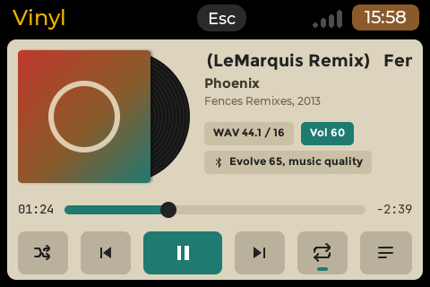
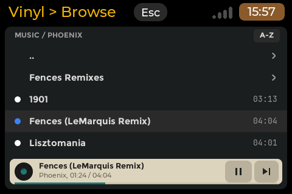
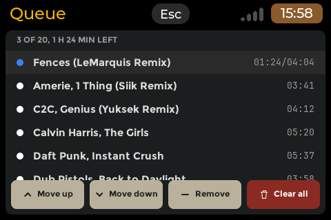
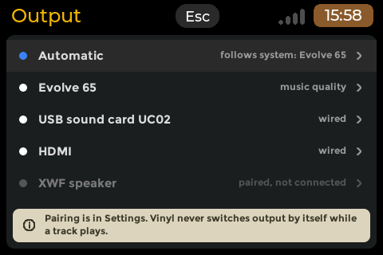
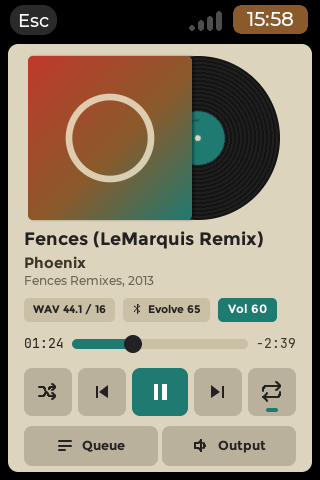
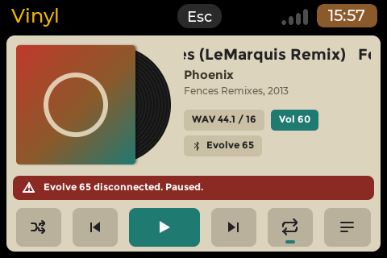
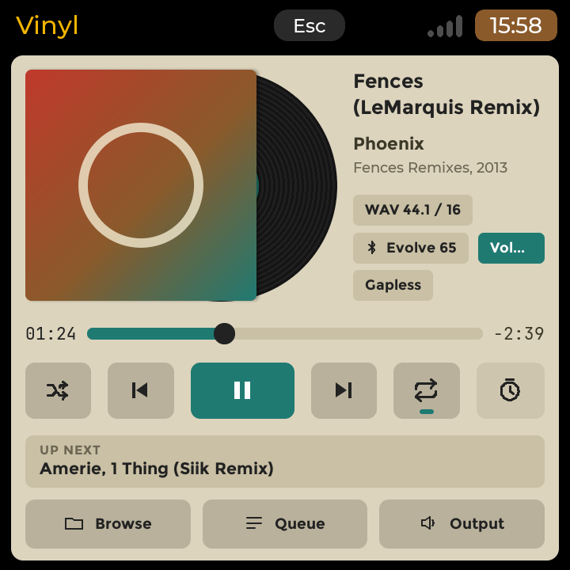
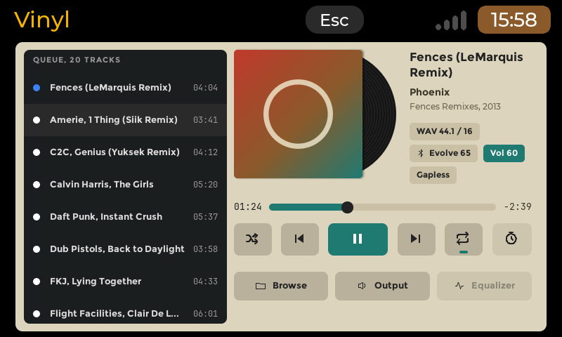

# Vinyl (`vinyl`)

A music player for CyberdeckZero Launcher boards: it plays the music in `~/Music` and on USB drives, folder by folder or
from M3U playlists, with gapless playback, shuffle, repeat, embedded cover art and resume where you stopped. It plays on
while you use other apps (on boards with multitasking), to wired outputs and, on boards with a sound server, to
Bluetooth headsets and speakers; headset, speaker and keyboard play keys work. Version **0.1.0** (phase P1 of the launcher
repo's report 059, the MVP: folder first, no library database yet).

Kind: a native `cp0_lvgl` app (kind A of the guidelines): its own screens, touch and keys. The design is the owner-approved
drafts in [`docs/design`](docs/design) (the `.dc.html` files): a cream panel in Cassette's family with its own teal accent,
the record sliding out of its square sleeve and turning while it plays.

## Screenshots

Headless harness, demonstration world (`VINYL_DEMO=1`):

| | |
|---|---|
|  |  |
|  |  |
|  |  |

Square (720x720, the HackBerry) and large (800x480, two panes):
 

## What it does

| Page | What |
|---|---|
| **Browser** (the root) | `~/Music` and the mounted drives (`/media/<user>`, `/run/media/<user>`, `/mnt`): folders A-Z, playlists (`.m3u`, `.m3u8`), tracks A-Z (natural order) with their title tags and lengths; the mini player at the bottom. A track plays its folder as the queue; a playlist plays its entries. |
| **Now playing** | cover art (embedded JPEG or PNG, else the drawn sleeve), title (one line that scrolls, or two lines on the square and large screens), artist, album and year, the format, the volume, the output; the position with a seek bar (a tap seeks), previous, play / pause, next, shuffle, repeat (off, all, one: a teal mark, and a "1" for one); up next (square), the queue pane (large). |
| **Queue** | the play order from the playing track, "3 OF 20, 1 H 24 MIN LEFT"; Move up, Move down, Remove, Clear all (keeps the playing track). No dragging anywhere. |
| **Output** | Automatic (the system's default output), the Bluetooth devices (music or call quality), the wired outputs, a paired device that is off (dimmed). Vinyl never switches output by itself: when the output in use goes away, playback pauses ("Evolve 65 disconnected. Paused."). |

The top band is the launcher's: the toolkit's header with the title (none in portrait), the Esc and the shared status strip.

### Keys and touch

| Function | Key | Touch |
|---|---|---|
| Play / pause | Space (Enter on now playing) | the teal key; the mini player's key |
| Previous / next track | `,` / `.` | the keys beside play (previous restarts a track after 3 s) |
| Seek back / forward 10 s | Left / Right (now playing) | tap the seek bar where to go |
| Shuffle / repeat | S / R | the keys left and right of the transport |
| Queue, Output, Browser | Q, O, B | the Queue key, the output chip or Output key, Browse (or Esc from now playing) |
| Lists: move, act | Up / Down, Enter (Right opens a folder) | browser: tap a row; queue: tap selects, tap again plays; output: tap chooses |
| Folder up | Left or Backspace (browser) | the ".." row |
| Queue editing | U move up, D move down, Delete or X remove, C clear all | the four buttons |
| In-app volume (only for an output the system volume does not reach) | `-` / `=` | none in 0.1.0 |
| Back; at the browser, quit | Esc | the header's Esc |
| Headset, speaker, keyboard media keys | Play/Pause, PlayCD, PauseCD (a toggle), Next, Previous, Stop (pause and back to the start) | |

The volume, mute and brightness keys stay the launcher's (the app shows the level it reads from `status.state`). A media
key seen twice within 250 ms (the same button on two input nodes) acts once.

## Formats

| Tier | Formats | Library (loaded at run time) |
|---|---|---|
| 1 (always) | MP3 (gapless with the LAME header), FLAC (16/24/32 bit kept), Ogg Vorbis, Ogg Opus, WAV (PCM, float, RF64), AIFF / AIFC | libmpg123, libvorbisfile, libFLAC, libopus (package Depends); WAV/AIFF: own reader |
| 2 (when FFmpeg is installed) | AAC / ALAC / M4A, WMA, APE, WavPack, TTA, Musepack, DSF (as PCM), Ogg FLAC, trackers | libavformat, libavcodec, libswresample, libavutil 61 (Debian 13) or 62 (Ubuntu 26.04): **Recommends**, loaded only when such a file is opened, never at start |

Without FFmpeg a tier-2 file shows "This format needs the FFmpeg libraries. Install them from Settings, Apps." and the
next track plays. FFmpeg costs about 22.5 MB of memory once loaded (report 059, 14.6) and about 100 MB of disk on a Lite
image without its own recommends: to add it by hand, `sudo apt install --no-install-recommends libavformat61
libavcodec61 libswresample5`. To install Vinyl without it: `sudo apt install --no-install-recommends ./vinyl_*.deb`.

Gapless: the next track continues on the same stream when its format (rate, channels, sample size) is the same; another
format drains the stream and opens a new one (a short gap). Tags come from Vinyl's own readers (ID3v2.2-2.4 and v1, FLAC
and Ogg comments, MP4 items, WAV INFO, AIFF), never from a process per file; text is UTF-8 and Chinese, Japanese and
Korean titles draw with the launcher's Noto Sans CJK.

## Outputs, Bluetooth and volume

- **With a sound server** (PipeWire or PulseAudio: the HackBerry, the Pi 5 boards, the tablet): every output of the server,
  opened by name with DONT_MOVE (Cassette's layer), so the server never moves the music elsewhere. Automatic plays to the
  server's default output, looked up when playback starts and at each track change (never in the middle of a track).
  Bluetooth headsets and speakers are listed with their quality; one A2DP device at a time on the HackBerry, a second one
  gets call quality ("Call quality (16 kHz): the headset is in call mode." while it plays). A Bluetooth profile switch
  (the node re-created) is followed on the same device; a device that goes away pauses playback.
- **Without one** (the Lite boards: the deck, zero8, Pi 3A+): ALSA `default` (Automatic) and the cards with a playback
  device (through `plughw`, never `hw:`); the output page says "Bluetooth audio is not set up on this board."
- **Volume**: the volume keys are the launcher's and act on the default output; the volume chip shows that level. For an
  output the system volume does not reach (a chosen output that is not the default, or ALSA without a mixer the launcher
  drives) the chip shows Vinyl's own volume, changed with `-` / `=`.

## Background playback

`.desktop` `X-Background=run`: on a launcher with multitasking (canvases 480 px and more on the short side) Super, Alt+Tab
or the three-finger hold hide Vinyl and the music plays on; nothing is drawn while hidden. Below 480 px (zero8 in
landscape or portrait) the app owns the panel and Esc at the browser ends playback. The queue and the position are saved
as they change, so a close by the launcher (memory) resumes paused at the same place. On battery boards Vinyl asks the
launcher to let the idle panel dim while it plays in front (`dim allow`, decision D16).

## Requirements

- A screen of 480x320 or more (`X-MinSize=480x320`); a portrait layout for 320x480 and taller (`X-Portrait=320x480`).
- CyberdeckZero Launcher with the app contract; built at the shared pin (`apps/_common/LAUNCHER_REF`).
- Packages (Debian 13 names): libmpg123-0t64, libvorbisfile3, libflac14, libopus0, libasound2t64, libpulse0 (Depends);
  libavformat61, libavcodec61, libavutil59, libswresample5 or their 62/60/6 versions (Recommends).
- Reading the media keys needs read access to `/dev/input/event*` (the `input` group, as the launcher's user has).

## Install

Settings > Apps > Available > Vinyl, or by hand: `sudo apt install ./vinyl_0.1.0_arm64.deb` (apt installs the
dependencies), `sudo dpkg -r vinyl` to remove it.

## Files the app keeps

| Path | What |
|---|---|
| `~/.config/vinyl/state.json` | the queue, its order, shuffle, repeat, the position, the output, the browser's folder, the in-app volume |

Delete it to start fresh. Vinyl writes nothing else (it never writes tags or music files).

## Known limits (0.1.0)

- Folder browsing only: no library database, no search, no artist / album views (P2).
- No EQ, ReplayGain, crossfade or sleep timer: the drafts' sleep-timer and Equalizer keys are drawn dimmed, and the
  "Gapless" chip shows without the ReplayGain figure (P2).
- No metadata to headsets or car displays (MPRIS / AVRCP, P2); headset keys work when BlueZ hands them to an input node.
- A cover larger than 1200 px on its long side is not decoded (the memory cap on the Pi Zero 2 W): the drawn sleeve shows.
- FFmpeg seeks land on the packet at or before the position; the AAC length is the container's.
- The in-app volume has no touch control in 0.1.0 (keys only).
- MIDI, native DSD, SACD images, tag editing and video are out of scope (decision D14).

## Credits and licences

Vinyl is MIT (`2026 OSRdesign`). Linked into the binary: cp0_lvgl and LVGL (MIT), stb_image 2.30 (Sean Barrett and the
stb contributors, public domain / MIT; `third_party/stb`). Loaded at run time from the system, not shipped: libmpg123
(LGPL-2.1), libvorbisfile / libvorbis / libogg, libFLAC and libopus (BSD-3-Clause), libasound and libpulse
(LGPL-2.1-or-later), FFmpeg (libavformat, libavcodec, libavutil, libswresample: GPL-2.0-or-later as Debian and Raspberry
Pi OS build it; source https://ffmpeg.org/ and the Debian source package `ffmpeg`). Fonts: the launcher's Montserrat,
JetBrains Mono and Noto Sans CJK (SIL OFL 1.1) and DejaVu Sans, read at run time. The sound-server and ALSA layers and
the FLAC / Opus readers come from this repository's Cassette (same author, MIT). Full text:
`root/usr/share/doc/vinyl/copyright`.

## Build and test

```sh
wsl -e sh apps/vinyl/tests/run.sh               # the unit tests (-Werror) and the real-library fixtures
wsl -e sh apps/vinyl/build.sh host              # harness, unit tests, 20 scenes, contact sheets
wsl -e sh apps/vinyl/build.sh cross             # the arm64 binary; --arch amd64 for PCs
wsl -e sh apps/vinyl/tests/abi/run.sh [root]    # the hand-written FFmpeg / mpg123 / vorbisfile ABI against headers
python3 tools/make_registry.py --only vinyl --out <folder>    # a local .deb (not published)
python apps/vinyl/tools/make_icon.py            # the icon
```

Board protocol: [`tests/BOARD-TESTS.md`](tests/BOARD-TESTS.md).

## Changes

- **0.1.0** (not published yet): the P1 MVP of report 059 (decisions D1-D18).
