# Vinyl (`vinyl`)

A music player for CyberdeckZero Launcher boards: it plays the music in `~/Music` and on USB drives, folder by folder or
from M3U playlists, with gapless playback, shuffle, repeat, embedded cover art, ReplayGain, a sleep timer and resume where
you stopped (a long mix or audiobook keeps its own place). It plays on while you use other apps (on boards with
multitasking), to wired outputs and, on boards with a sound server, to Bluetooth headsets and speakers; headset, speaker
and keyboard play keys work. Version **0.2.0** (phase P2a of the launcher repo's report 060: the Menu with the sleep
timer, the Playback settings, the keys and About; folder first, no library database yet).

Kind: a native `cp0_lvgl` app (kind A of the guidelines): its own screens, touch and keys. The design is the owner-approved
drafts in [`docs/design`](docs/design) (the `.dc.html` files; the boards of 0.2.0, from the full-UX canvas, in
[`docs/design/full-ux`](docs/design/full-ux)): a cream panel in Cassette's family with its own teal accent, the record
sliding out of its square sleeve and turning while it plays.

## Screenshots

Headless harness, demonstration world (`VINYL_DEMO=1`):

| | |
|---|---|
|  |  |
|  |  |
|  |  |
| 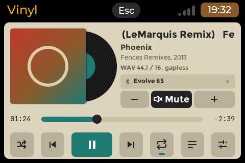 | 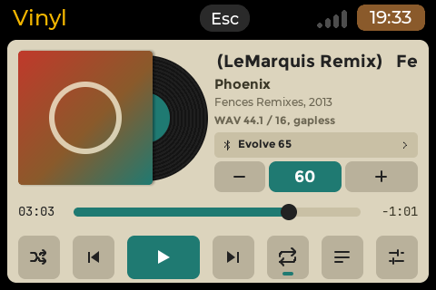 |
| 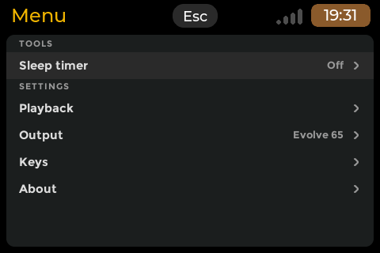 | 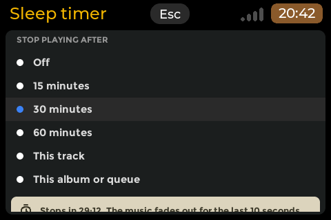 |
| 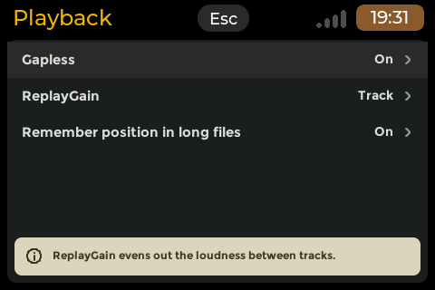 | 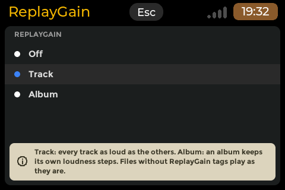 |
| 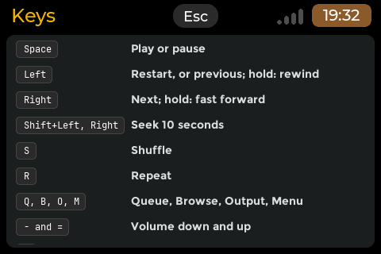 | 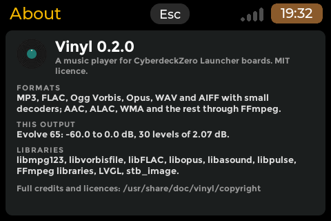 |

The deck (640x480), square (480x480) and large (800x480, two panes), the Menu and the Keys at 320x480:
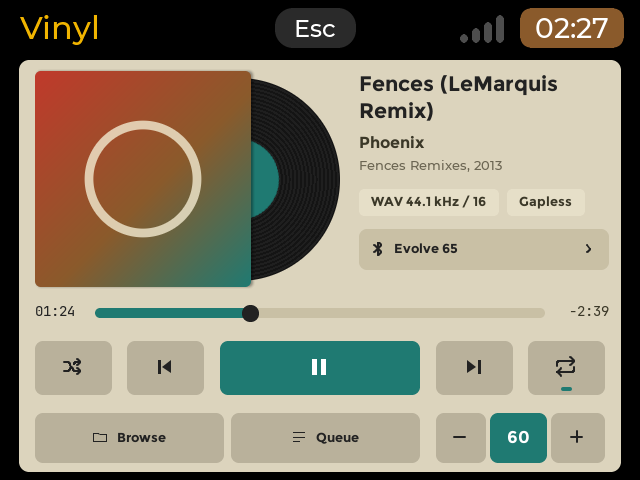 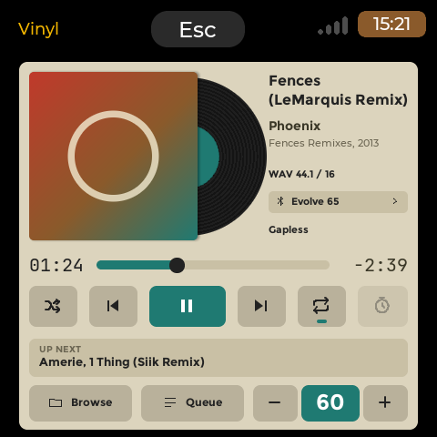
 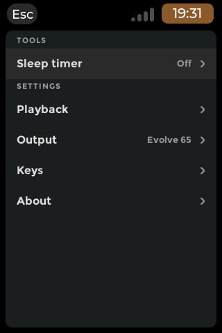
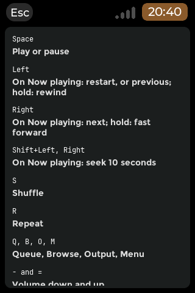

## What it does

| Page | What |
|---|---|
| **Browser** (the root) | `~/Music` and the mounted drives (`/media/<user>`, `/run/media/<user>`, `/mnt`): folders A-Z, playlists (`.m3u`, `.m3u8`), tracks A-Z (natural order) with their title tags and lengths; the mini player at the bottom. A track plays its folder as the queue; a playlist plays its entries. |
| **Now playing** | cover art (embedded JPEG or PNG, else the drawn sleeve) with the record sliding out (its label about a third out, with a dot and a centre ring that show it turning), title (one line that scrolls, or two lines on the 640x480, square and large screens), artist, album and year, the format and Gapless as information (one line at 480x320, flat chips at 640x480, plain text elsewhere; on the square and large screens the playing track's ReplayGain after it, "Gapless, RG -3.2 dB"), the output (a full-width button with the device's name and a chevron; a chip on 800x480 and wider), the volume group ("-", the level on teal, "+"); the position with a seek bar (a tap seeks, a drag scrubs), previous, play / pause, next, shuffle, repeat (off, all, one: a teal mark, and a "1" for one); the Menu key (the sliders icon: the seventh transport key at 480x320, the sixth on the square screens, an icon key at the left of the bottom row in portrait, a bottom-row key with its word on 640x480 and 800x480 and wider); the queue key (480x320) or the Queue key of the bottom row; the Browse key (640x480, square, large); up next (square), the queue pane and the sleep-timer key (large). An empty queue dims the transport keys, which then do nothing (the Queue, Browse, Menu and sleep-timer keys stay: they open their pages). |
| **Queue** | the play order from the playing track, "3 OF 20, 1 H 24 MIN LEFT"; Move up, Move down, Remove, Clear all (asks first: "Clear the queue?", Cancel, the default, or Clear; it keeps the playing track). An empty queue dims the four buttons; with only the playing track, Move up, Move down and Clear all are dimmed. No dragging in the lists (the seek bar is the one control that drags). |
| **Output** | Automatic (the system's default output), the Bluetooth devices (music or call quality), the wired outputs, a paired device that is off (dimmed). Vinyl never switches output by itself: when the output in use goes away, playback pauses ("Evolve 65 disconnected. Paused."). |
| **Menu** (P2a) | TOOLS: Sleep timer (Off, the time left, or the track mode); SETTINGS: Playback, Output (the output's name: it opens the Output page), Keys, About. Only what is built is listed (the Equalizer and the Library come later). |
| **Sleep timer** | Stop playing after: Off, 15, 30 or 60 minutes, This track, This album or queue (the chosen one has the blue dot); while it runs, "Stops in 29:12. The music fades out for the last 10 seconds." The minutes count from the choice, playing or paused; the last 10 s fade out, then the music pauses ("Sleep timer ended. Paused."). This track stops at the end of the track that plays, This album or queue before the next album (the album tag, else the folder) or at the end of the queue (a playlist plays to its end); the queue then waits on the next track, paused. The timer runs on while you change pages and while Vinyl is hidden; a restart forgets it; it pauses the music and nothing else. |
| **Playback** | Gapless (On: the next track continues on the same stream when its format is the same; Off: a short gap at every change), ReplayGain (Off / Track / Album, Track by default: the loudness from the files' tags), Remember position in long files (On: a file longer than 20 minutes starts again where you left it). Enter or a tap turns Gapless and Remember on or off; ReplayGain opens its list. |
| **Keys** | every key and what it does, the key on a key chip; it scrolls. |
| **About** | the version, the formats, THIS OUTPUT (the playing output's range and levels, "Sharkoon Mobile DAC: -45.0 to 0.0 dB, 23 levels of 2.05 dB."), the libraries, where the licences are. |

The top band is the launcher's: the toolkit's header with the title (none at 320x480, the toolkit's narrow portrait), the
Esc and the shared status strip. No page has a busy state: nothing waits in front of the user (tags, covers and the
output lists are read in the background).

### Keys and touch

| Function | Key | Touch |
|---|---|---|
| Play / pause | Space (Enter on now playing) | the teal key; the mini player's key |
| Previous / next track | Left / Right on now playing; `,` / `.` on every page; the media keys | the keys beside play; the mini player's next key |
| Scan back / ahead (muted, 3x) | hold Left / Right on now playing (or `,` / `.`, or a media key) | hold the previous / next key |
| Seek | Shift+Left / Shift+Right: back / forward 10 s (now playing) | tap the seek bar where to go, or press on it and drag: the knob follows the finger, the times show where it will land, and the seek happens when you let go (playing or paused; nothing else starts from a press on the bar) |
| Shuffle / repeat | S / R | the keys left and right of the transport |
| Queue, Output, Browser | Q, O, B | the Queue key; the output button (the output chip on 800x480 and wider; the Menu's Output row too); Browse (or Esc from now playing) |
| Menu, Sleep timer | M, T | the Menu key (the sliders icon, see Now playing); the sleep-timer key (800x480 and wider) or the Menu's Sleep timer row |
| Menu pages: move, act, back | Up / Down (the headings skipped), Enter or Right acts, Left goes back; Keys and About: Up / Down scroll | a tap on a row acts (opens it, chooses it, turns it on or off); Keys and About scroll by a drag |
| Lists: move, act, back | Up / Down, Enter; Right acts as Enter and Left goes back (queue, output; in the browser Right opens a folder) | browser: tap a row; queue: tap selects, tap again plays; output: tap chooses |
| Folder up | Left or Backspace (browser) | the ".." row |
| Queue pane (800x480 and wider) | Up / Down pick a track, Enter plays it | tap picks, tap again plays |
| Queue editing | U move up, D move down, Delete or X remove, C clear all (then Y clears; Enter or Esc cancels, as the dialog says) | the four buttons; Clear all asks "Clear the queue?" (the toolkit's dialog: Cancel, Clear, or the header's Esc; a tap outside does nothing). A button that cannot act is dimmed and does nothing |
| Volume | `-` / `=`: the volume of the output Vinyl plays on, one of its levels a press (about 2 dB) | "-" and "+" of the volume group, the level between them (teal): in the bottom row (640x480, square, portrait), under the output button (480x320), where the Equalizer key was (800x480). It sets and shows the playing output's real level as a percent of that output's levels; muted (by anything), the level box turns dark with the speaker-off mark in white and "Mute" beside it where both fit (480x320, 800x480 and the larger portrait and square screens), else the mark alone, large (640x480, 480x480, 480x640, 320x480), never a number; "-" does nothing and "+" brings the sound back at its level; "-" at the first level mutes. "--" when the level is not known; where nothing can change it a tap shows "Volume is not available on this board" |
| Close a notice | Esc (it also goes back as Esc always does: at the browser Vinyl quits) | tap it (it also goes after 6 s, 8 s for a disconnect) |
| Back; at the browser, quit | Esc (from a Menu page: the Menu; from the Menu: the page it was opened from) | the header's Esc |
| Headset, speaker, keyboard media keys | Play/Pause, PlayCD, PauseCD (a toggle), Next, Previous (as Right / Left above, held too), Stop (pause and back to the start) | |

Previous and next act when the key is released, the same from every path (the transport press, owner ruling
2026-11-12): next plays the next track (at the end of the queue with repeat off it stays on the last one; repeat all and
repeat one wrap to the first); previous goes back to the start of the track when more than 2 s of it have played, else
to the previous track (the first track starts again). Held for half a second they scan through the track at three times
its speed with the sound muted; on release the sound comes back from there, playing or paused as before. A forward scan
goes on into the next track; a backward one stops at 0:00. Left / Right on now playing are the one exception to the
Left = back, Right = Enter rule of the other pages. The volume group and `-` / `=` set the output Vinyl plays on; the
launcher's volume, mute and brightness keys stay the launcher's and act on the system's default output, so when Vinyl
plays on the default output the group follows them (with a sound server, within about half a second). A media key seen
twice within 250 ms (the same button on two input nodes) acts once.

## Formats

| Tier | Formats | Library (loaded at run time) |
|---|---|---|
| 1 (always) | MP3 (gapless with the LAME header), FLAC (16/24/32 bit kept), Ogg Vorbis, Ogg Opus, WAV (PCM, float, RF64), AIFF / AIFC | libmpg123, libvorbisfile, libFLAC, libopus (package Depends); WAV/AIFF: own reader |
| 2 (FFmpeg, installed with Vinyl) | AAC / ALAC / M4A, WMA, APE, WavPack, TTA, Musepack, DSF (as PCM), Ogg FLAC, trackers | libavformat, libavcodec, libswresample, libavutil 61 (Debian 13, Raspberry Pi OS) or 62 (Ubuntu 26.04): package **Depends** (decision D20), loaded only when such a file is opened, never at start |

Every board plays the common formats out of the box (the owner's decision D20, 2026-11-13). FFmpeg costs about 22.5 MB
of memory once loaded (report 059, 14.6), nothing before. On a Lite image the FFmpeg libraries and what they need are
about 104 MB of disk, which is what Settings > Apps installs from launcher 0.10.2 (it skips recommends); before 0.10.2
the installer also installed their own recommends, about 462 MB. If the libraries
are there but cannot be loaded, a tier-2 file shows "The FFmpeg libraries could not be loaded. Reinstall Vinyl." and the
next track plays.

Gapless: the next track continues on the same stream when its format (rate, channels, sample size) is the same; another
format drains the stream and opens a new one (a short gap). Tags come from Vinyl's own readers (ID3v2.2-2.4 and v1, FLAC
and Ogg comments, MP4 items, WAV INFO, AIFF), never from a process per file; text is UTF-8 and Chinese, Japanese and
Korean titles draw with the launcher's Noto Sans CJK.

## Outputs, Bluetooth and volume

- **With a sound server** (PipeWire or PulseAudio: the HackBerry, the Pi 5 boards, the tablet): every output of the server,
  opened by name with DONT_MOVE (Cassette's layer), so the server never moves the music elsewhere. Automatic plays to the
  server's default output, looked up when playback starts and at each track change (never in the middle of a track).
  Bluetooth headsets and speakers are listed with their quality; one A2DP device at a time on the HackBerry, a second one
  gets call quality ("Call quality (16 kHz): the headset is in call mode." while it plays). A Bluetooth profile switch
  (the node re-created) is followed on the same device; a device that goes away pauses playback.
- **Without one** (the Lite boards: the deck, zero8, Pi 3A+): ALSA `default` (Automatic) and the cards with a playback
  device (through `plughw`, never `hw:`); the output page says "Bluetooth audio is not set up on this board."
- **Volume** (decision D11 as the owner changed it, 2026-11-12; the levels as the owner decided on 2026-11-13): the
  volume group and `-` / `=` set the volume of the output Vinyl plays on and show its real level. Each output gets its
  own levels from its real range: the top 60 dB of it at most (a sensible usable range, after Dr. Lex's
  [volume control article](https://www.dr-lex.be/info-stuff/implement-a-volume-control.html)), cut in levels about 2 dB
  apart, linear in dB: level 1 is the bottom of that window (it sounds), the last level the output's own top (100 %), 0
  is mute; the group shows the level as a percent of the output's levels, so 50 % is the middle of that output's range
  and a press moves one level, not 5 %. The same output (the same DAC or card model) gets the same levels on every
  board; different outputs differ, as their hardware does.

  | Output | Range | Window | Levels | dB a level | 50 % |
  |---|---|---|---|---|---|
  | Sharkoon USB DAC (`PCM`, 1 dB steps) | -45..0 dB | -45..0 dB | 23 | 2.05 | 52 % = -22.5 dB (the middle) |
  | Raspberry Pi headphone jack (`PCM`, 0.01 dB steps, mute at min) | -102.39..+4.00 dB | -56..+4 dB | 30 | 2.07 | -27.0 dB |
  | Apple USB-C adapter (`Headset`, 0.5 dB steps) | -60..0 dB | -60..0 dB | 30 | 2.07 | -31.0 dB |
  | a sink with no known range (Bluetooth, software sinks) | | -60..0 dB | 30 | 2.07 | -31.0 dB |

  Without a sound server it is the card's playback mixer control (`Master`, `PCM`, `Speaker`, `Headphone`,
  `Headset`...), set by raw value and read back fresh; the control's switch mutes. A control whose lowest step is "mute"
  (the Pi jack's) has that step read as muted, and its dB range is taken from the step above (ALSA reports the mute step
  as -99999.99 dB); a control without dB data gets its own raw steps (at most 30). With a sound server it is the sink's
  own volume, set as the server's dB (`pa_sw_volume_from_dB`) whether it is the default sink or not; the window is the
  range of the ALSA card behind the sink (found from the sink's properties), placed under the sink's 0 dB as the server
  maps it, so a DAC whose floor is -45 dB never gets a level below it; a sink with no card (a Bluetooth headset) gets
  -60..0 dB. A level changed elsewhere (a headset's buttons, the launcher's keys on the default sink, alsamixer) shows as
  the nearest level within about half a second. Each set is logged with what the output holds after it
  (`volume: set <output> step i/N P % target X dB raw=M read back raw=K`). Only a card with no playback mixer gets
  Vinyl's software volume, over -60..0 dB. Vinyl's stream itself always plays at 100 %, with its own restore key, so a
  server never brings back another app's stream level. A muted output shows the same muted box in the group, whoever
  muted it: the card's switch, the control's own mute value, the sink's mute (`pactl set-sink-mute`, the launcher's key)
  or Vinyl's own mute, which it uses for a card with no playback mixer (the software volume) and for a control with
  neither a switch nor a mute value: its stream goes silent, the output keeps its level, and the mute survives a restart
  (`~/.config/vinyl/state.json`, `app_muted`). The sound server's placeholder output at start (`auto_null`) never shows a
  level.

## ReplayGain

From the files' tags only (decision D25: no analysis on the board; tag the files with a PC tool such as rsgain or
foobar2000): ID3v2 TXXX `REPLAYGAIN_TRACK_GAIN` / `_PEAK` and `REPLAYGAIN_ALBUM_GAIN` / `_PEAK` (MP3, WAV and AIFF id3
chunks), the same names as Vorbis comments (FLAC, Ogg Vorbis), Opus `R128_TRACK_GAIN` / `R128_ALBUM_GAIN` (their value
/ 256 + 5 dB, on top of the header's output gain the decoder applies), MP4 `----:com.apple.iTunes:replaygain_*`. Track
uses the track gain (the album gain when the file has none), Album the album gain (the track gain when it has none); an
untagged file plays at 0 dB. The gain never lifts the file's peak (the peak tag) above full scale. Vinyl applies it to its
own stream, before the output's volume: the volume group's levels, its percent and the output's own level do not move.
A pre-amp is not offered (0 dB).

## Planned settings

Not in 0.2.0 (the owner's roadmap, 2026-11-13; `docs/decisions.md`, "Later (not built)"), in the Playback settings of the
Menu (P2):

- **Gain boost**: 0 to +4 dB of software gain in 1 dB steps, with a limiter against clipping, for outputs that are quiet
  even at their maximum (the Raspberry Pi headphone jack beside a USB DAC).
- **Volume steps**: Normal (about 2 dB, the percent shown, as now) / 1 dB / 0.5 dB / 0.1 dB; in the dB modes the volume
  group shows the output's real level in dB ("-22.5 dB"), as some hi-fi amplifiers do.

## Background playback

`.desktop` `X-Background=run`: on a launcher with multitasking (canvases 480 px and more on the short side) Super, Alt+Tab
or the three-finger hold hide Vinyl and the music plays on; nothing is drawn while hidden. Below 480 px (zero8 in
landscape or portrait) the app owns the panel and Esc at the browser ends playback. The queue and the position are saved
as they change, so a close by the launcher (memory) resumes paused at the same place. Where the launcher answers `dim`
(board.state `requests`: the battery boards with backlight levels), Vinyl asks it to let the idle panel dim while it
plays in front (`dim allow`, decision D16).

## Requirements

- A screen of 480x320 or more (`X-MinSize=480x320`): the smallest approved draft is 480x320, where the sleeve beside the
  title, artist, format line, output button and volume group and a row of six transport keys already take the whole
  width; a smaller screen gets the launcher's notice. A portrait layout for 320x480 and taller (`X-Portrait=320x480`).
- The layouts (owner-approved drafts): 480x320 (and landscape screens of that shape under 480 px high or under 640 px
  wide), 640x480 (4:3 screens 640 to 799 px wide and 480 px or more high: the deck), square (480x480, 720x720),
  portrait, and two panes from 800x480 (800x480, 1024x600, and the 4:3 screens from 800 wide and 480 high: 800x600,
  1024x768). Where a layout has less room than the 7 mm
  touch size (the deck's 640x480 at 11.3 px/mm: 70 px rows; a 3.5-inch 480x320: 43 px for the volume group and the seek
  row), the touch areas share the room without overlapping (owner rule R-4).
- CyberdeckZero Launcher with the app contract; built at the shared pin (`apps/_common/LAUNCHER_REF`).
- Packages (Debian 13 names, all Depends): libmpg123-0t64, libvorbisfile3, libflac14, libopus0, libasound2t64,
  libpulse0, libavformat61, libavcodec61, libavutil59, libswresample5 (Ubuntu 26.04: libavformat62, libavcodec62,
  libavutil60, libswresample6).
- Reading the media keys needs read access to `/dev/input/event*` (the `input` group, as the launcher's user has).

## Install

Settings > Apps > Available > Vinyl, or by hand: `sudo apt install ./vinyl_0.2.0_arm64.deb` (apt installs the
dependencies), `sudo dpkg -r vinyl` to remove it.

## Files the app keeps

| Path | What |
|---|---|
| `~/.config/vinyl/state.json` | the queue, its order, shuffle, repeat, the position, the output, the browser's folder, the software level of an output without a mixer; written on a change (a track, a pause, the queue, a folder, the exit) and at most once a minute while playing |
| `~/.config/vinyl/settings.json` | Gapless, ReplayGain, Remember position in long files; written only when one changes |
| `~/.config/vinyl/positions.json` | where each long file (over 20 minutes) was left, the 500 most recent; written on a pause, a track change, the exit and at most once a minute while a long file plays |

Delete them to start fresh. Vinyl writes nothing else (it never writes tags or music files). The sleep timer is not saved.

## Known limits (0.2.0)

- Folder browsing only: no library database, no search, no artist / album views, no playlists of Vinyl's own (P2b, P2c).
- No EQ and no crossfade (P2d), no gain boost and no Volume steps yet (planned settings, above); no ReplayGain pre-amp.
  The ReplayGain figure shows on the square and large screens only. No sorting control in the browser (folders and
  tracks are A-Z).
- No metadata to headsets or car displays (MPRIS / AVRCP, P2); headset keys work when BlueZ hands them to an input node.
- A cover larger than 1200 px on its long side is not decoded (the memory cap on the Pi Zero 2 W): the drawn sleeve shows.
- FFmpeg seeks land on the packet at or before the position; the AAC length is the container's.
- The amd64 package targets Ubuntu 26.04, where FFmpeg is libavformat 62 (FFmpeg 8): Vinyl's FFmpeg 62 structure
  offsets were checked against the FFmpeg 8 headers (`tests/abi`), not yet played on the tablet.
- MIDI, native DSD, SACD images, tag editing and video are out of scope (decision D14).

## Credits and licences

Vinyl is MIT (`2026 OSRdesign`). Linked into the binary: cp0_lvgl and LVGL (MIT), stb_image 2.30 (Sean Barrett and the
stb contributors, public domain / MIT; `third_party/stb`). Loaded at run time from the system, not shipped: libmpg123
(LGPL-2.1), libvorbisfile / libvorbis / libogg, libFLAC and libopus (BSD-3-Clause), libasound and libpulse
(LGPL-2.1-or-later), FFmpeg (libavformat, libavcodec, libavutil, libswresample: GPL-2.0-or-later as Debian and Raspberry
Pi OS build it; source https://ffmpeg.org/ and the Debian source package `ffmpeg`). Fonts: the launcher's Montserrat,
JetBrains Mono and Noto Sans CJK (SIL OFL 1.1) and DejaVu Sans, read at run time. The sound-server and ALSA layers and
the FLAC / Opus readers come from this repository's Cassette (same author, MIT). Full text:
`root/usr/share/doc/vinyl/copyright`.

## Build and test

```sh
wsl -e sh apps/vinyl/tests/run.sh               # the unit tests (-Werror) and the real-library fixtures
wsl -e sh apps/vinyl/build.sh host              # harness, unit tests, 68 scenes (qa* for the design QA), sheets
wsl -e sh apps/vinyl/build.sh cross             # the arm64 binary; --arch amd64 for PCs
wsl -e sh apps/vinyl/tests/abi/run.sh [root]    # the hand-written FFmpeg / mpg123 / vorbisfile ABI against headers
python3 tools/make_registry.py --only vinyl --out <folder>    # a local .deb (not published)
python apps/vinyl/tools/make_icon.py            # the icon
wsl -e sh apps/vinyl/tools/mixer-probe/build.sh # vinyl-mixer-probe (arm64, amd64): a card's mixer as Vinyl sees and sets it
```

`vinyl-mixer-probe hw:CARD=<id> [--set PCT] [--selem-raw PCT] [--selem-db PCT] [--loop N] [--keep]` (on a board, Vinyl
stopped) lists the card's controls as Vinyl reads them and as alsa-lib's simple mixer (amixer) reports them, Vinyl's
choice and level, and with `--set` writes a level the way Vinyl does and reads the control back; the value from before
is put back at the end unless `--keep`. It is a board-probe tool, not part of the package.

Board protocol: [`tests/BOARD-TESTS.md`](tests/BOARD-TESTS.md).

## Changes

- **0.2.0** (not published yet): phase P2a of report 060 (the owner's decisions of 2026-11-13, D25 and D32): the Menu key
  on every layout (480x320: the seventh transport key; square: the sixth; portrait: the bottom row's first key; 640x480
  and large: a bottom-row key, Output a Menu row on large, the large layout's sleep-timer key acting) and the Menu: the
  sleep timer (15, 30, 60 minutes, this track, this album or queue, a 10 s fade, a notice at its end), Playback (Gapless,
  ReplayGain from tags with its clipping guard, positions in long files), Keys and About; M and T. state.json is written on
  changes and at most once a minute while playing (0.1.0: every 5 s), the MP3 tag reader skips covers it does not need.
- **0.1.0** (published 2026-11-13, apps PR #153): the P1 MVP of report 059 (decisions D1-D18), with the design-QA rounds: the transport
  press (owner ruling 2026-11-12), the volume group on every layout with the output button (owner, 2026-11-13), the
  approved 640x480 and 480x320 layouts, the record's label with its spin marks, a muted output shown the same way on
  every path and layout (the dark level box, the speaker-off mark, "Mute" where it fits), Clear all asks,
  the Raspberry Pi headphone jack's volume, Left / Right on the queue and output pages, the output rows' action dot,
  the title as the toolkit places it, the icon inside its margin.
