# Vinyl (`vinyl`)

A music player for CyberdeckZero Launcher boards: it plays the music in `~/Music` and on USB drives, folder by folder or
from M3U playlists, with gapless playback, shuffle, repeat, embedded cover art, ReplayGain, a sleep timer and resume where
you stopped (a long mix or audiobook keeps its own place). It plays on while you use other apps (on boards with
multitasking), to wired outputs and, on boards with a sound server, to Bluetooth headsets and speakers; headset, speaker
and keyboard play keys work. Version **0.8.0**, published 2026-11-22 (**network folders**: add your own SMB share from Music folders, and Vinyl plays shares the system mounted; they need launcher v0.10.8 or later; 0.7.0 brought a 10-band **Equalizer** with presets, and one **Transition** setting: Normal, Gapless or a Crossfade of 5, 10 or 20 seconds; 0.6.0 brought Knock-knock: three taps on the cover switch the screen off while the music plays; 0.5.0 brought a software Gain boost for quiet outputs and finer Volume steps; 0.4.0 brought playlists,
M3U8 files in `~/Music/Playlists`; 0.3.0 brought the Library, a SQLite library kept up to date by a background scan, with
Artists, Albums, Songs, Genres, Search, Track info and the actions of a row, and USB drives mounted on request; 0.2.0 the
Menu with the sleep timer, the Playback settings, the keys and About).

Kind: a native `cp0_lvgl` app (kind A of the guidelines): its own screens, touch and keys. The design is the owner-approved
drafts in [`docs/design`](docs/design) (the `.dc.html` files; the boards of 0.2.0 and the Equalizer's of 0.7.0, from the full-UX canvas, in
[`docs/design/full-ux`](docs/design/full-ux)): a cream panel in Cassette's family with its own teal accent, the record
sliding out of its square sleeve and turning while it plays.

## Screenshots

Headless harness, demonstration world (`VINYL_DEMO=1`):

| | |
|---|---|
|  | 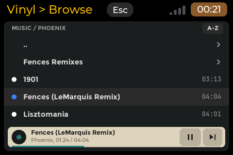 |
|  |  |
|  |  |
| 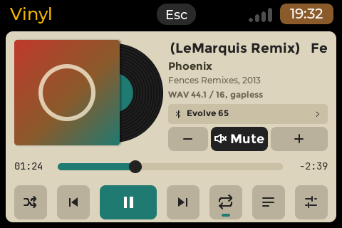 |  |
|  |  |
|  |  |
|  |  |
| 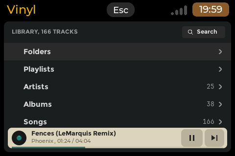 | 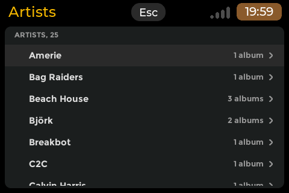 |
| 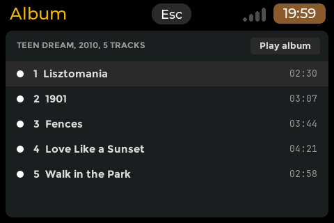 |  |
| 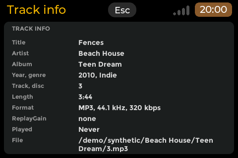 |  |
| 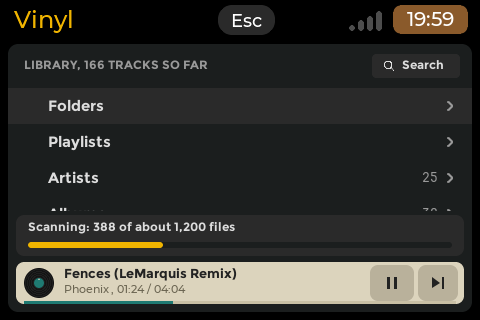 |  |
|  |  |
| 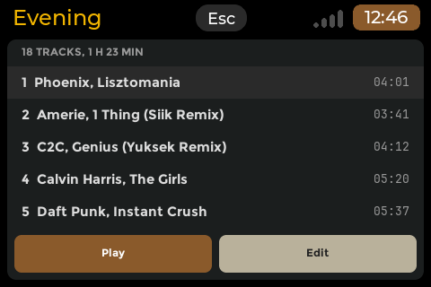 |  |
| 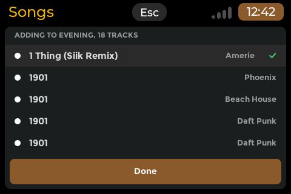 |  |
|  | 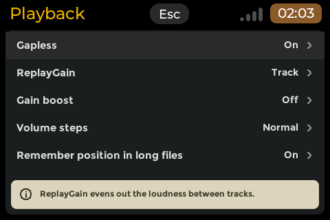 |
| 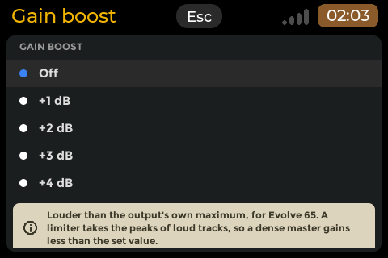 | 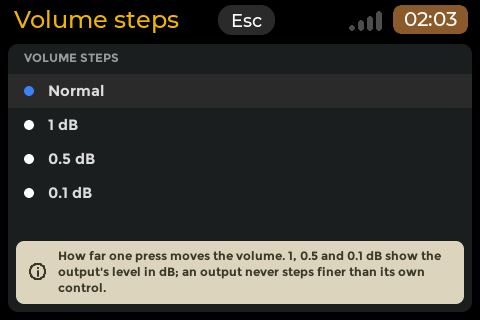 |
| 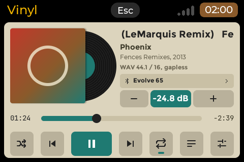 | 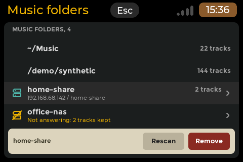 |
|  | |

The deck (640x480), square (480x480) and large (800x480, two panes), the Menu, the Keys, the Library hub, a playlist and the dB chip at 320x480, Add a network folder at 800x480 and the network shares at 320x480:
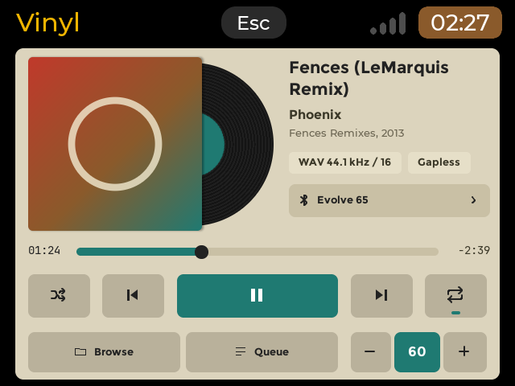 
 
  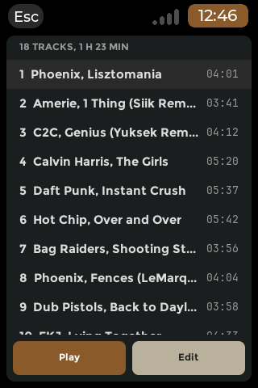 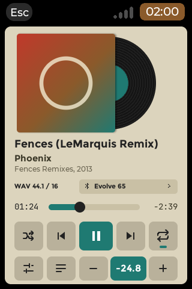
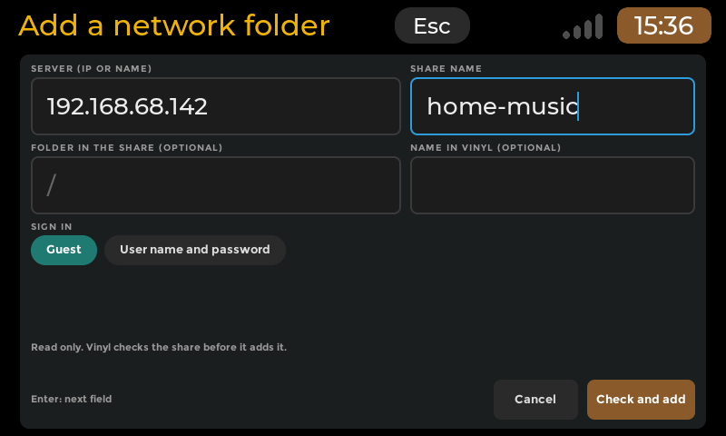 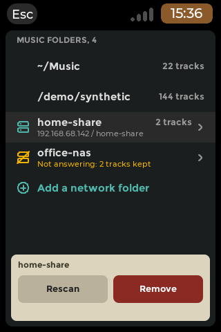

## What it does

| Page | What |
|---|---|
| **Browser** (the root) | `~/Music` and the mounted drives (`/media/<user>`, `/run/media/<user>`, `/mnt`): folders A-Z, playlists (`.m3u`, `.m3u8`), tracks A-Z (natural order) with their title tags and lengths; the mini player at the bottom. A track plays its folder as the queue; a playlist plays its entries. |
| **Library** (0.3.0) | Browse opens the hub: Folders (the Browser), Playlists (0.4.0, below), Artists, Albums, Songs and Genres with their counts, Search, and the mini player. Lists show 40 rows and the next 40 as you reach the end; an artist's page lists its albums by year, an album its tracks by disc; a genre leads to its albums. A track tap plays the list from there. A **1.5 s hold** (a bar fills and says "Keep holding for options"; or Ctrl+O) on a song, album or artist opens its actions: Play, Play next, Add to queue, Add to playlist (0.4.0), Track info. Search finds songs, albums, artists and genres while you type (case and accents ignored; one or two letters match the start). The scan runs at launch and when you open a folder from the Library, and stops when you leave the Library; Menu > Library shows its progress, Rescan now and the Music folders (add one through the Browser, remove one you added). A drive that is plugged in and not mounted is a row in Folders ("Tap to mount": Vinyl mounts it through udisks2, no password, and opens it; what Vinyl mounted it unmounts when it quits, and Music folders has an Eject button for it, and Mount for a drive that is plugged in and not mounted); a drive that is gone (pulled, or a stale mount) is shown nowhere, and what was queued from it leaves the queue (Vinyl then shows the Library at the default music folder, and opens on the Library when there is nothing left to resume). Without SQLite Browse stays the folder list. |
| **Playlists** (0.4.0) | A playlist is an M3U8 file in `~/Music/Playlists` (`#EXTM3U`, `#EXTINF:seconds,Artist - Title`, UTF-8); the Library's database only indexes them and is rebuilt from the files, so a file you add, change or delete outside Vinyl shows up when the Playlists page opens or a scan ends. **Library > Playlists** lists "+ New playlist" (asks for a name) and the playlists with their track counts; a tap opens one, a **1.5 s hold** (or Ctrl+O) opens its actions: Play, Rename, Delete, Export M3U. A playlist's page has two modes. The **view** (it opens in it) lists the tracks numbered, as the boards do; a tap or a click only SELECTS a row (it never starts the music), and two buttons sit under the rows: **Play** (the primary one: starts the playlist from its first track that is there, replacing the queue, shuffle and repeat as set; dimmed, with "Nothing in it can be played.", when every file is missing; Space does the same) and **Edit**. **Edit** changes the heading to "EDITING <NAME>, N TRACKS", puts a **Done** chip at its right (Done, or Esc, goes back to the view; a second Esc leaves the page) and the buttons to Move up, Move down, Remove and Add tracks, all of one look and all acting on the selected row (U / D, Shift+Up / Shift+Down and Delete work too). The options sheet (hold a row 1.5 s with its bar, or Ctrl+O, in both modes) has Play from here (Enter; in the view the Enter key does it too), Rename (N), Export M3U (E) and Delete playlist (Del; it asks first). **Add tracks** opens the Library in a pick mode (Artists, Albums, Songs, Genres, Search; the heading says "ADDING TO <NAME>, N TRACKS" and the **Done** button at the bottom, where the mini player is, or Esc, goes back to the playlist's edit mode). A song that is **already in the playlist shows a green check at the right** ("check x2" when it is in twice, and so on); a tap adds it again ("Added again.") and the number grows at once; an album, artist or genre row shows no mark (only song rows do: the songs of an album are marked on its page); "Add album" appends the album; nothing plays. **Add to playlist** (P on the song, album and artist actions) opens a picker, "+ New playlist" first then each playlist with its count, and appends the song, or the album's or the artist's tracks in album order; a playlist that already has the song says "in it, 18 tracks" ("in it x2, 31 tracks" when twice) and choosing it adds the song again. **Save as playlist** (the chip at the Queue's heading, or P on the Queue page) saves the queue in its play order under a name (suggested: Queue, then Queue 2 ...). A name is letters, digits, space, - and _ (up to 24 characters); a name that is taken (any case) says "That name is taken. Pick another." and the box stays. With no keyboard connected the on-screen keyboard opens by itself in the name box. **Delete playlist** (in the options) asks first (Cancel is the default; the letter Y deletes): the file goes, the songs stay. A file that is not on disk (a drive that is away, a deleted file, a Windows path that did not resolve) is **kept** in the playlist, drawn dimmed with "file not found", skipped when playing and inert to a tap; only Remove takes it out; a playlist with nothing playable is still listed. **Import:** in Folders, a `.m3u` / `.m3u8` row plays as before on a tap; held 1.5 s (or Ctrl+O) it offers Play, Import as a playlist (copied into `~/Music/Playlists` under its name; a taken name asks for another) and Add to the queue. The reader takes UTF-8 with or without a BOM, UTF-16 with a BOM, Windows-1252 / Latin-1 bytes, CRLF, backslashes and drive letters (`D:\Music\x.mp3` is looked for under the playlist's folder and the music folders), `file://` URLs and `#EXTINF`; `http(s)` lines are skipped. **Export M3U** writes `<name>.m3u8` to a folder you choose in the Browser (the "Use folder" key; a USB drive's root): a track on the same drive as the file gets a relative path, any other an absolute one, so a list of a stick's own tracks plays in a PC player. |
| **Now playing** | cover art (embedded JPEG or PNG, else the drawn sleeve) with the record sliding out (its label about a third out, with a dot and a centre ring that show it turning), title (one line that scrolls, or two lines on the 640x480, square and large screens), artist, album and year, the format and the Transition in use as information ("Gapless" or "Crossfade 10 s"; none for Normal; the running fade's while one runs; one line at 480x320 ("..., crossfade 10 s"), flat chips at 640x480 ("Fade 10 s" when a long format leaves no room), plain text elsewhere, none in portrait; on the square and large screens the playing track's ReplayGain after it, "Gapless, RG -3.2 dB"), the output (a full-width button with the device's name and a chevron; a chip on 800x480 and wider), the volume group ("-", the level on teal, "+"); the position with a seek bar (a tap seeks, a drag scrubs), previous, play / pause, next, shuffle, repeat (off, all, one: a teal mark, and a "1" for one); the Menu key (the sliders icon: the seventh transport key at 480x320, the sixth on the square screens, an icon key at the left of the bottom row in portrait, a bottom-row key with its word on 640x480 and 800x480 and wider); the queue key (480x320) or the Queue key of the bottom row; the Browse key (640x480, square, large); up next (square), the queue pane and the sleep-timer key (large). An empty queue dims the transport keys, which then do nothing (the Queue, Browse, Menu and sleep-timer keys stay: they open their pages). |
| **Queue** | the play order from the playing track, "3 OF 20, 1 H 24 MIN LEFT"; Move up, Move down, Remove and **Add** (0.4.0; there is no Clear all: remove rows one by one). Add opens the Library in a multi-select mode ("ADDING TO THE QUEUE, N TRACKS"): a green check marks the songs that are in the queue already ("check x2" when twice), a tap adds the song at the END of the queue ("Added to the queue."), a hold (or Ctrl+O) offers Play next and Add to the queue on a song, an album or an artist (an album is added whole, in album order), "Add album" on an album page; the **Done** button at the bottom, where the mini player is (or Esc), comes back to the Queue. With the queue empty only Add acts; with only the playing track Move up and Move down are dimmed. Save as playlist is the chip at the heading (or P). No dragging in the lists (the seek bar is the one control that drags). |
| **Output** | Automatic (the system's default output), the Bluetooth devices (music or call quality), the wired outputs, a paired device that is off (grey: a tap says how to connect it). Vinyl never switches output by itself: when the output in use goes away, playback pauses ("Evolve 65 disconnected. Paused."). |
| **Menu** (P2a) | TOOLS: **Equalizer** (0.7.0: the preset's name, or Off; see below), Sleep timer (Off, the time left, or the track mode), **Knock-knock** (0.6.0: On / Off, Off by default, directly under the Sleep timer, only where the launcher can switch the screen off on a board with a touch screen; Enter or a tap turns it on or off; under it a grey line says how: "Tap the cover 3 times to turn the screen off. Tap 3 times anywhere to wake it."; see Knock-knock below); SETTINGS: Playback, Library (when the Library's database opened: its scan, Rescan now, Music folders), Output (the output's name: it opens the Output page), Keys, About. Only what is built is listed. |
| **Equalizer** (0.7.0) | ten bars, 31 Hz to 16 kHz, -12 to +12 dB: "Band 4 kHz: +3 dB" for the selected band, the preset's name, the buttons "-", "+", Preset (Flat, Bass boost, Bass cut, Treble boost, Vocal, Loudness, Rock, Pop, Jazz, Classical, Custom), Reset (Flat) and On / Off. Moving a band makes the curve Custom (Custom keeps your own curve while you try a preset). One curve for every output. See Equalizer and crossfade below. |
| **Sleep timer** | Stop playing after: Off, 15, 30 or 60 minutes, This track, This album or queue (the chosen one has the blue dot; a choice closes the page, the Menu shows the time left); while it runs, "Stops in 29:12. The music fades out for the last 10 seconds." The minutes count from the choice, playing or paused; the last 10 s fade out, then the music pauses ("Sleep timer ended. Paused."). This track stops at the end of the track that plays, This album or queue before the next album (the album tag, else the folder) or at the end of the queue (a playlist plays to its end); the queue then waits on the next track, paused. The timer runs on while you change pages and while Vinyl is hidden; a restart forgets it; it pauses the music and nothing else. |
| **Playback** | **Transition** (0.7.0, in place of 0.6.0's Gapless On / Off: Normal, a short gap at every change; Gapless, the default, the next track continues on the same stream when its format is the same; Crossfade 5 sec, 10 sec or 20 sec, the end of a track overlaps the start of the next; see Equalizer and crossfade below), ReplayGain (Off / Track / Album, Track by default: the loudness from the files' tags), **Gain boost** (0.5.0: Off, +1 to +4 dB, per output; see Gain boost below), **Volume steps** (0.5.0: Normal, 1 dB, 0.5 dB, 0.1 dB; see below), Remember position in long files (On: a file longer than 20 minutes starts again where you left it). Enter or a tap turns Remember on or off; Transition, ReplayGain, Gain boost and Volume steps open their lists. |
| **Keys** | every key and what it does (the key's name, then its action; the rows of now playing say so); it scrolls. |
| **About** | the version, the formats, THIS OUTPUT (the playing output's range and levels, "Sharkoon Mobile DAC: -45.0 to 0.0 dB, 23 levels of 2.05 dB."), the libraries, where the licences are. |

The top band is the launcher's: the toolkit's header with the title (none at 320x480, the toolkit's narrow portrait), the
Esc and the shared status strip. No page has a busy state: nothing waits in front of the user (tags, covers and the
output lists are read in the background).

### Keys and touch

| Function | Key | Touch |
|---|---|---|
| Play / pause | Space (Enter on now playing) | the teal key; the mini player's key |
| Previous / next track | Left / Right on now playing; `,` / `.` on every page; the media keys | the keys beside play; the mini player's next key |
| Scan back / ahead (muted, 3x) | hold Left / Right on now playing (or `,` / `.`, or a media key) | hold the previous / next key |
| Seek | Shift+Left / Shift+Right: back / forward 10 s (now playing) | tap the seek bar where to go, or press on it and drag: the knob follows the finger, the times show where it will land, and the seek happens when you let go (playing or paused; nothing else starts from a press on the bar) |
| Shuffle / repeat | S / R | the keys left and right of the transport |
| Queue, Output, Browser | Q, O, B | the Queue key; the output button (the output chip on 800x480 and wider; the Menu's Output row too); Browse (or Esc from now playing) |
| Menu, Sleep timer | M (or Ctrl+O, the options key: a pointer's held click), T | the Menu key (the sliders icon, on every now-playing layout); the sleep-timer key (800x480 and wider) or the Menu's Sleep timer row |
| Equalizer (0.7.0) | E (from any page; on the Equalizer page E turns it on or off); there: Left / Right choose a band, Up / Down raise or lower it 1 dB, Enter opens the presets, 0 resets to Flat, Esc goes back | Menu > Equalizer; a tap on a bar selects its band, a drag up or down on it sets the band where the finger is; "-" and "+" change the selected band; Preset, Reset, On / Off |
| Menu pages: move, act, back | Up / Down (the headings skipped), Enter or Right acts, Left goes back; Keys and About: Up / Down scroll | a tap on a row acts (opens it, turns it on or off; a choice on the Sleep timer or ReplayGain list closes the list); Keys and About scroll by a drag |
| Lists: move, act, back | Up / Down, Enter; Right acts as Enter and Left goes back (queue, output; in the browser Right opens a folder) | browser: tap a row; queue: tap selects, tap again plays; output: tap chooses |
| Folder up | Left or Backspace (browser) | the ".." row |
| Library: search | `/` or Ctrl+F (on any Library page) | the Search chip of the hub |
| Library: actions of a row | hold 1.5 s, or Ctrl+O, on a song, album or artist; then Enter (Play), N (Play next), A (Add to queue), P (Add to playlist), I (Track info); Esc or Left closes | hold the row 1.5 s (the bar and "Keep holding for options" show from 0.5 s); tap an action; tap outside to close |
| Library: drives | Enter on a drive's row in Folders mounts it; Menu > Library > Music folders: select the drive, then Mount (a drive plugged in and not mounted) or Eject (one Vinyl mounted) | tap the row; the Mount / Eject button |
| Playlists | on the Playlists page: Enter opens, hold 1.5 s or Ctrl+O for Play (Enter), Rename (R), Delete (D), Export M3U (E); on a playlist's page: Space plays it from the first track, Enter plays from the selected row (view), Ctrl+O the options (Play from here, Rename (N), Export M3U (E), Delete playlist (Del)); in the edit mode U / D or Shift+Up / Shift+Down move the selected track, X or Delete removes it, Esc goes back to the view; on the Queue page P saves it as a playlist; on a `.m3u` row of Folders Ctrl+O opens Play, Import as a playlist (I), Add to the queue (A) | the rows, the buttons Play and Edit, then Move up, Move down, Remove and Add tracks with the Done chip, the Queue's "Save as playlist" chip; hold a row 1.5 s for its actions |
| Library: choose a folder | U uses the open folder (Menu > Library > Music folders > Add a folder) | the "Use folder" key in the strip |
| Queue pane (800x480 and wider) | Up / Down pick a track, Enter plays it | tap picks, tap again plays |
| Queue editing | U move up, D move down, Delete or X remove, A add songs (the Library; Done or Esc comes back), P save as a playlist | the four buttons (Move up, Move down, Remove, Add). A button that cannot act is dimmed and does nothing |
| Volume | `-` / `=`: the volume of the output Vinyl plays on, one of its levels a press (about 2 dB) | "-" and "+" of the volume group, the level between them (teal): in the bottom row (640x480, square, portrait), under the output button (480x320), where the Equalizer key was (800x480). It sets and shows the playing output's real level as a percent of that output's levels; muted (by anything), the level box turns dark with the speaker-off mark in white and "Mute" beside it where both fit (480x320, 800x480 and the larger portrait and square screens), else the mark alone, large (640x480, 480x480, 480x640, 320x480), never a number; "-" does nothing and "+" brings the sound back at its level; "-" at the first level mutes. "--" when the level is not known; where nothing can change it a tap shows "Volume is not available on this board" |
| Close a notice | Esc (it also goes back as Esc always does: at the browser Vinyl quits) | tap it (it also goes after 6 s, 8 s for a disconnect) |
| Back; at the browser, quit | Esc (from a Menu page: the Menu; from the Menu: the page it was opened from) | the header's Esc |
| Headset, speaker, keyboard media keys | Play/Pause, PlayCD, PauseCD (a toggle), Next, Previous (as Right / Left above, held too), Stop (pause and back to the start) | |
| Screen off / on (Knock-knock, 0.6.0, when it is On) | while it is off: the media keys, the volume keys and `-` / `=` only | three quick taps on the cover of Now playing switch it off; three quick taps anywhere bring it back |

Previous and next act when the key is released, the same from every path (the transport press, owner ruling
2026-11-12): next plays the next track (at the end of the queue with repeat off it stays on the last one; repeat all and
repeat one wrap to the first); previous goes back to the start of the track when more than 2 s of it have played, else
to the previous track (the first track starts again). Held for half a second they scan through the track at three times
its speed with the sound muted; on release the sound comes back from there, playing or paused as before. A forward scan
goes on into the next track; a backward one stops at 0:00. Left / Right on now playing are the one exception to the
Left = back, Right = Enter rule of the other pages. The volume group and `-` / `=` set the output Vinyl plays on; the
launcher's volume, mute and brightness keys stay the launcher's and act on the system's default output, so when Vinyl
plays on the default output the group follows them (with a sound server, within about half a second). A media key seen
twice within 250 ms (the same button on two input nodes) acts once.

## Formats

| Tier | Formats | Library (loaded at run time) |
|---|---|---|
| 1 (always) | MP3 (gapless with the LAME header), FLAC (16/24/32 bit kept), Ogg Vorbis, Ogg Opus, WAV (PCM, float, RF64), AIFF / AIFC | libmpg123, libvorbisfile, libFLAC, libopus (package Depends); WAV/AIFF: own reader |
| 2 (FFmpeg, installed with Vinyl) | AAC / ALAC / M4A, WMA, APE, WavPack, TTA, Musepack, DSF (as PCM), Ogg FLAC, trackers | libavformat, libavcodec, libswresample, libavutil 61 (Debian 13, Raspberry Pi OS) or 62 (Ubuntu 26.04): package **Depends** (decision D20), loaded only when such a file is opened, never at start |

Every board plays the common formats out of the box (the owner's decision D20, 2026-11-13). FFmpeg costs about 22.5 MB
of memory once loaded (report 059, 14.6), nothing before. On a Lite image the FFmpeg libraries and what they need are
about 104 MB of disk, which is what Settings > Apps installs from launcher 0.10.2 (it skips recommends); before 0.10.2
the installer also installed their own recommends, about 462 MB. If the libraries
are there but cannot be loaded, a tier-2 file shows "The FFmpeg libraries could not be loaded. Reinstall Vinyl." and the
next track plays.

Gapless (the Transition setting's default, and every crossfade's fallback): the next track continues on the same stream
when its format (rate, channels, sample size) is the same; another format drains the stream and opens a new one (a short
gap). Tags come from Vinyl's own readers (ID3v2.2-2.4 and v1, FLAC
and Ogg comments, MP4 items, WAV INFO, AIFF), never from a process per file; text is UTF-8 and Chinese, Japanese and
Korean titles draw with the launcher's Noto Sans CJK.

## Outputs, Bluetooth and volume

- **With a sound server** (PipeWire or PulseAudio: the HackBerry, the Pi 5 boards, the tablet): every output of the server,
  opened by name with DONT_MOVE (Cassette's layer), so the server never moves the music elsewhere. Automatic plays to the
  server's default output, looked up when playback starts and at each track change (never in the middle of a track).
  Bluetooth headsets and speakers are listed with their quality; one A2DP device at a time on the HackBerry, a second one
  gets call quality ("Call quality (16 kHz): the headset is in call mode." while it plays). A Bluetooth profile switch
  (the node re-created) is followed on the same device; a device that goes away pauses playback.
- **Without one** (the Lite boards: the deck, zero8, Pi 3A+): ALSA `default` (Automatic) and the cards with a playback
  device (through `plughw`, never `hw:`); the output page says "Bluetooth audio is not set up on this board."
- **Volume** (decision D11 as the owner changed it, 2026-11-12; the levels as the owner decided on 2026-11-13): the
  volume group and `-` / `=` set the volume of the output Vinyl plays on and show its real level. Each output gets its
  own levels from its real range: the top 60 dB of it at most (a sensible usable range, after Dr. Lex's
  [volume control article](https://www.dr-lex.be/info-stuff/implement-a-volume-control.html)), cut in levels about 2 dB
  apart, linear in dB: level 1 is the bottom of that window (it sounds), the last level the output's own top (100 %), 0
  is mute; the group shows the level as a percent of the output's levels, so 50 % is the middle of that output's range
  and a press moves one level, not 5 %. The same output (the same DAC or card model) gets the same levels on every
  board; different outputs differ, as their hardware does.

  | Output | Range | Window | Levels | dB a level | 50 % |
  |---|---|---|---|---|---|
  | Sharkoon USB DAC (`PCM`, 1 dB steps) | -45..0 dB | -45..0 dB | 23 | 2.05 | 52 % = -22.5 dB (the middle) |
  | Raspberry Pi headphone jack (`PCM`, 0.01 dB steps, mute at min) | -102.39..+4.00 dB | -56..+4 dB | 30 | 2.07 | -27.0 dB |
  | Apple USB-C adapter (`Headset`, 0.5 dB steps) | -60..0 dB | -60..0 dB | 30 | 2.07 | -31.0 dB |
  | a sink with no known range (Bluetooth, software sinks) | | -60..0 dB | 30 | 2.07 | -31.0 dB |

  Without a sound server it is the card's playback mixer control (`Master`, `PCM`, `Speaker`, `Headphone`,
  `Headset`...), set by raw value and read back fresh; the control's switch mutes. A control whose lowest step is "mute"
  (the Pi jack's) has that step read as muted, and its dB range is taken from the step above (ALSA reports the mute step
  as -99999.99 dB); a control without dB data gets its own raw steps (at most 30). With a sound server it is the sink's
  own volume, set as the server's dB (`pa_sw_volume_from_dB`) whether it is the default sink or not; the window is the
  range of the ALSA card behind the sink (found from the sink's properties), placed under the sink's 0 dB as the server
  maps it, so a DAC whose floor is -45 dB never gets a level below it; a sink with no card (a Bluetooth headset) gets
  -60..0 dB. A level changed elsewhere (a headset's buttons, the launcher's keys on the default sink, alsamixer) shows as
  the nearest level within about half a second. Each set is logged with what the output holds after it
  (`volume: set <output> step i/N P % target X dB raw=M read back raw=K`). Only a card with no playback mixer gets
  Vinyl's software volume, over -60..0 dB. Vinyl's stream itself always plays at 100 %, with its own restore key, so a
  server never brings back another app's stream level. A muted output shows the same muted box in the group, whoever
  muted it: the card's switch, the control's own mute value, the sink's mute (`pactl set-sink-mute`, the launcher's key)
  or Vinyl's own mute, which it uses for a card with no playback mixer (the software volume) and for a control with
  neither a switch nor a mute value: its stream goes silent, the output keeps its level, and the mute survives a restart
  (`~/.config/vinyl/state.json`, `app_muted`). The sound server's placeholder output at start (`auto_null`) never shows a
  level.

### Texts for the owner to confirm

Written for 0.2.0 where the canvas has none (`docs/decisions.md`, "Design QA of 0.2.0, run 1"): the notice "Sleep timer
ended. Paused."; the Sleep timer page's status lines "Stops at the end of this track. The music fades out for its last 10
seconds." and "Stops at the end of this album or queue. The music fades out for its last 10 seconds." (the minute modes'
"Stops in 29:12. ..." is the canvas's); the Menu values "This track" and "This album"; the ReplayGain pick list's strip
"Track: every track as loud as the others. Album: an album keeps its own loudness steps. Files without ReplayGain tags
play as they are."; the Keys page's actions after the canvas's eight rows. Written for 0.7.0 (`docs/decisions.md`, "P2d" and "The Transition setting"): the Transition list's strip "Normal leaves a
short pause between tracks; Gapless none. Crossfade overlaps the end of a track and the start of the next." (the choices'
words are the owner's); the Preset list's strip "Moving a band makes the
curve Custom. Reset sets every band to 0 dB; Custom keeps your own."; the presets' values; the Equalizer's "Off" button.

## ReplayGain

From the files' tags only (decision D25: no analysis on the board; tag the files with a PC tool such as rsgain or
foobar2000): ID3v2 TXXX `REPLAYGAIN_TRACK_GAIN` / `_PEAK` and `REPLAYGAIN_ALBUM_GAIN` / `_PEAK` (MP3, WAV and AIFF id3
chunks), the same names as Vorbis comments (FLAC, Ogg Vorbis), Opus `R128_TRACK_GAIN` / `R128_ALBUM_GAIN` (their value
/ 256 + 5 dB, on top of the header's output gain the decoder applies), MP4 `----:com.apple.iTunes:replaygain_*`. Track
uses the track gain (the album gain when the file has none), Album the album gain (the track gain when it has none); an
untagged file plays at 0 dB. The gain never lifts the file's peak (the peak tag) above full scale. Vinyl applies it to its
own stream, before the output's volume: the volume group's levels, its percent and the output's own level do not move.
A pre-amp is not offered (0 dB).

## Gain boost and Volume steps (0.5.0)

Both are in the Playback settings of the Menu.

- **Gain boost**: Off, or +1 to +4 dB of software gain on top of the output's volume, for an output that is quiet even at
  its maximum (the headphone jack of a Pi 3 or Pi 4 next to a USB DAC). It is set **per output** (the row shows the value
  of the output that plays now; a Bluetooth speaker can stay Off while a USB DAC has its own value) and applies at every
  volume level. A limiter (5 ms look-ahead, ceiling -1 dBFS) keeps the boosted sound from clipping, so a **dense master
  gains less than the set value**: the limiter takes its peaks. Measured as the RMS loudness gained with +4 dB: a track at a
  normal level +4.0 dB, peaks at -3 dBFS +3.6 dB, a dense modern master +2.6 dB (about 2 dB on loud dance masters), a
  hard-clipped master +0.1 dB. The limiter stays as it is on purpose (a louder result would need a clipper and distortion).
  Without a boost (and with a ReplayGain at or under 0 dB) the limiter is not in the path and the sound is bit-exact.
- **Volume steps**: Normal (about 2 dB a step, the percent shown, as in 0.4.0), 1 dB, 0.5 dB or 0.1 dB. In the dB modes
  the volume group shows the output's real level as a **dB chip** ("-22.5 dB"), and "-" and "+" move it by the step,
  **never finer than the output's own step** (a USB DAC with 1 dB steps moves 1 dB in the 0.5 and 0.1 modes too; the
  Pi's jack and a sound server's outputs go as fine as 0.1 dB). **Hold "-" or "+" to repeat**: nothing for half a
  second, then 10 steps a second, 30 a second after two seconds. The chip does not include the boost.
- **A tip.** The built-in jacks of the Pi 3 and Pi 4 are basic quality; a USB DAC gives a cleaner and louder output. The
  boost helps most on the built-in jack.

## Knock-knock: the screen off while the music plays (0.6.0)

To save the battery while you listen: knock on the cover and the screen goes dark, knock anywhere and it comes back.

- **The setting**: Menu > TOOLS > **Knock-knock**, directly under the Sleep timer (the owner's place for it, 2026-11-16),
  Off by default (Enter or a tap turns it on or off; the Menu page has no help strip). The row shows only where the launcher can switch the screen off and on for an app (board.state's
  `requests` lists `screen`: a launcher with the screen request, 0.10.4 or later, on a board with a backlight, levels or on /
  off) and the board has a touch screen (screen.state does not say `touch_slots=0`). An older launcher, a board without a
  backlight to switch (the HackBerry) or without a touch screen shows no row, and a setting left On does nothing there.
- **Screen off**: on Now playing, **three quick taps on the cover square** (the album art, or the drawn sleeve). Only the
  cover counts: taps anywhere else do what they always do, and a tap elsewhere in between starts the count again. The
  screen goes **black**: Vinyl covers the whole display with opaque black and stops drawing, and the backlight goes dark
  where the panel can (some panels only dim at their lowest backlight, such as the Pi 3A+ Waveshare DSI panel: the black
  picture keeps them dark too).
- **Screen on**: **three quick taps anywhere**. They press nothing: no button, no row, no Esc under them acts, the first
  one included.
- **Quick taps**: each press shorter than 0.4 s, each gap from a release to the next press shorter than 0.5 s, the three
  within 1.2 s from the first press to the last release, and the finger still (it may move a sixth of the touch target
  between its press and its release: about 1 mm, 13 px on the deck). Slower taps, long presses and drags do nothing. After
  a slow start the last three taps still count (the count slides; nothing has to be waited for).
- **While it is off**: the music plays on, the queue advances, the sleep timer runs; the **media keys** of headsets,
  speakers and keyboards (play, pause, next, previous, stop; held next / previous scan as always), the **volume and mute
  keys** (the launcher's) and **`-` and `=`** (Vinyl's own volume keys: the output Vinyl plays on, one step a press) work.
  **Every other key and every touch is ignored**: Space, Enter, the arrows, the letters, comma and dot, a short Esc.
  (Holding Esc 3 s is a launcher feature that depends on the board's multitasking and key setup; it is not part of Vinyl and Vinyl does not
  implement it.) Nothing is drawn under the
  black while it is off (no animation, no clock, no scrolling title); the first frame after waking is a full repaint.
- **The screen always comes back**: when Vinyl quits (Esc at the root, the launcher's close, a signal), when
  it is hidden (Super, Alt+Tab, the three-finger hold), when the setting is turned Off, when the launcher stops offering
  the request, and on a crash Vinyl can catch (it sends `screen on` before it ends; the black picture it left is then the
  launcher's to repaint when it takes the panel back). The launcher also restores the light by
  itself, about a second after Vinyl dies (`kill -9` included) and when Vinyl is hidden or replaced, so a black screen is
  never left behind. If the launcher refuses (another app holds the screen off) or does not answer, the screen stays on,
  the input stays as it was and Vinyl says "Screen off is not available.".
- **Nothing is saved by it**: the brightness and the launcher's Settings stay as they were; the screen comes back at the
  level it had.
- **Needs a touch screen**: where the launcher says the board has none (`touch_slots=0`) the row is not listed. Where the
  launcher does not say (an older launcher, multitasking off) the row shows; without a touch screen it then does nothing.

## Equalizer and crossfade (0.7.0)

- **Equalizer** (Menu > TOOLS > Equalizer, or E): ten bands at 31, 62, 125, 250, 500 Hz, 1, 2, 4, 8 and 16 kHz, each -12 to
  +12 dB in 1 dB steps, with presets (Flat, Bass boost, Bass cut, Treble boost, Vocal, Loudness, Rock, Pop, Jazz,
  Classical) and your own curve (Custom: moving a band makes the curve Custom, starting from the preset; Reset sets every
  band to 0 dB and keeps your Custom curve for later). One curve for every output, wired or Bluetooth, and every format
  (the small decoders and FFmpeg alike). On with Flat by default, which changes nothing; choosing a preset or moving a band
  turns it on; Off leaves the music exactly as before (bit-exact). **A boost is a boost**: a band raised by 6 dB is 6 dB
  louder and every other band keeps its level (no pre-gain lowers the music first; the first 0.7.0 draft did, so a boost
  made the music quieter). **No clipping**: the gain boost's look-ahead limiter follows the EQ and lowers only the peaks
  that would go over -1 dBFS; with ReplayGain Track (the default) most music has several dB of room before that. It costs about 1 % of one core
  on a Pi Zero 2 W (`vinyl --bench-dsp` measures it). On the page: Left / Right choose a band, Up / Down set it, Enter the
  presets, E on / off, 0 Reset; on the touch screen a tap selects a band and a drag up or down on its bar sets it. The
  setting is written when you stop changing it (not at every step).
- **Transition** (Menu > Playback > Transition; the owner's one setting of 2026-11-20 in place of 0.6.0's Gapless On / Off
  and the first draft's Crossfade list): how a track goes into the next when it ends by itself.

  | Transition | What a track change does |
  |---|---|
  | Normal | the stream drains and opens again: a short gap at every change (0.6.0's Gapless Off) |
  | Gapless (default) | the next track continues on the same stream when its format (rate, channels, sample size) is the same: no gap; another format drains and opens again (0.6.0's Gapless On) |
  | Crossfade 5 sec, 10 sec, 20 sec | the end of one track and the start of the next overlap for that long (equal-power curves: the loudness stays even), on **every** change, inside an album or between albums; a track shorter than twice the fade fades for half its length, under half a second there is no fade; a change into another format, or out of a track whose length is not known, is a Gapless change |

  In all of them **Next, Previous and a tap change at once**, and repeat one never fades (the same track again). A pause,
  a seek or an output change during a fade ends it: the track you hear goes on alone. During a fade a second decoder runs
  (report 059: FLAC 0.65 %, MP3 0.8 %, Vorbis 2.1 %, Opus 2.6-3.6 % of a Zero 2 W core); no buffer of decoded audio is kept.
  An older `settings.json` is read as it was: Gapless On is Gapless, Off is Normal, the draft's crossfade of 2-6 s is
  Crossfade 5 sec and 8-10 s Crossfade 10 sec; the next change of a setting writes `"transition"` in their place.

## Music on a network share

**Add a share from Vinyl (0.8.0, SMB).** Menu > Library > Music folders > **Add a network folder**: type the server (its IP
address, or a name such as `nas.local`) and the share name; a folder inside the share and the name the share gets in Vinyl
are optional (the name is made from the share name: letters, digits, `_` and `-`). Sign in as **Guest** (the default) or
choose **User name and password**. **Check and add** asks for the board user's password (the launcher's sudo prompt; it is
asked at every Add and Remove, nothing stays allowed), then the launcher's helper test-mounts the share (up to 10 s) and,
when it answers, keeps it for good: the share is mounted read-only at `/mnt/cyberdeck/<name>` whenever something looks into
it, also after a reboot, and every app sees it there. Vinyl adds it to the library and scans it. A refusal says why on the
form, before or after the password: a server that does not answer, no share of that name, refused (as guest: the share
needs a user; ZimaOS answers a wrong share name and a share that needs a login alike, so check both), a name in use,
"Needs a launcher update or cifs-utils", a wrong sudo password or a Cancel (nothing was changed). Some servers let a user
name they do not know in as a guest: Vinyl cannot tell, so check that the share shows the files you expect.

- **The password** of the share never goes on a command line and Vinyl does not keep it: for the time of the check Vinyl
  writes it to a file only you can read on the board's memory disk (`/run/user/<uid>/cyberdeckzero-share/`, mode 0600) and
  deletes it right after; the helper keeps its own root-only copy for the automatic mount. A read-only account on the NAS
  for the deck is the safe choice. The typed password is never in Vinyl's journal.
- **The shares** are listed in Music folders with a small server glyph, their name, "server / share" and their tracks.
  Select one for **Rescan** and **Remove** (800x480: a panel at the right with its details). **Remove** asks first, then
  the password: the share is unmounted and forgotten by the system, its folder, its library rows and its tracks in the
  queue go (the playing one stops). No file on the server is touched.
- **The glyph** (teal) marks a track from a share on Now playing (beside the format; the glyph alone on 320x480), in the
  queue and in the mini player, and the shares in Folders. Amber and slashed: the share does not answer (Vinyl asks each
  share at most every 10 s with a look of 3 s at most, on a thread of its own): its rows read "Not answering: N tracks
  kept", a track of it is not started ("The share ... is not answering."), the next track is never one of it, and a
  playing track whose share goes away stops ("... stopped answering. Stopped."). A read already waiting on a dead share
  can take 20 to 45 s to fail on the board's side; the screen and keys stay alive meanwhile. When the server is back the
  glyph turns teal again within about 10 s.
- **Needs launcher v0.10.8 or later**, the release that ships the helper (`/usr/libexec/cyberdeckzero/cyberdeckzero-share`, with
  `cifs-utils`): on an older launcher the Add row reads "Needs a launcher update" and does nothing else. A board user
  without sudo rights gets "This user may not use sudo."; the shares added from Vinyl stay usable after a launcher
  without the helper (they are plain system mounts).

**A share mounted by hand.** Vinyl also plays a folder that the **system** has mounted from a NAS or another computer
(SMB / CIFS, NFS, sshfs: the lines below) as an ordinary music folder; such a share gets the glyph, never a Remove (Vinyl
only removes what the helper added):

- a share is not a USB drive: no "(USB drive)" label, nothing to Eject, and when the network drops its tracks **stay in the
  queue** (the drive rule "the tracks of an unplugged drive leave the queue" is for sticks only). A track that cannot be
  reached says "The file cannot be reached (a network share that does not answer?)" and playback goes on to the next one;
- the library scan skips a share that does not answer and **keeps its rows** (nothing is deleted, the folder stays listed);
  it reads the share again at the next scan;
- every look at a share (the scan, a folder opened in Folders, the checks of the mounts) is bounded: Vinyl waits at most
  3 s on a thread of its own, gives up on a share that does not answer and does not ask it again for 5 s, then 10 s, up to a
  minute. Opening a folder of a share that is away shows "The network share does not answer." instead of freezing.

**Point the library at the mount**: Menu > Library > Music folders > Add a folder, open the share's folder (for example
`/mnt/nas/music`) and press "Use folder" (it is saved as `library.folders` in `~/.config/vinyl/settings.json`), then Rescan
now. A share mounted at `/mnt/<name>` or under `/media/<user>` is also offered by itself.

**SMB (cifs).** Put the credentials in a file only you can read (`sudo nano /etc/smb-nas.cred` with `username=` and
`password=` lines, then `sudo chmod 600 /etc/smb-nas.cred`) and add one line to `/etc/fstab` (replace `nas`, `music` and the
id numbers; `id pi` shows yours):

    //nas/music  /mnt/nas  cifs  credentials=/etc/smb-nas.cred,uid=1000,gid=1000,vers=3.0,_netdev,nofail,x-systemd.automount,x-systemd.idle-timeout=60,x-systemd.mount-timeout=10,ro  0  0

Then `sudo mkdir -p /mnt/nas && sudo systemctl daemon-reload && sudo systemctl restart remote-fs.target`, and `ls /mnt/nas`.
`x-systemd.automount` mounts the share when something first looks into it and lets go after 60 s idle, so the board boots
without the network and a missing server never holds the boot (`nofail`, `_netdev`, a 10 s mount time-out). Vinyl sees the
automount point (file-system type `autofs`) as the share. Drop `ro` if you want to write to it (Vinyl never does).

**NFS.** One line in `/etc/fstab` (install `nfs-common` first):

    nas:/export/music  /mnt/nfs  nfs  soft,timeo=50,retrans=2,ro,nofail,_netdev,x-systemd.automount,x-systemd.idle-timeout=60,x-systemd.mount-timeout=10  0  0

**Use `soft` for NFS.** NFS mounts are `hard` by default: when the server is gone every read waits until it comes back,
for ever, and **a hard NFS mount can freeze any program that looks at it**, not only Vinyl (an `ls`, a file manager, the
shell). Vinyl keeps its screen, keys and queue alive (its looks at a share are on threads of their own), but the playing
track stops, a hung read cannot be cancelled by anything, and quitting Vinyl can then wait for the read to end. `soft`
(read errors after about 10 s: `timeo=50` is five seconds in tenths, two retries) is safe here because Vinyl only
reads; the NFS manual warns that `soft` can corrupt data that is *written*.

Check it from a terminal before you open Vinyl: `findmnt /mnt/nas` shows the type (`cifs`, `nfs4` or `autofs`), and
`ls /mnt/nas | head` must answer in a second or two.

## Background playback

`.desktop` `X-Background=run`: on a launcher with multitasking (canvases 480 px and more on the short side) Super, Alt+Tab
or the three-finger hold hide Vinyl and the music plays on; nothing is drawn while hidden. Below 480 px (zero8 in
landscape or portrait) the app owns the panel and Esc at the browser ends playback. The queue and the position are saved
as they change, so a close by the launcher (memory) resumes paused at the same place. Where the launcher answers `dim`
(board.state `requests`: the battery boards with backlight levels), Vinyl asks it to let the idle panel dim while it
plays in front (`dim allow`, decision D16).

## Requirements

- A screen of 480x320 or more (`X-MinSize=480x320`): the smallest approved draft is 480x320, where the sleeve beside the
  title, artist, format line, output button and volume group and a row of seven transport keys already take the whole
  width; a smaller screen gets the launcher's notice. A portrait layout for 320x480 and taller (`X-Portrait=320x480`).
- The layouts (owner-approved drafts): 480x320 (and landscape screens of that shape under 480 px high or under 640 px
  wide), 640x480 (4:3 screens 640 to 799 px wide and 480 px or more high: the deck), square (480x480, 720x720),
  portrait, and two panes from 800x480 (800x480, 1024x600, and the 4:3 screens from 800 wide and 480 high: 800x600,
  1024x768). Where a layout has less room than the 7 mm
  touch size (the deck's 640x480 at 11.3 px/mm: 70 px rows; a 3.5-inch 480x320: 43 px for the volume group and the seek
  row), the touch areas share the room without overlapping (owner rule R-4).
- CyberdeckZero Launcher with the app contract; from 0.6.0 built against launcher v0.10.4 (`1d628b3`), not the shared pin
  (`apps/_common/LAUNCHER_REF`). Knock-knock needs launcher 0.10.4 or later, adding a network share 0.10.8 or later.
- Packages (Debian 13 names, all Depends): libmpg123-0t64, libvorbisfile3, libflac14, libopus0, libasound2t64,
  libpulse0, libavformat61, libavcodec61, libavutil59, libswresample5 (Ubuntu 26.04: libavformat62, libavcodec62,
  libavutil60, libswresample6), libsqlite3-0 (the Library).
- Reading the media keys needs read access to `/dev/input/event*` (the `input` group, as the launcher's user has).

## Install

Settings > Apps > Available > Vinyl, or by hand: `sudo apt install ./vinyl_0.8.0_arm64.deb` (apt installs the
dependencies), `sudo dpkg -r vinyl` to remove it.

## Files the app keeps

| Path | What |
|---|---|
| `~/.config/vinyl/state.json` | the queue, its order, shuffle, repeat, the position, the output, the browser's folder, the software level of an output without a mixer; written on a change (a track, a pause, the queue, a folder, the exit) and at most once a minute while playing |
| `~/.config/vinyl/settings.json` | Transition (`transition`: `normal`, `gapless`, `crossfade_5`, `crossfade_10`, `crossfade_20`; 0.7.0, read from the older `gapless` and `crossfade` keys when it is missing), ReplayGain, Gain boost (per output), Volume steps, Remember position in long files, Knock-knock (`knock_knock`, 0.6.0) and the Equalizer (`eq`: on, preset, custom curve; 0.7.0); written only when one changes (the Equalizer once you stop changing it) |
| `~/Music/Playlists/<name>.m3u8` | the playlists (0.4.0); written atomically (a temporary file renamed over the old one, so a power cut leaves the old file); Vinyl only writes them when you ask |
| `~/.local/share/vinyl/library.db` | the Library: a cache of the tags and the play counts, rebuilt by a scan (a damaged file is moved aside as `library.db.bad`) |
| `~/.config/vinyl/positions.json` | where each long file (over 20 minutes) was left, the 500 most recent; written on a pause, a track change, the exit and at most once a minute while a long file plays |

Delete them to start fresh. Vinyl writes nothing else (it never writes tags or music files). The sleep timer is not saved.

## Known limits (0.8.0)

- Network shares added from Vinyl are SMB only (no NFS or sshfs form), with no spaces in the share or folder names, and no
  browsing of a server's shares (type the share name). The form cannot tell a wrong password on a share that also lets
  guests in. The sudo prompt is the launcher's toolkit dialog ("Sudo Password"), without a line that says why it asks. A
  share's details panel (800x480) does not say how it signs in (the helper's list does not tell).
- A network share (see "Music on a network share") is read through the kernel as any folder: Vinyl bounds its own looks at it
  (3 s, then a back-off) but cannot cancel a read that is already stuck in a hard NFS mount (use `soft`); opening a playlist
  file (`.m3u8`) whose entries lie on a share checks each entry on the UI thread. A share that is not mounted at start
  (a fstab line without `x-systemd.automount`, the network not up yet) counts as an unmounted drive for the saved queue; the
  automount line avoids that.
- Playlists: only `.m3u8` files in `~/Music/Playlists` are listed (a `.m3u` put there is not; import it from Folders). A
  Windows path is matched with its case as written (a file `Song.MP3` for `song.mp3` is not found); a file name that holds
  a backslash is read as folders; a Linux path from another machine is kept as it is (dimmed when it is not here). The
  Move, Remove and Add buttons have no icon (the words alone). No drag to reorder, no sort, no smart playlists.
- The Library
  indexes `~/Music`, the mounted drives and the folders you add; it has no pinyin order for Han names (code-point order),
  reads no tags of WMA files (the file name is the title), and a stick never seen before needs a scan (Rescan now, or open
  its folder from Folders). A file the scan cannot read gets no row, without a notice (no "N files could not be read"
  yet).
- The search field draws typed Chinese, Japanese and Korean characters as boxes until the toolkit's text field gets the CJK
  fallback.
- Mounting a drive needs the `udisks2` package and a session allowed to mount: the polkit rule that launcher 0.10.3
  installs for its user, or the same rule added by hand (an ssh login is refused). It is a run-time need, not a
  dependency: without udisks2 the drives are listed and a tap says "Drives need the udisks2 package."; without the rule
  Vinyl shows "Could not mount it: this session is not allowed to mount drives.". Vinyl unmounts only what it mounted.
- One Equalizer curve for every output (per-output curves are P3), no pre-amp; a strong boost on a loud master is held at
  -1 dBFS by the limiter (its peaks, and the music with them, come down for a moment) rather than clipped. The crossfade
  only between tracks of the same format, at the end of a track; it needs the outgoing track's length (a file whose length
  is not known changes gapless). No ReplayGain pre-amp. A dense master gains less than the Gain boost value (the limiter
  takes its peaks).
  The ReplayGain figure shows on the square and large screens only. No sorting control in the browser (folders and
  tracks are A-Z).
- No metadata to headsets or car displays (MPRIS / AVRCP) and no folder art (a `cover.jpg` beside the tracks: only
  embedded covers), both P2e; headset keys work when BlueZ hands them to an input node.
- A cover larger than 1200 px on its long side is not decoded (the memory cap on the Pi Zero 2 W): the drawn sleeve shows.
- FFmpeg seeks land on the packet at or before the position; the AAC length is the container's.
- The amd64 package targets Ubuntu 26.04, where FFmpeg is libavformat 62 (FFmpeg 8): Vinyl's FFmpeg 62 structure
  offsets were checked against the FFmpeg 8 headers (`tests/abi`), not yet played on the tablet.
- MIDI, native DSD, SACD images, tag editing and video are out of scope (decision D14).

## Credits and licences

Vinyl is MIT (`2026 OSRdesign`). Linked into the binary: cp0_lvgl and LVGL (MIT), stb_image 2.30 (Sean Barrett and the
stb contributors, public domain / MIT; `third_party/stb`). Loaded at run time from the system, not shipped: libmpg123
(LGPL-2.1), libvorbisfile / libvorbis / libogg, libFLAC and libopus (BSD-3-Clause), libasound and libpulse
(LGPL-2.1-or-later), SQLite (libsqlite3, public domain), FFmpeg (libavformat, libavcodec, libavutil, libswresample: GPL-2.0-or-later as Debian and Raspberry
Pi OS build it; source https://ffmpeg.org/ and the Debian source package `ffmpeg`). Fonts: the launcher's Montserrat,
JetBrains Mono and Noto Sans CJK (SIL OFL 1.1) and DejaVu Sans, read at run time. The sound-server and ALSA layers and
the FLAC / Opus readers come from this repository's Cassette (same author, MIT). Full text:
`root/usr/share/doc/vinyl/copyright`.

## Build and test

```sh
wsl -e sh apps/vinyl/tests/run.sh               # the unit tests (-Werror) and the real-library fixtures
wsl -e sh apps/vinyl/build.sh host              # harness, unit tests, the scenes (qa* for the design QA, knock* for Knock-knock, qa-shares* for 0.8.0), sheets
wsl -e sh apps/vinyl/build.sh cross             # the arm64 binary; --arch amd64 for PCs
wsl -e sh apps/vinyl/tests/abi/run.sh [root]    # the hand-written FFmpeg / mpg123 / vorbisfile ABI against headers
python3 tools/make_registry.py --only vinyl --out <folder>    # a local .deb (not published)
python apps/vinyl/tools/make_icon.py            # the icon
wsl -e sh apps/vinyl/tools/mixer-probe/build.sh # vinyl-mixer-probe (arm64, amd64): a card's mixer as Vinyl sees and sets it
```

`vinyl-mixer-probe hw:CARD=<id> [--set PCT] [--selem-raw PCT] [--selem-db PCT] [--loop N] [--keep]` (on a board, Vinyl
stopped) lists the card's controls as Vinyl reads them and as alsa-lib's simple mixer (amixer) reports them, Vinyl's
choice and level, and with `--set` writes a level the way Vinyl does and reads the control back; the value from before
is put back at the end unless `--keep`. It is a board-probe tool, not part of the package.

The network-share tests (`tests/test_shares.cpp`) run a **fake helper**: a shell script the test writes into a temporary
folder and passes as the helper's path (`shares::ShareConfig::helper`; the app always runs
`/usr/libexec/cyberdeckzero/cyberdeckzero-share`, and no environment variable changes that). It speaks the helper's grammar,
answers what `FAKE_SHARE_REPLY` says after a line of sudo noise, and logs its arguments and what it found in a credentials
file (mode, line counts: never the password) to `FAKE_SHARE_LOG`. The scenes use `VINYL_DEMO_SHARES` (`1`, `queue`,
`missing`), `VINYL_DEMO_SHARE_REPLY` and `VINYL_DEMO_SHARE_FORM`: data, no helper, no prompt.

Board protocol: [`tests/BOARD-TESTS.md`](tests/BOARD-TESTS.md).

## Changes

- **0.8.0** (published 2026-11-22): **add and remove your own network share** (SMB) from Music folders (owner decisions of
  2026-11-22: D1 the sudo password at every Add and Remove, D3 guest by default with an optional user and password, D4/D7
  SMB only, in Vinyl, D9 Remove takes the folder, its library rows and its queued tracks): the form (server, share, an
  optional folder and name, Guest or a user), the checks before the prompt, the launcher's helper through the toolkit's sudo
  prompt (`cp0_config.mk`: `CONFIG_CP0_LVGL_INIT_SUDO=y`), a short line for every answer; the shares' rows (the server
  glyph, "server / share", "Not answering: N tracks kept"), Rescan and Remove; the glyph on Now playing, the queue, the mini
  player and Folders, amber and slashed while the share does not answer (a bounded look on a thread of its own); a track of
  a share that does not answer is not started, never named next, and stops when its share goes away. Needs launcher v0.10.8 or
  later (the release with `cyberdeckzero-share`).
- **0.7.1** (never published on its own, part of 0.8.0): **network shares as ordinary folders** (report 061 5.6): a share the system mounted (cifs, smb3,
  nfs, nfs4, sshfs, an automount point) is no USB drive any more (no "(USB drive)", never "unplugged", its tracks stay in the
  queue), and every look at it is bounded (a hard NFS mount that lost its server no longer holds the scan, the Folders page or
  the checks of the mounts; the scan keeps the rows of a share that does not answer); a section "Music on a network share" has
  the fstab lines.
- **0.7.0** (published 2026-11-20): phase P2d of report 060 (decisions D29, D30 and the owner's drag of 2026-11-13): the
  **Equalizer** (ten bands, presets, Custom, Reset, On / Off; keys and a drag on the bars; one curve for every output; a
  boost raises its band and leaves the others at their level, the limiter takes the peaks: the first draft lowered the
  whole music by the boost) and the crossfade, made one **Transition** setting with Gapless after the owner's board test
  of 2026-11-20 (Normal, Gapless, Crossfade 5 / 10 / 20 sec; a crossfade on every change, inside an album too; same
  format only; Next and Previous at once; an older settings file is carried over); Knock-knock's row gets a grey line of help; `vinyl --bench-dsp` prints the cost of the EQ, the limiter and the crossfade;
  the next track is named after the one being decoded (a track change could have named the playing track as its own next).
  Knock-knock: Vinyl waits up to 1.5 s for the launcher to switch the screen off (the Panasonic FZ-M1 tablet needs more than 200 ms).
- **0.6.0** (published 2026-11-16): **Knock-knock** (owner request and decisions of 2026-11-16): Menu > Tools, directly under the Sleep timer, Off by
  default. Needs **launcher 0.10.4 or later** (the `screen` request) and a board with a backlight and a touch screen; hidden otherwise:
  three quick taps on the cover switch the screen off while the music plays on, three quick taps anywhere bring it back;
  while it is off only the media and volume keys (and `-` / `=`) act; the screen comes back on every way out (exit, hidden, the setting Off, a caught crash).
- **0.5.0** (published 2026-11-16): **Gain boost** (0 to +4 dB per output, a limiter against clipping; a dense master gains
  less than the set value) and **Volume steps** (Normal, 1, 0.5 and 0.1 dB, the dB chip, never finer than the output's own
  step, hold "-" or "+" to repeat) in the Playback settings, with a gain line in the journal; a list (the queue, the
  Browser, the Library pages) no longer jumps back to the selected row after you scrolled it: it stays where you left it
  until a key or a tap on a row, so a long queue can be read while the music changes track.
- **0.4.0** (published 2026-11-15): phase P2c of report 060: playlists (decision D26: M3U8 files in `~/Music/Playlists`, the
  database an index rebuilt from them): the Playlists page, a playlist's page (Move up, Move down, Remove, Add tracks in a
  Library pick mode, Rename, Export M3U), Add to playlist from the song, album and artist actions, Save the queue as a
  playlist, Delete after a question, a `.m3u` / `.m3u8` imported from Folders (Windows paths, Latin-1 and UTF-16 files, file
  URLs), missing entries kept and dimmed. The M3U reader and writer (`core/playlist`) replace P1's reader.
- **0.3.0** (published 2026-11-14): phase P2b of report 060: the Library, a SQLite database (`libsqlite3-0`, loaded at
  run time) scanned at launch and when a folder is opened from the Library: the hub with Folders, Artists, Albums, Songs
  and Genres, Search, the actions of a row (Play, Play next, Add to queue, Track info) behind a 1.5 s hold with its bar
  (or Ctrl+O), Track info, play counts, and Menu > Library (the scan, Rescan now, Music folders). USB drives mounted on
  request through udisks2, with Eject in Music folders and the unmount at exit of what Vinyl mounted (needs the polkit
  rule of launcher 0.10.3 or one added by hand; without it Vinyl shows the denial notice). A drive that is gone is shown
  nowhere and its tracks leave the queue; Vinyl opens on the Library when there is nothing to resume; a page keeps its
  position when you leave it and come back.
- **0.2.0** (published 2026-11-14): phase P2a of report 060 (the owner's decisions of 2026-11-13, D25 and D32): the Menu key
  on every layout (480x320: the seventh transport key; square: the sixth; portrait: the bottom row's first key; 640x480
  and large: a bottom-row key, Output a Menu row on large, the large layout's sleep-timer key acting) and the Menu: the
  sleep timer (15, 30, 60 minutes, this track, this album or queue, a 10 s fade, a notice at its end), Playback (Gapless,
  ReplayGain from tags with its clipping guard, positions in long files), Keys and About; M and T. state.json is written on
  changes and at most once a minute while playing (0.1.0: every 5 s), the MP3 tag reader skips covers it does not need (faster tag reads); shortcut letters no longer echo into
  the page's text field (this also fixes R on Queue and Output).
- **0.1.0** (published 2026-11-13, apps PR #153): the P1 MVP of report 059 (decisions D1-D18), with the design-QA rounds: the transport
  press (owner ruling 2026-11-12), the volume group on every layout with the output button (owner, 2026-11-13), the
  approved 640x480 and 480x320 layouts, the record's label with its spin marks, a muted output shown the same way on
  every path and layout (the dark level box, the speaker-off mark, "Mute" where it fits), Clear all asks,
  the Raspberry Pi headphone jack's volume, Left / Right on the queue and output pages, the output rows' action dot,
  the title as the toolkit places it, the icon inside its margin.
