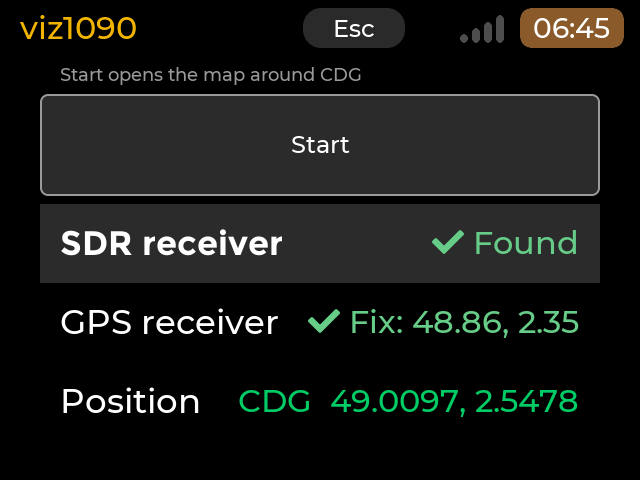
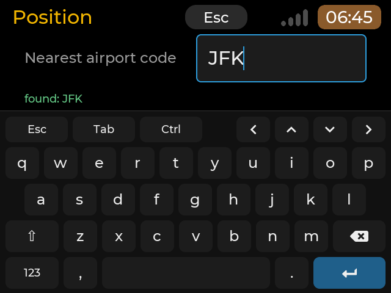
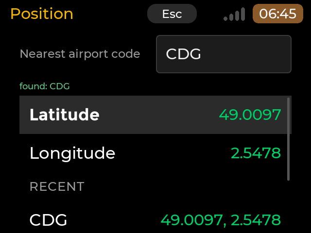
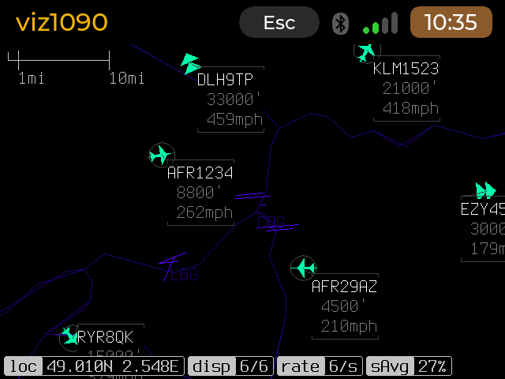

# viz1090

Version 0.2.1, package `viz1090`. Part of [cyberdeck-zero-apps](../../README.md).

The real [viz1090](https://github.com/nmatsuda/viz1090) ADS-B display (by Nathan Matsuda) on the deck, full screen,
with its own RTL-SDR decoder, an intro screen and a world map. The intro screen shows whether the SDR dongle and a
USB GPS receiver are found and takes your position (the nearest airport code, the GPS, latitude and longitude, or a
recent place), by touch or by keyboard. It fills any screen from 640x480 up (the deck, the 800x480 panels, 720x720,
1024x600, 1280x720).

Kind of app ([guidelines](../../docs/APP-GUIDELINES.md), section 1): the map is a **wrapped upstream program** (kind C:
viz1090 and readsb unchanged but for three constants, drawn through a small display bridge); the intro screen is a
**native app** on the launcher's `cp0_lvgl` (kind A), so that it has the launcher's header, Esc button, status strip,
lists and on-screen keyboard rule.

## Screenshots

The intro screen with the dongle and a GPS fix (640x480, headless harness):



The Position page on a touch-only board: the airport code field above the on-screen keyboard, and the same page with
the keyboard away, its Latitude / Longitude rows and the Recent places:




The map under the app header (title, the on-screen Esc, the status strip), with aircraft and viz1090's status line
(640x480, drawn by the bridge into a test framebuffer, with synthetic traffic from a test feeder):



## Use

Start **viz1090** from the launcher. The intro screen comes first.

* **viz1090** (the first page): a status line, **Start**, then three rows.
  * **SDR receiver**: *Found* with a check, or *Not found* with a cross (and "plug it in" when the row is wide
    enough); looked at again every second, so a dongle plugged in now shows at once.
  * **GPS receiver**: *None detected*, *Waiting for a fix* (where it is, "Found on /dev/ttyACM0, waiting for a
    fix", when the row is wide enough; Enter on the row says it in the status line), or *Fix: 48.8566, 2.3522* with
    a check. Enter or a tap on the row with a fix takes the GPS position. A port the deck user may not read shows
    *No access to /dev/ttyACM0* with a cross; Enter on the row says the fix (the `dialout` group).
  * **Position**: *CDG  49.0097, 2.5478* (the airport code when the position came from one), or *Not set*. Enter or
    a tap opens the Position page.
  * **Start** saves the position and opens the map. Without a position it says so in the status line and stays.
* **Position**: the **Nearest airport code** field (letters; IATA codes as on a boarding pass) with a line under it:
  *found: CDG* or *not in the list*. Enter on a known code sets the position and goes back. Under it **Latitude** and
  **Longitude** (each opens a page with one field: digits, `-` and `.`, checked against -90..90 / -180..180, Enter
  applies) and **RECENT**, the last five places you started with: a tap on one (or Enter) sets it and goes back, so a
  touch-only board never needs to type.
* **On-screen keyboard**: shown by the launcher's rule only (no physical keyboard connected, or the rule forced as on
  the HackBerry), while a field is being edited; it goes away within about a second when a keyboard connects. With a
  physical keyboard the airport code field edits at once; without one the Position page opens on its list and a tap on
  the field brings the keyboard. While it is up the page shows only the field and its line.
* **Map**: it sits under the same header as the intro screen (title, the on-screen **Esc**, the status strip). Touch
  pans (one finger) and zooms (two fingers), tried with a finger on the deck; the header's Esc or the Esc key returns
  to the launcher; `=` zooms in with the keyboard.

## Keys and touch

| Function | Keys | Touch |
| --- | --- | --- |
| Start the map | Enter on Start (Start has the focus when the page opens) | tap Start |
| Move between Start and the rows | Down / Up, Tab | - |
| Use the GPS position | Down to GPS receiver, Enter | tap the row, tap it again |
| Open Position | Down to Position, Enter | tap the row, tap it again |
| Type the airport code | letters, Backspace, Enter | tap the field, the on-screen keyboard |
| Latitude / Longitude | Down to the row, Enter, type, Enter | tap the row twice, the keyboard, Enter key |
| Pick a recent place | Down to it, Enter | tap it, tap it again |
| Stop typing (keyboard away) | Esc | the keyboard's Esc |
| Back one page | Esc or Left | the header's Esc |
| Leave (back to the launcher) | Esc on the first page | the header's Esc on the first page |
| Zoom the map in / out | `=` / `-`, Up / Down, PageUp / PageDown | pinch with two fingers |
| Pan the map | - | drag one finger |
| Leave the map (back to the launcher) | Esc | the header's Esc |
| End a stuck app | hold Esc 3 s (the launcher's watchdog) | - |

## Screens

The screen comes from the launcher's app contract (`APPLAUNCH_CANVAS`, `APPLAUNCH_SCREEN_*`), else the launcher's
`screen.state`, else the framebuffer itself (640x480 when nothing answers). The intro screen lays itself out with the
launcher's design tokens (header, row and button heights in millimetres, text sizes), like every native app; under
640x480 it only shows a "needs a screen of at least 640x480" notice and goes back to the launcher on any key or tap.
The tile itself is hidden on such a screen (`X-MinSize=640x480`). On the map the bridge draws the native pages'
header with the launcher's layout service (header height, title, Esc button and status strip exactly where the intro
screen has them: a 56 px header on the deck and the 800x480 / 1024x600 screens, 64 px on 720x720 and 1280x720), and
viz1090 gets the rest (`--screensize`: the screen's width, its height minus the header); the picture is turned and
converted for rotated panels and 16 bpp framebuffers as the launcher does (`APPLAUNCH_SCREEN_ROTATE`,
`APPLAUNCH_TOUCH_ORIENT=buffer`).

| Screen | Map text (`UISCALE`) |
| --- | --- |
| 640x480 (the deck), 800x480 (Pi 3A+ DSI, HyperPixel), 720x720 (HackBerry) | 2 |
| 1024x600 | 1 on a 7" panel (6.6 px/mm), 2 at the default 11.3 px/mm |
| 1280x720 | 2 (1 below 7.5 px/mm) |

`UISCALE` (viz1090's text size, 12 px x uiscale) follows the screen's density: 1 below 7.5 px/mm, 2 up to 14 px/mm,
3 above, and never more than one step per 240 screen rows. A `UISCALE=` line in `viz1090.conf` still wins. The map
window cut around your position (`RADIUS`, 500 nautical miles) is the same on every screen: viz1090 maps its zoom to
half the longer side, so the window covers the whole screen, square or wide, at any zoom up to that distance.

## Requirements

* A screen of at least **640x480** and a launcher with **full-screen app support** (`X-Fullscreen=true` in the
  `.desktop` file): the launcher stops drawing and gives the whole panel to the app.
* An **RTL-SDR dongle** with a 1090 MHz antenna.
* Optional: a USB GPS receiver (serial NMEA on `/dev/ttyACM*` or `/dev/ttyUSB*`). The deck user must be able to read
  it: the `dialout` group of Raspberry Pi OS (`sudo usermod -aG dialout $USER`, then log out and in). The intro only
  listens to it (it sets the port's speed while it looks for NMEA at 9600, 4800, 38400 and 115200 baud), never writes
  to it.
* `python3` and the libraries listed in `app.json` (installed with the package): SDL2, SDL2_ttf, SDL2_gfx (viz1090),
  librtlsdr, libusb, ncurses, zstd, zlib (readsb), FreeType (the bridge and the intro), libinput and libxkbcommon
  (the intro's keyboard and touch).
* Memory: the intro screen ends before the map starts (it is a native app like the others of this repository: about
  13-15 MB while it runs, the launcher's report 024; not yet measured on a board for this one). The package is a
  6.7 MB download and 13.4 MB installed: the world map 5.7 MB, the intro 3.0 MB (LVGL and the launcher's widgets
  are linked in), readsb 2.5 MB, viz1090 1.2 MB, fonts 1.5 MB.

## Install

On the deck: **Settings > Apps > Sources > + Add a GitHub source**, enter `OSRdesign/cyberdeck-zero-apps`, go to the
**Apps** tab, pick **viz1090** and press Enter. Installing asks for the deck user's sudo password; the package depends on
the libraries it needs. See the [repository README](../../README.md) for details. If an older version is installed,
the deck offers 0.2.1 as an update in the same menu. By hand: `sudo dpkg -i viz1090_0.2.1_arm64.deb` (then
`sudo apt-get -f install` for missing libraries).

## Files the app keeps

* `~/.config/cardputerzero/viz1090.conf`: your position and options, kept from 0.1 (`LAT`, `LON`, `AIRPORT`,
  `UISCALE`, `METRIC`, `RADIUS`, and since 0.2.0 `RECENT1`..`RECENT5`, the last places you started with). The intro
  rewrites `LAT`, `LON`, `AIRPORT` and `RECENT*` atomically and keeps every other line as it was. Delete the file to
  start again.
* `~/.cache/viz1090/`: the map window cut around your position (rebuilt when the position changes).

## Known limits

* After an upgrade through the Apps menu the tile moves to the end of the launcher grid.
* The airport list has the IATA codes of OurAirports' large and medium airports (about 4600); a 4-letter ICAO code
  is accepted in the field but answers "not in the list".
* The GPS row is too narrow for the port name on every screen size: it says *Waiting for a fix*; Enter on the row
  names the port in the status line.
* The latitude and longitude fields use the on-screen keyboard's letter page (its number pad has neither `-` nor
  `.`): the digits are on its `123` page.
* The map side: the keyboard is read from `/dev/input/bt-keyboard` (or `VIZ_KEYBOARD`) only, so a keyboard without
  that name (a USB keyboard, the HackBerry's built-in one) does not reach the map; touch and the header's Esc button
  still work. (The intro screen reads every keyboard, as the launcher does.)
* The header's Esc button takes the header's height (56 px, 5 mm on the deck) by the button's width (9 mm) plus a
  small margin; like the native pages, it does not reach into the map.
* Not yet tested on a board with an SDR dongle and a GPS receiver plugged in.

## Credits and licence

The package bundles several programs and data sets, each under its own licence (the full notices are in the
package's `copyright` file, [`root/usr/share/doc/viz1090/copyright`](root/usr/share/doc/viz1090/copyright)):

* **viz1090**: BSD licence. Source <https://github.com/nmatsuda/viz1090>, commit
  `fb7bf016d5d95ddca5b27f260e871484864b5c96`; built with one change (three constants in `AircraftLabel.h`, see
  `build/build_on_pi.sh`). Copyright Nathan Matsuda, Malcolm Robb and Salvatore Sanfilippo.
* **readsb** (the decoder): GNU General Public License 3 or later. Source <https://github.com/wiedehopf/readsb>,
  commit `094720939c01943de82b14df6f42f67fff1cd514`, built unmodified with `make RTLSDR=yes`. To get the source
  from the packager as well, open an issue at <https://github.com/OSRdesign/cyberdeck-zero-apps>.
* **Display bridge, intro screen and scripts** (`libviz_fb.so`, `vizsetup`, `run_viz1090.sh`, `extract_map.py`): MIT,
  2026 OSRdesign, sources in [`build`](build) and [`src`](src). `cp0_statusbar.[ch]`, `cp0_fb_output.[ch]`,
  `cp0_ui_metrics.[ch]`, `cp0_ui_roller.[ch]` and `cp0_ui_status_strip.[ch]` come from
  [cyberdeck-zero-launcher](https://github.com/OSRdesign/cyberdeck-zero-launcher) (MIT). The intro screen links
  the launcher's `cp0_lvgl` runtime and LVGL (both MIT) through [`apps/_common`](../_common/README.md), and draws
  with the launcher's fonts at run time (none bundled for it).
* **Fonts** of the map and the bridge: Terminus TTF, Montserrat and the Font Awesome 5 Free font files are under the
  SIL Open Font License 1.1; Font Awesome Free icons are under CC BY 4.0.
* **Map data**: Natural Earth and OurAirports (public domain), converted by `build/make_world.py`. The RTL-SDR USB
  ids of the intro come from librtlsdr's list of known devices.

## Build and test

The package is built from upstream sources plus the files of [`build`](build) (the map side, on a Raspberry Pi) and
[`src`](src) (the intro screen, cross-built in WSL):

```
sh apps/viz1090/build/build_on_pi.sh            # on a Pi (Debian 13): viz1090, readsb, the bridge -> root/opt/viz1090
wsl -e sh /mnt/c/CLAUDE/zero7/cyberdeck-zero-apps/apps/viz1090/build.sh all --strict
                                                # in WSL: the intro (root/opt/viz1090/vizsetup), unit tests, scenes
python3 tools/make_registry.py --only viz1090 --out <a folder outside packages/>
```

`build.sh host` runs the unit tests (`tests/test_core.cpp`: the NMEA sentences of a receiver with and without a fix,
the SDR id table on a fake sysfs, the airport list of the world map file, the settings file with its old keys and
unknown lines, the typed values, the recent list, the page texts, the package files) and the headless scenes of
`tests/scenes` at 640x480, 800x480, 720x720, 1024x600 and 1280x720 (480x320 for the notice), with the layout checks
of [`apps/_common/headless`](../_common/headless/README.md) and a contact sheet per scene. The board protocol is
[`tests/BOARD-TESTS.md`](tests/BOARD-TESTS.md). `build_on_pi.sh --bridge-only` rebuilds only the bridge and the
scripts. `build/make_world.py` builds the world map from open data (it needs a PC). The files of `build/`, `src/`,
`tests/` and this page are not part of the `.deb`; only `root/` is. The files in `build/` are described in
[build/README.md](build/README.md), which also explains how to run another SDL2 program full screen the same way.

## Changes

* **0.2.1**: rows show what can be tapped: a chevron opens a page or changes a value, grey text is information, a dot
  runs something (looks at the receiver again, uses the GPS fix or a recent place). Rebuilt on launcher 9912361.
* **0.2.0**: runs on every screen from 640x480 up instead of only 640x480, and the intro screen is new.
  * The intro screen is now a native app of the launcher's `cp0_lvgl` (it was an SDL program drawn through the
    bridge): the launcher's header with the on-screen Esc and the status strip, its lists and rows (every touch
    target at least the launcher's row and button heights), the on-screen keyboard by the launcher's rule instead of
    an always-visible digit keypad, the airport code typed by touch too, Latitude and Longitude pages, the last five
    places as a Recent list, the GPS position taken from its row, Esc to go back, every keyboard read (not only the
    Bluetooth one). It keeps the same settings file and the same contract with `run_viz1090.sh` (exit 0 = start).
  * The screen size, rotation, depth and density come from the launcher's app contract (or `screen.state`, or the
    framebuffer); viz1090 gets `--screensize` and a `--uiscale` chosen from the density (a `UISCALE=` line in the
    config still wins); the map sits under the launcher's app header (title, the on-screen Esc, the status strip, as
    on the intro screen and every native page) instead of a status bar and an X drawn over it, and the Esc button,
    the Esc key, SIGTERM, SIGINT and SIGHUP end it; rotated panels (90/180/270) and 16 bpp
    framebuffers are drawn through the launcher's own output stage (`cp0_fb_output.c`), and buffer-oriented touch
    (`APPLAUNCH_TOUCH_ORIENT=buffer`) is mapped through the rotation. The touch device named by the launcher
    (`APPLAUNCH_SCREEN_TOUCH`) is tried before the scan. Below 640x480 the tile is hidden (`X-MinSize=640x480`) and
    the intro shows a notice when started anyway.
* **0.1.1**: touch works again when the Bluetooth keyboard is connected. 0.1.0 opened a fixed
  `/dev/input/event1`, which on the deck is sometimes the infrared node of the RTL-SDR dongle and not the screen.
  The display layer now looks through `/dev/input/event*` for the touch screen (a device that reports multitouch
  positions and is not a keyboard, the Goodix panel first) and tries again every second if it is absent or goes away.
  `VIZ_TOUCH=/dev/input/eventN` still forces a device. On the deck the right device was opened at every launch,
  the keyboard, Esc and the close button kept working, and touch recovered by itself after an interruption.
